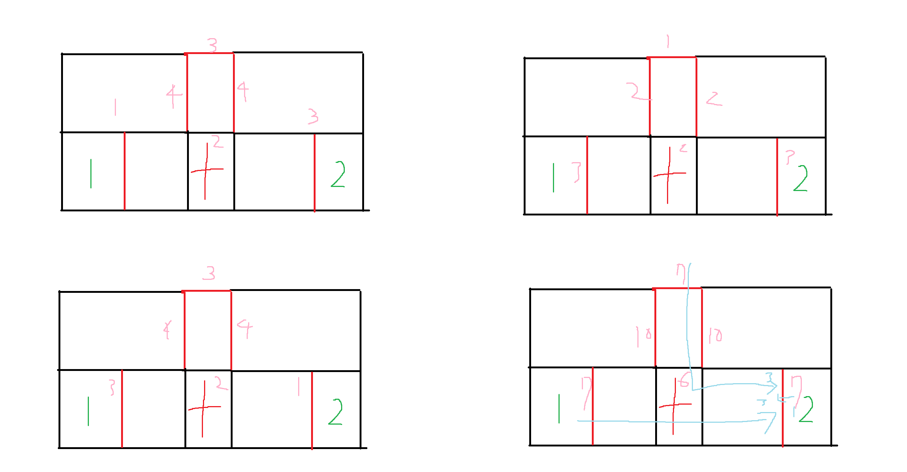

[상위 페이지 · Graph](/study/algorithms/graph/)

[https://www.acmicpc.net/problem/9376](https://www.acmicpc.net/problem/9376)


## 아이디어

죄수가 같이 탈출하는 방법은

1. 죄수1의 탈출 경로에 죄수 2가 있어 같이 탈줄
2. 죄수2의 탈출 경로에 죄수 1가 있어 같이 탈줄
3. 상근이와 만나 탈출

결국 죄수1, 죄수2, 상근이와 만나는 문의 지점이 가장 최소의 문의 개수일 것이다.

그러면 각각 3명을 bfs를 돌려 밖까지 최소의 방법을 찾아야하는데 어떻게 구할것인가? 가 문제다.

여기에는 두가지 방법이 있다.

1. 다익스트라
2. 0-1 넓이 우선 탐색

나는 2번으로 풀었고 2번은 간선이 0과 1로 이루어진 그래프에서만 사용 가능한 방법이다

문을 1로두고 그냥 통로를 0으로 뒀을 때 문을 통해가는 길은 후순위로 미루고 우선적으로 모든 통로부터 보는것이다.

위 방법대로 bfs를 돌리면



이런 형태로 나타나게 된다.

각자 3명이 천천히 문을 따고 들어갔을 때 + 지점에서 만나게 된다. 이 지점이 가장 최소로 문을 따는것이지만 저 +부분은 3명이 딴걸로 취급해서 -2를 해줘야한다.

여기서 한가지 더 문제는 문이 없을때는 나는 문을 기준으로 구했기 때문에 구할 수가 없다.

그래서 통로중 하나라도 죄수1+죄수2+상근 = 0인 부분이 있다는건 문을 안따고 갈 수 있다는것이기때문에 2로 해줬다.

## 정답

```python
from collections import deque

N = int(input())
dir = [[1,0],[-1,0],[0,-1],[0,1]]

def bfs(graph,start,R,C):
    queue = deque()
    queue.append((start))
    visited = [[-1] * (C+2) for _ in range(R+2)]
    visited[start[0]][start[1]] = 0
    found_person = 0
    count = 0
    while queue:
        r,c = queue.popleft()
        for dr,dc in dir:
            ddr = r + dr
            ddc = c + dc
            if 0<=ddr<R+2 and 0<=ddc<C+2 and graph[ddr][ddc] != "*" and visited[ddr][ddc] == -1:
                if graph[ddr][ddc] == "#":
                    count += 1
                    visited[ddr][ddc] = visited[r][c] + 1
                    queue.append((ddr,ddc))
                elif graph[ddr][ddc] == "." or graph[ddr][ddc] == "$":
                    visited[ddr][ddc] = visited[r][c]
                    queue.appendleft((ddr,ddc))
    return visited

for l in range(N):
    R,C = map(int, input().split())
    input_str = ''
    for _ in range(R):
        input_str += input() + '\n'
    # 주위를 .으로 둘러준 문자열로 변환
    input_str = input_str.rstrip()
    input_str = '.' * (len(input_str.split('\n')[0]) + 2) + '\n' + \
                '\n'.join(['.' + line + '.' for line in input_str.split('\n')]) + '\n' + \
                '.' * (len(input_str.split('\n')[0]) + 2)

    # 2차원 배열로 변환
    array = [list(row) for row in input_str.split('\n') if row]
    person = []
    for i in range(R + 2):
        for j in range(C + 2):
            if array[i][j] == "$":
                person.append([i,j])
    person1 = bfs(array,(person[0][0],person[0][1]),R,C)
    person2 = bfs(array, (person[1][0],person[1][1]),R,C)
    co_op = bfs(array, (0,0),R,C)

    result = 999999999999999
    for i in range(R + 2):
        for j in range(C + 2):
            if array[i][j] == "*":
                continue
            temp = person1[i][j] + person2[i][j] + co_op[i][j]
            if array[i][j] == "#":
                result = min(result, temp)
            if array[i][j] == "." and temp == 0:
                result = 2
                

    print(result - 2)
```
