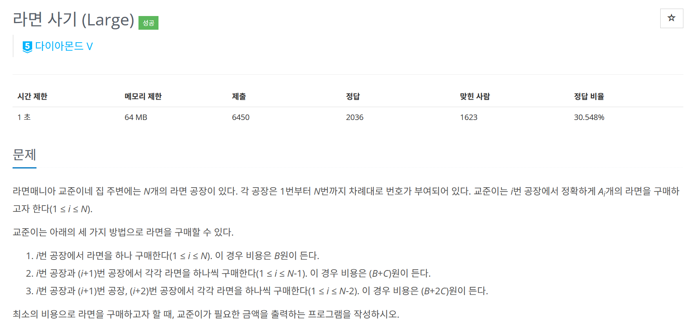

[상위 페이지 · 다이아](/study/algorithms/greedy/diamond/)



## 문제 태그

- 그리디

## 아이디어

- B ≤ C라면 그냥 B에서 다 사면 된다
- B > C인 경우는 B를 사는 개수는 줄이고 C를 많이 사야한다
- i==0일땐 B를 사고 i==1일땐 B+C, i==2일땐 B+2C로 다시 묶어사는게 이득이다. 이를 반복한다

## 정답

```python
import sys

input = sys.stdin.readline

n, B, C = map(int, input().split())
v = list(map(int, input().split()))
a = [0] * n
b = [0] * n

ans = 0

if B <= C:
    ans = sum(v) * B
else:
    for i in range(n):
        ans += v[i] * B
        a[i] = v[i]
        v[i] = 0

        if i + 1 < n:
            temp = min(a[i], v[i + 1])
            ans += temp * C
            a[i] -= temp
            v[i + 1] -= temp
            b[i] += temp

        if i - 1 >= 0 and i + 1 < n:
            temp = min(b[i - 1], v[i + 1])
            ans += temp * C
            v[i + 1] -= temp

print(ans)
```
