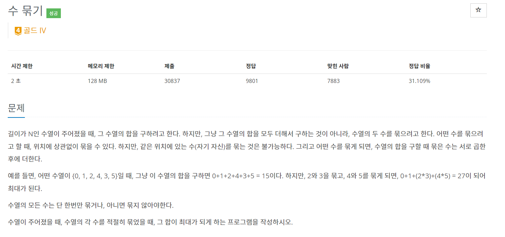

[상위 페이지 · 골드](/study/algorithms/greedy/gold/)

[https://www.acmicpc.net/problem/1744](https://www.acmicpc.net/problem/1744)



## 아이디어

숫자 두개씩 묶어 곱했을 때 최대가 되는 경우는 세가지를 따르면 된다

1. 오름차순 정리를 했을 때 오른쪽에서부터 묶는다
2. 음수 * 음수는 양수가 된다는것을 이용해 음수는 왼쪽에서부터 묶어 계산해준다
3. 음수의 개수가 홀수일때 0이 있으면 0과 곱해 없애준다

## 정답

```python
N = int(input())
arr = [int(input()) for _ in range(N)]
arr.sort()
posit  = []
nega = []
answer = 0
haszero = False
for i in arr:
    if i<0:
        nega.append(i)
    elif i == 1:
       answer += 1
    elif i == 0:
        haszero = True
    else:
        posit.append(i)
if len(nega) % 2 != 0:
    if haszero:
        nega.pop()
    else:
        answer += nega.pop()
for i in range(0,len(nega)-1,2):
    answer += nega[i] * nega[i+1]
if len(posit) % 2 != 0:
    answer += posit.pop(0)
for i in range(0,len(posit)-1,2):
    answer += posit[i] * posit[i+1]
print(answer)
```
