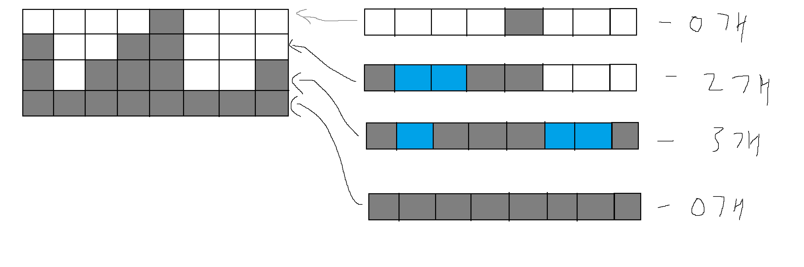

[상위 페이지 · Implementation](/study/algorithms/implementation/)

[https://www.acmicpc.net/problem/14719](https://www.acmicpc.net/problem/14719)


## 아이디어



2차원의 그래프를 1차원으로 바꾸고 벽과 벽 사이에 있는건 모두 빗물이 고일 수 있다. 이 성질을 이용해서 풀면 된다.

## 정답

```python
N,M = map(int,input().split())
arr = list(map(int,input().split()))
graph = [[0]*M for _ in range(N)]
for i in range(M):
    for j in range(N-1,N-arr[i]-1,-1):
        graph[j][i] = 1
answer = 0
for i in range(N):
    flag = False
    temp = 0
    for j in range(M):
        if flag:
            if graph[i][j] == 1:
                answer += temp
                temp = 0
            else:
                temp += 1
        if graph[i][j] == 1 and not flag:
            flag = True
print(answer)
```
