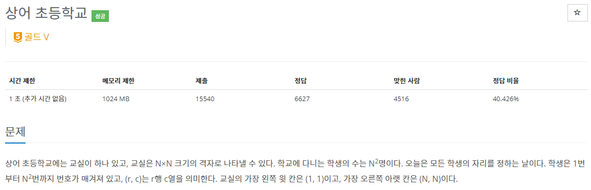
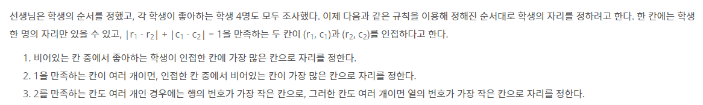
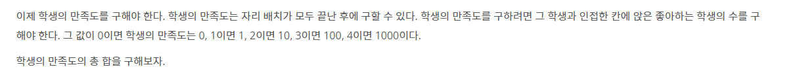

[상위 페이지 · Implementation](/study/algorithms/implementation/)

[https://www.acmicpc.net/problem/21608](https://www.acmicpc.net/problem/21608)







## 아이디어

기본적인 구현문제는 문제의 따라 구현하면 된다

1. 비어있는 칸 중에서 좋아하는 학생이 인접한 칸이 가장 많은 칸으로 자리를 정한다
2. 1번이 만족하는 칸이 여러개면 인접한 칸 중 비어있는 칸이 가장 많은 칸으로 자리를 정한다
3. 2를 만족하는 칸이 여러개면 행의 번호가 가장 작은 그마저도 여러개라면 열의 번호가 가장 작은 칸으로
4. 1~3 과정을 통해 모든 학생의 자리를 배정했다면 붙어있는 학생 수의 따라 만족도를 계산해준다

## 정답

```python
import sys

input = sys.stdin.readline
N = int(input()) # 학생 수
a = {} # 학생 번호와 원하는 학생들의 번호
dir = [[1,0],[-1,0],[0,1],[0,-1]] # 좌우상하
classm = [[0]*N for _ in range(N)] # 학생들의 자리 배정

for i in range(N**2):
    nums = list(map(int,input().split()))
    studentNum = nums.pop(0)
    a[studentNum] = nums # a 딕셔너리에 학생번호와 좋아하는 학생번호 저장
    temp = [] # 비어있는 칸 중에서 좋아하는 학생이 인접한 칸이 가장 많은 칸을 찾기 위한 리스트
    for n in range(N):
        for m in range(N):
            countBlank = 0
            countFav = 0
            if classm[n][m] != 0:
                continue
            for k in dir:
                if 0<=n+k[0]<N and 0<=m+k[1]<N:
                    if classm[n+k[0]][m+k[1]] in nums:
                        countFav += 1
                    elif classm[n+k[0]][m+k[1]] == 0:
                        countBlank += 1
            temp.append((n,m,countFav,countBlank)) # (행, 열, 인접한 좋아하는 학생 수, 인접한 빈자리 수) 저장
    temp.sort(reverse=True,key=lambda x:(x[2],x[3],-x[0],-x[1])) # 인접한 좋아하는 학생 수가 많은 순으로 정렬, 인접한 빈자리 수가 많은 순으로 정렬, 행 번호가 작은 순으로 정렬, 열 번호가 작은 순으로 정렬
    classm[temp[0][0]][temp[0][1]] = studentNum # 가장 좋은 자리에 학생 배정

answer = 0 # 만족도 합
for n in range(N):
    for m in range(N):
        studentnum = classm[n][m]
        count = 0
        for k in dir:
            if 0 <= n + k[0] < N and 0 <= m + k[1] < N:
                if classm[n+k[0]][m+k[1]] in a[studentnum]:
                    count+=1
        if count != 0:
            answer += 10**(count-1) # 만족도 계산

print(answer)

```
