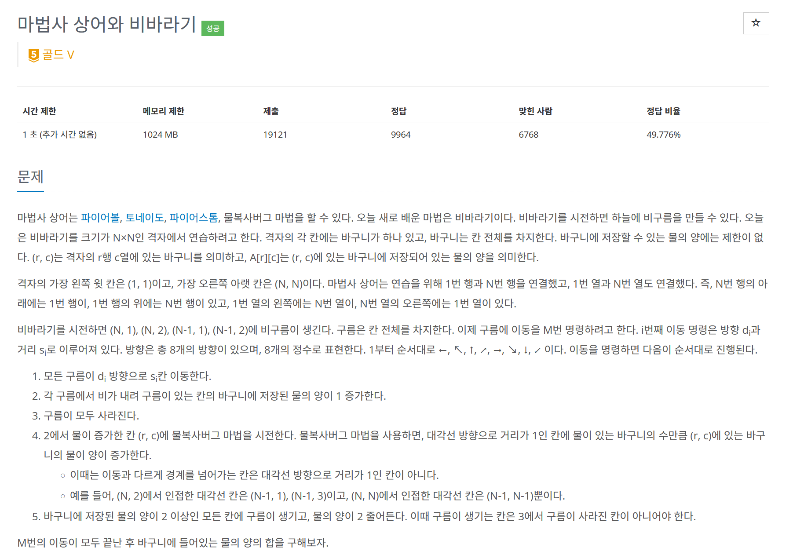

[상위 페이지 · Implementation](/study/algorithms/implementation/)



## 문제 태그

- 구현

## 아이디어

1. 시키는대로 문장을 잘 읽고 만든다
2. 0→N, N→0은 나머지 연산자를 이용하여 0~N의 범위로 움직이게 한다
3. 구름 중복을 확인할때 not in으로 확인하면 시간초과난다. 좀 더 번거롭더라도 visited 배열을 만들어 확인

## 정답

```python
import sys
input = sys.stdin.readline
N,M = map(int,input().split())
graph = [list(map(int,input().split())) for i in range(N)]
dir = [[0,-1],[-1,-1],[-1,0],[-1,1],[0,1],[1,1],[1,0],[1,-1]]
cloud = [[N-1,0],[N-1,1],[N-2,0],[N-2,1]]

def move_cloud(cloud,di,si):
    for i in range(len(cloud)):
        cloud[i][0] = (cloud[i][0] + (dir[di][0] * si)) % N
        cloud[i][1] = (cloud[i][1] + (dir[di][1] * si)) % N
    return cloud

def rain(cloud):
    global graph
    for y,x in cloud:
        graph[y][x] += 1

def add_water(cloud,visited):
    global graph
    for y,x in cloud:
        count = 0
        visited[y][x] = 1
        for dy,dx in [[1,1],[-1,1],[1,-1],[-1,-1]]:
            ddx = x + dx
            ddy = y + dy
            if 0<=ddx<N and 0<=ddy<N and graph[ddy][ddx] > 0:
                count += 1
        graph[y][x] += count

def new_cloud(cloud,visited):
    temp_cloud = []
    for i in range(N):
        for j in range(N):
            if visited[i][j] != 1 and graph[i][j] >= 2:
                temp_cloud.append([i,j])
                graph[i][j] -= 2
    return temp_cloud
while M>0:
    di,si = map(int,input().split())
    cloud = move_cloud(cloud,di - 1,si)
    rain(cloud)
    visited = [[0 for i in range(N)] for j in range(N)]
    add_water(cloud,visited)
    cloud = new_cloud(cloud,visited)
    M -= 1

result = 0
for i in graph:
    result += sum(i)
print(result)
```
