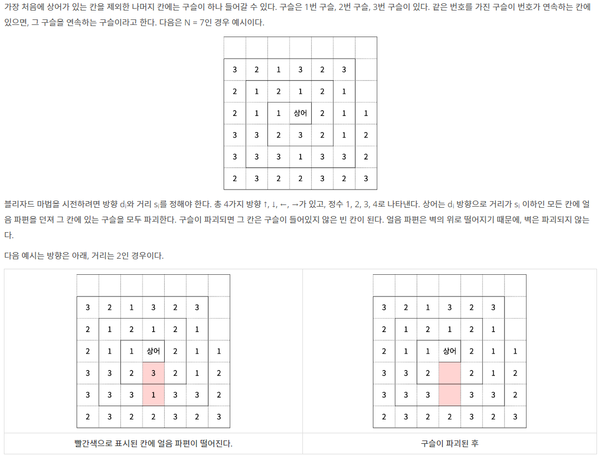
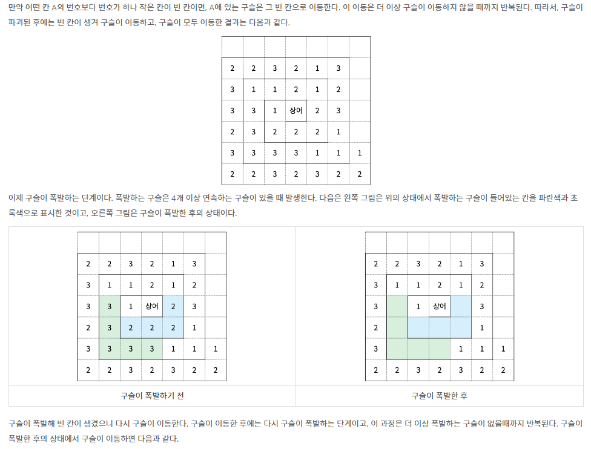
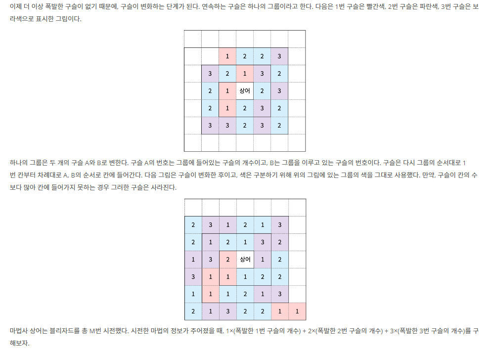
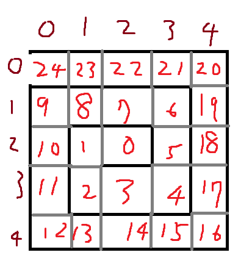

[상위 페이지 · 골드](/study/algorithms/implementation/gold/)








## 문제 태그

- 구현

## 아이디어

문제가 매우 길다. 읽다 토나온다. 긴 문제들은 놓치지 않게 천천히 구분해주는게 중요하다

문제가 요구하는 프로세서는 총 4단계다

1. 마법사 상어가 마법을 쓴다. 이때 마법사 상어는 위 아래 왼쪽 오른쪽으로만 쏜다
2. 부셔진 구슬은 버리고 남아있는 구슬을 땡긴다
3. 구슬이 4개 붙어있다면 터진다. 더 이상 구슬이 터지지 않을 때까지 2~3을 반복한다
4. 구슬이 새로운 구슬 A, B 두개로 변한다. 구슬이 111 이렇게 붙어있다면 구슬 A는 이어져있는 개수 구슬 B는 번호 그대로. 한마디로 3과 1이 새로이 들어가는것이다.

여기서 중요한거는 마법사 상어가 터트린건 점수로 포함되지 않는다는것이다. 이 점을 인지해야 한다.

2차원 배열 그대로 가져다 정리하려고 하면 너무 복잡해진다. 어떤게 이어진거고 어떤게 벽으로 막혀있는지 구분하기 매우 힘들다. 2차원 배열을 1차원 배열로 변환하는 작업을 거쳐야 한다



1차원 배열로 바꾸는건 어렵지 않다 일단 0부터 시작해서 소용돌이로 배열을 돌아주며 키값으로 좌표값 밸류로 넘값 을 저장해주면 된다 — 예로 (2,1)은 1  (3,4)은 17 —

다음은 마법사가 마법을 사용하게 하는 함수가 필요하다. 그냥 간단하게 좌표를 넘값으로 바꿔서 해당하는 구슬의 번호를 -1(터짐) 상태로 만들어준다

터진 구슬을 없애고 땡겨주는 작업은 쉽다. 1차원 배열을 돌아주며 -1인 구슬을 remove 그 이후 없어진 만큼 다시 0으로 채운다

다음은 체인 개수를 세는것인데 이것도 1차원 배열을 쭉 돌아주며 체인이 4번 이상 되면 일단은 -1처리하고 배열을 다 돌고 터진구슬을 없애고 땡겨준다

마지막으로 구슬을 변환시키는 단계는 위에 체인 개수를 세는것과 똑같지만 좀 다른점은 필드를 복사해서 거기서 건들어줘야 한다.

조건과 문제만 잘 읽고 하라는대로만 하면 풀리는 읽는게 제일 어려운 문제였다

## 정답

```python
"""
마법 수행 -> 구슬 이동 -> 완전 탐색 후 같은 구슬 4개 인접시 폭발 -> 구슬 이동 ->
"""
dir = ['', [0, -1], [0, 1], [-1, 0], [1, 0]]  # 마법으로 움직이는 방향
dx = [-1, 0, 1, 0]
dy = [0, 1, 0, -1]
N, M = list(map(int, input().split()))
fieldByLoc = [list(map(int, input().split())) for _ in range(N)]
fieldByNum = []  # 1차원 배열
locToNum = {}  # 좌표 -> 1차원 배열에서의 인덱스
numToLoc = {}  # 1차원 배열에서의 인덱스 -> 좌표
magic = [list(map(int, input().split())) for _ in range(M)]
middle = [(N + 1) // 2 - 1, (N + 1) // 2 - 1]
answer = 0

# 초기상태 만들기
# 2차원배열 -> 1차원배열 변환 좌표값과 넘값 왔다갔다 하기 쉽게 딕셔너리 제작
def init():
    nowposx = middle[0]
    nowposy = middle[1]
    count = 0
    direction = 0
    i = 1
    while count < N ** 2 - 1:
        for _ in range(2):
            for _ in range(i):
                nowposx += dx[direction]
                nowposy += dy[direction]
                # 만약 현재 위치가 게임판 안에 있다면
                if 0 <= nowposx <= N and 0 <= nowposy <= N:
                    # 1차원 배열에 해당 위치의 구슬 추가
                    fieldByNum.append(fieldByLoc[nowposy][nowposx])
                    # 좌표 -> 1차원 배열에서의 인덱스로 매핑
                    locToNum[(nowposx, nowposy)] = count
                    # 1차원 배열에서의 인덱스 -> 좌표로 매핑
                    numToLoc[count] = (nowposx, nowposy)
                    count += 1
            direction = (direction + 1) % 4
        i += 1

# 재배열 터진 구슬을 처리하고 땡겨준다
def arrangement():
    global fieldByNum
    count = fieldByNum.count(-1)
    # 폭발한 구슬을 제외한 구슬만 모아 새로운 1차원 배열 생성
    fieldByNum = [i for i in fieldByNum if i != -1]
    # 빈 칸만큼 0으로 채워줌
    fieldByNum.extend([0]*count)

# 마법 사용
def useMagic(direction, howMany):
    nowposx = middle[0]
    nowposy = middle[1]
    for _ in range(howMany):
        nowposx += dir[direction][0]
        nowposy += dir[direction][1]
        num = locToNum[(nowposx, nowposy)]
        # 해당 위치의 구슬을 폭발시킴 (-1로 바꿈)
        fieldByNum[num] = -1

# 체인 찾기
def destroyByChain():
    global answer
    destroyed = False
    nowNum = 0
    count = 0

    for i in range(N ** 2-1):
        if nowNum != fieldByNum[i]:
            if count > 3:  # 체인 개수가 3 이상이면 폭파
                answer += count * nowNum
                # 체인으로 인해 폭발한 구슬을 -1로 변경
                for j in range(i - count, i):
                    fieldByNum[j] = -1
                destroyed = True
            # 체인 초기화
            nowNum = fieldByNum[i]
            count = 1
        else:
            count += 1
    return destroyed

# 구슬 변환 시작
def transformation():
    global fieldByNum
    temp = []
    nowNum = fieldByNum[0]
    count = 0
    for i in range(N ** 2 - 1):
        if nowNum != fieldByNum[i]:
            # 연속된 구슬의 개수와 번호를 temp 리스트에 추가
            temp.append(count)
            temp.append(nowNum)
            nowNum = fieldByNum[i]
            count = 1
        else:
            count += 1
    # temp 리스트에 마지막 구슬의 정보 추가
    temp.append(count)
    temp.append(nowNum)
    # temp 리스트를 이용해 1차원 배열 변경
    fieldByNum = temp[:N**2 - 1]

# 초기상태 만들기 함수 실행
init()
# 매직 구슬 사용
for (i,j) in magic:
    useMagic(i,j)
    # 구슬 재배열과 폭발 처리 반복
    while True:
        # 체인으로 인해 구슬이 폭발하면 다시 재배열과 폭발 처리를 반복
        if not destroyByChain():
            break
        arrangement()
    # 구슬 변환
    transformation()

print(answer)

```
