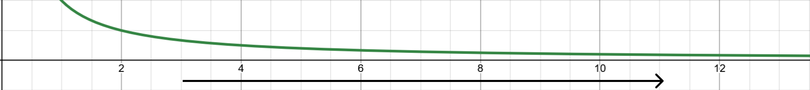

[상위 페이지 · Math](/study/algorithms/math/)

수학, 특히 실해석학에서 **볼차노-바이어슈트라스 정리(Bolzano–Weierstrass theorem)**는 베르나르트 볼차노와 카를 바이어슈트라스의 이름을 딴 정리로, 유한 차원 유클리드 공간 $$\mathbb{R}^n$$에서의 수렴에 대한 기본 결과이다. 이 정리는 $$\mathbb{R}^n$$ 안의 모든 **유계인 무한 수열**은 **수렴하는 부분수열**을 가진다는 것을 기술한다.

## 배경지식

- [유클리드 공간](/study/algorithms/math/yukeulrideu-gonggan/)

## 정의

<aside markdown="1">
💡

**볼차노-바이어슈트라스 정리**는 다음과 같이 정의된다:

$$\mathbb{R}^n$$의 모든 유계인 무한 수열 $$(x_k)_{k=1}^{\infty}$$은 수렴하는 부분수열을 가진다.

즉, 수열 $$(x_k)$$가 유계이면, 어떤 부분수열 $$(x_{k_j})$$과 어떤 점 $$x \in \mathbb{R}^n$$이 존재하여

$$\underset {j \to \infty}{\lim}x_{k_j} = x$$

가 성립한다.

</aside>

## 증명 ( 구간 축소법 )

예를 들어, 수열 $$a_n = \frac{1}{n}$$을 생각해보자. 이 수열의 항들을 나열하면 $$1, \frac{1}{2}, \frac{1}{3}, \frac{1}{4}, \ldots$$이다.

### **유계성 확인**

모든 $$n \in \mathbb{N}$$에 대해 $$0 < a_n \leq 1$$이므로, 이 수열은 유계이다. 구체적으로, 상한은 1이고 하한은 0이다. 따라서 모든 항이 닫힌 구간 $$[0, 1]$$에 포함된다.

### **구간 축소법의 적용**

구간 $$I_1 = [0, 1]$$에서 시작한다. 이 구간을 반으로 나누면 $$[0, \frac{1}{2}]$$와 $$[\frac{1}{2}, 1]$$이 된다. 수열 $$\{a_n\}$$은 무한하므로, 이 두 구간 중 적어도 하나는 수열의 무한히 많은 항을 포함한다.

$$n \geq 2$$일 때 $$a_n \leq \frac{1}{2}$$이므로, 구간 $$[0, \frac{1}{2}]$$가 무한히 많은 항을 포함한다. 이를 $$I_2 = [0, \frac{1}{2}]$$라 하자. $$I_2$$ 내부에 한 항을 선택하여 $$a_{n_1}$$로 부른다.

마찬가지로 $$I_2$$구간을 반으로 나누면 $$[0, \frac{1}{4}]$$와 $$[\frac{1}{4}, \frac{1}{2}]$$로 나누어지게 된다. $$[0, \frac{1}{4}]$$가 무한히 많은 항을 포함하므로 이를 $$I_3 = [0,\frac{1}{4}]$$라 한다. $$I_3$$안에는 항이 무한하므로 $$n_1$$보다 인덱스가 더 큰 ($$n_2 > n_1$$) 항 $$a_{n_2}$$를 반드시 선택할 수 있다.

이 과정을 반복하면, 각 단계에서 길이가 절반으로 줄어드는 닫힌 구간의 수열 $$I_1 \supset I_2 \supset I_3 \supset \cdots$$를 얻게 되며, 각 구간은 원래 수열의 무한히 많은 항을 포함한다.

### **칸토어의 구간 축소 정리 적용**

<aside markdown="1">
💡

**칸토어의 구간 축소 정리**

다음 조건을 만족하는 닫힌 구간의 수열 $$I_n = [a_n, b_n]$$이 있다고 가정한다.

- **축소 (Nested):** $$I_1 \supset I_2 \supset I_3 \supset \cdots$$ (구간이 계속 중첩되며 포함됨)
- **길이의 0으로의 수렴:** 구간의 길이 $$\underset{n \to \infty}{\lim}(b_n - a_n) = 0$$

이때, **이 모든 구간의 교집합($$\bigcap_{n=1}^{\infty} I_n$$)은 정확히 단 하나의 점($$\{c\}$$)으로 이루어진다.**

</aside>

우리는 위와 같은 방법을 통해 다음과 같은 결과를 얻어 낼 수 있다.

1. **축소 구간열:** $$I_0 \supset I_1 \supset I_2 \supset \cdots \supset I_k \supset \cdots$$
2. **부분수열:** $$(x_{n_k}) = (x_{n_1}, x_{n_2}, \ldots)$$ (이때 $$n_1 < n_2 < \cdots$$이고, 각 $$x_{n_k} \in I_k$$입니다.)
3. **길이:** $$\lim_{k \to \infty} |I_k| = 0$$
    - $$|I_1| = b_0 - a_0 = L$$
    - $$|I_2| = \frac{L}{2}$$
    - $$|I_3| = \frac{L}{4}$$
    - $$|I_k| = \frac{L}{2^k}$$
    - $$\underset{k \to \infin}{\lim}\frac{L}{2^k} = 0$$

칸토어의 구간 축소 정리를 적용할 수 있는 모든 조건을 만족하기에, 축소되는 닫힌 구간들의 교집합 $$\bigcap_{k=1}^{\infty} I_k$$는 정확히 하나의 점을 포함한다. 이 경우 그 점은 $$x = 0$$이다.

### 수렴 증명

k번째 항은 $$a_{n_k}$$는 $$I_k$$안에 있다($$a_{n_k} \in I_k$$). 극한값 c 역시 $$I_k$$안에 있다($$c \in I_k$$). $$a_{n_k}$$와  c는 $$I_k$$안에 존재하므로 두 점 사이의 거리는 0보다 크고 $$I_k$$의 길이보다 작다.

$$
0 \le |a_{n_k} - c| \le \frac{L}{2^k}
$$

조임 정리에 의해 다음과 같이 정리 된다.

$$
\underset{k \to \infin}{\lim}0 \le \underset{k \to \infin}{\lim}|a_{n_k} - c| \le \underset{k \to \infin}{\lim}\frac{L}{2^k}
\\
0 \le \underset{k \to \infin}{\lim}|a_{n_k} - c| \le 0
\\
c \le \underset{k \to \infin}{\lim}a_{n_k} \le c
$$

고로

$$
\underset{k \to \infin}{\lim}a_{n_k} = c
$$

$$a_{n_k}$$라는 부분 수열은 점 c로 수렴함을 알 수 있다.
