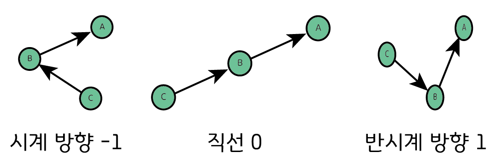
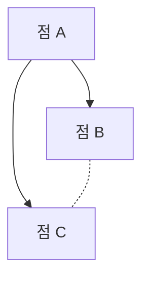

[상위 페이지 · Math](/study/algorithms/math/)



CCW(Counter Clock Wise) 알고리즘은 3개의 점 A, B, C가 있을 때 이 세 점을 이은 직선의 방향을 알고자 할 때 유용한 기하 알고리즘이다.

직선의 방향은 시계 방향, 반시계 방향, 일직선의 3가지 경우가 있다. 이는 외적을 통해 구할 수 있는데, 외적의 결과가 음수이면 시계 방향, 0이면 일직선, 양수이면 반시계 방향이 된다.

## 벡터의 외적

기하학적으로 벡터의 외적은 다음과 같이 이해할 수 있다:

두 벡터 v₁과 v₂가 있을 때, 이 두 벡터의 외적의 크기는 다음과 같은 의미를 가진다:

- 두 벡터가 이루는 평행사변형의 넓이와 같다
- |v₁ × v₂| = |v₁| |v₂| sin θ (θ는 두 벡터 사이의 각도)

CCW 알고리즘에서는 이러한 기하학적 성질을 활용한다:

- 세 점 A, B, C가 있을 때, 벡터 AB와 AC의 외적을 구한다
- 외적의 방향(부호)은 벡터 AB를 벡터 AC로 회전시킬 때의 회전 방향을 나타낸다
- 양수면 반시계 방향 회전(벡터 AB에서 AC로 반시계 방향으로 회전)
- 음수면 시계 방향 회전(벡터 AB에서 AC로 시계 방향으로 회전)



이러한 기하학적 해석은 컴퓨터 그래픽스, 로봇 공학, 게임 개발 등 다양한 분야에서 물체의 방향과 회전을 다룰 때 유용하게 활용된다.

## CCW 알고리즘 구현

CCW 알고리즘은 다음과 같이 구현할 수 있다:

```python
class Point:
    def __init__(self, x: int, y: int):
        self.x = x
        self.y = y

def ccw(A: Point, B: Point, C: Point) -> int:
    result = (B.x - A.x) * (C.y - A.y) - (C.x - A.x) * (B.y - A.y)
    
    if result > 0:      return 1    # 반시계 방향
    elif result < 0:    return -1   # 시계 방향
    else:              return 0     # 일직선
```

여기서 result 값은 벡터의 외적을 2차원 평면에서 계산한 것이다. 이는 다음과 같이 해석된다:

- 양수인 경우: 점 C는 선분 AB의 왼쪽에 위치 (반시계 방향)
- 음수인 경우: 점 C는 선분 AB의 오른쪽에 위치 (시계 방향)
- 0인 경우: 세 점이 일직선 상에 위치

## 알고리즘의 활용

CCW 알고리즘은 다음과 같은 기하 문제를 해결하는 데 핵심적인 역할을 한다:

- 다각형의 내부/외부 판별
- 선분 교차 판별
- 볼록 껍질(Convex Hull) 구성
- 점과 직선의 위치 관계 판단

특히 게임 개발에서는 충돌 감지, 시야 판정, 경로 탐색 등의 구현에 활용될 수 있다.
