[상위 페이지 · Math](/study/algorithms/math/)

<aside class="notion-callout notion-callout--with-icon" markdown="1">
💡
{: .notion-callout__icon aria-hidden="true"}

**정의**

함수는 집합 X(정의역)와 집합 Y(치약) 사이의 대응 관계로, X의 원소 x에 대하여 Y의 단 하나의 원소 y가 대응 되는 관계.

</aside>

## 대수함수

<aside class="notion-callout notion-callout--with-icon" markdown="1">
💡
{: .notion-callout__icon aria-hidden="true"}

**정의**

함수 $$y=f(x)$$가 존재할 때 x와 y에 대한 다항식 P(x,y)가 다음 식을 만족하면 대수함수라고한다. 

$$
P(x,f(x)) = 0
$$

여기서 다항식 $$P(x,y)$$는 x와  y의 유한한 덧셈, 뺄셈, 곱셈, 그리고 자연수의 거듭제곱으로만 이루어져야 한다.

예시)

- $$P(x,y) = x^2 + y^2-1$$이라는 다항식이 있을 때 
$$P(x,y) = 0$$ 즉 $$x^2 + y^2 -1 = 0$$을 만족하는 함수 $$y = f(x) = \sqrt{1-x^2}$$은 대수함수이다
</aside>

### 다항함수

<aside class="notion-callout notion-callout--with-icon" markdown="1">
💡
{: .notion-callout__icon aria-hidden="true"}

**정의**

하나의 변수와 상수에 대해 덧셈, 뺄셈, 곱셈, 및 음이 아닌 정수 거듭제곱 연산만을 유한 번 적용하여 얻을 수 있는 함수

함수 $$f(x)$$가 아래와 같은 형태로 표현될 때 이를 다항함수라고 한다.

$$
f(x) = a_nx^n + a_{n-1}x^{n-1} + ... + a_2x^2 + a_1x + a_0
$$

이 정의를 구성하는 각 요소는 다음과 같은 조건을 만족해야한다.

- **계수($$a_n,a_{n-1},…,a_0$$):** 변수 x에 곱해진 상수들로 보통 실수이다.
- **지수($$n,n-1,…,0$$):** 변수 x의 거듭제곱을 나타내는 수로 반드시 0또는 양의 정수여야 한다.
- **차수(Degree):** 가장 높은 지수 n (단, 최고차항의 계수 $$a_n$$은 0이 아니여야 함)을 그 다항함수의 차수라고 한다.
</aside>

**상수함수**

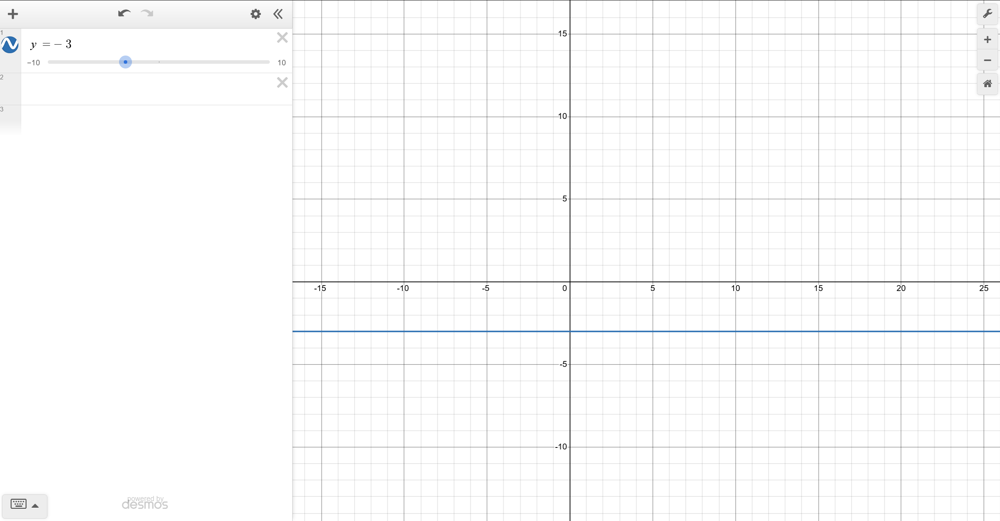

$$f(x) \equiv 1$$과 같이 정의역에 관계없이 함숫값이 항상 같은 함수를 상수함수라고 한다. 다항함수의 일종이며 식으로는 다음과 같이 나타낼 수 있다.

$$
f(x) \equiv a
$$

- 일반적으로 그래프는 x축에 평행 또는 일치하는 직선으로 기울기가 일정하며 따라서 일대응대응이 아니다.
- 위아래로 모두 볼록한 함수이다. 모든 함숫값이 동일하기 때문
- 극점이 무수히 많다
- 상수 함수는 x축과 평행하므로 모든점에서의 접선의 기울기는 0이된다.

**일차함수**

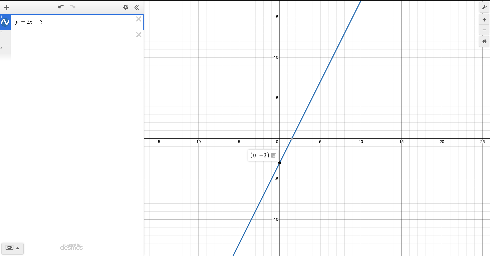

일차함수는 변수 x에 대한 일차식으로 나타낼 수 있는 함수를 말한다. 직선의 방정식이라고도 불리며 그래프를 그렸을 때 직선이 되는 함수이다. 일반적으로 다음과 같이 표현된다

$$
y = ax + b
$$

- **a (기울기) :** 직선이 얼마나 기울어져 있는지 나타낸다. x의 계수이며 절대 0이 될 수 없다 ( a≠ 0 )
    - 기울기의 a의 부호와 크기에 따라 그래프의 모양이 결정된다
        - a > 0 (양수 일 때) : 그래프는 오른쪽 위로 향한다. (x값이 증가하면 y값도 증가).
            
            이를 단조 증가한다고 한다.
            
        - a < 0 (음수 일 때) : 그래프는 오른쪽 아래로 향한다. (x값이 증가하면 y값도 감소).
            
            이를 단조 감소한다고 한다.
            
    - a의 절댓값이 클수록 그래프는 y축에 더 가까워지며 경사가 가팔라진다.
- **b (y절편) :** 직선이 y축과 만나는 점의 y 좌표
    - 그래프는 항상 점 (0,b)를 지난다
    - 만약 b = 0이면 (y = ax) 그래프는 원점을 지나는 정비례 관계를 가진다.
- **x절편 :** 그래프가 x축과 만나는 점의 x좌표를 의미하며 y = 0일때의 x값이다.
    - y = ax + b 에서 y에 0을 대입하면 0 = ax + b가 되므로 절편은 $$-\frac{b}{a}$$이다.

**이차함수**

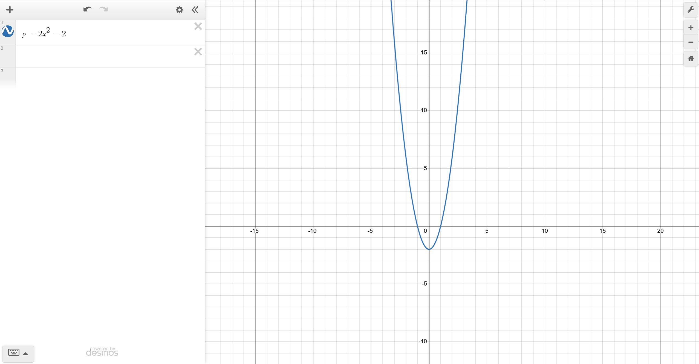

이차함수는 변수 x에 대한 이차식으로 나타낼 수 있는 함수이다. 그래프를 그리면 포물선 모양이 나온다. 대표적인 우함수이다. 이차함수는 일반적으로 다음과 같이 표현된다. 

<aside class="notion-callout notion-callout--with-icon" markdown="1">
💡
{: .notion-callout__icon aria-hidden="true"}

**우함수의 정의**

우함수(짝함수)는 함수의 그래프가 y축에 대하여 대칭인 함수이다. 대수적으로는 정의역에 속하는 모든 실수 x에 대하여 f(-x) = f(x)를 만족하는 함수이다. 이는 x의 부호를 바꾸어도 함숫값이 변하지 않음을 의미한다. 우함수의 그래프를 y축을 기준으로 접으면 서로 완벽하게 겹치는 특성이 있다.

</aside>

$$
y= ax^2 + bx + c
$$

- a : 계수 a의 부호는 포물선이 어느 방향으로 볼록한지 결정한다.
    - **a >0 (양수 일 때)** : 아래로 볼록한 모양이며, 최소값을 가진다
    - **a < 0 (음수 일 때)** : 위로 볼록한 모양이며, 최대값을 가진다
    - a의 절대값이 클수록 포물선의 폭이 좁아진다
- 꼭짓점
    - 포물선의 가장 아래쪽 또는 가장 위쪽 지점으로 함수의 최소값 또는 최대값을 나타내는 매우 중요한 점이다
    - 꼭짓점 x의 좌표는
        
        $$
        x = -\frac{b}{2a}
        $$
        
        그렇다면 꼭짓점의 좌표는 $$(-\frac{b}{2a},f(-\frac{b}{2a}))$$이다
        

**삼차함수**

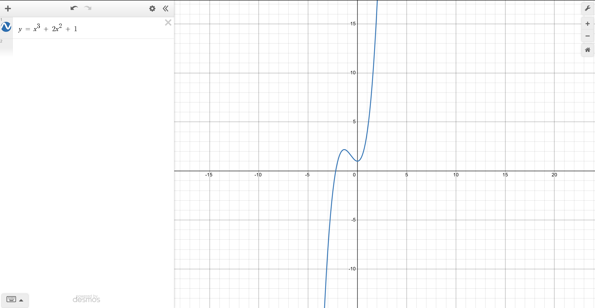

삼차함수는 변수 x에 대한 삼차식으로 나타낼 수 있는 함수이다. 그래프는 일반적으로 부드러운 S자 형태의 곡선을 가진다. 만약 지수가 모두 홀수만 있다면 이는 기함수라고도 불린다.

<aside class="notion-callout notion-callout--with-icon" markdown="1">
💡
{: .notion-callout__icon aria-hidden="true"}

**기함수의 정의**

기함수(홀함수)는 원점에 대하여 대칭인 함수이다. 함수 f(x)가 모든 실수 x에 대하여 f(-x) = -f(x)를 만족할 때 기함수라고 한다. 이는 그래프가 원점을 지나며 원점을 중심으로 180° 회전했을 때 원래의 그래프와 일치함을 의미한다. 멱함수에서는 지수가 홀수인 항으로만 구성된 함수가 기함수이다. 대표적인 예로는 f(x) = x, f(x) = x³, f(x) = sin x 등이 있다.

</aside>

$$
y = ax^3 + bx^2 + cx + d
$$

- a : a의 부호에 따라 그래프의 양 끝 방향이 결정된다
    - **a > 0 (양수 일 때) :** 그래프는 오른쪽 위로 계속 올라간다. (시작: 왼쪽 아래, 끝 오른쪽 위)
    - **a < 0 (음수 일 때) :** 그래프는 오른쪽 아래로 계속 내려간다. (시작: 왼쪽 위, 끝: 오른쪽 아래)
- 극값
    - 삼차함수는 그래프가 꺾이는 지점인 극값(극댓값, 극솟값)을 가질 수 있다
    - 극값은 최대 2개까지 가질 수 있으며 경우에 따라 없을수도 있다. 극값이 없는 경우 함수는 계속 증가하거나 감소만한다.
    - 극값은 함수의 도함수가 0이 되는 지점이다. 삼차함수 $$f(x) = ax³ + bx² + cx + d$$에서는 $$f'(x) = 3ax² + 2bx + c = 0$$의 해가 극값을 결정한다.
- 변곡점
    - 변곡점은 삼차함수 그래프에서 중요한 특징이다.
    - 이 점을 기준으로 그래프의 볼록한 방향이 바뀐다
    - 모든 삼차함수는 단 하나의 변곡점을 가지며 그래프는 이 점에 대하여 점대칭이다.
    - 변곡점은 이계도함수가 0이 되는 점으로, 이 점에서 그래프의 오목성이 바뀐다. 삼차함수에서는 항상 이계도함수가 $$f''(x) = 6ax + 2b$$의 형태이다.
        
        변곡점의 x 좌표
        
        $$
        x = -\frac{b}{3a}
        $$
        

### 유리함수

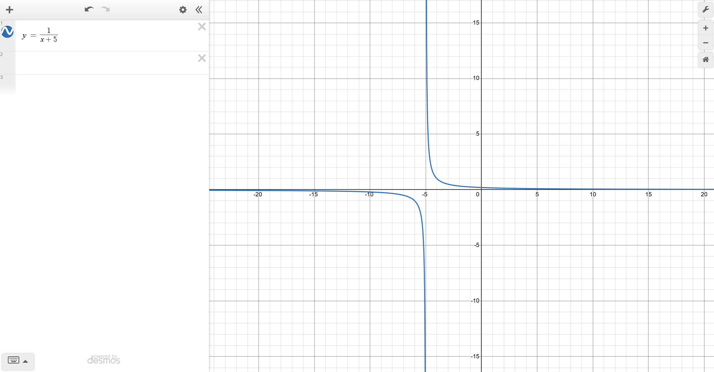

유리함수는 두 다항함수의 비율(분수)로 표현할 수 있는 함수이다. 유리함수는 다음과 같은 식으로 표현이 된다

$$
y = \frac{Q(x)}{P(x)}
$$

다항함수 또한 P(x)가 상수항인 유리함수로 볼 수 있다. 유리함수라고하면 분수함수를 보통 유리함수라고 한다.

**일반형:**

$$
y = \frac{cx + d}{ax + b}
$$

**표준형:**

$$
y = \frac{k}{x - p} + q
$$

<aside class="notion-callout notion-callout--with-icon" markdown="1">
💡
{: .notion-callout__icon aria-hidden="true"}

**정의역과 치역**

**정의역 :**

$$
\{ x \in \mathbb{R} | P(x) \neq 0\}
$$

- 정의역은 분모 P(x)를 0으로 만들지 않는 모든 실수 x들의 집합이다

**치역:**

$$
\{ y \in \R | y \neq q  \}
$$

- 표준형을 보았을 때 이 함수의 그래프는 수평 점근선인 y = q와 절대 만나지 않는다. 즉 y의 값은 q에서 정의가 되지 않는다. 고로 치역은 q를 제외한 모든 실수이다
</aside>

- P(x)와 Q(x)는 각각 다항함수이다. 가장 중요한 조건으로 분모가 되는 P(x)는 0이 될 수 없다.
- 점근선 : 유리함수 그래프의 가장 핵심적인 특징으로 그래프가 한없이 가까워지지만 절대 만나지 않는 선을 의미한다.
    - 수직 점근선
        - 분모를 0으로 만드는 x값에서 발생한다
        - 그래프는 이 수직선을 경계로 그려지며 이 선을 넘지 않는다
    - 수평 점근선
        - x값이 한없이 커지거나 작아질 때 가까워지는 수평선이다
        - 분자와 분모의 차수에 따라 위치가 결정된다.
- 함수의 특징
    - 유리함수는 연속이지만 분모가 0이 되는 점에서는 정의되지 않는다.
    - 분자의 차수가 분모의 차수보다 작으면 수평 점근선이 y = 0이다.
    - 분자와 분모의 차수가 같으면 수평 점근선이 “y = 분자의 최고차항 계수/분모의 최고차항 계수”이다.
    - 분자의 차수가 분모의 차수보다 1 크면 기울어진 점근선이 생긴다.

### 무리함수

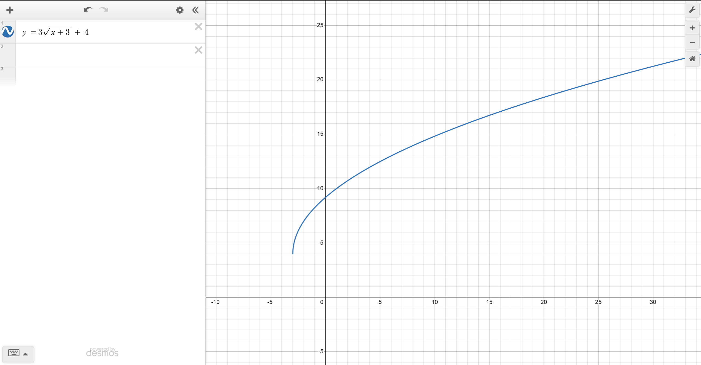

무리함수는 근호($$\sqrt{}$$)안에 변수 x를 포함하는 함수이다. 무리함수는 일반적으로 다음과 같은 기본 형태로 표현된다

$$
y = a\sqrt{bx + c} + d
$$

<aside class="notion-callout notion-callout--with-icon" markdown="1">
💡
{: .notion-callout__icon aria-hidden="true"}

**정의역과 치역**

**정의역**

$$
\{ x \in \R | x \ge -\frac{c}{b} \}
$$

- 무리함수에서 정의역은 근호안의 값이 0 이상이여야한다. 즉, bx + c ≥ 0 이라는 조건을 만족해야한다. 만약 b < 0이라면 부등호의 방향이 달라진다

**치역**

$$
\{ y \in \R | y \ge d \}
$$

- 무리함수의 치역은 a의 부호와 상수항 d에 의해 결정된다. 만약 a<0이라면 부등호의 방향이 달라진다
</aside>

- **그래프의 방향 :** 시작점에서 어느 방향으로 그래프가 그려지는지는 x의 계수인 b의 부호와 근호 앞의 계수인 a부호에 따라 결정된다
    - a > 0 : 그래프는 시작점보다 위쪽에 그려진다
    - a < 0 : 그래프는 시작점보다 아래쪽에 그려진다
    - b > 0 : 그래프는 시적점보다 오른쪽에 그려진다
    - b < 0 : 그래프는 시작점보다 왼쪽에 그려진다
- **그래프의 이동 :** c와 d가 그래프의 원형에서 얼마나 평행이동하는지 관여하며 c는 가로 평행이동을 결정하고 d는 세로 평행이동을 결정한다. 구체적으로, c값이 음수이면 그래프는 오른쪽으로, 양수이면 왼쪽으로 이동하는데 이는 근호 안의 식 bx+c에서 c/b의 절대값만큼 이동하는 것이다. d값은 그래프 전체를 위나 아래로 d만큼 이동시키는 역할을 한다. 즉, 무리함수 $$y=\sqrt x$$의 그래프에서 $$y=\sqrt{x-2}+3$$의 그래프는 오른쪽으로 2만큼, 위로 3만큼 이동한 형태이다.

## 초월함수

초월함수는 대수함수가 아닌 모든 함수 즉 다항방정식의 해로 표현할 수 없는 함수를 말한다.

쉽게 말해 덧셈 뺄셈 곱셈 나눗셈 그리고 유리수 거듭제곱같은 유한한 대수적 연산만으로 나타낼 수 없는 함수를 초월 함수라고 한다.

초월함수는 보통 대수적인 방법으로는 그 값을 정확히 계산할 수 없고 보통 무한급수나 다른 근사적인 방법으로 값을 구하게 된다.

초월함수는 그래프의 모양이 대수함수와는 확연히 다른 특성을 보이는데, 이는 함수의 증가 또는 감소 속도가 다항함수보다 빠르거나 느리기 때문이다. 또한 주기성, 점근선, 특이점 등 고유한 특성들이 나타나는 경우가 많다.

### 지수함수

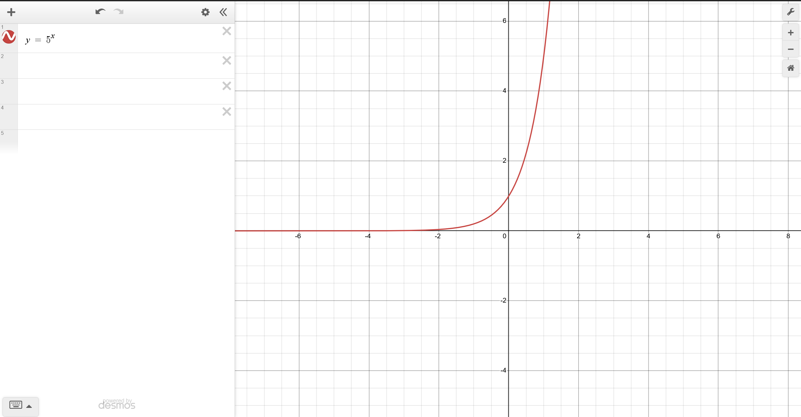

지수함수는 어떤 수(밑)를 거듭제곱하는 횟수(지수)를 변수 x로 두는 함수이다. y 값이 상승하는 폭이 가장 크다. 지수함수는 일반적으로 다음과 같은 형태로 표현된다.

$$
y = a^x
$$

<aside class="notion-callout notion-callout--with-icon" markdown="1">
💡
{: .notion-callout__icon aria-hidden="true"}

**정의역과 치역**

**정의역:**

$$
\{ x \in \R \}
$$

- x값은 모든 실수가 될 수 있다

**치역:**

$$
\{ y \in \R\ |\ y > 0 \}
$$

- y값은 항상 0보다 큰 양수가 된다.
</aside>

- **a (밑, base):** 거듭제곱의 대상이 되는 수. 밑은 1이아닌 양수여야 함.
    - a > 1일 때 (증가함수)
        - 그래프는 오른쪽 위로 급격하게 올라간다
        - x값이 증가하면 y값은 기하급수적으로 증가
    - 0 < a < 1 일 때 (감소 함수)
        - 그래프는 오른쪽 아래로 급격하게 내려간다
        - x값이 증가하면 y값은 0에 한없이 가까워진다
- **x (지수, exponent) :** 밑이 거듭제곱되는 횟수로 변수이다.
- 점 (0,1)을 반드시 지남: 밑 a의 값에 상관 없이 모든 지수함수는 (0,1)을 지난다.
- x축을 점근선으로 가진다

### 로그함수

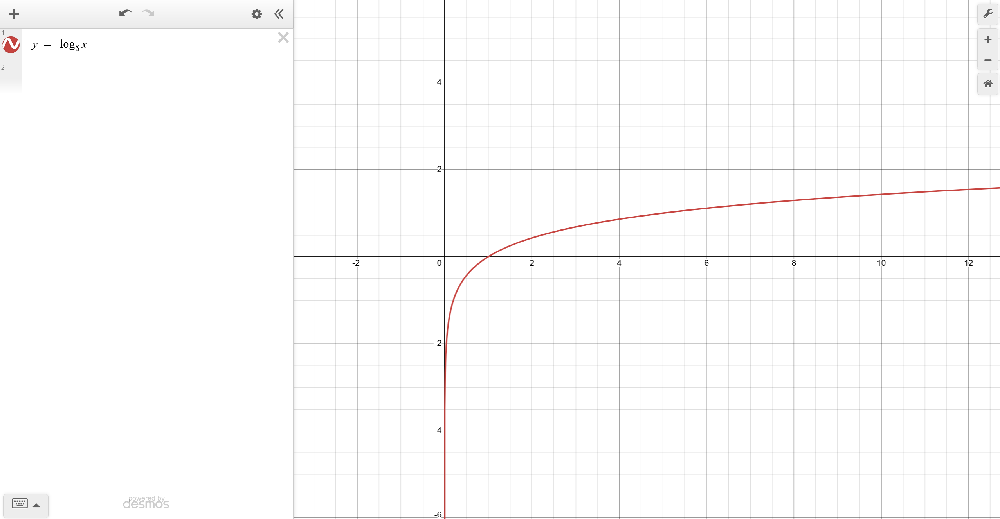

로그함수는 지수함수의 역함수로 어떤 수를 만들기 위해 밑을 몇 번 거듭제곱해야 하는지를 나타내는 함수이다. 로그함수는 일반적으로 다음과 같이 표현된다.

$$
y = log_ax
$$

<aside class="notion-callout notion-callout--with-icon" markdown="1">
💡
{: .notion-callout__icon aria-hidden="true"}

**정의역과 치역**

**정의역:**

$$
\{ x \in \R\ |\ x > 0 \}
$$

- 모든 양수가 정의역이다.

**치역:**

$$
\{ y \in \R \}
$$

- 모든 실수가 치역이다.
</aside>

- a (밑, base) : 거듭제곱의 기준이 되는 수로 1이 아닌 양수여야 한다.
    - a > 1 일 때 (증가함수)
        - 그래프는 오른쪽 위로 올라간다.
        - x값이 증가하면 y값도 증가한다.
    - 0 < a < 1 일 때 (감소함수)
        - 그래프는 오른쪽 아래로 서서히 내려간다.
        - x값이 증가하면 y값은 감소한다.
- x (진수, argument) : 로그를 취하는 대상으로 반드시 양수여야 한다.
- 로그함수의 그래프는 지수함수의 그래프를 직선 y = x에 대해 대칭시킨 모양이다.
- 점 (1,0)을 지난다.
- y축을 점근선으로 가진다.

### 삼각함수

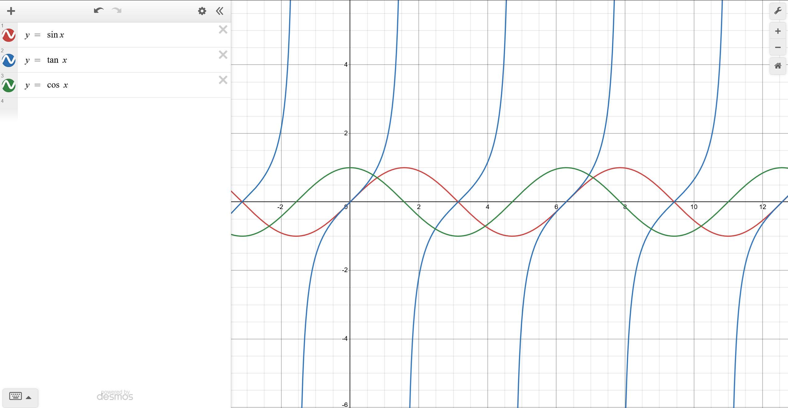

삼각함수는 직각삼각형 정의를 일반적인 모든 각에 대해 확장한것이다. 좌표평면의 원점을 중심으로 하고 반지름이 1인 단위원을 고려한다

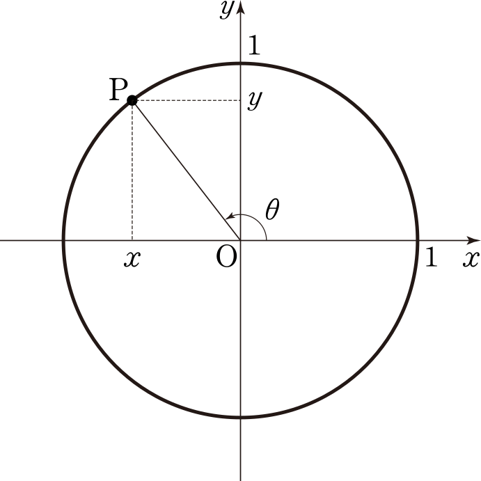

$$
sin(\theta) = y \\
cos(\theta) = x \\
tan(\theta) = \frac{y}{x}
$$

<aside class="notion-callout notion-callout--with-icon" markdown="1">
💡
{: .notion-callout__icon aria-hidden="true"}

**호도법**

부채꼴에서 호의 길이 l이 반지름 r과 중심각의 수치에 비례한다는 특징과 “원주가 지름의 $$\pi$$배로 일정”하다는 성질을 이용하여 정의되는 각이다.

$$
\theta = (1회전)\times \frac{l}{2\pi r}
$$

- l = r인 경우로 정의하여 이에 따라 1회전은 $$2\pi\ rad$$이다
</aside>

<aside class="notion-callout notion-callout--with-icon" markdown="1">
💡
{: .notion-callout__icon aria-hidden="true"}

**정의역과 치역**

**정의역**

- sin, cos

$$
\{ x \in \R \}
$$

- tan
    
    $$
    	\{x \in \R \ |\ x \neq n\pi + \frac{\pi}{2}\}
    $$
    
    - $$tan = \frac{sin}{cos}$$이기에 cos이 0이 되는 지점은 정의역에서 제외된다

**치역**

- sin, cos

$$
\{ y \in \R  | -1 \le y \le 1 \}
$$

- tan

$$
\{ y \in \R \}
$$

</aside>

- **주기성** :  sin과 cos은 주기가 $$2\pi$$인 주기함수이다.  $$360\degree$$마다 같은 모양이 반복된다. tan는 주기가 $$\pi$$인 주기함수이다. $$180\degree$$마다 같은 모양이 반복된다.
- **점근선 ( tan(x) ) :** cos(x)가 0이 되는 지점에서 수직 점근선이 존재한다.

### 역삼각함수

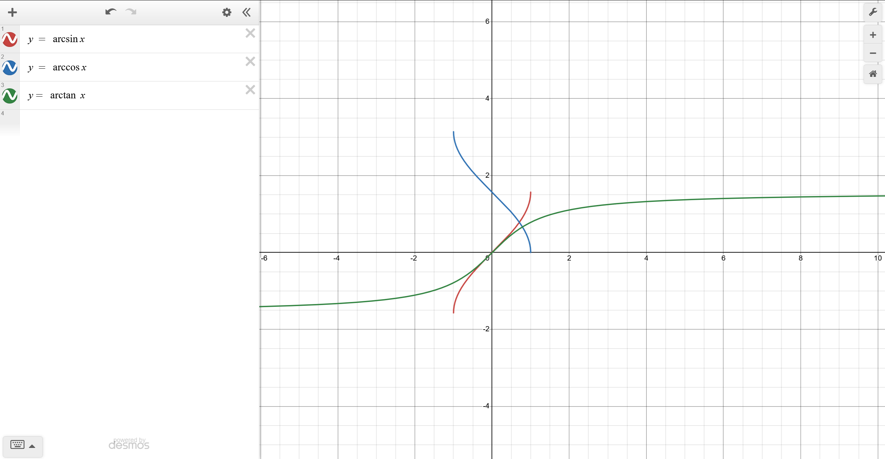

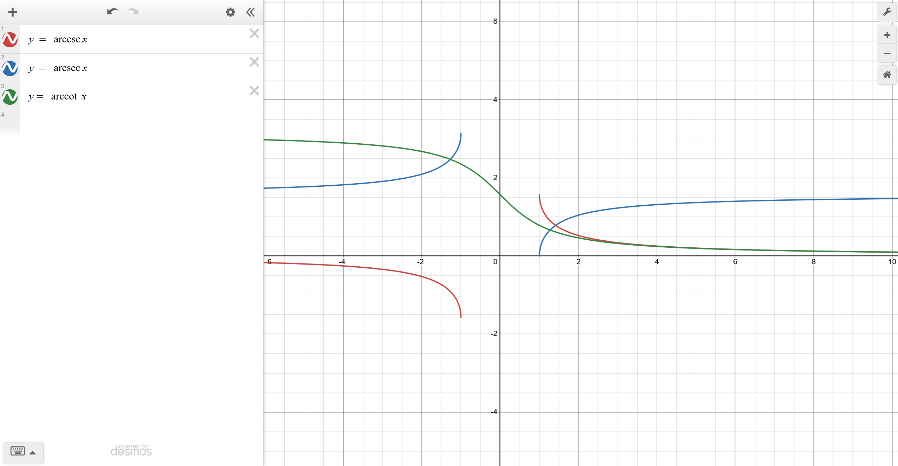

역삼각함수는 삼각함수의 역함수로 비율 값을 입력받아 그 비율을 만들어내는 각도를 출력한다.

$$
y = \arcsin(x) \\
y = \arccos(x) \\
y = \arctan(x)
$$

<aside class="notion-callout notion-callout--with-icon" markdown="1">
💡
{: .notion-callout__icon aria-hidden="true"}

**정의역과 치역**

**정의역**

- arcsin, arccos

$$
\{x \in \mathbb{R} \ \| \ -1 \le x \le 1\}
$$

- arctan

$$
\{ x \in \R \}
$$

**치역**

- arcsin

$$
\{y \in \mathbb{R} \ \| \ -\frac{\pi}{2} \le y \le \frac{\pi}{2}\}
$$

- arccos

$$
\{y \in \mathbb{R} \ \| \ 0 \le y \le \pi\}
$$

- arctan

$$
\{y \in \mathbb{R} \ \| \ -\frac{\pi}{2} < y < \frac{\pi}{2}\}
$$

</aside>

- **주치 :** 역삼각함수가 단 하나의 값만 출력하도록 치역의 범위를 제한해야하는데 이를 주치라고 한다. 예를 들어 sin값이 $$\frac{1}{2}$$가 되는 각도는 $$\frac{\pi}{6}$$, $$\frac{5\pi}{6}$$등 무수히 많지만 $$\arcsin(\frac{1}{2})$$의 값은 주치 범위 안에 있는 $$\frac{\pi}{6}$$하나로 약속한다.
- **대칭성 :** arcsin과 arctan는 원점에 대해 대칭인 기함수이다. arccos은 점 $$(0,\frac{\pi}{2})$$에 대해 점대칭이다.

### 쌍곡선함수

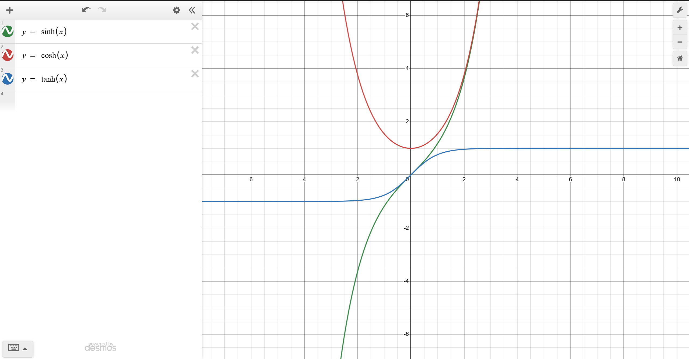

쌍곡선함수는 자연로그 밑 e를 이용하여 정의되는 함수들로 삼각함수와 매우 유사한 성질을 가지고 있다. 삼각함수가 단위원($$x^2+y^2=1$$)에서 정의된다면, 쌍곡선함수는 단위 쌍곡선($$x^2-y^2=1$$)과 관련이 깊다. 각 함수에 대한 정의는 다음과 같다.

- 쌍곡선 사인

$$
sinh(x) =\frac{e^x - e^{-x}}{2}
$$

- 쌍곡선 코사인

$$
cosh(x) = \frac{e^x + e^{-x}}{2}
$$

- 쌍곡선 탄젠트

$$
tanh(x) = \frac{sinh(x)}{cosh(x)} = \frac{e^x - e^{-x}}{e^x + e^{-x}}
$$

<aside class="notion-callout notion-callout--with-icon" markdown="1">
💡
{: .notion-callout__icon aria-hidden="true"}

**정의역과 치역**

| **함수** | **정의역** | **치역** | **주요 성질** |
| --- | --- | --- | --- |
| **y = sinh(x)** | 모든 실수 (−∞,∞) | 모든 실수 (−∞,∞) | **기함수(원점 대칭)**: sinh(−x)=−sinh(x)원점 (0, 0)을 지남 |
| **y = cosh(x)** | 모든 실수 (−∞,∞) | [1,∞) | **우함수(y축 대칭)**: cosh(−x)=cosh(x)(0, 1)에서 최솟값 1을 가짐 
**현수선(catenary)**모양 |
| **y = tanh(x)** | 모든 실수 (−∞,∞) | (−1,1) | **기함수(원점 대칭)**
수평 점근선: y=1, y=−1 |
| **y = csch(x)** | x≠0 | y≠0 | 기함수 |
| **y = sech(x)** | 모든 실수 (−∞,∞) | (0,1] | 우함수
(0, 1)에서 최댓값 1을 가짐 |
| **y = coth(x)** | x≠0 | (−∞,−1)∪(1,∞) | 기함수
수직 점근선: x=0수평 점근선: y=1, y=−1 |
</aside>

### 역쌍곡선함수

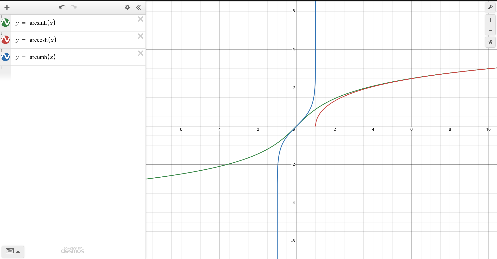

역쌍곡선함수는 이름 그대로 쌍곡선 함수의 역함수이다. 가장 큰 특징으로 이 함수들은 로그함수로 표현된다.

- 역쌍곡선사인

$$
arsinh(x) = \ln(x + \sqrt{x^2 + 1})
$$

- 역쌍곡선코사인

$$
arcosh(x) = \ln(x+\sqrt{x^2 - 1})
$$

- 역쌍곡선탄젠트

$$
artanh(x) = \frac{1}{2}\ln{\left( \frac{1+x}{1-x}\right)}
$$

<aside class="notion-callout notion-callout--with-icon" markdown="1">
💡
{: .notion-callout__icon aria-hidden="true"}

**정의역과 치역**

| **함수** | **정의역 (Domain)** | **치역 (Range)** | **그래프 특징** |
| --- | --- | --- | --- |
| **y = arsinh(x)** | 모든 실수 (-∞, ∞) | 모든 실수 (-∞, ∞) | - sinh(x)를 y=x에 대칭한 모양
-**원점 대칭 (기함수)**
- 항상 증가하며, (0, 0)을 지남 |
| **y = arcosh(x)** | [1, ∞) | [0, ∞) | - cosh(x)의 y ≥ 0 부분을 y=x에 대칭
-**정의역이 1부터 시작함**
- (1, 0)에서 시작하여 증가하는 곡선 |
| **y = artanh(x)** | (-1, 1) | 모든 실수 (-∞, ∞) | - tanh(x)를 y=x에 대칭한 모양
-**정의역이 -1과 1 사이로 제한됨**-**수직 점근선**: x = 1, x = -1 |
| **y = arcsch(x)** | x ≠ 0 | y ≠ 0 | - 원점 대칭 (기함수) |
| **y = arsech(x)** | (0, 1] | [0, ∞) | - 정의역이 0과 1 사이 |
| **y = arcoth(x)** | (-∞, -1) ∪ (1, ∞) | y ≠ 0 | - 수평 점근선: y = 0
- 수직 점근선: x = 1, x = -1 |
</aside>
