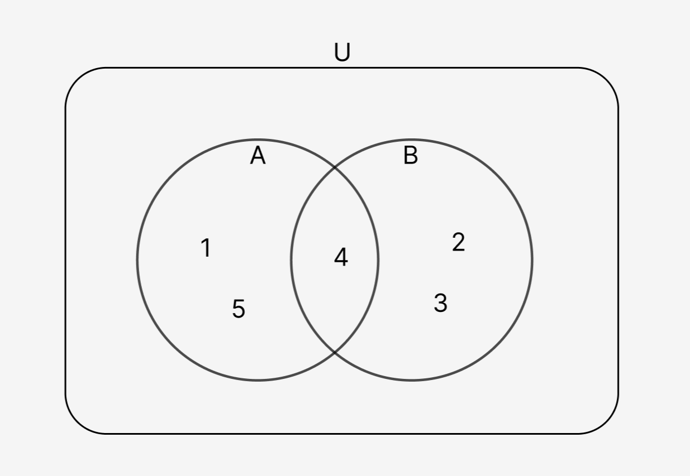
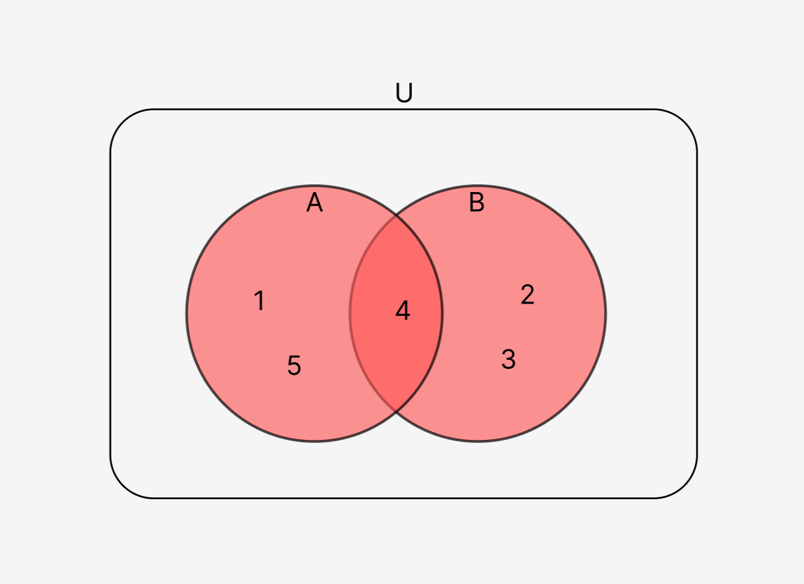
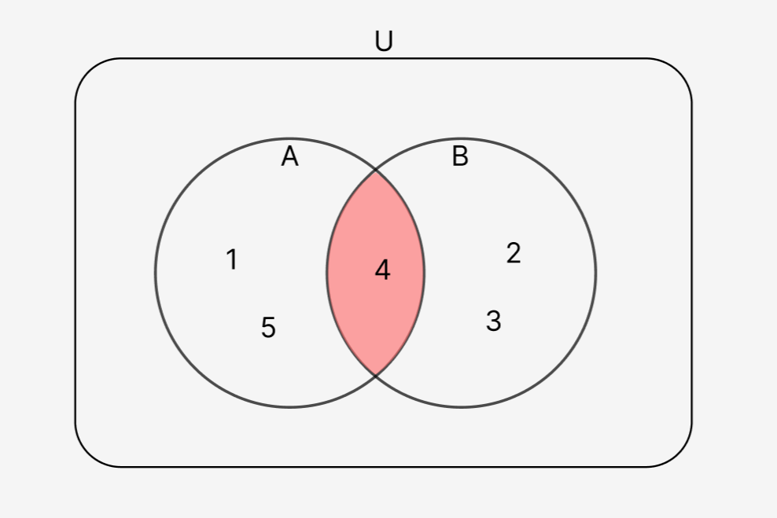
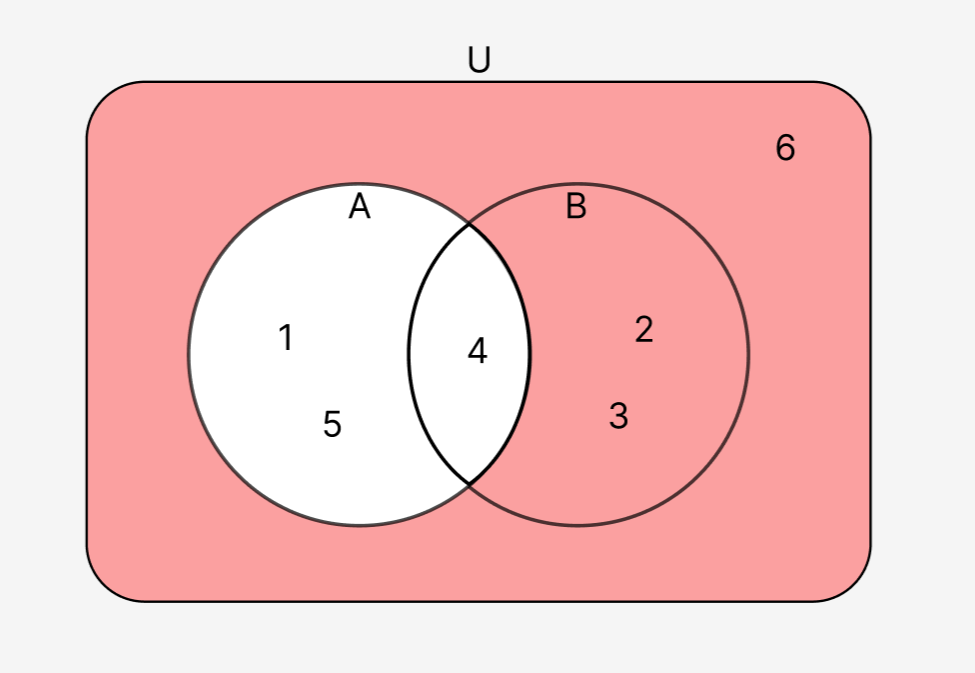
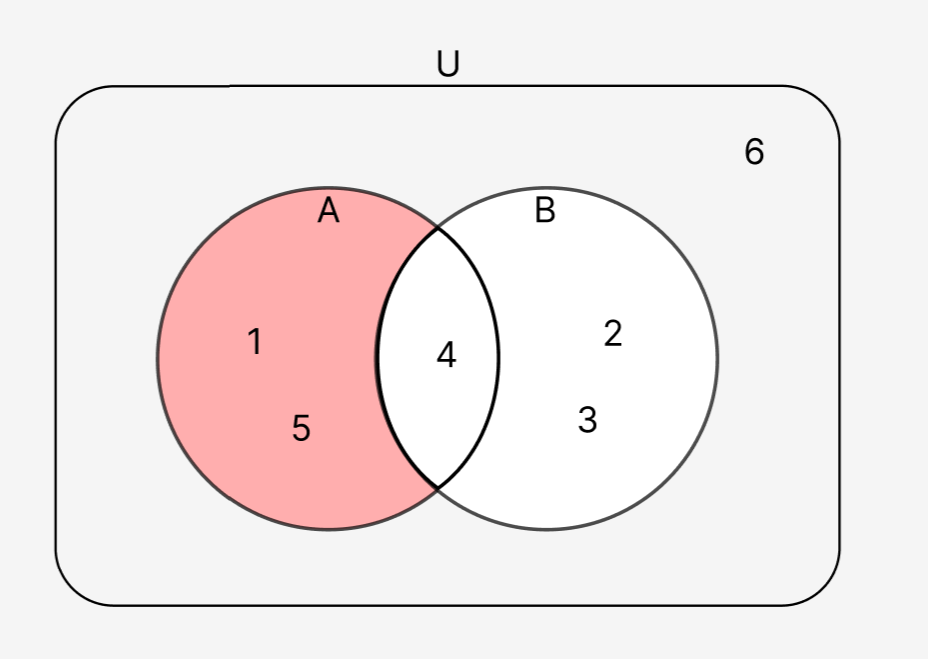
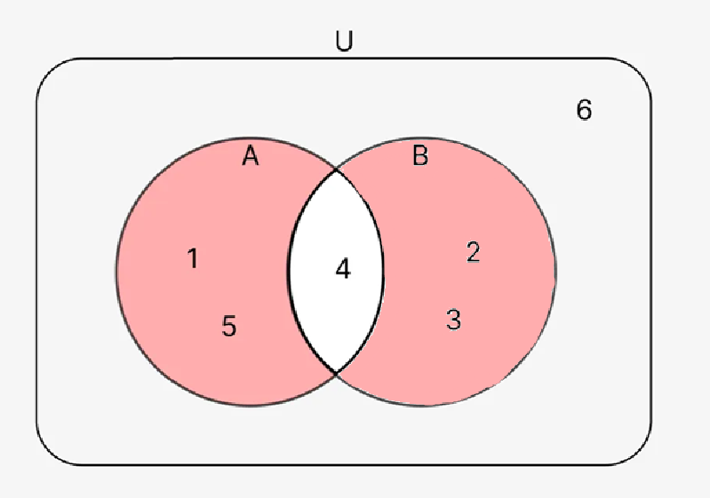

[상위 페이지 · Math](/study/algorithms/math/)

수학에서 집합론은 여러 대상들의 모임인 집합과 그 성질을 연구하는 분야이다. 집합은 명확히 정의된 대상들의 **중복과 순서가 없는 모임**으로, 이러한 대상들을 **원소**라고 부른다. 집합론은 현대 수학의 기초를 형성하며, 원소의 포함 관계, 집합 간의 연산(합집합, 교집합, 차집합 등), 함수와 관계 등의 개념을 다룬다. 집합은 원소의 개수에 따라 **유한집합과 무한집합**으로 나뉘며, 원소가 없는 **공집합**과 원소가 하나뿐인 **싱글턴**과 같은 특수한 형태도 존재한다. 

현대 집합론의 기초는 체르멜로-프랭켈 집합론(Zermelo-Fraenkel set theory)으로, 20세기 이후 수학의 거의 모든 분야에 엄밀한 기초(Foundations of mathematics)를 제공하는 표준이 되었다. 집합론은 논리학과 밀접한 관련이 있으며, 수학적 사고의 기본 틀을 제공한다. 또한 위상수학, 해석학, 대수학 등 여러 수학 분야의 근간을 이루며, 무한의 개념을 엄밀하게 다루기 위한 도구로서 중요한 역할을 한다.

## 기본 개념

## 집합과 원소

**집합(set)의 정의**

집합이란 주어진 조건에 의해 그 대상을 **분명하게 결정할 수 있는것**들의 모임이다. 여기서 핵심은 ‘분명하게 결정할 수 있다’는 점으로 누가 판단하더라도 그 결과가 동일해야한다. 즉 객관적인 기준이 존재해야한다

- 집합이 될 수 있는 경우
    - 7보다 작은 홀수 양의 정수 모임 → 1, 3, 5
    - 대한민국의 수도 → 서울
    - 알파벳 모음의 모임 → a,e,i,o,u
- 집합이 될 수 없는 경우
    - 아름다운 그림의 모임 → “**아름다움”**의 기준은 사람마다 다름
    - 우리 반에서 키가 큰 학생들의 모임 → **“크다”**의 기준이 없음

**원소(Elemet)의 정의**

원소란 어떤 집합을 구성하고 있는 **대상 하나하나**를 의미한다.

예를 들어, 집합 A를 ‘6의 양의 약수의 모임’이라고 정의한다면, 집합 A는 {1, 2, 3, 6}이 된다. 

이때 1,2,3,6 각각을 **집합 A의 원소**라고 한다.

**집합과 원소의 관계 표현**

어떤 대상이 특정 집합에 속할 때 기호 $$\in$$을 사용한다 이는 “…는 …의 원소이다(is an elemet of)”를 의미한다. 반대로 원소가 아님을 나타낼 때는 $$\notin$$을 사용한다.

- A = {1, 2, 3, 6}일 때
    - 2는 집합 A의 원소이므로 $$2\in A$$라고 표현한다
    - 5는 집합 A의 원소가 아니므로 $$5 \notin A$$라고 표현한다

요소의 개수를 표기할때는 절대값( | | ) 혹은 노름( || || ) 기호를 사용해 표기한다. 또는 number의 n을 따서 n(A)를 사용해 표기하기도 한다.

- A = {1 ,2 ,3, 6}일 때
    - $$|A|$$ = 4
    - n(A) = 4

**집합의 근본적인 성질**

집합은 두가지의 중요한 고유의 성질을 가진다.

1. 순서 무관의 법칙 (Unordered)
    - 집합에서는 원소 나열하는 순서를 고려하지 않는다. 순서가 달라도 구성하는 원소가 같다면 두 집합은 동일한 집합이다.
2. 원소 유일성의 원칙 (Distinct)
    - 집합에서는 중복된 원소를 허용하지 않는다. 어떤 원소를 여러 번 나열하더라도 그 원소는 한개만 있는것으로 간주한다.

## 집합의 표현

집합이 무엇인지 정의했다면, 그 집합을 수학적으로 어떻게 쓰고 나타내는지 알아야한다. 집합을 표현하는 방법으로 크게 3가지가 있다.

### **1. 원소 나열법 (Tabular form)**

**정의 :** 가장 직관적이고 기본적인 방법으로 집합에 속하는 모든 원소를 중괄호(”{ }”)안에 하나하나 나열하여 나타내는 방식이다.

**예시)**

- 원소가 적은 유한집합:
    - A = {a, e, i, o ,u}
- 원소가 많고 규칙적인 유한집합
    - 원소의 개수가 많지만 규칙이 명확할 경우 일부만 나열하고 중간 부분은 줄임표( … )를 사용하여 생략한다
    - B = {1, 2, 3, … , 100}
- 무한집합
    - 원소가 무한이 많더라도 규칙적이라면 원소 나열법을 사용할 수 있다.
    - E = {2, 4, 6, 8, …}

### **2. 조건제시법 (Set-builder form)**

**정의 :** 집합의 원소를 일일히 나열하는 대신 그 원소들이 공통으로 만족하는 조건이나 성질을 제시하여 나타내는 방법. 이는 원소가 무수히 많거나 특정 규칙으로 묶이는 집합을 표현할때 유용하다.

**형식** : {대표문자 | 그 문자가 만족하는 조건}

- 대표 문자 : 집합의 임의의 원소를 대표하는 변수
- 수직선 | : ‘such that’ 또는 ‘given that’의 의미로 뒤로 나오는 조건에 대해 설명하겠다는 기호이다
- 조건 : 대표 문자가 집합의 원소가 되기 위해 만족해야하는 규칙

**예시 )**

- $$A = \{x \in \Z^ +\ |\ x < 10 \}$$
    - x는 양의 정수이며, 그 x는 10보다 작은 자연수이다.
    - 이를 원소 나열법으로 표현하면 A = {1, 2, 3, 4, 5, 6, 7, 8, 9}
- $$A = \{ y\ |\ y는\ 대한문국의\ 광역시 \}$$
    - 이를 원소 나열법으로 표현하면 B = {부산, 대구, 인천, 광주, 대전, 울산}

### **3. 벤 다이어그램 (Venn Diagram)**

정의 : 영국 수학자 존 벤이 고안한 방법으로, 집합을 원이나 폐곡선 등의 그림으로 표현하여 집합 사이의 관계를 시각적으로 나타내는 방식이다.

- 보통 전체집합을 사각형으로 그 안의 부분집합을 원으로 그린다
- 집합의 영역 안에는 해당 집합에 속하는 원소들을 기입한다
- 벤 다이어그램은 집합의 연산이나 포함 관계를 직관적으로 파악하는데에 매우 유용하다

## 집합의 종류

집합은 그 안에 포함된 원소의 개수를 기준으로 크게 분류 될 수 있다.

### **유한집합 (Finite Set)**

**정의:** 원소의 개수를 자연수나 0으로 셀 수 있는 집합, 즉 원소의 개수가 유한한 집합을 말한다.

### **공집합 (Empty Set)**

**정의 :** 유한집합의 아주 특별한 형태로 원소가 단 하나도 없는 집합을 의미한다.

**표기:** 공집합은 두가지 기호로 나타낸다

1. $$\phi$$
2. { } (원소를 넣는 중괄호 안을 비워둠)

원소의 개수 : 공집합의 원소의 개수는 0이다. n($$\phi$$) = 0이다

**주의할 점 :** { $$\phi$$ }는 공집합이 아니다. 이 집합은 $$\phi$$라는 원소 한개를 가지고 있는 싱글턴 집합이다. 빈 바구니 자체와 빈 바구니를 또 다른 바구니에 담은것과는 다르다.

### **무한집합 (Infinite Set)**

**정의 :** 유한 집합이 아닌 집합, 즉 원소의 개수가 무한히 많아서 끝까지 셀 수 없는 집합

**예시 )**

- $$\N$$ = {1,2,3,4,5, …} (자연수 전체의 집합)
- $$\Z$$ = {…, -2, -1, 0, 1, 2, …} (정수 전체의 집합)
- $$\mathbb{Q}$$ = {x | x는 유리수}
- {x | 0 < x < 1 인 실수}

### **싱글턴 (Singleton)**

**정의 :** 원소가 오직 한개만 있는 집합. 단일 원소 집합이라고도 함

**예시 )**

- A = {5} → n(A) = 1
- B = {서울} → n(B) = 1
- C = { $$\phi$$ } → $$\phi$$를 원소로 갖는 집합이므로 n(C) = 1 이다.

### 전체 집합

정의: 우리가 생각하고자 하는 문제의 전체 범위를 담고 있는 집합을 전체집합이라고 한다. 즉, 우리가 다루는 모든 집합들은 이 전체집합의 부분집합이 된다. 전체집합은 보통 기호 U로 나타낸다.

예시 : 주사위 던지기에 대해 이야기한다면 나올 수 있는 모든 눈의 집합 U = {1, 2, 3, 4, 5, 6}이 전체집합이 된다. “홀수의 눈” 집합 {1, 3, 5}는 이 전체 집합의 부분집합이다.

### 부분 집합

**정의 :** 두 집합 A,B에 대하여 집합 A의 모든 원소가 집합 B에 포함될 때 “A는 B의 부분 집합이다”라고 한다

**기호 :**  A가 B의 부분집합임을 $$A \subset B$$또는 $$A \subseteq B$$와 같이 나타낸다

- $$\subset$$은 보통 진부분집합을 의마하나, 많은 경우 $$\subseteq$$와 혼용하여 사용한다. $$\subseteq$$는 “작거나 같다”는 의미를 명확히하여 자기 자신도 부분집합임을 강조한다

**예시 )**

- 부분집합인 경우
    - A ={1, 2} 이고 B = {1, 2, 3} 일 때
    - 집합 A의 원소인 1, 2는 모두 집합 B에도 속해있다.
    - 따라서 $$A \subseteq B$$이다
- 부분집합이 아닌 경우
    - C = {1, 2, 4}이고 B = {1, 2, 3} 일 때
    - 집합 C의 원소 중 4는 B에 속하지 않는다.
    - 따라서 C는 B의 부분 집합이 아니며 기호로 $$C \nsubseteq B$$라고 쓴다

**부분집합의 성질**

1. 공집합은 모든 집합의 부분집합이다.
    - 어떤 집합 A가 주어지든 $$\phi \subseteq A$$는 항상 성립한다
2. 모든 집합은 자기 자신의 부분집합이다
    - 어떤 집합 A가 주어진든 $$A \subseteq A$$는 항상 성립한다

### **진부분집합 (Proper Subset)**

**정의 :** 집합 A가 집합 B의 부분집합이면서, A와 B가 서로 같지 않을 때, “A는 B의 진부분집합이다”라고한다

**기호 :** $$A \subset B$$

**예시)**

- 진부분집합인경우
    - A = {1, 2}이고 B = {1, 2, 3}일 때
    - A는 B의 부분집합이면서 서로 같지 않으므로 A는 B의 진부분집합이다
- 진부분집합이 아닌 경우
    - A = {1, 2}이고 C = {1, 2}일 때
    - A는 C의 부분집합이지만 A와 C는 같으므로 진부분집합은 아니다

### **서로 같은 집합 (Equality of Sets)**

**정의:** 두 집합 A,B에 대하여 $$A \subset B$$이면서 동시에 $$B \subset A$$가 성힙할 때 두 집합 A와 B는 서로 같다고 하며 $$A = B$$로 나타낸다

### 멱집합

멱집합은 만들 수 있는 모든 부분집합들을 원소로 갖는 새로운 집합을 만드는것

**정의 :** 어떤 집합 A에 대하여, A의 모든 부분집합들을 원소로 하는 집합을 “A의 멱집합”이라고한다

**기호** : 집합 A의 멱집합은 P(A)로 나타낸다

**핵심 :** 멱집합의 원소는 집합이다. 즉, 집합들의 집합이다

**조건제시법 표현** : $$P(A) = \{ X\ |\ X\subset A\}$$

**멱집합 구하기 (예시)**

집합 A = {1, 2}

1. 먼저 집합 A의 모든 부분집합을 찾는다
    - 원소가 0개인 부분집합 :  $$\phi$$
    - 원소가 1개인 부분집합 : {1}, {2}
    - 원소가 2개인 부분집합 : {1,2}
2. 찾아낸 부분집합들 전체를 하나의 집합 안에 원소로 넣는다
    - P(A) = { $$\phi$$, {1}, {2}, {1, 2} }
3. P(A) = { $$\phi$$, {1}, {2}, {1, 2} }가 집합 A의 멱집합이 된다

**멱집합의 원소의 개수**

멱집합의 원소의 개수는 원래 집합의 원소 개수와 밀접한 관련이 있으며, 규칙적이다.

**공식 :** 집합 A의 원소 개수가 n(A) = k일 때 A의 멱집합 P(A)의 원소의 개수는 n(P(A)) = $$2^k$$이다

**증명 :** 부분집합을 만든다는 것은, 원래 집합의 각 원소에 대해 “이 원소를 부분집합에 포함시킬 것인가, 아니면 포함시키지 않을 것인가?” 라는 두가지 선택을 하는것과 같음

- A = {1, 2, 3}의 부분집합을 만들 때
    - 원소 1에 대해 → 포함 OR 포함 X → 2가지 경우
    - 원소 2에 대해 → 포함 OR 포함 X → 2가지 경우
    - 원소 3에 대해 → 포함 OR 포함 X → 2가지 경우
- 따라서 만들 수 있는 모든 부분집합의 총개수는 $$2 \times 2 \times 2 = 2^3 = 8$$가지가 된다

## 집합의 연산

집합의 연산은 주어진 집합들을 이용해 새로운 집합을 만들어내는 기본적인 연산이다. 숫자 세계에 덧셈, 뺄셈, 곱셈, 나눗셈이 있는 것 처럼, 집합 세계에는 합집합, 교집합, 여집합, 차집합과 같은 고유한 연산 방법이 있다. 이러한 연산은 여러 집합간의 관계를 분석하고 원하는 조건을 만족하는 새로운 집합을 구성한다.

## 합집합 (Union)

합집합은 주어진 두개 이상의 집합에 속해 있는 모든 원소들을 빠짐없이 모아 만든 새로운 집합이다. 즉, 집합 A 또는 집합 B에 속하는 원소들을 전부 포함하는 집합이다

**기호 :** 두 집합 A와 B의 합집합은 $$A\cup B$$라고 표기한다.

**예시** : A = {1, 4, 5} 이고 B = {2, 3, 4}일 때 두 집합의 모든 원소를 중복 없이 포함한다

- $$A \cup B$$ = {1, 2, 3, 4, 5}

**조건제시법 표현:**

- $$A \cup B = \{ x\ |\ x \in A\ 또는\ x \in B\}$$

**합집합의 원소의 개수**

두 집합의 합집합의 원소 개수는 각 집합의 원소 개수를 단순히 더한것과 다를 수 있다. 교집합에 속한 원소가 중복으로 계산되기 때문이다.

**공식 :** [포함 배제 원리](/study/algorithms/math/poham-baeje-weonri/) 

예시 적용

- A = {1, 4, 5}, B = {2, 3, 4} 이고 $$A \cap B$$ = {3} 이다
- n(A) = 3, n(B) = 3, n($$A \cap B$$) = 1 이므로 n($$A\cup B$$) = 3 + 3 - 1  = 5이다

## 교집합

교집합은 주어진 두 개 이상의 집합에 동시에 공통으로 속하는 원소만을 모아 만든 새로운 집합이다. 즉, 집합 A에도 속하고 그리고 집합 B에도 속하는 원소들의 집합이다.

**기호 :** 두 집합 A와 B의 교집합은 $$A\cap B$$라고 표기한다.

**예시** : A = {1, 4, 5} 이고 B = {2, 3, 4}일 때 두 집합의 공통으로 들어있는 원소를 포함한다

- $$A \cap B$$ = {4}

**조건제시법 표현:**

- $$A \cap B = \{ x\ |\ x \in A\ 그리고 \ x \in B\}$$

**서로소 (Disjoint Sets)**

정의 : 두 집합 A와 B의 교집합이 공집합일 때, 즉 두 집합에 공통된 원소가 단 하나도 없을 때, A와 V는 “서로소”관계에 있다고 한다.

## 여집합

여집합은 어떤 집합의 바깥 부분에 해당하는 개념이다. 전체 집합 U와 그 부분 집합 A에 대하여, U의 원소중 A에 속하지 않는 모든 원소로 이루어진 집합을 “A의 여집합”이라고 한다.

기호 : 집합 A의 여집합은 $$A^c$$로 표기하며 때로는 $$A'$$로 표현하기도 한다

예시)

- 전체 집합 U = {1, 2, 3, 4, 5, 6}이고 집합 A = {1, 4, 5}일 때 U의 원소중에서 A에 속하지 않는 나머지 원소는 {2, 3, 6}이므로 A의 여집합은 $$A^c$$ = {2, 3, 6} 이다.

조건제시법 표현:

- $$A^c = \{x\ |\ x \in U\ 그리고\ x \notin A\}$$

성질:

- $$(A^c)^c = A$$  : 여집합의 여집합은 자기자신이다
- $$A \cup A^c = U$$ :  어떤 집합과 그 여집합을 합하면 항상 전체집합이 된다
- $$A \cap A^c = \phi$$ : 어떤 집합과 그 여집합 사이에는 공통 원소가 전혀 없어 항상 서로소이다.
- $$U^c = \phi$$ : 전체 집합의 여집합은 공집합이다
- $$\phi^c = U$$ : 공집합의 여집합은 전체 집합이다.

## 차집합

차집합은 어떤 집합 A의 원소중에서 다른 집합 B에도 속하는 원소들을 제외하고 남은 순수한 A의 원소들만으로 이루어진 집합이다.

**기호 :** 집합 A에 대한 집한 B의 차집합은 A-B 또는 A\B라고 표기한다.

**예시:** A = {1, 4, 5}이고 B = {2, 3, 4}일 때

- A - B :
    - 집합 A의 원소 {1, 4, 5} 중에서 B에도 속하는 원소 {4}를 제거한다. 따라서 A - B = {1, 5}이다
- B - A:
    - 집합 B의 원소 {2, 3, 4} 중에서 A에도 속하는 원소 {4}를 제거한다. 따라서 B-A = {2, 3}이다

**조건제시법 표현:**

- A - B =  $$\{ x\ |\ x \in A\ 그리고\ x \notin  B \}$$

**성질**

1. 교환법칙은 성립하지 않는다
    - 차집합은 연산 순서에 영향을 받는다. 일반적으로 A-B ≠ B-A이다
2. 다른 연산과의 관계
    - 차집합은 교집합과 여집합을 이용하여 표현할 수 있다. 이는 복잡한 식을 변형할 때 매우 유용하다
    - $$A-B = A \cap B^C$$
        - “A에는 속하지만 B에는 속하지 않는 원소”

## 대칭차집합

대칭차집합은 두 집합 A와 B가 있을 때, A에만 속하거나 B에만 속하는 원소들의 집합을 말한다.

기호 : $$A \oplus B$$  또는 $$A \Delta B$$

예시 :  A = {1,4,5}, B = {2,3,4}일 때

- $$A\Delta B$$ = {1,2,3,5}

조건제시법 표현 :

- $$A\Delta B = \{x |(x \in A \cup B) \wedge(x\not\in A \cap B)\}$$

## 집합 연산의 법칙

집합 연산은 여러 가지 중요한 법칙을 따른다. 이러한 법칙들은 집합의 성질을 이해하고 복잡한 집합 연산을 간단히 하는 데 유용하다.

**1. 교환법칙 (Commutative Law)**

- 합집합: $$A \cup B = B \cup A$$
- 교집합: $$A \cap B = B \cap A$$

집합의 합집합과 교집합은 순서를 바꾸어도 결과가 같다.

**2. 결합법칙 (Associative Law)**

- 합집합: $$(A \cup B) \cup C = A \cup (B \cup C)$$
- 교집합: $$(A \cap B) \cap C = A \cap (B \cap C)$$

세 개 이상의 집합을 연산할 때 괄호의 위치와 관계없이 결과가 같다.

**3. 분배법칙 (Distributive Law)**

- 합집합에 대한 교집합의 분배: $$A \cap (B \cup C) = (A \cap B) \cup (A \cap C)$$
- 교집합에 대한 합집합의 분배: $$A \cup (B \cap C) = (A \cup B) \cap (A \cup C)$$

한 연산을 다른 연산에 대하여 분배할 수 있다.

**4. 항등법칙 (Identity Law)**

- 합집합: $$A \cup \phi = A$$
- 교집합: $$A \cap U = A$$

공집합과의 합집합, 전체집합과의 교집합은 자기 자신이다.

**5. 지배법칙 (Domination Law)**

- 합집합: $$A \cup U = U$$
- 교집합: $$A \cap \phi = \phi$$

전체집합과의 합집합은 전체집합이고, 공집합과의 교집합은 공집합이다.

**6. 멱등법칙 (Idempotent Law)**

- 합집합: $$A \cup A = A$$
- 교집합: $$A \cap A = A$$

자기 자신과의 합집합이나 교집합은 자기 자신이다.

**7. 보원법칙 (Complement Law)**

- $$A \cup A^c = U$$
- $$A \cap A^c = \phi$$
- $$(A^c)^c = A$$

집합과 그 여집합의 합집합은 전체집합이고, 교집합은 공집합이다. 여집합의 여집합은 원래 집합이다.

**8. 드모르간 법칙 (De Morgan's Law)**

- $$(A \cup B)^c = A^c \cap B^c$$
- $$(A \cap B)^c = A^c \cup B^c$$

합집합의 여집합은 각 집합의 여집합의 교집합과 같고, 교집합의 여집합은 각 집합의 여집합의 합집합과 같다.

**9. 흡수법칙 (Absorption Law)**

- $$A \cup (A \cap B) = A$$
- $$A \cap (A \cup B) = A$$

집합 A와 다른 집합과의 연산 결과를 A와 다시 연산하면 A가 된다.

## 관계와 함수

앞서 우리는 '집합'이라는 개념을 통해 원소들을 모으고, 합집합, 교집합 등 집합 자체를 연산하는 방법을 배웠다. 이제부터는 한 걸음 더 나아가, **두 집합의 원소들을 서로 '연결'하고 '짝짓는'** 방법에 대해 배운다. 이 '연결' 또는 '짝지음'을 수학적으로 엄밀하게 정의한 것이 바로 **관계**이며, 이 관계 중에서 매우 특별하고 유용한 규칙을 만족하는 것이 **함수**이다.

이 단원에서는 먼저 두 원소의 순서가 중요한 **'순서쌍(Ordered Pair)'** 개념을 도입하고, 두 집합 간에 만들 수 있는 모든 가능한 순서쌍의 집합인 **'곱집합(Cartesian Product)'**을 정의한다.

이 곱집합을 기반으로, 우리는 '관계'를 '곱집합의 부분집합'으로 공식화한다. "a는 b보다 작다", "a는 b의 약수이다"와 같은 다양한 연결 규칙들이 어떻게 수학적 '관계'로 표현되는지 살펴볼 것이다. 또한, 관계의 여러 종류(반사, 대칭, 추이 관계)를 분석하고, 이들을 모두 만족하여 '같다'의 개념을 확장하는 **'동치관계(Equivalence Relation)'**에 대해 깊이 있게 다룬다.

마지막으로, '관계' 중에서 가장 중요하고 질서정연한 형태인 '함수'를 배운다. 함수는 하나의 입력(정의역의 원소)에 대해 **오직 하나의 출력(공역의 원소)만이 짝지어지는** 특별한 관계이다. 함수의 기본 정의부터 일대일 함수, 전사 함수 등 **함수의 다양한 종류**를 배우고, 두 함수를 연결하는 **'합성함수'**와 함수의 연산을 거꾸로 되돌리는 **'역함수'**의 개념까지 탐구하며 현대 수학의 가장 기본적인 도구를 완성한다.

## 순서쌍과 곱집합

### **순서쌍의 정의**

앞서 배운 집합의 개념에서는 원소들의 **순서가 중요하지 않았다**. 예를 들어, $$\{1, 2\}$$와 $$\{2, 1\}$$은 완전히 같은 집합이다. 그러나 실생활에서는 순서가 중요한 경우가 많다. 좌표평면 위의 점 $$(2, 3)$$과 $$(3, 2)$$는 다른 위치를 나타내며, "철수가 영희를 좋아한다"와 "영희가 철수를 좋아한다"는 다른 의미이다.

이처럼 **원소의 순서가 중요한 경우**를 표현하기 위해 **순서쌍(Ordered Pair)**이라는 개념을 도입한다.

**정의:** 두 원소 $$a$$와 $$b$$에 대하여, $$a$$를 첫 번째 성분, $$b$$를 두 번째 성분으로 하는 순서쌍을 $$(a, b)$$로 나타낸다.

순서쌍 $$(a, b)$$와 $$(c, d)$$가 같을 필요충분조건은 $$a = c$$이고 $$b = d$$일 때이다. 즉:

$$(a, b) = (c, d) \Leftrightarrow a = c \text{ and } b = d$$

이는 일반 집합과의 중요한 차이점이다. 집합 $$\{a, b\} = \{b, a\}$$이지만, 순서쌍 $$(a, b) \neq (b, a)$$ (단, $$a \neq b$$일 때)이다.

(사진 필요: 좌표평면 위에 점 $$(2, 3)$$과 $$(3, 2)$$를 표시하여 순서쌍에서 순서가 중요함을 시각적으로 보여주는 그림)

### **순서쌍의 확장**

순서쌍의 개념은 세 개 이상의 원소로 확장할 수 있다. 세 원소 $$a, b, c$$의 순서쌍을 **순서삼조(Ordered Triple)**라 하고 $$(a, b, c)$$로 나타낸다. 일반적으로 $$n$$개의 원소의 순서쌍을 **순서 n-조(Ordered n-tuple)**라 하고 $$(a_1, a_2, \ldots, a_n)$$으로 나타낸다.

### **곱집합의 정의**

두 집합 $$A$$와 $$B$$가 주어졌을 때, $$A$$의 원소를 첫 번째 성분으로, $$B$$의 원소를 두 번째 성분으로 하는 모든 가능한 순서쌍들의 집합을 만들 수 있다. 이를 **곱집합(Cartesian Product)** 또는 **데카르트 곱**이라고 한다.

**정의:** 두 집합 $$A$$와 $$B$$에 대하여, $$A$$와 $$B$$의 곱집합 $$A \times B$$는 다음과 같이 정의된다:

$$A \times B = \{(a, b) \mid a \in A \text{ and } b \in B\}$$

즉, $$A \times B$$는 첫 번째 성분이 $$A$$의 원소이고 두 번째 성분이 $$B$$의 원소인 모든 순서쌍의 집합이다.

### **곱집합의 예시**

**예시 1:** $$A = \{1, 2\}$$, $$B = \{a, b, c\}$$일 때, $$A \times B$$를 구하면:

$$A \times B = \{(1, a), (1, b), (1, c), (2, a), (2, b), (2, c)\}$$

$$A$$의 원소가 2개, $$B$$의 원소가 3개이므로, $$A \times B$$의 원소는 $$2 \times 3 = 6$$개이다.

(사진 필요: 집합 $$A = \{1, 2\}$$와 $$B = \{a, b, c\}$$에 대한 곱집합 $$A \times B$$를 나타내는 표 또는 좌표평면 형태의 도식. 세로축에 $$A$$의 원소, 가로축에 $$B$$의 원소를 배치하고 각 교점에 순서쌍을 표시)

**예시 2:** 실수 집합 $$\mathbb{R}$$에 대하여, $$\mathbb{R} \times \mathbb{R}$$은 실수 순서쌍 $$(x, y)$$의 집합이며, 이는 2차원 좌표평면의 모든 점을 나타낸다. 따라서:

$$\mathbb{R} \times \mathbb{R} = \mathbb{R}^2$$

이는 우리가 익히 아는 $$xy$$-평면과 같다.

(사진 필요: 2차원 좌표평면($$xy$$-평면)에 여러 점들을 표시하여 $$\mathbb{R} \times \mathbb{R} = \mathbb{R}^2$$가 평면의 모든 점을 나타냄을 보여주는 그림)

### **곱집합의 성질**

**1. 곱집합은 교환법칙이 성립하지 않는다**

일반적으로 $$A \times B \neq B \times A$$이다. 왜냐하면 $$(a, b) \neq (b, a)$$ ($$a \neq b$$일 때)이기 때문이다.

예를 들어, $$A = \{1, 2\}$$, $$B = \{x, y\}$$일 때:

- $$A \times B = \{(1, x), (1, y), (2, x), (2, y)\}$$
- $$B \times A = \{(x, 1), (x, 2), (y, 1), (y, 2)\}$$

두 집합은 명백히 다르다.

**2. 곱집합의 원소 개수**

유한집합 $$A$$, $$B$$에 대하여, $$|A| = m$$, $$|B| = n$$일 때:

$$|A \times B| = |A| \times |B| = m \times n$$

이는 $$A$$의 각 원소마다 $$B$$의 모든 원소와 짝을 이루기 때문이다.

**3. 공집합과의 곱집합**

임의의 집합 $$A$$에 대하여:

$$A \times \phi = \phi \times A = \phi$$

공집합에는 원소가 없으므로, 순서쌍을 만들 수 없다.

**4. 곱집합과 분배법칙**

곱집합은 합집합과 교집합에 대하여 분배법칙이 성립한다:

- $$A \times (B \cup C) = (A \times B) \cup (A \times C)$$
- $$A \times (B \cap C) = (A \times B) \cap (A \times C)$$
- $$(A \cup B) \times C = (A \times C) \cup (B \times C)$$
- $$(A \cap B) \times C = (A \times C) \cap (B \times C)$$

### **n개 집합의 곱집합**

곱집합의 개념은 여러 개의 집합으로 확장할 수 있다. 집합 $$A_1, A_2, \ldots, A_n$$에 대하여:

$$A_1 \times A_2 \times \cdots \times A_n = \{(a_1, a_2, \ldots, a_n) \mid a_i \in A_i \text{ for each } i = 1, 2, \ldots, n\}$$

특히, 같은 집합 $$A$$의 $$n$$번 곱집합을 $$A^n$$으로 나타낸다:

$$A^n = \underbrace{A \times A \times \cdots \times A}_{n \text{개}}$$

예를 들어, $$\mathbb{R}^3 = \mathbb{R} \times \mathbb{R} \times \mathbb{R}$$는 3차원 공간의 모든 점 $$(x, y, z)$$를 나타낸다.

(사진 필요: 3차원 좌표공간에 점 $$(x, y, z)$$를 표시하여 $$\mathbb{R}^3$$의 개념을 시각화한 그림)

### **곱집합의 응용**

곱집합은 수학의 여러 분야에서 핵심적인 역할을 한다:

- **좌표 기하학:** 평면과 공간의 점들은 각각 $$\mathbb{R}^2$$와 $$\mathbb{R}^3$$의 원소로 표현된다
- **관계와 함수:** 다음 절에서 배울 관계는 곱집합의 부분집합으로 정의되며, 함수는 특별한 관계이다
- **확률론:** 두 사건의 결과 공간은 각 사건의 표본공간의 곱집합으로 표현된다
- **선형대수학:** 행렬과 벡터 공간의 개념은 곱집합을 기반으로 한다

### **곱집합과 일반 집합의 차이**

곱집합을 이해할 때 주의해야 할 점은, 곱집합 $$A \times B$$와 집합의 집합 $$\{A, B\}$$를 혼동하지 않는 것이다:

- $$A \times B$$는 순서쌍 $$(a, b)$$들의 집합이다
- $$\{A, B\}$$는 집합 $$A$$와 $$B$$를 원소로 하는 집합이다

예를 들어, $$A = \{1, 2\}$$, $$B = \{3, 4\}$$일 때:

- $$A \times B = \{(1, 3), (1, 4), (2, 3), (2, 4)\}$$ - 순서쌍 4개로 이루어진 집합
- $$\{A, B\} = \{\{1, 2\}, \{3, 4\}\}$$ - 집합 2개로 이루어진 집합

이 둘은 완전히 다른 개념이며, 혼동하지 않도록 주의해야 한다.

## 관계

## 관계의 종류

## 동치관계

## 함수

## 함수의 종류

## 합성함수와 역함수

## 기수와 농도

### 집합의 대등

## 가산집합

## 비가산집합

## 기수

## 칸토어 정리

## 연속체 가설

## 순서 집합

## 부분 순서 집합

## 전순서 집합

## 정렬 집합

## 초론의 보조 정리

## 하세 도표

## 공리적 집합론

## 체르멜로-프렝켈 골리계

## 선택 공리

## 러셀의 역설

## 서수

## 서수의 정의

## 서수 연산

## 초한 귀납
