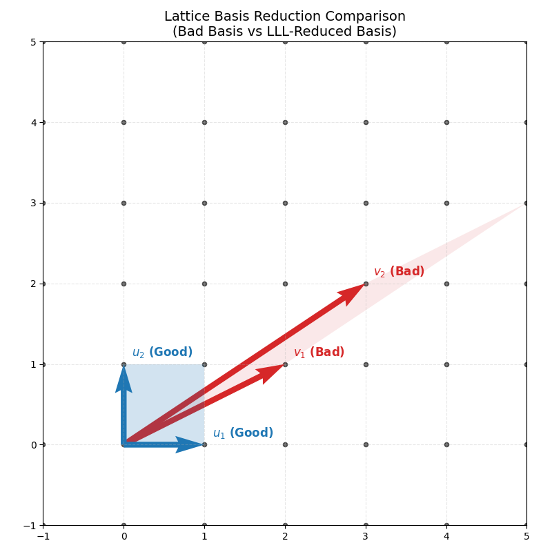

[상위 페이지 · Math](/study/algorithms/math/)

### 배경 지식

- [Shortest Vector Problem](/study/algorithms/math/shortest-vector-problem/)
- [행렬](/study/algorithms/math/haengryeol/)

## 1. 개요

## **1.1 LLL 알고리즘이란?**

Lenstra-Lenstra-Lovász (LLL) 알고리즘은 1982년 Arjen Lenstra, Hendrik Lenstra, László Lovász 세 명의 수학자가 개발한 알고리즘으로 격자의 기저를 짧고, 직교에 가깝게 변환해 주는 격자 기저 축소알고리즘이다.

쉽게 말해 LLL은 공간을 설명하는 더 좋고 효율적인 좌표축을 찾아주는 도구라고 할 수 있다.

## **1.2. 알고리즘의 탄생 배경**

이 알고리즘은 원래 암호학을 위해 만들어진 것이 아니다. 초기에는 유리수 계수 다항식의 인수분해를 효율적으로 수행하기 위한 중간 단계로 고안되었다. 하지만 이 알고리즘이 가진 강력한 성질 덕분에 이후 정수론, 최적화 문제, 그리고 암호학 전반에 큰 변화를 가져왔다.

격자에서 가장 짧은 벡터를 찾는 문제인 SVP (Shortest Vector Problem)는 풀기 매우 어려운 NP-hard 문제이다. 즉, 차원이 커질수록 완벽한 정답을 찾는 데 걸리는 시간이 기하급수적으로 늘어난다.

하지만 LLL 알고리즘은 타협점을 제시했다. 완벽하게 제일 짧은 벡터는 아니더라도, 충분히 짧은 벡터를 매우 빠르게 찾아다.

이것이 LLL의 핵심 가치이다. LLL은 최초로 다항 시간 안에 작동하는 격자 기저 축소 알고리즘으로서, 수학적으로 완벽한 최단 벡터보다는 조금 길지만, 실용적으로 사용하기엔 충분히 짧은 근사 해를 제공한다.

## 2. 격자 이론

## **2.1 격자의 정의**

격자란 유한 개의 기저 벡터들의 정수 선형결합으로 생성되는 이산적인 점들의 집합이다. 보다 엄밀하게 말하면 $$\mathbb{R}^m$$ 공간에서 선형독립인 기저 벡터 $$b_1, b_2, \ldots, b_n$$ (단, $$n \leq m$$)이 주어졌을 때 이들로 생성되는 격자 $$L$$은 다음과 같이 정의된다:

$$
L = \left\{ \sum_{i=1}^{n} x_i b_i \mid x_i \in \mathbb{Z} \right\}
$$

여기서 $$x_i$$는 정수 계수이며 이는 격자가 연속적인 공간이 아닌 이산적인 점들의 집합임을 의미한다. 기저 벡터들은 행렬 $$B = [b_1, \ldots, b_n]$$로 표현할 수 있으며, 격자의 차원은 $$n$$이고 격자가 놓인 공간의 차원은 $$m$$이다.

### **행렬 표현의 예시:**

2차원 평면에서 두 기저 벡터 $$b_1 = (3, 1)$$, $$b_2 = (1, 2)$$로 생성되는 격자를 생각해보자. 이를 행렬로 표현하면:

$$
B = \begin{bmatrix} 3 & 1 \\ 1 & 2 \end{bmatrix}
$$

이 격자의 점들은 $$x_1 \cdot (3, 1) + x_2 \cdot (1, 2)$$ 형태로 생성된다. 예를 들어, $$x_1 = 2, x_2 = -1$$일 때 격자점은 $$2(3,1) + (-1)(1,2) = (6,2) + (-1,-2) = (5,0)$$이 된다.

3차원 공간의 경우, 세 기저 벡터 $$b_1 = (2, 0, 1)$$, $$b_2 = (1, 3, 0)$$, $$b_3 = (0, 1, 2)$$로 생성되는 격자는 다음과 같이 표현된다:

$$
B = \begin{bmatrix} 2 & 1 & 0 \\ 0 & 3 & 1 \\ 1 & 0 & 2 \end{bmatrix}
$$

여기서 각 열이 하나의 기저 벡터를 나타낸다. 이러한 행렬 표현은 격자의 구조를 간결하게 나타내며, LLL 알고리즘이 행렬 연산을 통해 기저를 변환하는 방식을 이해하는 데 핵심적이다.

## **2.2 축차 최소값**

격자 $$L$$에서 $$i$$개의 선형 독립인 벡터들을 골랐을 때, 그중 가장 긴 벡터의 길이가 최소가 되게 하는 값을 $$i$$-번째 축차 최소값 $$\lambda_i(L)$$이라고 한다. 특히 $$\lambda_1(L)$$은 격자 안에 있는 0이 아닌 벡터 중 가장 짧은 벡터의 길이이다. LLL 알고리즘의 목표는 첫 번째 기저 벡터 $$\|b_1\|$$을 $$\lambda_1(L)$$에 최대한 가깝게 만드는 것이며, 이는 Minkowski의 정리와 연결된다.

### **축차 최소값의 예시**

2차원 격자에서 다음과 같은 기저를 생각해보자:

$$
B = \begin{bmatrix} 5 & 2 \\ 0 & 3 \end{bmatrix}
$$

이 격자에서 생성되는 벡터들 중 일부는:

- $$v_1 = (5, 0)$$, 길이 $$\|v_1\| = 5$$
- $$v_2 = (2, 3)$$, 길이 $$\|v_2\| = \sqrt{4 + 9} = \sqrt{13} \approx 3.61$$
- $$v_3 = (3, -3) = (5,0) - (2,3)$$, 길이 $$\|v_3\| = \sqrt{9 + 9} = 3\sqrt{2} \approx 4.24$$

이 중에서 $$v_2 = (2, 3)$$가 가장 짧은 0이 아닌 벡터이므로, $$\lambda_1(L) = \sqrt{13}$$이다.

LLL 알고리즘을 적용하면 기저 벡터들이 변환되어 더 짧고 균형 잡힌 형태가 된다. 예를 들어, $$b_1 = (5, 0)$$을 $$b_2 = (2, 3)$$ 방향으로 축소하면:

- 투영 계수: $$\mu_{1,2} = \frac{\langle b_1, b_2 \rangle}{\|b_2\|^2} = \frac{10}{13} \approx 0.77$$, 가장 가까운 정수는 1
- 축소 후: $$b_1' = b_1 - 1 \cdot b_2 = (5, 0) - (2, 3) = (3, -3)$$

이제 기저 벡터들을 길이 순으로 정렬하면:

$$
B' = \begin{bmatrix} 2 & 3 \\ 3 & -3 \end{bmatrix}
$$

여기서 $$b_1' = (2, 3)$$, $$b_2' = (3, -3)$$이다. 행렬식은 $$\det(B') = |2 \cdot (-3) - 3 \cdot 3| = |-15| = 15$$로 원래의 행렬식과 동일하게 보존되며 벡터들의 길이는 각각 $$\|b_1'\| = \sqrt{13} \approx 3.61$$, $$\|b_2'\| = \sqrt{18} \approx 4.24$$로 원래의 길이 5, $$\sqrt{13}$$보다 전체적으로 균형 잡히고 짧아진 것을 볼 수 있다. 이것이 LLL이 달성하고자 하는 목표이다.

## **2.3 기저와 행렬식**

격자의 중요한 특징 중 하나는 동일한 격자를 생성하는 기저가 무한히 많다는 점이다. 두 기저 $$B$$와 $$B'$$가 같은 격자를 생성한다면, 이들 사이에는 유니모듈러 행렬 $$U$$가 존재하여 $$B' = BU$$의 관계가 성립한다.

<aside markdown="1">
💡

**유니모듈러 행렬**

유니모듈러 행렬이란 정수 성분을 가지며 행렬식이 $$\pm 1$$인 행렬을 의미한다. 이러한 행렬은 격자 이론에서 매우 중요한 역할을 하는데, 그 이유는 유니모듈러 행렬을 이용한 기저 변환이 격자 자체를 변화시키지 않기 때문이다.

예를 들어, 다음과 같은 행렬들은 모두 유니모듈러 행렬이다:

$$
U_1 = \begin{bmatrix} 1 & 0 \\ 0 & 1 \end{bmatrix}, \quad U_2 = \begin{bmatrix} 1 & 2 \\ 0 & 1 \end{bmatrix}, \quad U_3 = \begin{bmatrix} 0 & 1 \\ -1 & 0 \end{bmatrix}
$$

유니모듈러 행렬의 중요한 성질은 다음과 같다:

- 행렬식이 $$\pm 1$$이므로 역행렬이 항상 존재하며, 역행렬 또한 정수 성분을 갖는다.
- 두 유니모듈러 행렬의 곱도 유니모듈러 행렬이다.
- 기저 행렬 $$B$$에 유니모듈러 행렬 $$U$$를 곱하면 $$B' = BU$$가 되는데, 이때 $$B$$와 $$B'$$는 동일한 격자를 생성한다.

따라서 LLL 알고리즘이 기저를 변환할 때 사용하는 정수 연산(벡터 간 덧셈과 뺄셈, 순서 교환)은 모두 유니모듈러 변환으로 표현될 수 있으며, 이는 알고리즘이 원래 격자의 구조를 보존하면서도 더 좋은 기저를 찾을 수 있음을 보장한다.

</aside>

격자의 행렬식 또는 부피는 기저의 선택과 무관한 격자의 고유한 성질이며, 다음과 같이 정의된다:

$$
\det(L) = \sqrt{\det(B^T B)}
$$

이는 기저 벡터들이 생성하는 평행육면체의 $$n$$차원 부피를 나타낸다. Hadamard 부등식에 의하면, 격자의 행렬식은 기저 벡터들의 길이의 곱보다 작거나 같다:

$$
\det(L) \leq \prod_{i=1}^{n} \|b_i\|
$$

등호는 기저 벡터들이 서로 직교할 때 성립한다. 이는 직교 기저가 가장 효율적인 기저임을 수학적으로 보여준다.

## **2.4 그람-슈미트 직교화**

그람-슈미트 직교화는 주어진 기저 벡터들을 서로 직교하는 벡터들의 집합으로 변환하는 과정이다. 기저 $$b_1, \ldots, b_n$$에 대해 직교화된 벡터 $$b_i^*$$는 다음과 같이 재귀적으로 정의된다:

$$
b_1^* = b_1
\\
b_i^* = b_i - \sum_{j=1}^{i-1} \mu_{i,j} b_j^*\quad (for \ i=2, \dots, n)
$$

여기서 그람-슈미트 계수 $$\mu_{i,j}$$는 다음과 같이 계산된다:

$$
\mu_{i,j} = \frac{\langle b_i, b_j^* \rangle}{\langle b_j^*, b_j^* \rangle} = \frac{\langle b_i, b_j^* \rangle}{\|b_j^*\|^2}
$$

이 계수는 벡터 $$b_i$$를 $$b_j^*$$ 방향으로 정규화한 정사영의 크기를 나타낸다. 그람-슈미트 직교화를 통해 얻은 $$b_i^*$$들은 서로 직교하며, 원래 기저가 생성하는 부분공간과 동일한 공간을 생성한다.

### **행렬식과 그람-슈미트 벡터의 관계**

격자의 행렬식은 그람-슈미트 직교화된 벡터들의 길이의 곱과 정확히 일치한다:

$$
\det(L) = \prod_{i=1}^{n} \|b_i^*\|
$$

이 공식은 LLL 알고리즘의 종료 조건을 증명할 때 사용하는 포텐셜 함수를 이해하는 데 필수적이다. Hadamard 부등식에 의해 $$\det(L) \leq \prod \|b_i\|$$이고, $$\det(L) = \prod \|b_i^*\|$$이므로, 결국 우리의 목표는 $$\|b_i\|$$를 $$\|b_i^*\|$$에 최대한 가깝게 만드는 것임이 수학적으로 명확해진다. 이 식은 LLL이 왜 길이를 줄이는지 설명하는 가장 강력한 연결 고리이다.

### **구체적인 예시**

2차원 격자에서 기저가 $$b_1 = (6, 2)$$, $$b_2 = (3, 5)$$라고 가정해보자.

**원래 기저 벡터의 길이:**

- $$\|b_1\| = \sqrt{36 + 4} = \sqrt{40} \approx 6.32$$
- $$\|b_2\| = \sqrt{9 + 25} = \sqrt{34} \approx 5.83$$
- 길이의 곱: $$6.32 \times 5.83 \approx 36.8$$

**그람-슈미트 직교화 후:**

- $$b_1^* = (6, 2)$$
- $$\mu_{2,1} = \frac{\langle b_2, b_1^* \rangle}{\|b_1^*\|^2} = \frac{18 + 10}{40} = 0.7$$
- $$b_2^* = b_2 - \mu_{2,1} b_1^* = (3, 5) - 0.7(6, 2) = (-1.2, 3.6)$$
- $$\|b_1^*\| = \sqrt{40} \approx 6.32$$
- $$\|b_2^*\| = \sqrt{1.44 + 12.96} = \sqrt{14.4} \approx 3.79$$
- 길이의 곱: $$6.32 \times 3.79 \approx 24.0$$

**해석:**

- **원래 기저:** 길이의 곱이 36.8로 크지만, 벡터들이 비스듬함
- **직교화 후:** 길이의 곱이 24.0으로 줄어들고, 벡터들이 수직에 가까움
- **격자의 행렬식:** $$\det(L) = 24.0$$은 기저 선택과 무관하게 동일

이 예시는 Hadamard 부등식이 실제로 어떻게 작동하는지 보여준다. 원래 기저의 길이 곱(36.8)이 격자의 행렬식(24.0)보다 크며, 직교화된 기저의 길이 곱이 정확히 행렬식과 일치한다. 따라서 $$\|b_i\|$$를 $$\|b_i^*\|$$에 가깝게 만드는 것이 효율적인 기저를 찾는 핵심임을 알 수 있다.

**문제점:** 그람-슈미트 직교화의 가장 큰 문제는 원래 기저가 정수 벡터로 구성되어 있더라도, 직교화 과정에서 유리수 또는 실수 계수가 등장하여 결과 벡터 $$b_i^*$$가 더 이상 격자점이 아니게 된다는 점이다. 위 예시에서 $$b_2^* = (-1.2, 3.6)$$는 정수 좌표가 아니므로 실제 격자의 기저로 사용할 수 없다.

LLL 알고리즘은 바로 이 문제를 해결하기 위해 고안되었다. LLL은 그람-슈미트 직교화의 결과를 직접 사용하는 대신, 정수 연산만을 사용하여 그람-슈미트 직교 기저에 가까운 기저를 격자 내에서 찾아내는 과정이라고 할 수 있다. 

위 예시에서 LLL을 적용하면 $$b_1' = (2, 3)$$, $$b_2' = (4, -1)$$와 같은 정수 벡터로 이루어진 더 좋은 기저를 얻을 수 있다. 즉, LLL은 직교성과 짧은 길이라는 이상적인 성질을 정수 제약 조건 하에서 근사적으로 달성하는 알고리즘이다.

## 3. LLL 축소의 정의

LLL 축소는 주어진 격자 기저를 좋은 기저로 변환하는 과정을 수학적으로 정의한 것이다. 여기서 좋은 기저란 벡터들이 짧고 서로 거의 직교에 가까운 기저를 의미한다.

## 3.1 목표

LLL 알고리즘의 목표는 **나쁜 기저를 좋은 기저로 변환**하는 것이다.



**나쁜 기저의 특징:**

- 벡터들의 길이가 길다
- 벡터들이 서로 찌그러져 있다 (거의 평행에 가깝다)
- 그람-슈미트 직교화를 적용했을 때 원래 벡터와 직교화된 벡터의 길이 차이가 크다

**좋은 기저의 특징:**

- 벡터들의 길이가 짧다
- 벡터들이 서로 직교에 가깝다
- 그람-슈미트 직교화를 적용했을 때 원래 벡터와 직교화된 벡터의 길이가 비슷하다

이러한 목표를 달성하기 위해 LLL 알고리즘은 두 가지 핵심 조건을 사용한다.

## 3.2 두 가지 핵심 조건

LLL 축소된 기저는 다음 두 가지 조건을 동시에 만족해야 한다. 이 조건들은 각각 기저의 직교성과 길이 최적화를 보장한다.

### 3.2.1 크기 조건

그람-슈미트 계수 $$\mu_{i,j}$$의 절대값이 0.5 이하여야 한다.

$$
|\mu_{i,j}| \leq \frac{1}{2} \quad \text{for all } 1 \leq j < i \leq n
$$

이 조건은 각 기저 벡터 $$b_i$$가 이전 벡터들의 그람-슈미트 직교화 $$b_j^*$$에 너무 많이 기대어 있지 않다는 것을 보장한다.

**기하학적 해석:**

- 그람-슈미트 계수 $$\mu_{i,j} = \frac{\langle b_i, b_j^* \rangle}{\|b_j^*\|^2}$$는 벡터 $$b_i$$를 $$b_j^*$$ 방향으로 정사영한 크기를 나타낸다.
- 만약 $$|\mu_{i,j}| > 0.5$$라면, $$b_i$$가 $$b_j^*$$ 방향으로 너무 많이 튀어나와 있다는 의미이다.
- 이 경우 $$b_i$$에서 적절한 정수 배의 $$b_j$$를 빼줌으로써 $$|\mu_{i,j}| \leq 0.5$$를 만족시킬 수 있다.

**예시:**

2차원 격자에서 $$b_1 = (3, 1)$$, $$b_2 = (7, 3)$$이라고 하자.

- $$b_1^* = (3, 1)$$
- $$\mu_{2,1} = \frac{\langle b_2, b_1^* \rangle}{\|b_1^*\|^2} = \frac{21 + 3}{9 + 1} = \frac{24}{10} = 2.4$$
- $$|\mu_{2,1}| = 2.4 > 0.5$$이므로 크기 조건을 위반한다.
- **축소 과정:** $$b_2' = b_2 - \lfloor \mu_{2,1} \rceil b_1 = (7, 3) - 2 \cdot (3, 1) = (1, 1)$$
- 새로운 $$\mu_{2,1}' = \frac{\langle (1,1), (3,1) \rangle}{10} = \frac{4}{10} = 0.4 \leq 0.5$$

크기 조건은 기저 벡터들이 서로 **직교에 가깝게** 만들어지도록 한다. 이는 Hadamard 부등식에서 등호에 가까워지도록 하는 효과가 있다.

### 3.2.2 로바스 조건

연속된 두 벡터의 그람-슈미트 직교화 결과가 급격하게 짧아지지 않도록 보장하는 조건이다.

$$
\delta \|b_{k-1}^*\|^2 \leq \|b_k^* + \mu_{k,k-1} b_{k-1}^*\|^2 \quad \text{for all } 2 \leq k \leq n
$$

여기서 $$\delta$$는 **감쇠 인자**로 일반적으로 $$\delta = \frac{3}{4}$$를 사용한다.

이 조건은 $$k$$번째 벡터의 직교 성분이 $$k-1$$번째 벡터의 직교 성분보다 너무 짧아지지 않도록 제한한다.

**수식 해석:**

로바스 조건의 우변 $$\|b_k^* + \mu_{k,k-1} b_{k-1}^*\|^2$$은 다음과 같이 전개된다:

$$
\|b_k^* + \mu_{k,k-1} b_{k-1}^*\|^2 = \|b_k^*\|^2 + 2\mu_{k,k-1} \langle b_k^*, b_{k-1}^* \rangle + \mu_{k,k-1}^2 \|b_{k-1}^*\|^2
$$

그람-슈미트 직교화의 정의에 의해 $$b_k^*$$와 $$b_{k-1}^*$$는 서로 직교하므로 $$\langle b_k^*, b_{k-1}^* \rangle = 0$$이다. 따라서:

$$
\|b_k^* + \mu_{k,k-1} b_{k-1}^*\|^2 = \|b_k^*\|^2 + \mu_{k,k-1}^2 \|b_{k-1}^*\|^2
$$

로바스 조건은 다음과 같이 쓸 수 있다:

$$
\delta \|b_{k-1}^*\|^2 \leq \|b_k^*\|^2 + \mu_{k,k-1}^2 \|b_{k-1}^*\|^2
$$

이를 정리하면:

$$
\|b_k^*\|^2 \geq (\delta - \mu_{k,k-1}^2) \|b_{k-1}^*\|^2
$$

**기하학적 해석:**

- 만약 $$\|b_k^*\|$$가 $$\|b_{k-1}^*\|$$보다 너무 작다면, 두 벡터의 순서를 바꾸는 것이 더 효율적일 수 있다.
- 로바스 조건이 위반되면 $$b_k$$와 $$b_{k-1}$$의 순서를 교환한다.
- 이 교환 과정을 통해 더 짧은 벡터가 앞쪽으로 이동하게 된다.

**예시:**

$$\delta = 3/4$$를 사용하고, 크기 조건이 이미 만족된 상태에서:

- $$\|b_1^*\| = 10$$, $$\|b_2^*\| = 3$$, $$\mu_{2,1} = 0.4$$라고 하자.
- 로바스 조건 확인: $$\frac{3}{4} \cdot 100 = 75 \leq 9 + 0.16 \cdot 100 = 25$$?
- $$75 \not\leq 25$$이므로 로바스 조건을 위반한다.
- **교환 과정:** $$b_1$$과 $$b_2$$의 순서를 바꾼다.
- 교환 후 더 짧은 벡터가 먼저 오게 되어 전체 기저의 품질이 향상된다.

**감쇠 인자 $$\delta$$의 역할:**

- $$\delta = 1$$: 가장 엄격한 조건. 완전히 직교하는 기저를 요구하지만, 정수 격자에서는 달성 불가능할 수 있다.
- $$\delta = 3/4$$: 표준 선택. 이론적 보장과 실용성 사이의 균형을 제공한다.
- $$\delta = 1/4$$: 약한 조건. 알고리즘이 더 빨리 종료되지만 기저의 품질이 낮아진다.

로바스 조건은 기저 벡터들의 **길이를 최적화**하는 역할을 한다. 더 짧은 벡터를 앞쪽에 배치함으로써 첫 번째 벡터가 격자의 최단 벡터에 가깝도록 만든다.

### 3.2.3 두 조건의 상호작용

크기 조건과 로바스 조건은 서로 협력하여 작동한다:

- **크기 조건:** 벡터들을 서로 직교에 가깝게 만든다 (방향 최적화)
- **로바스 조건:** 벡터들의 길이를 최소화한다 (크기 최적화)

LLL 알고리즘은 이 두 조건을 반복적으로 만족시키는 과정을 통해, Hadamard 부등식에서 $$\prod \|b_i\|$$를 $$\prod \|b_i^*\| = \det(L)$$에 최대한 가깝게 만든다. 이는 기저가 최적에 가까워졌음을 의미한다.

**종료 보장:** 이 두 조건을 만족하는 기저를 **LLL 축소된 기저**라고 부르며, LLL 알고리즘은 다항 시간 내에 반드시 이러한 기저를 찾아낸다는 것이 증명되어 있다.

## 4. 알고리즘 동작 원리

LLL 알고리즘의 동작 원리는 크게 세 가지 핵심 단계로 구성된다: **그람-슈미트 계수 계산**, **축소** , 그리고 **교환** 이다. 이 세 단계를 반복적으로 수행하면서 기저를 점진적으로 개선해 나간다.

## 4.1 기본 흐름

LLL 알고리즘은 다음과 같은 순서로 동작한다:

### 4.1.1 그람-슈미트 계수 계산

먼저 현재 기저 벡터들에 대해 그람-슈미트 직교화를 수행하고, 이를 통해 **뮤 계수** $$\mu_{i,j}$$를 계산한다.

**계산 과정:**

1. 각 기저 벡터 $$b_i$$에 대해 그람-슈미트 직교 벡터 $$b_i^*$$를 계산한다:
    
    $$
    b_i^* = b_i - \sum_{j=1}^{i-1} \mu_{i,j} b_j^*
    $$
    
2. 뮤 계수를 다음과 같이 계산한다:
    
    $$
    \mu_{i,j} = \frac{\langle b_i, b_j^* \rangle}{\|b_j^*\|^2}
    $$
    

이 계수들은 크기 조건과 로바스 조건을 확인하는 데 사용된다.

**예시:**

기저 $$b_1 = (3, 1)$$, $$b_2 = (7, 3)$$에 대해:

- $$b_1^* = (3, 1)$$
- $$\mu_{2,1} = \frac{\langle (7,3), (3,1) \rangle}{\|(3,1)\|^2} = \frac{24}{10} = 2.4$$
- $$b_2^* = (7,3) - 2.4 \cdot (3,1) = (-0.2, -0.4)$$

### 4.1.2 축소 단계

크기 조건 $$|\mu_{i,j}| \leq 0.5$$를 만족시키기 위해 기저 벡터들을 조정한다.

**동작 원리:**

만약 $$|\mu_{k,k-1}| > 0.5$$이면, 벡터 $$b_k$$에서 $$b_{k-1}$$의 적절한 배수를 빼서 크기를 줄인다. 이는 정수 연산으로 수행되며, 격자의 구조를 유지한다.

**수식:**

$$
b_k \leftarrow b_k - \lfloor \mu_{k,k-1} + 0.5 \rfloor \cdot b_{k-1}
$$

여기서 $$\lfloor \mu_{k,k-1} + 0.5 \rfloor$$는 $$\mu_{k,k-1}$$를 가장 가까운 정수로 반올림한 값이다.

**단계별 예시:**

위의 예시에서 $$\mu_{2,1} = 2.4$$이므로:

1. $$|\mu_{2,1}| = 2.4 > 0.5$$이므로 축소가 필요하다
2. 계수를 계산한다: $$\lfloor 2.4 + 0.5 \rfloor = \lfloor 2.9 \rfloor = 2$$
3. 축소를 수행한다: $$b_2 \leftarrow (7,3) - 2 \cdot (3,1) = (1,1)$$
4. 새로운 $$\mu_{2,1}$$을 계산한다: $$\mu_{2,1}' = \frac{\langle (1,1), (3,1) \rangle}{10} = \frac{4}{10} = 0.4 \leq 0.5$$ ✓

**기하학적 의미:**

축소 단계는 벡터들을 서로 직교에 가깝게 만드는 역할을 한다. 마치 평행사변형의 모양을 더 직사각형에 가깝게 변형하는 것과 같다. 이는 하다마르 부등식의 등호 조건에 가까워지도록 하는 효과가 있다.

**일반화:**

실제 알고리즘에서는 벡터 $$b_k$$를 이전의 모든 벡터 $$b_1, b_2, \ldots, b_{k-1}$$에 대해 축소한다. 즉, 역순으로 $$j = k-1, k-2, \ldots, 1$$에 대해 다음을 수행한다:

$$
b_k \leftarrow b_k - \lfloor \mu_{k,j} + 0.5 \rfloor \cdot b_j
$$

### 4.1.3 교환 단계

로바스 조건을 만족시키기 위해 인접한 두 벡터의 순서를 바꾼다.

**로바스 조건 검사:**

각 인덱스 $$k$$에 대해 다음 조건을 확인한다:

$$
\delta \|b_{k-1}^*\|^2 \leq \|b_k^* + \mu_{k,k-1} b_{k-1}^*\|^2
$$

그람-슈미트 직교화의 성질에 의해 이는 다음과 같이 단순화된다:

$$
	\delta \|b_{k-1}^*\|^2 \leq \|b_k^*\|^2 + \mu_{k,k-1}^2 \|b_{k-1}^*\|^2
$$

**조건 위반 시:**

위 조건이 만족되지 않으면 $$b_k$$와 $$b_{k-1}$$의 순서를 교환한다. 이는 더 짧은 벡터를 앞으로 이동시켜 전체 기저의 품질을 향상시킨다.

**예시:**

$$\delta = 3/4$$를 사용하고, 크기 조건이 이미 만족된 상태에서:

- $$\|b_1^*\|^2 = 100$$, $$\|b_2^*\|^2 = 9$$, $$\mu_{2,1} = 0.4$$라고 가정하자
- 로바스 조건을 확인한다:
    
    $$
    \frac{3}{4} \cdot 100 = 75 \stackrel{?}{\leq} 9 + 0.16 \cdot 100 = 25
    $$
    
- $$75 \not\leq 25$$이므로 조건을 위반한다
- 따라서 $$b_1$$과 $$b_2$$의 순서를 교환한다
- 교환 후 더 짧은 벡터가 먼저 오게 되어 기저의 품질이 개선된다

**교환 후 처리:**

벡터의 순서가 바뀌면 그람-슈미트 계수들도 다시 계산해야 한다. 특히 교환된 위치 주변의 계수들이 영향을 받는다. 또한 인덱스 $$k$$를 하나 감소시켜 이전 위치로 돌아가서 다시 검사한다.

### 4.1.4 전체 알고리즘 흐름

LLL 알고리즘은 다음과 같은 순서로 진행된다:

1. $$k = 2$$부터 시작한다 → 첫 번째 벡터는 이미 축소되어 있다고 가정
2. 벡터 $$b_k$$를 모든 이전 벡터들에 대해 축소한다
3. 로바스 조건을 확인한다:
    - 조건이 만족되면: $$k \leftarrow k + 1$$로 다음 벡터로 이동
    - 조건이 위반되면: $$b_k$$와 $$b_{k-1}$$을 교환하고 $$k \leftarrow \max(k-1, 2)$$로 돌아간다
4. $$k > n$$이 되면 종료한다

**의사 코드:**

```python
def LLL(B, delta=3/4):
    n = len(B)
    B_star, mu = gram_schmidt(B)  # 그람-슈미트 직교화
    
    k = 1
    while k < n:
        # 축소 단계
        for j in range(k-1, -1, -1):
            if abs(mu[k][j]) > 0.5:
                B[k] = B[k] - round(mu[k][j]) * B[j]
                # 계수 재계산
                update_coefficients(k, j)
        
        # 로바스 조건 검사
        if delta * norm_sq(B_star[k-1]) <= norm_sq(B_star[k]) + mu[k][k-1]**2 * norm_sq(B_star[k-1]):
            k += 1
        else:
            # 교환
            B[k], B[k-1] = B[k-1], B[k]
            # 계수 재계산
            update_gram_schmidt(k-1, k)
            k = max(k-1, 1)
    
    return B

```

## 4.2 종료 조건 및 복잡도

### 4.2.1 종료 보장

LLL 알고리즘이 유한 시간 내에 종료된다는 것을 증명하기 위해 **포텐셜 함수**를 사용한다.

**포텐셜 함수의 정의:**

$$
\Phi(B) = \prod_{i=1}^{n} \|b_i^*\|^{2(n-i+1)}
$$

이 함수는 다음과 같은 성질을 가진다:

- **양의 정수 값:** 정수 격자에서 $$\Phi(B)$$는 항상 양의 정수이다
- **하한 존재:** $$\Phi(B) \geq 1$$이므로 무한히 감소할 수 없다
- **단조 감소:** 교환이 일어날 때마다 $$\Phi(B)$$가 감소한다

**핵심 증명 아이디어:**

1. 축소 단계는 $$\Phi(B)$$를 변화시키지 않는다 (격자의 부피는 불변)
2. 교환 단계는 로바스 조건 위반 시에만 발생하며, 이때 $$\Phi(B)$$가 엄격히 감소한다
3. $$\Phi(B)$$는 양의 정수이고 하한이 있으므로, 교환은 유한 번만 일어날 수 있다
4. 따라서 알고리즘은 반드시 종료한다

**교환 시 포텐셜 감소량:**

로바스 조건이 위반되어 교환이 일어나면:

$$
\Phi_{\text{new}} \leq \left(\frac{4}{4\delta - 1}\right)^{n-k+1} \Phi_{\text{old}}
$$

$$\delta = 3/4$$일 때 $$\frac{4}{4\delta - 1} = 2$$이므로, 포텐셜이 최대 $$2^{-(n-k+1)}$$배로 줄어든다.

### 4.2.2 시간 복잡도

LLL 알고리즘의 시간 복잡도는 기저의 차원 $$n$$과 입력 벡터 성분의 비트 길이 $$B$$에 의존한다.

**상세 분석:**

- **교환 횟수:** 포텐셜 함수 분석에 의해 최대 $$O(n^2 B)$$번의 교환이 일어난다
- **각 반복의 비용:** 그람-슈미트 계수 계산 및 업데이트에 $$O(n^2)$$의 산술 연산이 필요하다
- **산술 연산 비용:** 정수의 비트 길이가 $$O(nB)$$이므로, 각 산술 연산은 $$O((nB)^2)$$ 시간이 소요된다

**전체 시간 복잡도:**

$$
O(n^2 B) \times O(n^2) \times O((nB)^2) = O(n^6 B^3 \log^3 B)
$$

더 정확히는 다음과 같이 표현된다:

$$
O(n^4 \log B) \text{ (산술 연산 횟수)} \times O(n^2 B^2) \text{ (각 연산 비용)}
$$

**실용적 복잡도:**

- 일반적인 경우 평균 복잡도는 이론적 상한보다 훨씬 좋다
- 차원이 작을 때 ($$n \leq 100$$) 매우 빠르게 동작한다
- 현대적 구현(예: fplll 라이브러리)은 다양한 최적화 기법을 사용한다

### 4.2.3 출력 품질 보장

LLL 알고리즘이 출력하는 기저는 다음과 같은 품질 보장을 제공한다:

**첫 번째 벡터의 길이:**

$$
\|b_1\| \leq 2^{(n-1)/2} \cdot \lambda_1(L)
$$

여기서 $$\lambda_1(L)$$은 격자 $$L$$의 실제 최단 벡터 길이이다.

**기저의 직교성:**

$$
\prod_{i=1}^{n} \|b_i\| \leq 2^{n(n-1)/4} \cdot \det(L)
$$

이는 LLL 축소된 기저가 하다마르 부등식의 등호 조건에 지수적으로 가깝다는 것을 의미한다.

**연속 최소값 근사:**

더 일반적으로, LLL 기저의 처음 $$k$$개 벡터는 격자의 처음 $$k$$개 연속 최소값에 대한 좋은 근사를 제공한다.

## 5. 성능 한계와 개선

LLL 알고리즘의 성능에는 한계가 있으며, 이를 극복하기 위한 다양한 변형 알고리즘들이 개발되었다.

## 5.1. LLL의 한계

- **지수적 근사 비율:** 차원이 증가함에 따라 근사 비율이 지수적으로 증가하므로, 매우 높은 차원에서는 실제 최단 벡터와의 차이가 클 수 있다
- **첫 번째 벡터만 보장:** LLL은 주로 첫 번째 기저 벡터의 품질만 보장한다. 나머지 벡터들은 상대적으로 덜 최적화될 수 있다
- **로바스 조건의 약함:** δ = 3/4는 빠른 실행을 위한 선택이지만, 더 강한 조건(δ → 1)을 사용하면 더 나은 기저를 얻을 수 있다 (단, 실행 시간 증가)

## 5.2. 개선된 알고리즘

- **BKZ (Block Korkine-Zolotarev):** LLL을 일반화한 알고리즘으로, 블록 단위로 더 강력한 축소를 수행한다. 근사 비율이 $$n^{n/k}$$ 정도로 개선되지만, 실행 시간이 증가한다
- **HKZ (Hermite-Korkine-Zolotarev):** 가장 강력한 축소 기준으로, 거의 최적에 가까운 기저를 제공하지만, 지수 시간이 소요된다
- **LLL with deep insertions:** 교환 시 더 깊은 위치까지 고려하여 품질을 개선한다

실무에서는 문제의 특성과 시간 제약에 따라 적절한 알고리즘을 선택한다. 많은 경우 LLL만으로도 충분하며, 더 강력한 알고리즘이 필요할 때는 LLL을 전처리 단계로 사용한 후 BKZ나 다른 알고리즘을 적용한다.
