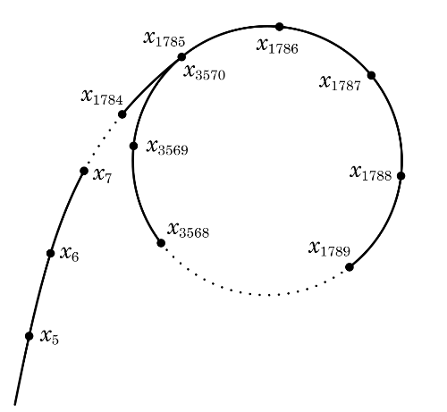

[상위 페이지 · Math](/study/algorithms/math/)

## 선행지식

- 정수론의 기본 개념 이해
    - 최대공약수(GCD)와 모듈러 연산
    - 소수와 합성수의 개념
- 확률론적 알고리즘의 이해
    - 랜덤성과 결정론적 함수의 차이
- 그래프 이론의 기초
    - 순환(cycle) 개념
    - 플로이드의 순환 찾기 알고리즘
- 비둘기집 원리의 이해

## 기본 개념

폴라드-로 알고리즘은 존 폴라드가 1975년에 고안한 정수 인수분해 알고리즘이다. 순환고리 형태의 그래프가 로마자 문자 'ρ'와 비슷한 모양을 만들어내어 이러한 이름이 붙었다. 이는 합성수의 인수를 효율적으로 찾아내는 데 사용되는 확률적 알고리즘이다.

## 설명

폴라드 로 알고리즘은 2부터 N 사이의 랜덤한 수 x를 선택하여 N과의 공통 인수를 찾는 방법으로, $$gcd(x,N) \not\equiv 1(mod\ N)$$인 성질을 활용한다.

이 알고리즘이 효과적으로 작동하기 위해서는 두 가지 전제 조건이 필요하다:

1. N이 짝수가 아닐 것. N이 짝수라면 소인수 2가 존재하므로 알고리즘을 사용할 필요 없이 2를 반환하면 된다.
2. N이 소수가 아닐 것. N이 소수인 경우 모든 x에 대해 $$gcd(x,N) \equiv 1(mod\ n)$$이 성립한다.

따라서 밀러-라빈 알고리즘을 사용하여 N이 소수인 경우를 먼저 확인한다.

단순히 2부터 N 사이의 무작위 수를 선택하면 편향이 발생하거나 약수를 찾기 어려울 수 있다.

이러한 문제를 해결하기 위해 $$f(x) = x^2 + c\ mod\ N$$를 사용하여 x값을 결정한다.

<aside markdown="1">
💡

왜 $$f(x) = x^2 + c\ mod\ N$$를 사용하는가?

1. 꼭 $$f(x) = x^2 + c\ mod\ N$$만 사용해야 하는 것은 아니다. $$f(x) = x^2 + x + c\ mod\ N$$도 가능하다. 하지만 $$f(x) = x^2 + c\ mod\ N$$를 선호하는 이유는 다음과 같다:
    1. 계산이 가장 단순함
    2. 제곱 연산과 상수항 c로 인해 결정론적 함수이면서도 충분한 랜덤 효과를 낼 수 있음
2. 왜 1차함수는 안되는가?
    1. 주기가 너무 규칙적이게 됨
    2. 랜덤성이 약해짐
3. 그냥 랜덤을 사용하면 안되는가?
    1. 이러한 f(x)를 사용하면 mod N의 값이 고르게 분포되며, 값은 무작위적이지만 일정한 규칙성을 가진다. 따라서 이미 확인한 경우를 다시 확인할 확률이 낮아진다.
</aside>

<aside markdown="1">
💡

추가적인 정보(1) 비둘기집 원리

만약 비둘기집이 23개 있고 비둘기가 24마리라면, 두 마리가 들어간 집이 반드시 존재할까?

답은 "반드시 존재한다"이다. 비둘기를 집당 한 마리씩 배정해도 한 마리가 남기 때문에, 그 비둘기는 어느 한 집에 들어갈 수밖에 없다.

이는 자명해 보이지만, 확률론에서 매우 중요한 원리이다.

</aside>

<aside markdown="1">
💡

추가적인 정보(2) 모듈러 산술의 기본 성질

모듈러 산술에서는 다음과 같은 성질이 있음.

$$
if\ N|d
\\
a \equiv b(mod\ N) \to a \equiv b(mod\ d)
$$

</aside>

이제 $$f(x) = x^2 + c\ mod\ N$$가 훌륭한 유사 난수 수열 생성기임을 알 수 있다. 비둘기집 원리에 따라 N의 약수 d에 대해 $$a_n$$ mod d는 반드시 사이클을 가지게 된다. 쉽게 말해 f(x) mod N 안에 f(x) mod d의 사이클도 돌고 있는것이다.

따라서 $$a_n\ mod\ d \to a_{n+1}\ mod\ d$$로 향하는 화살표를 그리면 아래와 같은 그래프가 형성된다.



이 그래프가 그리스 문자 로(ρ)와 닮았기에 폴라드 로 알고리즘이라고 명명되었다.

N|d에 대해 수열이 순환할 때, 어떤 두 정수 x, y에 대해 $$a_x \equiv a_y (mod\ d)$$가 성립하는 구간이 존재한다. 이는 곧 $$gcd(a_x - a_y, N) ≠ 1$$을 의미하며, $$gcd(a_x - a_y, N)$$이 N의 인수가 된다.

<aside markdown="1">
💡

$$a_x - a_y \equiv 0 \pmod{d}$$는 $$a_x - a_y$$가 인수 d의 배수라는 의미이다.

$$a_x - a_y$$와 N의 최대공약수를 구하면 d의 배수와 N의 공통 인수인 d를 얻을 수 있다.

이렇게 인수 d를 간접적으로 구하는 이유는 d의 값을 모르기 때문에 $$x^2 + c \pmod{d}$$를 직접 계산할 수 없기 때문이다. 대신 $$x^2 + c \pmod{N}$$ 상에서 계산된 값들이 특정 시점에 충돌할 수 있으므로, $$f(x) - f(f(x))$$의 차이를 이용하여 d를 찾는다.

</aside>

이제 우리의 목표는 $$a_x \equiv a_y (mod\ d)$$를 만족하는 두 정수 x, y를 찾는 것이다. 이는 순환 그래프에서 충돌이 발생했다는 의미이며, 이 충돌을 감지하면 두 정수 x, y를 구할 수 있다. 이를 위해 플로이드 순환 알고리즘을 사용하는데, x = f(x), y = f(f(y))로 설정하여 순환을 찾는다. 즉, x는 한 칸씩, y는 두 칸씩 이동하는 방식이다.

<aside markdown="1">
💡

플로이드 순환 알고리즘을 사용하는 이유

1. 같은 위치에서 출발하는 토끼(속도 2)와 거북이(속도 1)는 매 시행마다 1칸씩 멀어진다. 하지만 사이클이 존재하면 토끼가 거북이보다 뒤에 있게 되어, 매 시행마다 1칸씩 가까워진다. 따라서 두 포인터는 반드시 만나게 되어 충돌 감지가 보장된다.
2. 구현이 단순
3. 메모리 효율이 좋음 → 복잡한 로직이나 자료구조가 불필요
</aside>

만약 $$gcd(a_x - a_y, N)$$의 값이 1이 아니라면 이는 N의 비자명한 약수, 즉 인수를 찾은 것이고, $$gcd(a_x - a_y, N)$$의 값이 1이 나왔다면 이는 $$a_x \equiv a_y (mod\ n)$$에서 충돌이 일어났다는 뜻이다. 이는 곧 자명한 인수를 발견하지 못했다는 의미이므로 x와 상수항 c를 다시 선택하면 된다.

이 알고리즘은 소인수가 아닌 일반적인 인수를 찾는 것이다. $$gcd(a_x - a_y, N)$$의 값이 합성수이고 소인수를 찾고자 한다면, $$gcd(a_x - a_y, N)$$의 값을 다시 폴라드 로 알고리즘에 입력하여 소수가 나올 때까지 인수분해를 반복한다.

 $$gcd(a_x - a_y, N) = d$$로 두었을 때 d는 N의 약수이므로 $$gcd(a_x - a_y, d)$$의 인수 또한 N의 약수이다

## 구현

```python
import math
import random
import heapq

n = int(input())
basic_primes = {2, 3, 5, 7, 11, 13, 17, 19, 23, 29, 31, 37, 41}

def power(x, y, p):
    res = 1
    x = x % p
    while y > 0:
        if y & 1:  # y가 홀수면
            res = res * x % p  # x와 곱하고 나머지 연산
        # y가 짝수이면
        y = y >> 1  # y /= 2
        x = (x * x) % p  # 거듭제곱 계산
    return res

# 밀러-라빈 판정
def miller_rabin(n, a):
    d = n - 1  # 홀수
    while d % 2 == 0:
        d //= 2  # 2^d*r+1

    x = power(a, d, n)  # a^{d} % n 계산

    if x == 1 or x == n - 1:  # x가 1 또는 n-1이면 소수
        return True
    while d != n - 1:  # n-1이 아닌 동안
        x = power(x, 2, n)  # x^{2} % n 계산
        d *= 2
        # x가 1이면 합성수이고 아니면 소수
        if x == 1:
            return False
        if x == n - 1:
            return True
    return False

def isPrime(n):
    if n in basic_primes:  # 기본적으로 소수인 경우
        return True
    if n == 1 or n % 2 == 0:  # 1과 2의 배수는 소수가 아님
        return False
    for a in basic_primes:
        # long long 범위는 2, 3, 5, 7, 11, 13, 17, 19, 23, 29, 31, 37, 41의 소수로 검사.
        # 37까지만 검사해도 됨
        # 성립하지 않아 false를 반환하면 아마도 소수가 아님 (not False = True)
        if not miller_rabin(n, a):
            return False

    return True

def f(x,c,n):
    return (x**2 + c) % n

def pollads_ro(n):
    # 1은 소수가 아님
    if n == 1:
        return 1
    # 2를 제외한 모든 짝수는 합성수에 해당
    if n % 2 == 0:
        return 2
    # 이미 소수라면 소인수에 해당 or N이 소수라면 자기 자신만이 소인수에 해당함.
    if isPrime(n):
        return n
    x = random.randrange(2,n)
    c = random.randrange(1,n)
    y = x
    g = 1
    # gcd != 1 소인수일 가능성이 있음
    # gcd(x-y,n) = gcd(30,81) = 3 즉 결정론적인 함수를 돌아서 나온 함숫값하고 최대공약수를 뽑았을 때
    # gcd 값이 1이 아니면 어쨋든 gcd 값인 인수는 있다는것 이게 소수이면 소인수
    while g == 1:
        # 폴라드 로의 자명한 결정론적 함수(x^2 + c)로 두개의 포인터 생성
        # x는 f(x) y=f(f(y)) 이렇게하면 속도가 다른 두개의 포인터가 사이클이 있는 결정론적 함수를 돌게 됨
        # 모듈러 n만 보고 있지만 이는 위에서 설명한 모듈러 d도 내포하고 있는것
        x = f(x,c,n)
        y = f(f(y,c,n),c,n)
        g = math.gcd(x-y,n)
        # g == n이라는 뜻은 x == y 라는뜻 두개의 포인터가 충돌했다는 뜻은 아마도 소인수에 해당하는 부분이 없다는것
        # 다시 폴라드-로 알고리즘을 돌 것
        if g == n:
            return pollads_ro(n)
    # 만약 g의 값이 소수가 아니라면 소인수는 아님으로 폴라드-로 알고리즘을 g의 값으로 다시 돌기
    # g가 N의 약수임으로 g의 약수 또한 N의 약수임
    if not isPrime(g):
        return pollads_ro(g)
    return g

factor = []
while n > 1:
    p = pollads_ro(n)
    n //= p
    heapq.heappush(factor, p)

while factor:
    print(heapq.heappop(factor))
```
