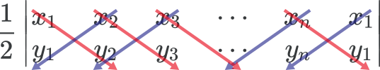

[상위 페이지 · Math](/study/algorithms/math/)

신발끈 공식(Shoelace Formula)은 다각형의 면적을 계산하는 간단하고 효율적인 수학적 방법이다. 이 공식은 좌표 기하학에서 특히 유용하며, 복잡한 다각형의 면적을 쉽게 구할 수 있게 해준다.

## 기본 원리



신발끈 공식은 다각형의 꼭짓점 좌표를 사용하여 면적을 계산한다. 이름이 '신발끈'인 이유는 계산 과정에서 좌표들을 대각선으로 곱하는 패턴이 신발끈을 엮는 모양과 유사하기 때문이다.

## 수학적 표현

$$
A = \frac{1}{2} \left| \sum_{i=0}^{n-1} (x_i y_{i+1} - x_{i+1} y_i) \right|
$$

여기서:

- ($$x_i$$, $$y_i$$)는 다각형의 i번째 꼭짓점 좌표이다.
- n은 다각형의 꼭짓점 수이다.
- $$(x_n, y_n) = (x_0, y_0)$$로, 마지막 꼭짓점은 첫 번째 꼭짓점과 동일하다.

## 계산 과정

신발끈 공식의 계산 과정은 다음과 같다:

1. 다각형의 모든 꼭짓점 좌표를 시계 방향 또는 반시계 방향으로 나열한다.
2. 각 꼭짓점의 x 좌표와 다음 꼭짓점의 y 좌표를 곱한 값들의 합을 계산한다.
3. 각 꼭짓점의 y 좌표와 다음 꼭짓점의 x 좌표를 곱한 값들의 합을 계산한다.
4. 두 번째 합에서 첫 번째 합을 뺀 후 절대값을 취하고 2로 나눈다.

## 예시

예를 들어, 좌표가 (0,0), (4,0), (4,3), (0,3)인 직사각형의 면적을 계산해 보자:

```python
# 꼭짓점 좌표
vertices = [(0,0), (4,0), (4,3), (0,3)]

# 신발끈 공식 적용
sum1 = sum(vertices[i][0] * vertices[(i+1)%4][1] for i in range(4))
sum2 = sum(vertices[i][1] * vertices[(i+1)%4][0] for i in range(4))

# 면적 계산
area = 0.5 * abs(sum1 - sum2)
print(f"직사각형의 면적: {area}")  # 결과: 12

```

## 장점과 한계

**장점:**

- 계산이 간단하고 직관적이다.
- 모든 종류의 단순 다각형에 적용 가능하다.
- 컴퓨터 알고리즘으로 쉽게 구현할 수 있다.

**한계:**

- 자체 교차 다각형에는 올바른 결과를 제공하지 않을 수 있다.
- 부동 소수점 오차가 누적될 수 있어 대형 다각형에서는 정밀도 문제가 발생할 수 있다.

## 결론

신발끈 공식은 다각형의 면적을 계산하는 효율적인 방법으로 특히 컴퓨터 과학과 계산 기하학 분야에서 널리 사용된다. 이해하기 쉽고 구현이 간단하면서도 다양한 응용 분야에서 활용할 수 있는 유용한 수학적 도구이다.
