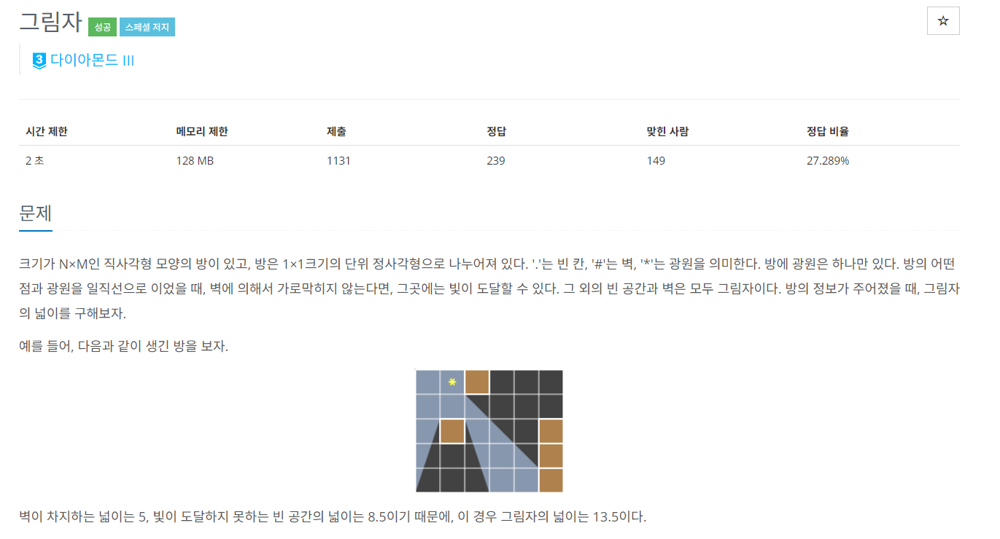
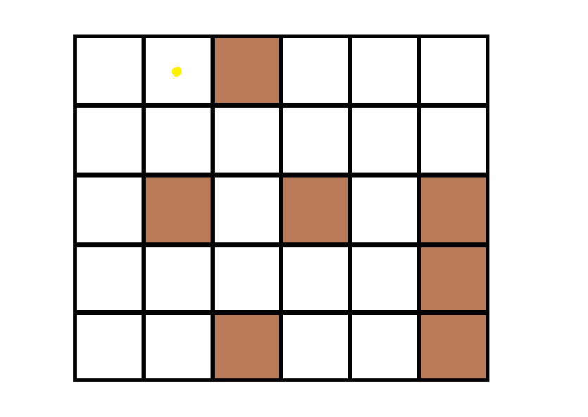
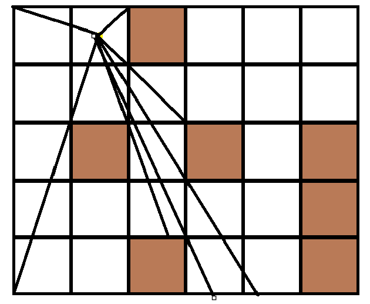
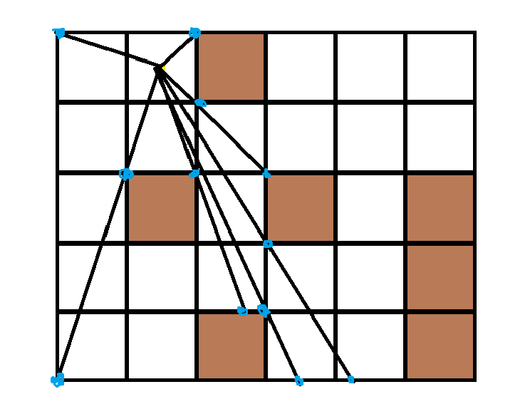
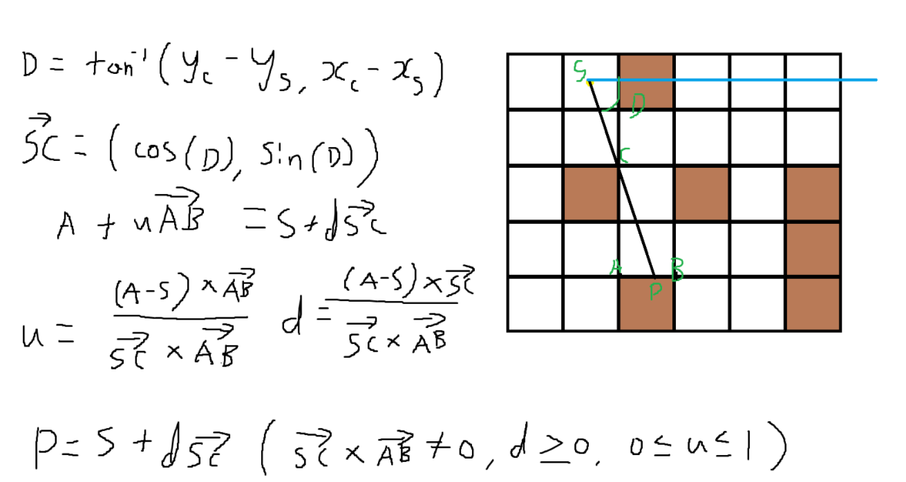
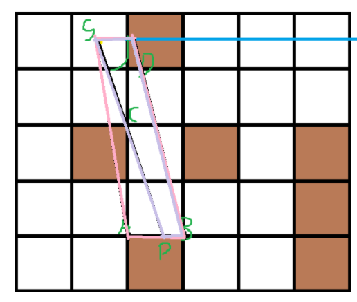
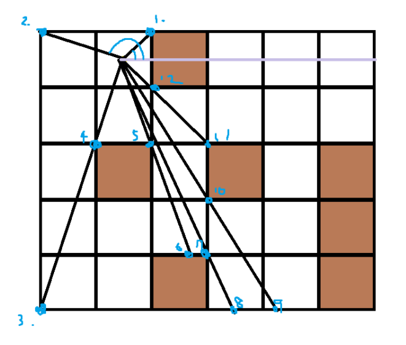
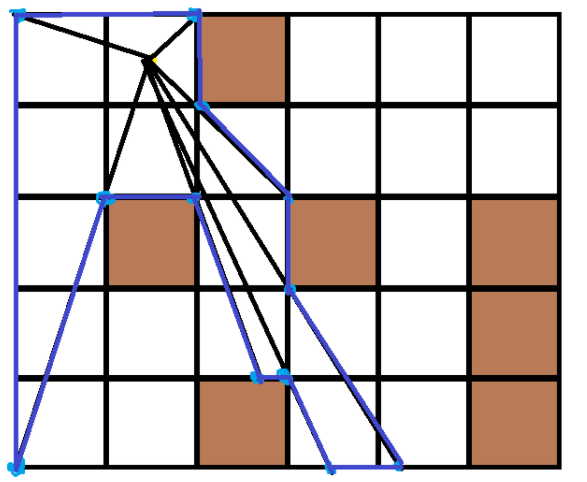
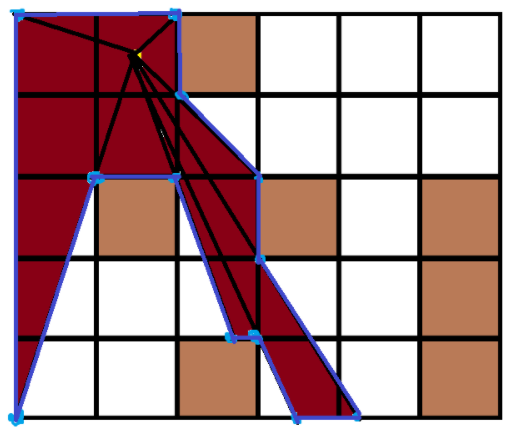

[상위 페이지 · Math](/study/algorithms/math/)



## 문제 태그

- 기하학
- 구현
- 스위핑
- 선분 교차 판정
- 정렬

## 아이디어



### 1. 광원에서 나오는 빛에 영향을 주는건 오직 장애물의 꼭짓점



원래는 모든 꼭짓점에 다 선을 그어야 하지만 설명에서는 알아보기 쉽게 하기 위해 영향을 주는 선만 그었음

### 2. 이 광원에서 나오는 모든 선의 최종 교점의 좌표를 구한다.



- 점 P를 구하는 방법



- 우선 $$D각도 = tan^{-1}{(y_c-y_s, x_c-x_s)}$$를 구해준다
- 각도를 구하면 이 각도를 이용해 $$\overrightarrow{r} = \overrightarrow{SC}$$를 구할 수 있다.
- 그럼 이제 벡터의 외적으로 두개의 평행사변형을 구할 수 있으며 이 두개의 평행사변형의 넓이 비례로 점 P의 위치하는점을 알 수 있다.
    
    
    
    이는 진짜 평행사변형의 넓이를 구하는것이 아닌 벡터 의미적 평행사변형의 비를 구하는것임
    
    - 이는 식으로
    
    $$
    S + d\overrightarrow{r} = A + u\overrightarrow{s}
    $$
    
    - 이를 행렬식으로 표현하면
        
        $$
        
        \underbrace{\begin{bmatrix}
        r_x & -s_x \\
        r_y & -s_y
        \end{bmatrix}}_{\mathbf M}
        \underbrace{\begin{bmatrix}
        d \\ u
        \end{bmatrix}}_{\mathbf{x}}
        =
        \underbrace{\begin{bmatrix}
        A_x - S_x \\ A_y - S_y
        \end{bmatrix}}_{\mathbf{b}}
        
        $$
        
    - 역행렬로 x를 풀어낸다
        
        $$
        \begin{bmatrix}
        d \\ u 
        \end{bmatrix}= 
        \frac{1}{r_xs_y-r_ys_x}
        \begin{bmatrix}
        -s_y & s_x \\
        -r_y & r_x
        \end{bmatrix}
        \begin{bmatrix}
        A_x-S_x \\ A_y-S_y
        \end{bmatrix}
        $$
        
    - 이를 스칼라식으로 전개하면
    
    $$
    
    d=\frac{(A_x-S_x)(-s_y)+(A_y-S_y)s_x}{r_xs_y-r_ys_x},
    \\
    \\
    u=\frac{(A_x-S_x)(-r_y)+(A_y-S_y)r_x}{r_xs_y-r_ys_x}
    
    $$
    
    - 즉 정리하면
    
    $$
    d = \frac{(A-S) * \overrightarrow{s}}{\overrightarrow{r} * \overrightarrow{s}}
    \\
    u = \frac{(A-S) * \overrightarrow{r}}{\overrightarrow{r}*\overrightarrow{s}}
    $$
    
- 단 여기서 점 P는 다음에서 성립함
    - $$\overrightarrow{r}*\overrightarrow{s} ≠ 0$$, (0은 평행임으로 교차해야함)
    - d > 0, (d가 0보다 작으면 원하는 벡터의 반대 방향임으로 0보다 커야함)
    - 0≤u≤1, (u는 선분AB 사이에 존재해야함)

### 3. 이 교점을 각도 순서대로 정렬한다



### 4. 이 교점을 순서대로 잇는다



### 5. 시계 방향으로 정렬된 점들을 이용해 내부 다각형의 넓이를 구한다.



<aside class="notion-callout notion-callout--with-icon" markdown="1">
💡
{: .notion-callout__icon aria-hidden="true"}

신발끈 공식

[Shoelace Formula](/study/algorithms/math/shoelace-formula/) 

$$
넓이 = \frac{1}{2} * \sum_{i = 0}^{p점의\ 개수}{(x_iy_{i+1} - x_{i+1}y_i)} 
$$

</aside>

### 6. 전체 넓이에서 빛이 닿는 곳을 뺀다

### etc.

- 점 P들간의 간격이 앱실론보다 작다면 중복으로 처리해도 무방함
- 좌표 스케일을 2배로 키우면 소숫점 계산을 안해도 된다. 마지막 넓이만 1/4하면 됨.

## 정답

```python
import sys
import math
from collections import defaultdict

def cross(ax, ay, bx, by):
    return ax * by - ay * bx

def dot(ax, ay, bx, by):
    return ax * bx + ay * by

def ray_hit_seg(Sx, Sy, dx, dy, Ax, Ay, Bx, By):
    rx, ry = dx, dy
    sx, sy = Bx - Ax, By - Ay
    qx, qy = Ax - Sx, Ay - Sy
    den = cross(rx, ry, sx, sy)

    # 평행 or 동일 선분
    if den == 0:
        if cross(qx, qy, rx, ry):  # 서로 다른 평행선
            return None
        # 동일 직선 → 끝점 두 개 중 앞쪽 끝만 고려
        rr = rx * rx + ry * ry
        tA = dot(qx, qy, rx, ry) / rr
        tB = dot(Bx - Sx, By - Sy, rx, ry) / rr
        cand = [t for t in (tA, tB) if t >= 0]
        return min(cand) if cand else None

    # 일반 교차
    t = cross(qx, qy, sx, sy) / den
    u = cross(qx, qy, rx, ry) / den
    return t if t >= 0 and 0 <= u <= 1 else None

def shoelace(area_pts):
    s = 0
    for i in range(len(area_pts)):
        x1, y1 = area_pts[i]
        x2, y2 = area_pts[(i + 1) % len(area_pts)]
        s += x1 * y2 - x2 * y1
    return abs(s) / 8.0

N, M = map(int, sys.stdin.readline().split())
room = [sys.stdin.readline().strip() for _ in range(N)]

seg_list = []  # (x1,y1,x2,y2) 튜플
vertex_set = set()
Sx = Sy = -1  # 광원 좌표
wall_cnt = 0

for r in range(N):
    for c in range(M):
        ch = room[r][c]
        if ch == '*':  # 광원
            Sx, Sy = 2 * c + 1, 2 * r + 1
        if ch == '#':  # 벽(#)인 경우 네 변 추가
            wall_cnt += 1
            x, y = 2 * c, 2 * r
            seg_list += [
                (x, y, x + 2, y),
                (x + 2, y, x + 2, y + 2),
                (x + 2, y + 2, x, y + 2),
                (x, y + 2, x, y),
            ]
            vertex_set |= {(x, y), (x + 2, y), (x + 2, y + 2), (x, y + 2)}

# 방 테두리 4 변
seg_list += [
    (0, 0, 2 * M, 0),
    (2 * M, 0, 2 * M, 2 * N),
    (2 * M, 2 * N, 0, 2 * N),
    (0, 2 * N, 0, 0),
]
vertex_set |= {(0, 0), (2 * M, 0), (2 * M, 2 * N), (0, 2 * N)}

EPS = 1e-12
angle_list = []

for vx, vy in vertex_set:
    dx, dy = vx - Sx, vy - Sy
    theta = math.atan2(dy, dx)
    for d in (theta - EPS, theta, theta + EPS):
        if d < 0:
            d += 2 * math.pi
        if d >= 2 * math.pi:
            d -= 2 * math.pi
        angle_list.append(d)

angle_list = sorted(set(angle_list))  # 중복 제거 후 정렬
poly = []  # 시야 다각형 꼭짓점

for th in angle_list:
    dx, dy = math.cos(th), math.sin(th)
    best_t = None
    for Ax, Ay, Bx, By in seg_list:
        t_hit = ray_hit_seg(Sx, Sy, dx, dy, Ax, Ay, Bx, By)
        if t_hit is not None and (best_t is None or t_hit < best_t):
            best_t = t_hit
    if best_t is not None:
        px = Sx + best_t * dx
        py = Sy + best_t * dy
        # 직전 점과 거의 같으면 중복 제거
        if not poly or abs(px - poly[-1][0]) > EPS or abs(py - poly[-1][1]) > EPS:
            poly.append((px, py))

lit_area = 0.0
if len(poly) >= 3:
    lit_area = shoelace(poly)

total = N * M
shadow = total - lit_area - wall_cnt

print(f"{shadow}")

```
