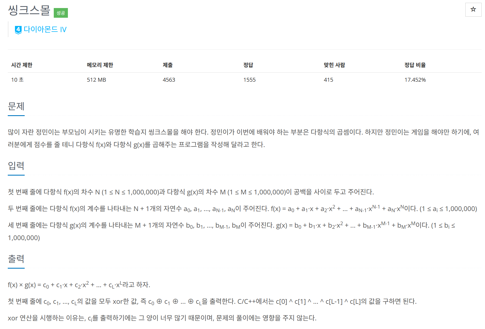

[상위 페이지 · 다이아](/study/algorithms/math/diamond/)



## 문제 태그

- 수학
- 정수론
- FFT
- 중국인의 나머지 정리

## 아이디어

- NTT를 이용해야하는데 여기서 주로 사용하는 mod는 998244353임. 이는 998244353의 수까지 밖에 커버하지 못하는것으로 $$c_i$$가 저 소수보다 커질 가능성이 매우크다.
- 고로 총 3가지의 원시근이 있는 소수로 각각 NTT를 한 뒤 중국인의 나머지 정리로 다시 합쳐 $$c_i$$를 재구성한다

## 정답

```python
import sys

input = sys.stdin.readline

def next_power_of_two(x):
    if x == 0:
        return 1
    return 1 << ((x - 1).bit_length())

def ntt(x, mod, gen):
    N = len(x)
    if N == 1:
        return x
    even = ntt(x[::2], mod, pow(gen, 2, mod))
    odd = ntt(x[1::2], mod, pow(gen, 2, mod))
    result = [0] * N
    factor = 1
    for i in range(N // 2):
        term = (factor * odd[i]) % mod
        result[i] = (even[i] + term) % mod
        result[i + N // 2] = (even[i] - term + mod) % mod
        factor = (factor * gen) % mod
    return result

def intt(x, mod, gen):
    gen_inv = pow(gen, -1, mod)
    res = ntt(x, mod, gen_inv)
    N = len(x)
    N_inv = pow(N, -1, mod)
    return [(r * N_inv) % mod for r in res]

mods = [998244353, 469762049, 754974721]
roots = [3, 3, 11]

N, M = map(int, input().split())
a = list(map(int, input().split()))
b = list(map(int, input().split()))

sz = next_power_of_two(N + M + 1)

hs = []
for mid in range(3):
    mod = mods[mid]
    rt = roots[mid]
    gen = pow(rt, (mod - 1) // sz, mod)
    fa = [x % mod for x in a] + [0] * (sz - (N + 1))
    fb = [x % mod for x in b] + [0] * (sz - (M + 1))
    fa = ntt(fa, mod, gen)
    fb = ntt(fb, mod, gen)
    fh = [(fa[i] * fb[i]) % mod for i in range(sz)]
    fh = intt(fh, mod, gen)
    hs.append(fh)

total_mod = 1
for m in mods:
    total_mod *= m
Mis = [total_mod // m for m in mods]
invs = [pow(Mis[i], -1, mods[i]) for i in range(3)]

xor_all = 0
for deg in range(N + M + 1):
    xs = [hs[j][deg] for j in range(3)]
    c = 0
    for j in range(3):
        c += xs[j] * Mis[j] * invs[j]
    c %= total_mod
    xor_all ^= c

print(xor_all)
```
