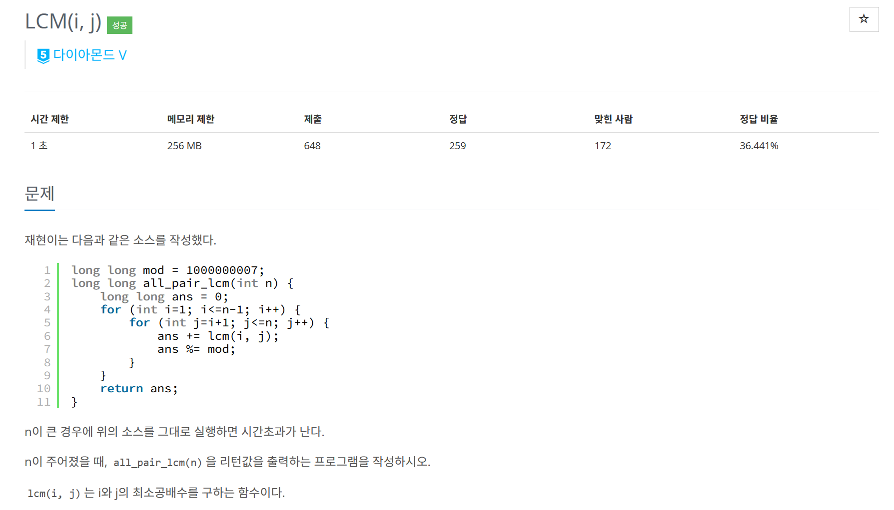

[상위 페이지 · 다이아](/study/algorithms/math/diamond/)



## 문제 태그

- 수학
- 정수론
- 오일러 피 함수

## 아이디어

- 최소공배수와 최대공약수는 다음과 같은 관계임
    
    $$
    \sum_{i=1}^{n} lcm(i, n) = \sum_{i=1}^{i}\frac{i \cdot n}{gcd(i,n)} = n\sum_{i=1}^{i}\frac{i}{gcd(i,n)}
    $$
    
- gcd(i, n)을 오일러 피 함수를 이용해 구함
    
    $$
    \sum_{i=1}^{n} lcm(i, n) = \frac{n}{2}(1 + \sum_{d|n}d \cdot \phi({d}))
    $$
    
- 고로 1부터 n까지 모든 수 k에 대한 오일러 피 함수 값을 에라토스테네스의 체 방식으로 구함
- 그 다음 1부터 n까지 $$f(k) = \sum_{d|k}d \cdot \phi({d})$$의 값을 미리 구함
- j를 2부터 n까지 순회하며 다음 식을 누적하며 더함

$$
\sum_{i=1}^{j-1} lcm(i, j)=(\sum_{i=1}^{j} lcm(i,j)) - lcm(j,j) 
\\
= (\frac{j}{2}(1+f(j))) - j
$$

## 정답

```python
import sys

def solve():
    n = int(sys.stdin.readline())
    mod = 1000000007

    phi = [i for i in range(n + 1)]
    for i in range(2, n + 1):
        if phi[i] == i:
            for j in range(i, n + 1, i):
                phi[j] -= phi[j] // i

    sum_d_phi_d = [0] * (n + 1)
    for d in range(1, n + 1):
        term = (d * phi[d]) % mod
        for k in range(d, n + 1, d):
            sum_d_phi_d[k] = (sum_d_phi_d[k] + term) % mod

    ans = 0

    inv2 = (mod + 1) // 2

    for j in range(2, n + 1):
        f_j = sum_d_phi_d[j]
        sum_lcm_ij = (j * ((1 + f_j) % mod)) % mod
        sum_lcm_ij = (sum_lcm_ij * inv2) % mod
        term_j = (sum_lcm_ij - j + mod) % mod
        ans = (ans + term_j) % mod

    print(ans)

solve()
```
