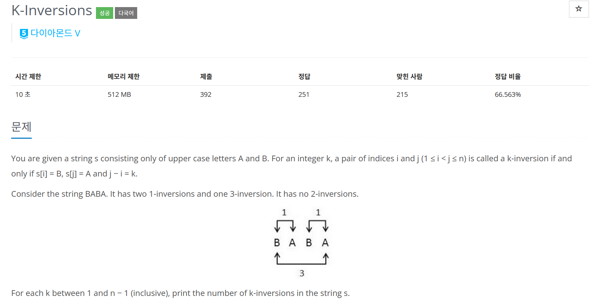
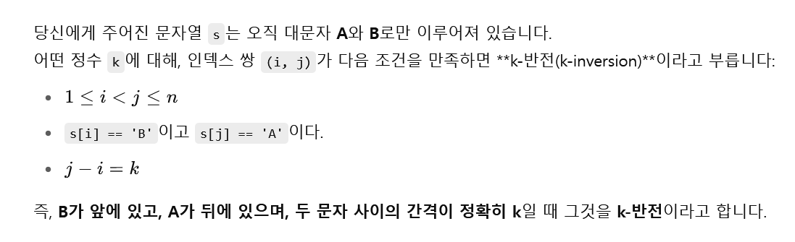

[상위 페이지 · 다이아](/study/algorithms/math/diamond/)



## 문제 해석



## 문제 태그

- 수학
- 정수론
- fft

## 아이디어

1. B는 X배열의 i에 A는 Y배열의 n - 1 - i에 나눠서 집어넣고 컨볼루션한다.

## 정답

```cpp
import sys
def main():
    import sys
    s = sys.stdin.readline().strip()
    n = len(s)

    # --- NTT 설정 ---
    mod = 998244353
    root = 3

    def ntt(a, invert):
        N = len(a)
        j = 0
        # bit‐reversal
        for i in range(1, N):
            bit = N >> 1
            while j & bit:
                j ^= bit
                bit >>= 1
            j |= bit
            if i < j:
                a[i], a[j] = a[j], a[i]
        # Cooley–Tukey
        length = 2
        while length <= N:
            # wlen = root^((mod-1)/length)
            wlen = pow(root, (mod - 1) // length, mod)
            if invert:
                wlen = pow(wlen, mod - 2, mod)
            for i in range(0, N, length):
                w = 1
                half = length >> 1
                for j in range(i, i + half):
                    u = a[j]
                    v = a[j + half] * w % mod
                    a[j] = (u + v) % mod
                    a[j + half] = (u - v + mod) % mod
                    w = w * wlen % mod
            length <<= 1
        if invert:
            inv_n = pow(N, mod - 2, mod)
            for i in range(N):
                a[i] = a[i] * inv_n % mod

    # build 두 배열: X[i]=1 if s[i]=='B', Y[n-1-i]=1 if s[i]=='A'
    sz = 1
    while sz < n * 2:
        sz <<= 1
    X = [0] * sz
    Y = [0] * sz
    for i, ch in enumerate(s):
        if ch == 'B':
            X[i] = 1
        else:  # ch == 'A'
            Y[n - 1 - i] = 1

    # NTT(x), NTT(y), pointwise, inverse NTT
    ntt(X, False)
    ntt(Y, False)
    for i in range(sz):
        X[i] = X[i] * Y[i] % mod
    ntt(X, True)

    # 결과 출력: k=1..n-1 에 대해 X[(n-1)-k]
    out = sys.stdout
    for k in range(1, n):
        # real count 은 mod 연산 후에도 그대로
        out.write(str(X[n - 1 - k]) + "\n")

if __name__ == "__main__":
    main()

```
