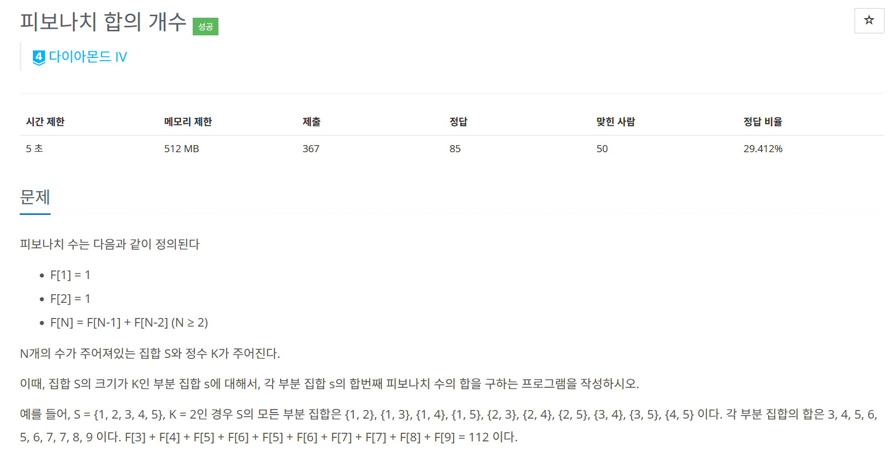

[상위 페이지 · Math](/study/algorithms/math/)



## 문제 태그

- 수학
- 정수론
- fft << 왜 fft인지 모름 난 dp로 품

## 아이디어

1. 비네의 공식을 사용

$$
\alpha = \frac{1 + \sqrt{5}}{2}\ \beta = \frac{1 - \sqrt{5}}{2}\\
F_n = \frac{\alpha^n - \beta^n}{\sqrt5}

$$

1. 우리가 구하려는건

$$
\sum_{|S| = K}F({\sum_{s \in S}s})
$$

1. 비네의 공식에 대입하면

$$
\sum_{|S| = K}F({\sum_{s \in S}s}) = \frac{1}{\sqrt5}(\sum_{|S| = K}\alpha^{\sum_{s \in S}s} - \sum_{|S| = K}\beta^{\sum_{s \in S}s})
$$

1. subset의 각 합은 dp로 구함
    
    $$
    \sum_{|S| = K}\alpha^{\sum_{s \in S}s}=dp_a[K] = dp_a[K] + (dp_a[K-1] * (\alpha)^s)\\
    \sum_{|S| = K}\beta^{\sum_{s \in S}s}=dp_b[K] = dp_b[K] + (dp_b[K-1] * (\beta)^s)
    $$
    
2. 고로

$$
\sum_{|S| = K}F({\sum_{s \in S}s}) = \frac{1}{\sqrt5}(dp_a[K] - dp_b[K])
$$

<aside markdown="1">
💡

**$$\sqrt5$$ 구하기**

$$x^2 \equiv 1\ mod\ p$$

- 페르마의 소정리 → $$a^{p-1} \equiv 1\ mod \ p = a^{(\frac{p-1}{2})^2} \equiv 1\ mod\ p$$
- 고로 $$\sqrt5 \equiv 5^{\frac{p-1}{4}}\ mod\ p$$
- 역원은 $$\frac{1}{\sqrt{5}} \equiv (\sqrt5)^{p-2}$$
</aside>

## 정답

```python
import sys

input = sys.stdin.readline

MOD =  99991

def modexp(a, e, mod=MOD):
    r = 1
    a %= mod
    while e:
        if e & 1:
            r = r * a % mod
        a = a * a % mod
        e >>= 1
    return r

N, K = map(int, input().split())
S = list(map(int, input().split()))

sqrt5 = modexp(5, (MOD + 1) // 4)
inv_sqrt5 = modexp(sqrt5, MOD - 2)
inv2 = (MOD + 1) // 2

alpha = (1 + sqrt5) * inv2 % MOD
beta = (1 - sqrt5) * inv2 % MOD

dp_a = [0] * (K + 1)
dp_b = [0] * (K + 1)
dp_a[0] = dp_b[0] = 1

for s in S:
    a_s = modexp(alpha, s)
    b_s = modexp(beta, s)
    for k in range(K, 0, -1):
        dp_a[k] = (dp_a[k] + dp_a[k - 1] * a_s) % MOD
        dp_b[k] = (dp_b[k] + dp_b[k - 1] * b_s) % MOD

ans = (dp_a[K] - dp_b[K]) * inv_sqrt5 % MOD
print(ans)
```
