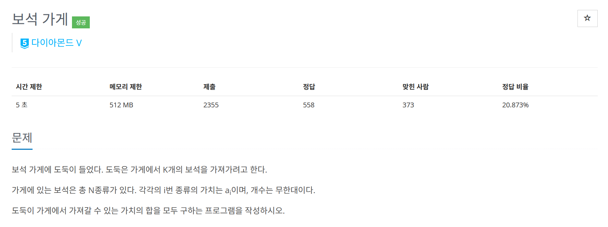

[상위 페이지 · Math](/study/algorithms/math/)



## 문제 태그

- 수학
- 분할 정복을 이용한 거듭제곱
- FFT

## 아이디어

- 보석의 가치를 지수로 만들어서 다항식을 구성한뒤 그 다항식을 k번 제곱하면 우리가 원하는 값이 나온다
- 각 보석 가치를 보석 가치의 최소값으로 빼면 그 크기가 작아져 조금 더 연산이 빨라진다

## 정답

```python
import sys

sys.setrecursionlimit(10**5)

def cooley_tukey_ntt(a, gen, modulus):
    n = len(a)
    if n == 1:
        return a[:]

    omegas = [1] * n
    for i in range(1, n):
        omegas[i] = (omegas[i - 1] * gen) % modulus

    a_even = a[0::2]
    a_odd = a[1::2]

    gen2 = pow(gen, 2, modulus)

    y_even = cooley_tukey_ntt(a_even, gen2, modulus)
    y_odd = cooley_tukey_ntt(a_odd, gen2, modulus)

    y = [0] * n
    for k in range(n // 2):
        p = y_even[k]
        q = (omegas[k] * y_odd[k]) % modulus
        y[k] = (p + q) % modulus
        y[k + n // 2] = (p - q + modulus) % modulus
    return y

def intt(a, gen, modulus):
    n = len(a)
    gen_inv = pow(gen, -1, modulus)
    res = cooley_tukey_ntt(a, gen_inv, modulus)

    n_inv = pow(n, -1, modulus)
    return [(x * n_inv) % modulus for x in res]

def solve():
    n, k = map(int,input().split())
    jewel_values = list(map(int, input().split()))

    min_val = min(jewel_values)
    base_sum = k * min_val
    shifted_values = sorted(list(set([v - min_val for v in jewel_values])))

    MOD = 998244353
    PRIMITIVE_ROOT = 3

    max_shifted_sum = k * shifted_values[-1]
    m = 1
    while m <= max_shifted_sum:
        m <<= 1

    p_coeffs = [0] * m
    for val in shifted_values:
        if val < m:
            p_coeffs[val] = 1

    gen_m = pow(PRIMITIVE_ROOT, (MOD - 1) // m, MOD)

    p_ntt = cooley_tukey_ntt(p_coeffs, gen_m, MOD)

    pk_ntt = [pow(x, k, MOD) for x in p_ntt]

    result_coeffs = intt(pk_ntt, gen_m, MOD)

    possible_sums = []
    for i, coeff in enumerate(result_coeffs):
        if coeff > 0:
            original_sum = i + base_sum
            possible_sums.append(str(original_sum))

    print(" ".join(possible_sums))

if __name__ == "__main__":
    solve()
```
