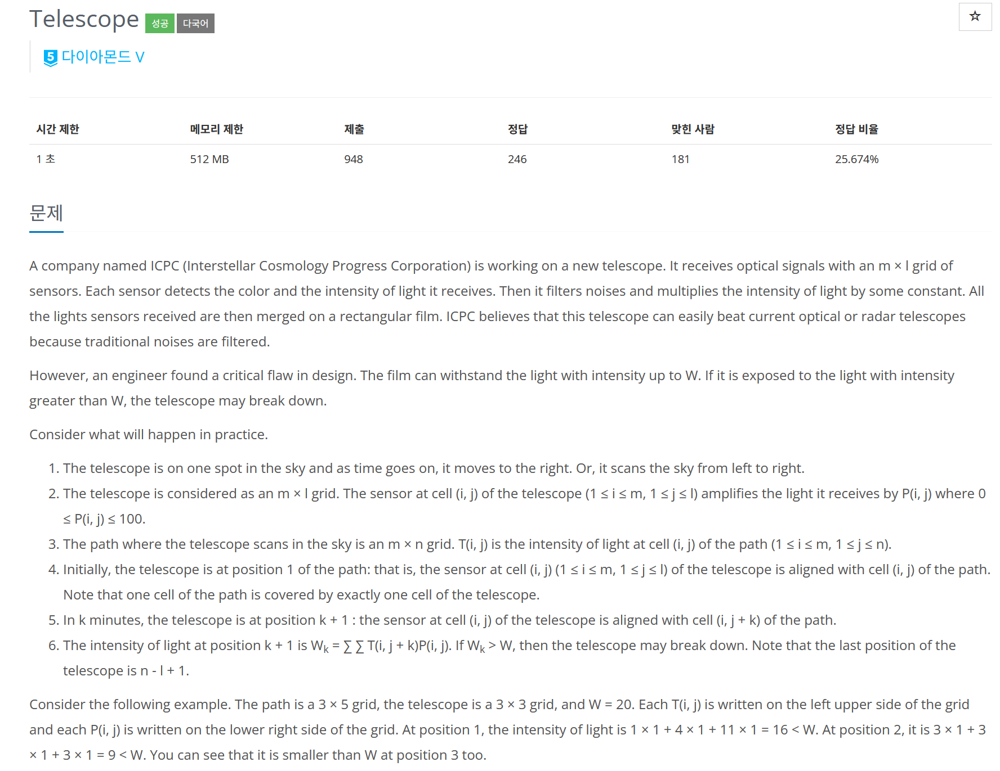
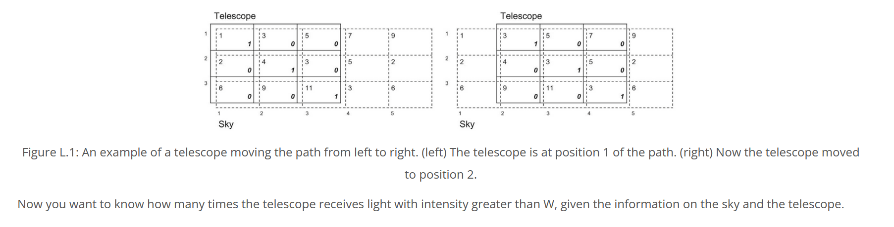

[상위 페이지 · 다이아](/study/algorithms/math/diamond/)





## 문제 해석

- 그냥 두개의 2차원 리스트를 컨볼루션 해라

## 문제 태그

- 수학
- 정수론
- fft

## 아이디어

1. ntt 가 아닌 찐 fft 문제임. ntt로 풀면 모듈러 연산때문에 제대로 된 결과가 나오지 않음
2. 고로 fft로 2차원 컨볼루션을 하면 됨.

## 정답

```cpp
#include <bits/stdc++.h>
using namespace std;
using cd = complex<double>;
const double PI = acos(-1);
int N;
vector<int> rev;
vector<cd> roots;
void prepare_fft(){
    int log_n = __builtin_ctz(N);
    rev.assign(N,0);
    for(int i=1;i<N;i++){
        rev[i] = (rev[i>>1]>>1) | ((i&1)<<(log_n-1));
    }
    roots.assign(N,cd());
    for(int i=0;i<N;i++){
        double ang = 2*PI*i/N;
        roots[i] = cd(cos(ang), sin(ang));
    }
}
void fft(vector<cd>& a, bool invert){
    for(int i=0;i<N;i++){
        if(i < rev[i]) swap(a[i], a[rev[i]]);
    }
    for(int len=1; len<N; len<<=1){
        for(int i=0;i<N;i+=2*len){
            for(int j=0;j<len;j++){
                cd u = a[i+j];
                cd v = a[i+j+len] * (invert ? conj(roots[N/(2*len)*j]) : roots[N/(2*len)*j]);
                a[i+j]       = u + v;
                a[i+j+len] = u - v;
            }
        }
    }
    if(invert){
        for(int i=0;i<N;i++) a[i] /= N;
    }
}
int main(){
    ios::sync_with_stdio(false);
    cin.tie(NULL);

    int n, l, m;
    long long W;
    cin >> n >> l >> m >> W;
    vector<vector<double>> T(m, vector<double>(n));
    vector<vector<double>> P(m, vector<double>(l));
    for(int i=0;i<m;i++)
        for(int j=0;j<n;j++)
            cin >> T[i][j];
    for(int i=0;i<m;i++)
        for(int j=0;j<l;j++)
            cin >> P[i][j];

    int need = n + l - 1;
    N = 1;
    while(N < need) N <<= 1;
    prepare_fft();

    vector<cd> fa(N), fb(N);
    vector<long long> res(need);
    for(int i=0;i<m;i++){
        for(int j=0;j<N;j++){
            fa[j] = j < n ? T[i][j] : 0;
            fb[j] = j < l ? P[i][l-1-j] : 0;
        }
        fft(fa, false);
        fft(fb, false);
        for(int j=0;j<N;j++) fa[j] *= fb[j];
        fft(fa, true);
        for(int j=0;j<need;j++)
            res[j] += (long long)(fa[j].real() + 0.5);
    }

    int cnt = 0;
    for(int k = l - 1; k < n; k++){
        if(res[k] > W) cnt++;
    }
    cout << cnt;
    return 0;
}

```
