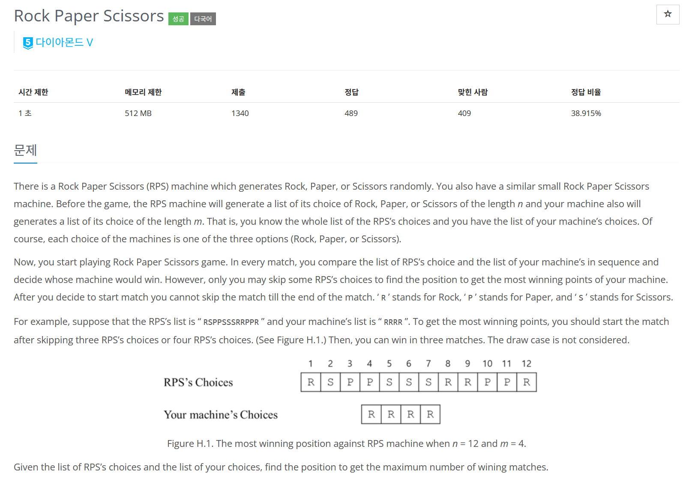
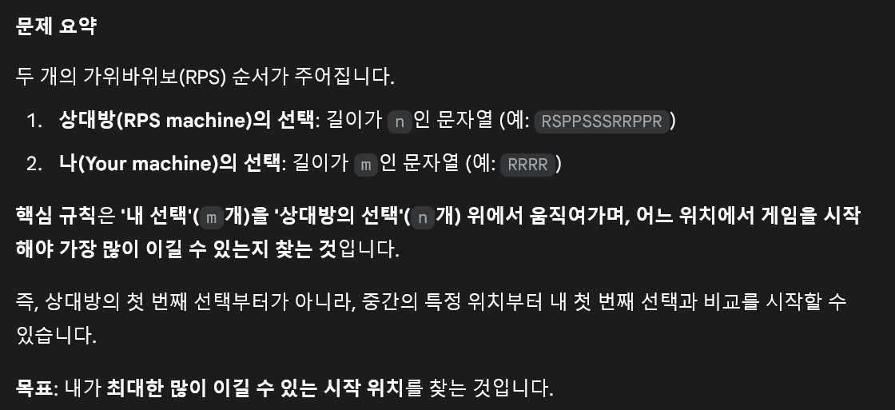

[상위 페이지 · 다이아](/study/algorithms/math/diamond/)



## 문제 해석



## 문제 태그

- 수학
- FFT

## 아이디어

- 각 가위, 바위, 보에 대해 FFT로 컨볼루션을 하여 승리 횟수를 구한다
- 각 가위 바위 보에 대해 0~n까지 반복하여 최대값을 찾는다

## 정답

```python
import sys
input = sys.stdin.readline

def cooley_tukey_ntt(a, gen, modulus):
    if len(a) == 1:
        return a[:]
    omegas = [0] * len(a)
    omegas[0] = 1
    for i in range(1, len(omegas)):
        omegas[i] = omegas[i-1] * gen % modulus
    gen2 = pow(gen, 2, modulus)
    even = cooley_tukey_ntt(a[::2], gen2, modulus)
    odd = cooley_tukey_ntt(a[1::2], gen2, modulus)
    out = [0] * len(a)
    for k in range(len(a)//2):
        p = even[k]
        q = (omegas[k] * odd[k]) % modulus
        out[k] = (p + q) % modulus
        out[k + len(a)//2] = (p - q + modulus) % modulus  # 음수 방지
    return out

def intt(a, gen, modulus):
    gen_inv = pow(gen, -1, modulus)
    res = cooley_tukey_ntt(a, gen_inv, modulus)
    N = len(a)
    N_inv = pow(N, -1, modulus)
    return [(x * N_inv) % modulus for x in res]

def mul(A, B, mod, gen):
    a = A[:]
    b = B[:]
    ntt_a = cooley_tukey_ntt(a, gen, mod)
    ntt_b = cooley_tukey_ntt(b, gen, mod)
    prod = [(ntt_a[i] * ntt_b[i]) % mod for i in range(len(a))]
    return intt(prod, gen, mod)

mod = 998244353
primitive_root = 3

n, m = map(int, input().split())
A = input().strip()
B = input().strip()

# 배열 생성
A_r = [1 if c == 'R' else 0 for c in A]
A_p = [1 if c == 'P' else 0 for c in A]
A_s = [1 if c == 'S' else 0 for c in A]

mask_R = [1 if c == 'R' else 0 for c in B]
mask_P = [1 if c == 'P' else 0 for c in B]
mask_S = [1 if c == 'S' else 0 for c in B]

N = 1
while N < n + m - 1:
    N <<= 1

gen = pow(primitive_root, (mod - 1) // N, mod)

def compute_conv(X, mask, N, gen, mod):
    rev_mask = mask[::-1]
    X_pad = X + [0] * (N - len(X))
    rm_pad = rev_mask + [0] * (N - len(mask))
    return mul(X_pad, rm_pad, mod, gen)

conv_R = compute_conv(A_s, mask_R, N, gen, mod)
conv_P = compute_conv(A_r, mask_P, N, gen, mod)
conv_S = compute_conv(A_p, mask_S, N, gen, mod)

max_win = 0
for i in range(n):
    total = (conv_R[i + m - 1] + conv_P[i + m - 1] + conv_S[i + m - 1]) % mod
    if total > max_win:
        max_win = total

print(max_win)
```
