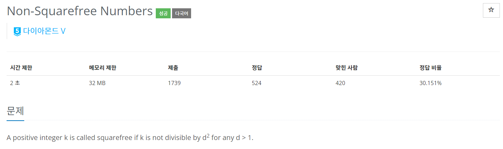
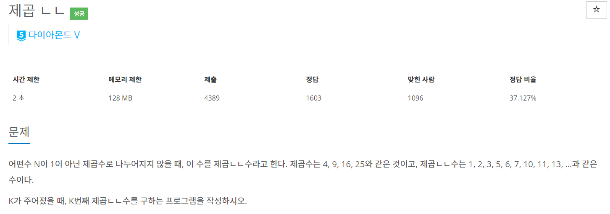

[상위 페이지 · 다이아](/study/algorithms/math/diamond/)

8464번 [https://www.acmicpc.net/problem/8464](https://www.acmicpc.net/problem/8464)



1557번 [https://www.acmicpc.net/problem/1557](https://www.acmicpc.net/problem/1557)



## 아이디어

일단 자유제곱수란 제곱수를 인수로 가지지 않는것을 말한다

1,2,3,5,6,7,10,11,13같이 소인수 분배를 해도 인수에 제곱수를가지지 않는것이다.

4,8,12… 같은건 소인수 분해를 했을 때 $$2^2$$을 인수로 가지기 때문에 자유제곱수가 아니다.

이러한 자유제곱수를 구하는건 소수 제곱수의 배수를 다 없애주면 그게 자유제곱수를 구하는것이다.

k번째 자유제곱수를 구하는것은 내 앞에 자유제곱수가 얼마나 있냐 이런뜻과 동일하다.

문제의 범위는 1억이고 정렬돼있는 숫자임으로 이분정렬을 써야한다.

### 첫번째 시도

처음엔 뫼비우스 함수와 포함배제원리를 따로 생각해서 이분탐색을 통해 숫자하나를 정해주고 그 숫자의 대한 위치를 찾는다 위치를 찾는건 포함배제원리에 따라 구하면 된다. 처음에 생각했던건 단순히 소수 2, 3, 5, 7, 11, 13정도의 제곱을 n으로 나눠주면 각자의 자유제곱수가 아닌 숫자들의 개수가 나온다. 하지만 여기에는 4와 9의 공배수 36의 배수나 4와 25의 공배수 100배수 등이 포함 돼 있기 때문에 걸러줘야 한다.

좀 더 예시를 들어보자면

$$\lfloor900 / 4\rfloor = 225$$

$$\lfloor900 / 9\rfloor = 100$$

$$\lfloor900 / 25\rfloor = 36$$

$$\lfloor900 / 49\rfloor = 18$$

$$\lfloor900 / 121\rfloor = 7$$

$$\lfloor900 / 289\rfloor = 3$$

$$\lfloor900 / 361\rfloor = 2$$

$$\lfloor900 / 169\rfloor = 5$$

$$\lfloor900 / 529\rfloor = 1$$

$$\lfloor900 / 841\rfloor = 1$$

각각의 집합 4,9,25,49,121,169,289,361,529,841이 n까지 배수로 가지는 수는

225+100+36+18+7+5+3+2+1+1 = 428개이다

하지만 여기엔 위에서도 말 했듯 중복되는 숫자들도 포함 돼 있다. 중복으로 처리된 숫자들은 각 집합의 공배수들이다

$$\lfloor900 / 36(4\times9)\rfloor = 25$$

$$\lfloor900 / 100(4\times25)\rfloor = 9$$

$$\lfloor900 / 196(4\times49)\rfloor = 4$$

$$\lfloor900 / 484(4\times121)\rfloor = 1$$

$$\lfloor900 / 676(4\times169)\rfloor = 1$$

$$\lfloor900 / 225(9\times25)\rfloor = 4$$

$$\lfloor900 / 441(9\times49)\rfloor = 2$$

여기에 없는 공배수들은 900을 넘어가는 공배수들임으로 계산이 0으로 나오기때문에 포함시키지 않았다. 중복으로 처리된 숫자들은 25+9+4+1+1+4+2 = 46개

하지만 4 와 9 와 25의 공배수는 900으로 위 계산에서 총 3번 빠졌음으로 계산을 하지 않은것과 같다 고로 4와 9와 25의 공배수 900을 마지막으로 더 해준다.

1~900까지 자유제곱수가 아닌것들은 383개. 900은 517번째 자유제곱수임을 알 수 있다.

구하는 방법을 알았으니 이제 이진탐색중 파라메트릭 서치를 통해 K에 가깝게 줄여나가면 된다.

첫 low와 high는 K범위는 1억까지임으로 low는 0, high는 20억으로 충분히 높게 잡아주고 계산한다.

만약 지금 현재 숫자가 low+high의 중간값의 자유제곱수 숫자가 K보다 높다면 다시 0~중간값에서 계산을 한다. 이런식으로 계산을 해나가면 K로 수렴하게 되는데 이때의 low+high의 중간값이 k번째 자유제곱수가 된다.

```python
import operator
from functools import reduce

primes = [2,3,5,7,11,13]

def order_square_num(n):
    count = 0
    for i in range(1, 2 ** len(primes)):
        s = set()
        for j in range(len(primes)):
            if i & (1 << j):
                s.add(primes[j])
        squarenum = (reduce(operator.mul, s)) ** 2
        if squarenum > n:
            continue
        sign = -1 if len(s) % 2 == 0 else 1
        count += sign * (n // squarenum)
    return n - count

def binary_search(low,high,x):
    mid = (low + high)//2
    order = order_square_num(mid)
    if x == order:
        return mid
    elif order>x:
        return binary_search(low,mid-1,x)
    else:
        return binary_search(mid + 1, high, x)

print(binary_search(0,40,5))
```

하지만 이것은 시간을 너무 많이 뺏겼다. 매번 소수를 곱해서 구하는것은 너무 느렸다.

### 정답 1557번

사실 [뫼비우스 함수](/study/algorithms/math/moebiuseu-hamsu/) 를 잘 쓰면 매번 안구해도 된다. 뫼비우스의 특징은 자유제곱수 아니라면 0을 반환하고 자유제곱수라면 소인수 분해를 했을 때 소수의 개수가 홀수라면 -1을 짝수라면 1을 반환한다.

미리 뫼비우스의 함숫값을 다 구해놓고 뫼비우스의 함숫값을 잘 이용하면 $$\sqrt{n}$$개의 계산으로 이게 몇번째 자유제곱수인지 알 수 있다.

처음 no를 n으로 잡고

i = 2 : mobius(2) = -1 :no += mobius(2) * (n//2^2) : 4의 배수 빼주기

i = 3 : mobius(3) = -1 : no += mobius(3) * (n//3^3) : 9의 배수 빼주기

i = 4 : mobius(4) = 0 :  no += mobius(4) * (n//4^4) : 16의 배수 빼주기인데 이미 빠졌음으로 0

i = 5 : mobius(5) = -1 :  no += mobius(5) * (n//5^5) : 25의 배수 빼주기

i = 6 : mobius(6) = 1 :  no += mobius(6) * (n//6^6) : 4와 9에서 빠진 36의 배수를 다시 더해주기

…

i = $$\sqrt{n}$$ : mobius($$\sqrt{n}$$) : no +=mobius($$\sqrt{n}$$) * (n// $$\sqrt{n}$$ * $$\sqrt{n}$$)까지 반복

에라토스테네스의 체를 생각하면 편하다

$$\sqrt{n}$$까지만 해도 되는 이유는 그 이상으로 넘어가면 n // i*i가 0이 되기 떄문에 의미가 없다

```python
import operator
import sys
from functools import reduce

sys.setrecursionlimit(10 ** 5)

def mobius_values(n):
    global mobius
    mobius = [0] * n
    mobius[1] = 1
    for i in range(1, n):
        if mobius[i]:
            for j in range(i * 2, n, i):
                mobius[j] -= mobius[i]

def square_free_num_no(n):
    no = n
    for i in range(2,int(n**0.5)+1):
        no += mobius[i] * (n//(i*i))
    return no

k = int(input())

high = 200000000000
low = 0
mobius_values(1000001)
while high-1 > low:
    mid = (low + high) // 2
    if square_free_num_no(mid)>=k:
        high = mid
    else:
        low = mid
print(high)
```

### 정답 8464번

이 문제는 완전히 1557과 반대인 k번째 자유제곱수가 아닌 숫자를 구하는것 이기 때문에

n - 자유제곱수의 no를 해주면 자유제곱수가 아닌 숫자의 no가 나온다

```python
import operator
import sys
from functools import reduce

sys.setrecursionlimit(10 ** 5)

def mobius_values(n):
    global mobius
    mobius = [0] * n
    mobius[1] = 1
    for i in range(1, n):
        if mobius[i]:
            for j in range(i * 2, n, i):
                mobius[j] -= mobius[i]

def square_free_num_no(n):
    no = n
    for i in range(2,int(n**0.5)+1):
        no += mobius[i] * (n//(i*i))
    return no

k = int(input())

high = 200000000000
low = 0
mobius_values(1000001)
while high-1 > low:
    mid = (low + high) // 2
    if mid - square_free_num_no(mid)>=k:
        high = mid
    else:
        low = mid
print(high)
```
