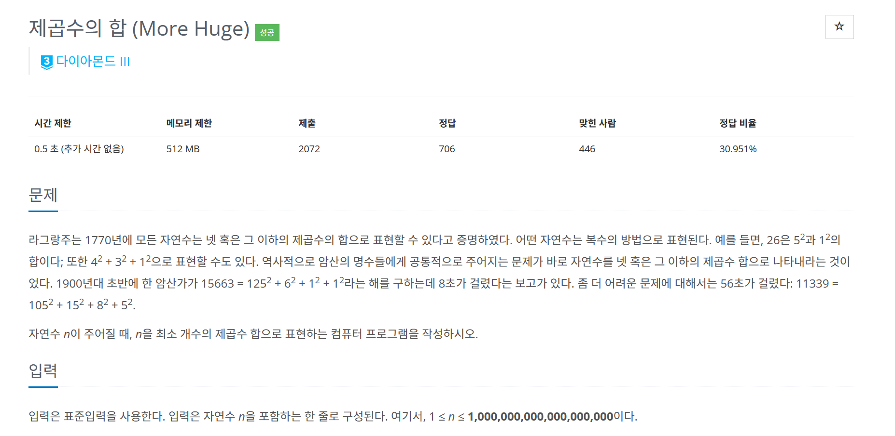

[상위 페이지 · 다이아](/study/algorithms/math/diamond/)



## 문제 태그

- 정수론
- 폴라드 로
- 밀러 라빈 소수 판별

## 아이디어

1. 1개로 표현할 수 있는 n은 $$\sqrt(n)$$임
2. 2개로 표현할 수 있는 n은 페르마의 두 제곱수 정리에 따라 소인수 % 4 == 3인 소인수의 지수가 홀수면 안됨
3. 3개로 밖에 표현 못하는 n은 르장드르의 정리에 따라 $$4^n*(8b+7)$$의 꼴로 표현이 되면 안됨.
4. 이 모든 케이스를 뚫으면 라그랑주 정리에 따라 4개로는 무조건 표현이 됨.

## 정답

```python
import math
import random
import sys
from random import randrange
from math import gcd
input = sys.stdin.readline

# 소수 후보
basic_primes = {2, 3, 5, 7, 11, 13, 17, 19, 23, 29, 31, 37, 41}

# 모듈러 거듭 제곱
def mod_pow(base, exponent, mod):
    result = 1
    base %= mod
    while exponent:
        if exponent & 1:
            result = result * base % mod
        base = base * base % mod
        exponent >>= 1
    return result

# 소수 판별 (Miller-Rabin)
is_prime_memo = dict()

def is_prime(n):
    if n in is_prime_memo:
        return is_prime_memo[n]
    if n == 1:
        return False
    if n < 4:
        return True
    if n % 2 == 0:
        return False
    if n in basic_primes:
        is_prime_memo[n] = True
        return True

    def miller_rabin_test(n, a):
        d = n - 1
        r = 0
        while d % 2 == 0:
            d //= 2
            r += 1
        x = pow(a, d, n)
        if x == 1 or x == n - 1:
            return True
        for _ in range(r - 1):
            x = pow(x, 2, n)
            if x == n - 1:
                return True
        return False

    is_probably_prime = True
    for base in basic_primes:
        if not miller_rabin_test(n, base):
            is_probably_prime = False
            break

    is_prime_memo[n] = is_probably_prime
    return is_probably_prime

# Pollard's Rho 알고리즘
factor_memo = dict()

def pollards_rho(n):
    if n == 1:
        return 1
    if n % 2 == 0:
        return 2
    if is_prime(n):
        return n

    def f(x, c, mod):
        return (x ** 2 + c) % mod

    x = random.randrange(2, n)
    c = random.randrange(1, n)
    y = x
    g = 1

    while g == 1:
        x = f(x, c, n)
        y = f(f(y, c, n), c, n)
        g = math.gcd(x - y, n)
        if g == n:
            return pollards_rho(n)
    if not is_prime(g):
        return pollards_rho(g)
    return g

# 정수 n의 소인수분해 리스트 반환
def factorize(n):
    if n in factor_memo:
        return factor_memo[n]
    if n == 1:
        factor_memo[n] = []
        return []
    if n % 2 == 0:
        factor_memo[n] = [2] + factorize(n // 2)
        return factor_memo[n]
    if is_prime(n):
        factor_memo[n] = [n]
        return [n]
    p = pollards_rho(n)
    factor_memo[n] = factorize(p) + factorize(n // p)
    return factor_memo[n]

# 네 제곱수 정리 기반 항 개수 판단
def min_square_count(n):
    factors = {}
    for f in factorize(n):
        factors[f] = factors.get(f, 0) + 1

    all_even = True
    for exp in factors.values():
        if exp % 2 != 0:
            all_even = False
            break

    legendre_ok = True
    for p, exp in factors.items():
        if p % 4 == 3 and exp % 2 != 0:
            legendre_ok = False
            break

    if all_even:
        return 1
    if legendre_ok:
        return 2
    while n % 4 == 0:
        n //= 4
    return 3 if n % 8 != 7 else 4

# 실행부
n = int(input())
count = min_square_count(n)
print(count)
```
