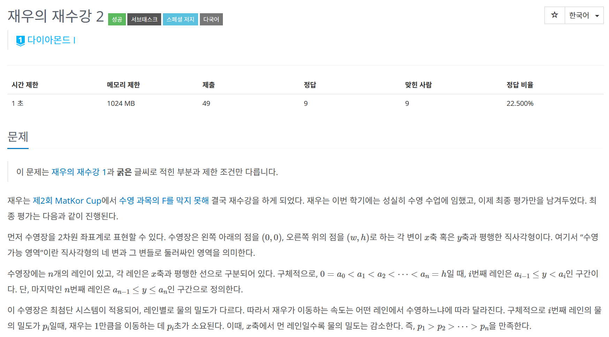
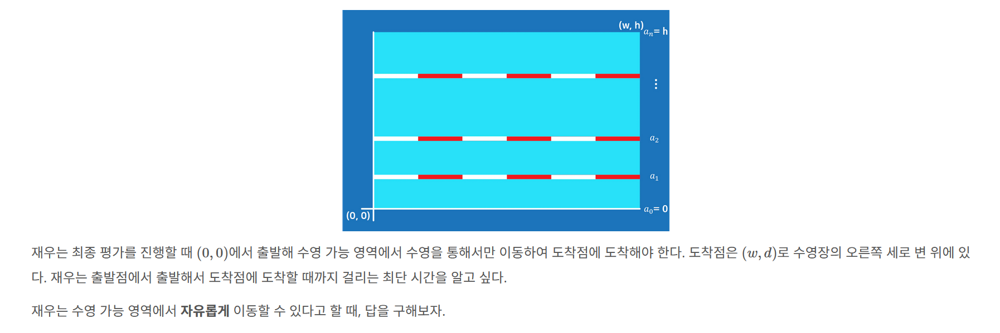

[상위 페이지 · 다이아](/study/algorithms/math/diamond/)





## 문제 태그

- 수학
- 구현
- 기하학
- 이분 탐색
- 시뮬레이션
- 미적분학
- 물리학

## 아이디어

[32231. 재우의 삼수강](/study/algorithms/math/diamond/boj-32231/) 과 유사한 문제이다.

### 시간 구하기

시간을 구하는건

$$
T = \int_{0}^{w}dt
$$

이 dt는 거리 요소와 속도의 관계에 따라 ds/v로 표현할 수 있다.

$$
ds = \sqrt{dx^2 + dy^2} = \sqrt{1 + (y'(x))^2}dx
$$

v는 단위거리 1을 이동할때에 1/p만큼 걸리므로 T는 다음과 같이 나타나게 된다

$$
T = \int_{0}^{w}\frac{ds}{v} = \frac{\sqrt{1 + (y'(x))^2}}{\frac{1}{p(y(x))}}
\\
=\int_{0}^{w}p(y(x))\sqrt{1 + (y'(x))^2}
$$

### 오일러 라그랑주

x에 명시적으로 의존하지 않으므로 Beltrami식을 이용해 오일러-라그랑주를 적용해준다.

$$
\frac{p(y(x))}{\sqrt{1+(y'(x))^2}} = C
$$

이 문제는 적분 제한을 걸어 수평 총 이동량이 w가 되도록 C를 결정하면 되는것이다.

### C 결정하기

적분 제한을 걸어 수평 총 이동량이 w가 되도록 C를 결정하려면 우선 다음식을 C를 포함한 형태로 바꾸어주어야 한다.

$$
\int_{0}^{w}dx = w
$$

- 수평 이동 미소량
    
    $$
    \frac{dy}{dx} = tan\theta
    $$
    
    이므로 이 식을 dx에 대해 나타 낼 수 있으면 된다. (스넬의 법칙)
    
    $$
    p_icos\theta_i = C \rightarrow cos\theta_i = \frac{C}{p_i}
    
    $$
    
    $$
    sin^2\theta_i = 1 - cos^2\theta_i = 1-(\frac{C}{p_i})^2 \rightarrow sin\theta_i = \sqrt{1 - (\frac{C}{p_i})^2} = \frac{\sqrt{p_i^2 - C^2}}{p_i}
    $$
    
    $$
    tan\theta = \frac{sin\theta}{cos\theta} = \frac{\frac{\sqrt{p_i^2 - C^2}}{p_i}}{\frac{C}{p_i}}= \frac{\sqrt{p_i^2 - C^2}}{C}
    $$
    
    $$
    dx = \frac{dy}{tan\theta} = \frac{dy}{\frac{\sqrt{p_i^2 - C^2}}{C}} = \frac{Cdy}{\sqrt{p_i^2 - C^2}}
    $$
    

$$
dx = \frac{dy}{(\sqrt{p(y)/C})^2 -1}
$$

이므로,

$$
\int_{0}^{w}dx = \int_{y(0)}^{y(w)}\frac{dy}{(\sqrt{p(y)/C})^2 -1} = w
$$

를 풀어 C를 구할 수 있다.

### 이분법

C의 단조 증가함에 따라 총 이동량이 w를 초과하는지 여부가 결정되므로 이분법을 사용하여 적절한 C 값을 찾을 수 있다.

### 전체 총 시간 구하기

문제에서는 이동 방법으로 대각선이나 수평이동이 주어졌다. 고로 각각 대각선이나 수평이동에 걸린 시간을 구해서 합해주면 된다.

- 대각선
    
    $$
    T = \int_{0}^{w}p(y(x))\sqrt{1 + (y'(x))^2}
    $$
    
    에 Beltrami식을 대입하면
    
    $$
    T = \int_{0}^{w}p(y(x))\sqrt{1 + (y'(x))^2} = p(y)\frac{p(y)}{C}dx=  \frac{1}{C}\int_{0}^{w}p(y)^2dx
    $$
    
    따라서
    
    $$
    T_{dig} = \frac{1}{C}\int_{y(0)}^{y(w)}p(y)^2\frac{dy}{(\sqrt{p(y)/C})^2 -1} = \int_{y(0)}^{y(w)} \frac{p(y)^2}{\sqrt{p(y)^2 - C^2}}dy
    $$
    

$$
T_{dig}=\int_{y(0)}^{y(w)} \frac{p(y)^2}{\sqrt{p(y)^2 - C^2}}dy
$$

수평으로 이동해야할 총량은 w - 대각선으로 이동한 거리이다. 남은 수평 거리는 가장 빠른 레인 $$p_n$$에서만 이동하므로

$$
T_{hor} = p_n(w - \sum_{i=1}^{n}\Delta{x_i})
$$

고로 정답은

$$
T = T_{dig} + T_{hor}
$$

### 수평 이동이 존재한다면

만약 수평 이동이 조금이라도 존재한다는 뜻은 그 $$p_n$$에서 각도가 0인 움직임이 있다는 뜻이다.

고로 수평이동이 조금이라도 존재한다면

$$
p_icos\theta_i = C
$$

에 따라 C는 자동적으로 $$p_n$$이 된다.

## 정답

```python
import sys
import math

def compute_time_via_layers(w, segments, v_h):
    if not segments:
        return v_h * w

    def F(C):
        return sum(dy * C / math.sqrt(v * v - C * C) for dy, v in segments)

    v_min = min(v for _, v in segments)
    if all(v > v_h for _, v in segments) and F(v_h) <= w:
        C = v_h
    else:
        L, R = 0.0, v_min - 1e-12
        for _ in range(100):
            C = 0.5 * (L + R)
            if F(C) > w:
                R = C
            else:
                L = C
        C = 0.5 * (L + R)

    dx_diag = F(C)
    dx_hor = w - dx_diag
    T_diag = sum(v * v * dy / math.sqrt(v * v - C * C) for dy, v in segments)
    T_hor = v_h * dx_hor
    return T_diag + T_hor

def main():
    input = sys.stdin.readline
    w, _ = map(int, input().split())
    n, d = map(int, input().split())
    a_list = list(map(int, input().split()))
    p = list(map(float, input().split()))

    A = [0.0] + a_list
    y0, y1 = 0.0, float(d)

    s = e = -1
    for i in range(n):
        top = A[i]
        bottom = A[i + 1] if i + 1 < n else float('inf')
        if top <= y0 <= bottom:
            s = i
        if top <= y1 <= bottom:
            e = i

    k = n - 1
    best = float('inf')
    if s == e:
        best = p[s] * math.hypot(w, y1 - y0)

    for m in range(max(s, e), k + 1):
        segments = []
        curr_y = y0

        for i in range(s, m):
            dest_y = A[i + 1]
            segments.append((dest_y - curr_y, p[i]))
            curr_y = dest_y

        for i in range(m - 1, e, -1):
            dest_y = A[i]
            segments.append((curr_y - dest_y, p[i]))
            curr_y = dest_y

        segments.append((abs(y1 - curr_y), p[e]))
        print(segments)
        candidate = compute_time_via_layers(w, segments, p[m])
        best = min(best, candidate)

    print(f"{best:.6f}")

if __name__ == "__main__":
    main()

```
