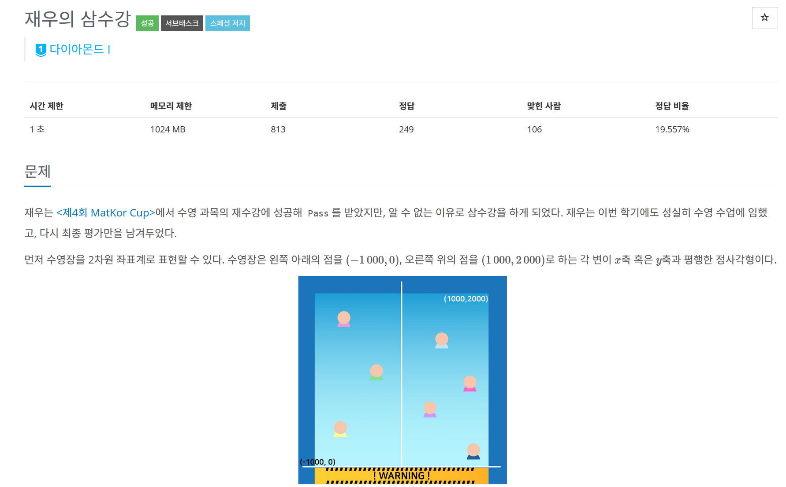
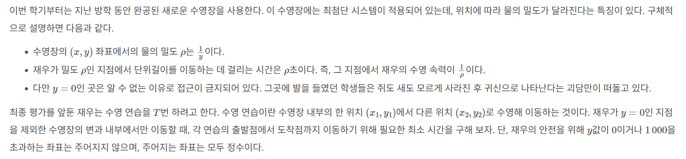
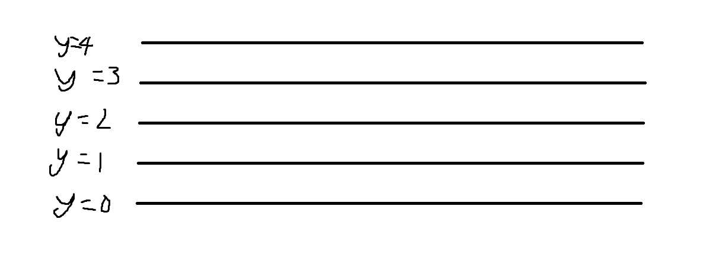
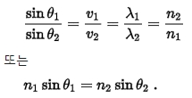
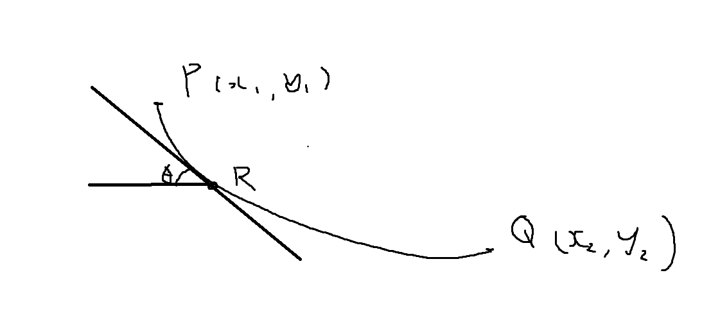
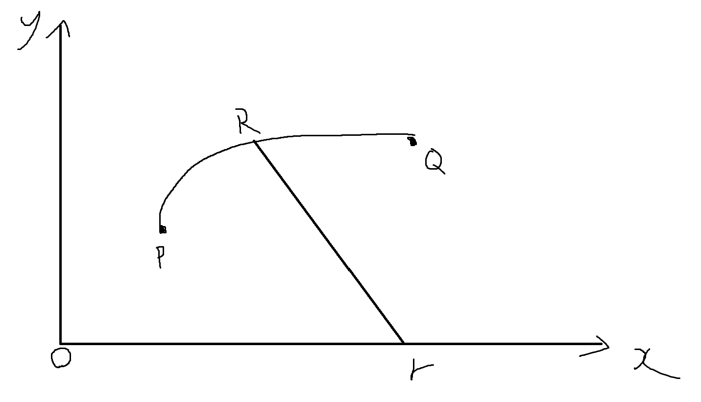

[상위 페이지 · Math](/study/algorithms/math/)





## 문제 태그

- 수학
- 기하학
- 물리학
- 미적분학

## 아이디어



이 문제는 y에 따라 매질이 달라지는 문제로 생각할 수 있음. 고로



위 스넬의 법칙에서 매질이 다수일때의 문제임. 스넬의 법칙에서 매질이 다수일때는

$$
n\sin \theta = C(상수)
$$

가 나오게 된다.

### $$n \sin \theta = C(상수)$$ 유도



미소거리 ds를 지날 때 걸리는 미소시간은

$$
dt = \frac{n(x)ds}{c}
$$

- n(x) : x에서의 굴절률

따라서 점 $$P(x_1,y_1) \rightarrow Q(x_2,y_2)$$ 로 이동한다고 가정하면

$$
t = \frac{1}{c} \int_{x_1}^{x_2}{n(x) \sqrt{1 + y'^2}dx}
$$

따라서 t는 범함수가 되며 이것을 최소화 하려면 오일러-라그랑주를 만족해야한다

$$
\frac{d}{dx} \left[ n(x) \cdot \frac{y'}{\sqrt{1 + y'^2}}  \right] = 0
\\
n(x) \cdot \frac{y'}{\sqrt{1 + y'^2}} = C

$$

이때, n(x) ≥ 이고 위 식에 절대값을 씌운다

$$
n(x) \cdot \left\vert   \frac{y'}{\sqrt{1 + y'^2}}\right\vert  = C
$$

그런데 위 그래프의 점 R을 보면 결국 y'은 해당 점에서의 접선의 기울기와 같고, 그 값은 점 R에 x축과 평행한 선을 그었을 때, 접선과 해당 선이 이루는 예각의 크기를 θ라 하면 $$tan(π-θ)=-tanθ$$이고, $$\vert y'\vert =tanθ$$이다.

$$
\frac{\left\vert y'\right\vert }{\sqrt{1 + \left\vert y'\right\vert ^2}} = \frac {tan\theta}{\sqrt{1 + tan^2\theta}}
\\
= \frac{tan\theta}{sec\theta}
\\
= sin\theta
$$

고로

$$
n \sin \theta = C(상수)
$$

이다.

위 식에서 n을 v로 나타내면

$$
\frac{sin\theta}{v} = C
$$

v = y이기에 v를 y로 치환할 수 있다.



다음 그림을 살펴보자. y에 대해 식을 나타내면

$$
y = Csin\theta,\ \frac{dy}{d\theta} = C cos\theta
$$

이고 y’도 구할 수 있게 된다

$$
y' = \frac{1}{tan\theta}
$$

왜 점 P → Q로 갈 때 직선이 아닌 곡선일까?

그 이유는 위 식($$\frac{sin\theta}{v} = C$$)에 따라 어디에 있든 간에 이 값이 일정해야 하기 때문이다. 이는 곧 점 P→Q는 r을 중심으로 하는 원의 호를 따라 움직이는 것이 최소 시간 경로가 되는 셈이다.

이제 어느 정도 윤곽이 잡혔으니 시간을 구하자. 위에서 구했던것이다.

$$
T = \int_{x_1}^{x_2}{\frac{\sqrt{1 + (y')^2}}{y}}dx
$$

이를 모두 $$\theta$$치환 해준다면 다음과 같은 식이 나온다

$$
T = \int_{\theta_1}^{\theta_2}\frac{1}{sin\theta}d\theta
$$

### theta 치환

### dx 구하기

$$
y' = \frac{dy}{dx} = cot\theta
$$

에 $$\frac{dy}{d\theta}$$를 넣는다

$$
C cos\theta \frac{d\theta}{dx} = cot\theta \rightarrow \frac{d\theta}{dx} = \frac{cot\theta}{Ccos\theta} = \frac{cos\theta}{Csin\theta cos\theta} = Csin\theta = y
$$

따라서

$$
dx = yd\theta = Csin\theta d\theta
$$

### 적분식에 대입

우선 피적분함수의 루트 먼저 계산한다

$$
\sqrt{1 + (y')^2} = \sqrt{1 + cot^2\theta} = \sqrt{csc^2\theta} = csc\theta
$$

이제 원래 적분에 다 치환을 하면

$$
\frac{\sqrt{1+(y')^2}}{y} dx =\frac{csc\theta}{Csin\theta}Csin\theta d\theta = csc\theta d\theta
$$

즉

$$
T = \int_{x_1}^{x_2}{\frac{\sqrt{1 + (y')^2}}{y}}dx = T = \int_{\theta_1}^{\theta_2}csc\theta d\theta = T = \int_{\theta_1}^{\theta_2}\frac{1}{sin\theta}d\theta
$$

위 세타로 치환한 적분식을 적분한다면

$$
T = \int_{\theta_1}^{\theta_2}\frac{1}{sin\theta}d\theta = \left[ ln \left\vert  csc\theta - cot\theta \right\vert \right]^{\theta_2}_{\theta_1}
$$

### 적분 과정

### 미분 형태로 바꾸기

$$
csc\theta = csc\theta\frac{csc\theta + cot\theta}{csc\theta + cot\theta} = \frac{csc^2\theta + csc\theta cot\theta}{csc\theta + cot\theta}

\\
\frac{d}{d\theta}(cot\theta + csc\theta) = -(csc^2\theta + csc\theta cot\theta)
$$

### 치환

$$
u = cot\theta + csc\theta => du = -(csc^2\theta + csc\theta cot\theta)d\theta
$$

따라서

$$
csc\theta d\theta= -\frac{du}{u}
$$

### 적분 정리

$$
I = - \int\frac{du}{u} = -ln\vert u\vert  + C = -ln\vert cot\theta + csc\theta\vert  + C
= ln\vert csc\theta - cot\theta\vert  + C
$$

이대로 적분값을 구해도 좋지만 반각 공식을 사용하여 좀 더 편하게 적분값을 구할 수 있다.

**기본 삼각함수로 표현**

$$
csc\theta - cot\theta = \frac{1}{sin\theta} - \frac{cos\theta}{sin\theta} = \frac{1-cos\theta}{sin\theta}
$$

**반각 공식 대입**

$$
1-cos\theta = 2sin^2\frac{\theta}{2}
\\
sin\theta = 2sin\frac{\theta}{2}cos\frac{\theta}{2}
$$

따라서

$$
\frac{1-cos\theta}{sin\theta} = \frac{2sin^2\frac{\theta}{2}}{2sin\frac{\theta}{2}cos\frac{\theta}{2}} = \frac{sin\frac{\theta}{2}}{cos\frac{\theta}{2}} = tan\frac{\theta}{2}
$$

**최종 적분값 식**

$$
\left[ ln \left\vert  tan\frac{\theta}{2}\right\vert \right]^{\theta_2}_{\theta_1} = ln\left\vert tan\frac{\theta_1}{2}\right\vert  - ln\left\vert tan\frac{\theta_2}{2}\right\vert
$$

고로 각 점P,Q에서 r을 중심으로 하는 원에서의 중심각을 계산해서 적분값을 구한다.

## 정답

```python
import sys
import math
input = sys.stdin.readline

def solve(x,y,x2,y2):
    if x > x2:
        x, x2 = x2, x
    if y > y2:
        y, y2 = y2, y

    if x == x2:
        return math.log(y2) - math.log(y)

    tau = math.atan((y2 - y) / (x2 - x))

    x3 = (x + x2) / 2
    y3 = (y + y2) / 2

    x4 = y3 * math.tan(tau) + x3

    theta1 = math.atan2(y, x4 - x)
    theta2 = math.atan2(y2, x4 - x2)

    val1 = math.log(abs(math.tan(theta1 / 2)))
    val2 = math.log(abs(math.tan(theta2 / 2)))

    return abs(val2 - val1)

def main():
    t = int(input())
    for _ in range(t):
        x, y, x2, y2 = map(float, sys.stdin.readline().split())
        sys.stdout.write(f"{solve(x, y, x2, y2):.6f}\n")

if __name__ == "__main__":
    main()
```
