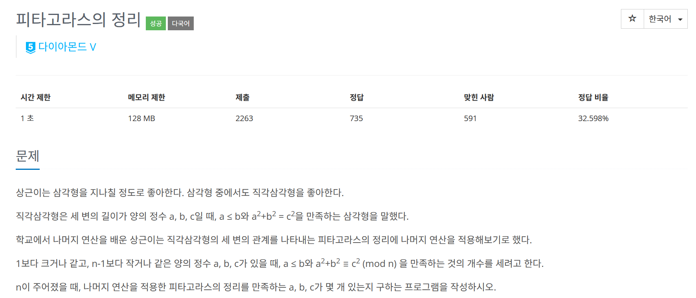

[상위 페이지 · 다이아](/study/algorithms/math/diamond/)



## 문제 태그

- 수학
- fft

## 아이디어

1. $$a^2 + b^2$$은 결국 s = [1,2,3,…,n-1] ⇒ $$s^2$$=[1,4,9…n-1] mod n을 fft 한 결과(X)이다.
2. X[i] = $$a^2 + b^2$$의 값, $$S^2$$[i] = $$c^2$$의 결과
3. 고로 X[i] * S[i] = a,b쌍에 대한 c의 개수. c와 ab쌍은 독립적임으로 경우의 수를 구하기 위해선 곱해야함
4.  $$a^2 + a^2$$인 경우도 확인 해야함.
5. 지금까지 센건 a>b인 경우도 센거니까 1/2하면 정답

## 정답

```python
import sys

input = sys.stdin.readline

MOD = 998244353
PRIMITIVE_ROOT = 3

def modpow(x, e, m=MOD):
    r = 1
    while e:
        if e & 1:
            r = r * x % m
        x = x * x % m
        e >>= 1
    return r

def ntt(a, invert):
    n = len(a)
    # bit-reverse
    j = 0
    for i in range(1, n):
        bit = n >> 1
        while j & bit:
            j ^= bit
            bit >>= 1
        j |= bit
        if i < j:
            a[i], a[j] = a[j], a[i]

    length = 2
    while length <= n:
        wlen = modpow(PRIMITIVE_ROOT, (MOD - 1) // length)
        if invert:
            wlen = modpow(wlen, MOD - 2)
        for i in range(0, n, length):
            w = 1
            half = length >> 1
            for j in range(i, i + half):
                u = a[j]
                v = a[j + half] * w % MOD
                a[j] = (u + v) % MOD
                a[j + half] = (u - v + MOD) % MOD
                w = w * wlen % MOD
        length <<= 1
    # if inverse, divide by n
    if invert:
        inv_n = modpow(n, MOD - 2)
        for i in range(n):
            a[i] = a[i] * inv_n % MOD

n = int(input().strip())

# 1) f[r]: a^2 ≡ r (mod n) 의 빈도
f = [0] * n
for a in range(1, n):
    f[(a * a) % n] += 1

# 2) 순환 합성곱을 위한 NTT
M = 1
while M < 2 * n:
    M <<= 1

A = f + [0] * (M - n)
ntt(A, False)
for i in range(M):
    A[i] = A[i] * A[i] % MOD
ntt(A, True)

# 3) g[s]: a^2 + b^2 ≡ s (mod n) 인 순서쌍 개수
g = [0] * n
for i in range(M):
    g[i % n] = (g[i % n] + A[i])  # 값이 이미 정확히 저장됨

# 4) a ≤ b 보정 후 답 계산
sum1 = 0
sum2 = 0
for s in range(n):
    sum1 += f[s] * g[s]
    sum2 += f[s] * f[(2 * s) % n]

ans = (sum1 + sum2) // 2
print(ans)

```
