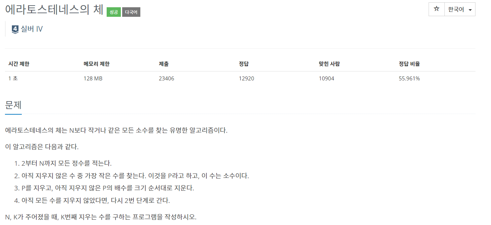

[상위 페이지 · 에라토스테네스의 체](/study/algorithms/math/eratoseuteneseuyi-ce/)

[https://www.acmicpc.net/problem/2960](https://www.acmicpc.net/problem/2960)



## 아이디어

시중에 풀린 에라토스테네스의 체 코드보다 문제에 적혀있는 알고리즘대로 코드를 작성해야 문제를 풀 수 있다

## 정답

```python
n,m = map(int,input().split())  # 찾고자 하는 범위
sieve = [True] * (n+1)  # 모든 수를 소수로 간주
count = 1

for i in range(2,n+1):
    if sieve[i]: #소수라면 배수 제거하기
        for j in range(i,n+1,i):
            if not sieve[j]:   #이미 제거 한 수라면 넘기기
                continue
            sieve[j] = False
            if count == m:
                print(j)
                exit(0)
            count+=1
```
