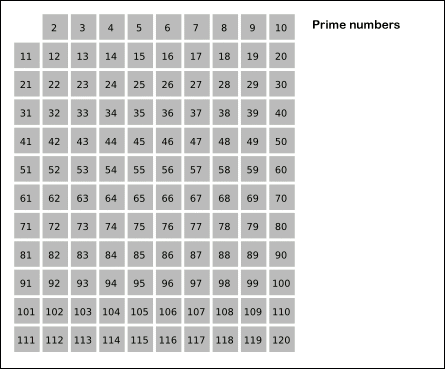

[상위 페이지 · Math](/study/algorithms/math/)

## 선행지식

- for문 사용

## 설명

에라토스테네스의 체는 소수를 찾는 알고리즘 중 하나이다. 2부터 시작하여 차례로 배수들을 지워나가는 방식으로 소수를 찾는다.

예를 들어, 2부터 20까지의 소수를 찾는 경우를 살펴보자. 먼저 2는 소수이므로 2의 배수인 4, 6, 8, 10, 12, 14, 16, 18, 20을 제거한다. 다음으로 3은 소수이므로 3의 배수들을 살펴보는데, 6, 9, 12, 15, 18은 이미 제거되었거나 제거할 수 있으므로 3만 남긴다. 4는 이미 2의 배수로 제거되었고, 5는 소수이므로 5의 배수들을 제거하고 5만 남긴다. 이러한 과정을 반복하여 20까지의 소수를 모두 찾을 수 있다.

에라토스테네스의 체를 구현할 때는 배열을 사용하여 각 숫자의 소수 여부를 저장한다. 처음에는 모든 숫자를 소수로 간주하고, 소수가 아닌 숫자는 배열에서 제거해 나간다.



아래는 에라토스테네스의 체를 이용하여 1부터 100까지의 소수를 찾는 예제 코드이다

```python
# 에라토스테네스의 체를 이용하여 1부터 100까지의 소수를 찾는 코드

n = 100  # 찾고자 하는 범위
sieve = [True] * (n+1)  # 모든 수를 소수로 간주

for i in range(2, int(n**0.5)+1):
    if sieve[i]:
        for j in range(i*2, n+1, i):
            sieve[j] = False  # i의 배수 제거

# 소수 출력
for i in range(2, n+1):
    if sieve[i]:
        print(i, end=' ')
```

## 시간/공간 복잡도 증명

- 시간 복잡도 O(n log log n)의 유도 과정은 다음과 같다:
    - 각 소수 p에 대해 p의 배수를 지우는 연산은 약 n/p번 수행된다
    - 따라서 총 연산 횟수는 n/2 + n/3 + n/5 + n/7 + ... (소수들의 역수 합 × n)이 된다
    - 소수들의 역수 합은 log log n에 비례함이 수학적으로 증명되어 있다
    - 결과적으로 전체 알고리즘의 시간 복잡도는 O(n log log n)이 된다
- 공간 복잡도는 O(n)이다. 이는 1부터 N까지의 모든 수에 대해 소수 여부를 저장하기 위한 불리언 배열이 필요하기 때문이다.

## 최적화

- 범위의 제곱근까지만 검사하는 최적화 원리는 수학적 근거에 기반한다. N까지의 소수를 찾을 때 $$\sqrt N$$보다 큰 수 p가 소수가 아니라면, p = a × b 형태로 표현할 수 있는데 a와 b 중 적어도 하나는 반드시 $$\sqrt N$$ 이하여야 한다. 이미 $$\sqrt N$$ 이하의 모든 소수의 배수를 제거했다면 그 이상의 소수들은 이미 남아있는 수들이 되므로 추가 검사가 불필요하다.
    - 실제 구현 시 이 최적화는 다음과 같이 적용된다:
        - 초기에 2부터 N까지 모든 수를 소수 후보로 표시한다
        - 2부터 $$\sqrt N$$까지의 각 소수 p에 대해 $$p^2$$부터 시작하여 p의 모든 배수를 제거한다
        - p의 배수 중 p × 2, p × 3, ..., p × (p-1)은 이미 이전 단계에서 제거되었으므로 $$p^2$$부터 시작해도 된다
- 추가 최적화 기법으로는 다음과 같은 것들이 있다:
    - 짝수는 2를 제외하고 모두 소수가 아니므로, 홀수만 저장하는 배열을 사용하면 메모리를 절반으로 줄일 수 있다
    - 비트마스킹 기법을 사용하여 bool 배열 대신 비트 단위로 저장하면 메모리 사용량을 8배 줄일 수 있다
    - 세그먼트 체를 사용하여 매우 큰 범위의 소수를 찾을 때 메모리 사용량을 최적화할 수 있다

## 문제해결

- [2960번 에라토스테네스의 체](/study/algorithms/math/eratoseuteneseuyi-ce/boj-2960/)
