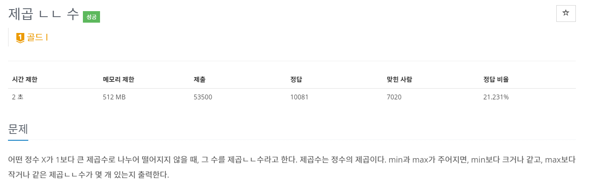

[상위 페이지 · Math](/study/algorithms/math/)

[https://www.acmicpc.net/problem/1016](https://www.acmicpc.net/problem/1016)



## 아이디어

아리스토테네스의 체의 원리를 이용하여 소수의 제곱수들을 지워준다. 하지만 1~max까지 지운다면 시간초과와 메모리가 터질것이다.

제곱수의 배수들을 없앨때, min max범위에 벗어난건 없앨필요 없음으로 그 제곱수의 상수(min / 제곱수)배를 우선 해주고 탐색을 시작한다. 즉 min이랑 가까운 제곱수부터 시작해서 지워주는 것이다.

## 정답

```python
minn, maxx = map(int,input().split())
factorization = {}

for i in range(2,int(maxx**0.5)+1):
    d = max(1,int(minn/(i*i)))
    d *= i*i
    while d<=maxx:
        factorization[d] = factorization.get(d,False)
        d+=i*i

result = 0
for i in range(minn,maxx+1):
    if factorization.get(i,True):
        result+=1
print(result)
```
