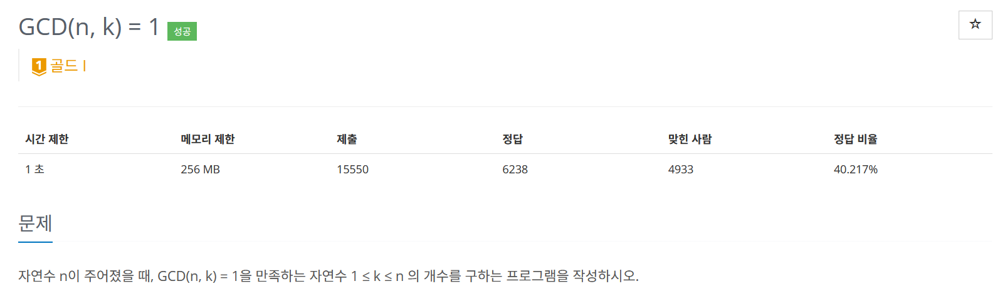

[상위 페이지 · 골드](/study/algorithms/math/gold/)



## 문제 태그

- 오일러 피 함수

## 아이디어

1. GCD(n,k) = 1이란 뜻은 n, k가 서로소 즉 공통된 인수가 없다는 뜻
2. [오일러 피 함수](/study/algorithms/math/oilreo-pi-hamsu/) 를 구현하여 풀면 된다

## 정답

```python
 import sys
input = sys.stdin.readline

N = int(input())
result = N
i = 2
while i ** 2 <= N:
    if N % i == 0:
        result *= (1 - (1/i))
        while not N % i:
            N //= i
    i += 1

if N > 1:
    result *= 1 - 1 / N

print(round(result))
```
