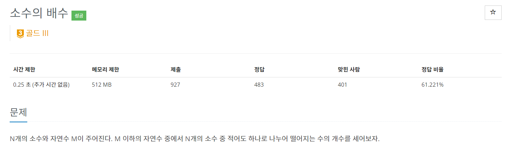

[상위 페이지 · 골드](/study/algorithms/math/gold/)

[https://www.acmicpc.net/problem/17436](https://www.acmicpc.net/problem/17436)



## 아이디어

*챗gpt의 도움을 받음*

문제는 소수가 여러개 주어지고 주어진 소수들로 1~M까지 나누어 떨어지는 개수를 구하는것이다.

만약 1~30까지 소수 2, 3, 5로 나눠지는걸 찾는다면

집합 2 : {2,4,6,8,10,12,14,16,18,20,22,24,26,28,30}

집합 3 : {3,6,9,12,15,18,21,24,27,30}

집합 5 : {5,10,15,20,25,30}

가 있을 것이다.

하지만 집합 2,3,5에는 겹치는것들이 있으며 이것을 제거해주기 위해서는 포함배제원리를 사용해야한다

[포함 배제 원리](/study/algorithms/math/poham-baeje-weonri/) ← 포함배제원리 설명

포함배제원리의 따르면

일단 집합 2의 개수, 집합 3의 개수, 집합 5의 개수를 다 더해준다 그 다음 집합 2와 3의 합집합, 집합 3과 5의 합집합, 집합 2와 집합 5의 합집합을 빼준다. 마지막으로 집합 2와 3 그리고 5의 합집합을 더해준다.

위 과정을 예시와 함께 설명하자면

집합 2의 개수 : {2,4,6,8,10,12,14,16,18,20,22,24,26,28,30} = 15개

집합 3의 개수 : {3,6,9,12,15,18,21,24,27,30} = 10개

집합 5의 개수 : {5,10,15,20,25,30} = 6개

---

겹치는거 빼주기

집합 $$2\cap3$$ 의 개수 = 집합 6의 개수: {6,12,18,24,30} = 5개

집합 $$3\cap5$$의 개수 = 집합 15의 개수 : {15,30} = 2개

집합 $$2\cap5$$의 개수 = 집합 10의 개수 : {10,20,30} = 3개

---

위에서 뺀 것 중 30은 개수에서 다 뺐음으로 다시 더해야 한다

집합 $$2\cap3\cap5$$의 개수 = 집합 30의 개수  : {30} = 1개

---

집합 $$2\cup3\cup5$$의 개수 = 15 + 10 + 6 - 5 - 2 - 3 + 1 = 22개

위 과정을 프로그래밍으로 구현하는건 꽤나 까다롭다, 나는 비트를 이용해서 구현할 것이다.

일단 소수의 개수를 N이라고 했을때 1부터 $$2^N-1$$개 만큼 반복을 한다. 즉 N의 개수가 3이라면 1~7까지 반복한다

1~7까지 반복할때 1~7을 비트로 나타내준다

1 = 001

2 = 010

…

7 = 111

이는 곧 사용할 소수(집합)를 뜻한다 예로 001은 2,3,5중 5를 사용하겠다는것이고 111은 2,3,5 전부 사용하겠다는 뜻이다

이제 사용 할 소수들을 정했으면 이 소수들의 최소 공배수를 구해서 나눠지는 개수를 구한다.

만약 사용 한 소수들의 개수가 홀수개라면 더해주고 짝수개라면 빼준다.

위 과정을 거쳐주면 문제를 해결 할 수 있다.

파이썬의 set()을 이용해 그냥 중복을 제거하면 안되냐! 라는 의견이 있을 수 있다.

안타깝게도 M의 범위는 $$10^{12}$$, 소수의 개수는 10개까지 가능함으로 set에 넣었다간 메모리가 부족할것이다.

## 정답

```python
#포함배제원리의 이해를 위해 챗gpt와 함께 했다
from math import lcm

# 위의 코드를 포함배제 원리를 이용하여 구현하면 다음과 같다.
def get_prime_divisible_count(primes, n):
    count = 0  # 나누어 떨어지는 수의 개수를 저장할 변수 count를 0으로 초기화
    for i in range(1, 2**len(primes)):  # 1부터 2^len(primes)까지 반복문 수행
        s = set()  # i에 대응하는 집합 s를 구성하기 위해 set() 함수를 사용하여 빈 집합 생성
        for j in range(len(primes)):  # primes 리스트의 인덱스를 하나씩 가져와서 반복문 수행
            if i & (1 << j):  # i의 j번째 비트가 1인 경우
                s.add(primes[j])  # 해당 소수를 집합 s에 추가
        sign = -1 if len(s) % 2 == 0 else 1  # 홀수개면 + 짝수개면 - 집합의 부호 결정
																				# lcm은 최소공배수를 구해주는 함수
        count += sign * (n // lcm(*s))  # 최종 결과에 계산된 값 더하기 또는 빼기
    return count  # count 값을 반환

n,m = list(map(int,input().split()))
prime = list(map(int,input().split()))

print(get_prime_divisible_count(prime, m))  # 함수를 호출하여 결과 출력
```
