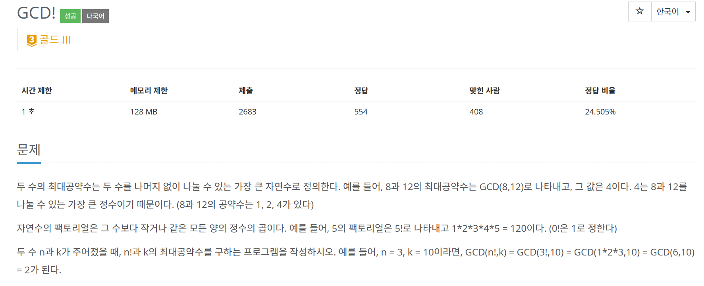

[상위 페이지 · Math](/study/algorithms/math/)



## 문제 태그

- 수학
- 정수론
- 소수 판정

## 아이디어

1. n의 범위가 커서 팩토리얼을 직접 구해서 gcd에 넣는 단순한 문제는 아님.
2. gcd 특성을 알아야함.
    1. a = 504 = $$2^3 + 3^2 + 7$$
    2. b = 108 = $$2^2 + 3^3$$
    3. gcd(a,b) = 둘다 존재하는 소인수중 지수가 작은것 = $$2^2 + 3^2$$ = 36
3. 팩토리얼 소인수 분해 하는 방법
    - N!을 소인수분해하면 N! = 2^a × 3^b × 5^c × ... 와 같이 표현할 수 있다.
    - 예를 들어 100!에서 2의 지수 a를 구하는 방법이다:
    - 2의 배수의 개수: ⌊100/2⌋ = 50이다
    - 4의 배수의 개수: ⌊100/4⌋ = 25이다
    - 8의 배수의 개수: ⌊100/8⌋ = 12이다
    - 16의 배수의 개수: ⌊100/16⌋ = 6이다
    - 32의 배수의 개수: ⌊100/32⌋ = 3이다
    - 64의 배수의 개수: ⌊100/64⌋ = 1이다
    
    따라서 100!에서 2의 총 지수는 50+25+12+6+3+1 = 97이다.
    
    같은 방식으로 다른 소수들의 지수도 계산할 수 있다.
    
4. 팩토리얼을 직접 소인수 분해해도 좋지만 그냥 k만 소인수 분해하고 팩토리얼쪽에서는 그냥 k의 소인수에 맞춰 그때 그때 구해줘도 충분함

## 정답

```python
import sys

def factorize(k):
    factors = {}
    # 2로 나누기
    while k % 2 == 0:
        factors[2] = factors.get(2, 0) + 1
        k //= 2
    # 3,5,7,... 으로 나누기
    p = 3
    while p * p <= k:
        while k % p == 0:
            factors[p] = factors.get(p, 0) + 1
            k //= p
        p += 2
    # 남은 소수
    if k > 1:
        factors[k] = factors.get(k, 0) + 1
    return factors

def exp_in_factorial(n, p):
    cnt = 0
    while n:
        n //= p
        cnt += n
    return cnt

def gcd_factorial(n, k):
    k_facs = factorize(k)
    g = 1
    for p, a in k_facs.items():
        e = exp_in_factorial(n, p)
        if e > 0:
            g *= p ** min(a, e)
    return g

for line in sys.stdin:
    line = line.strip()
    if not line:
        continue
    n, k = map(int, line.split())
    print(gcd_factorial(n, k))
```
