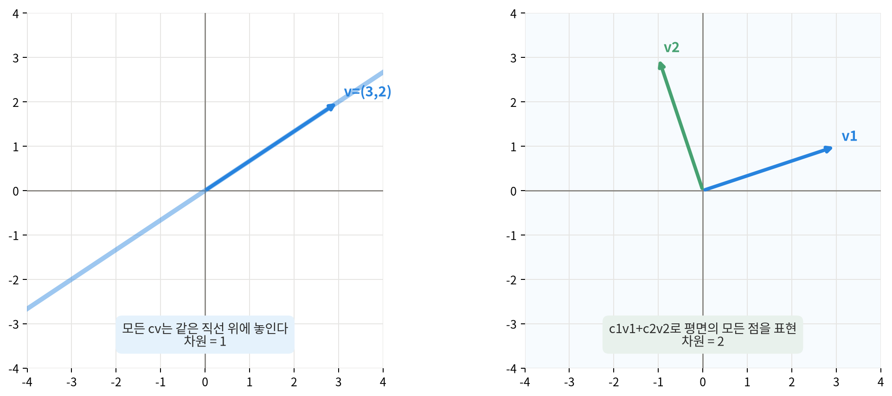
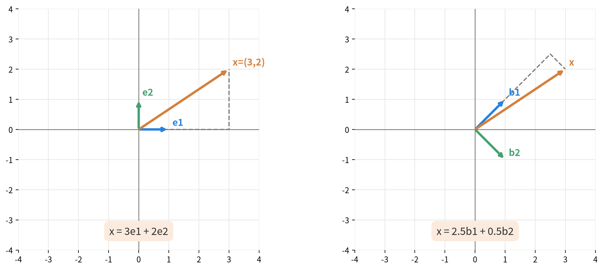
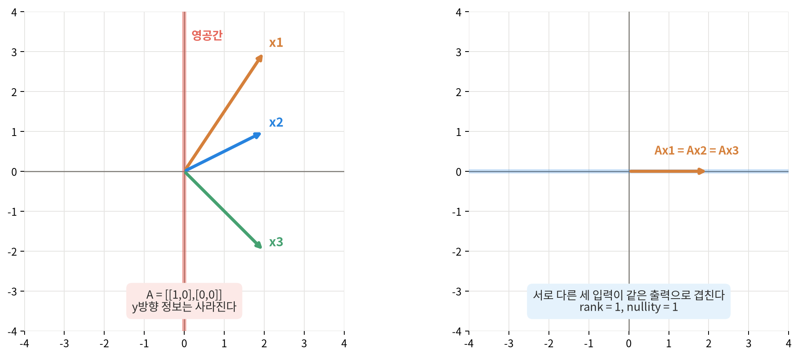
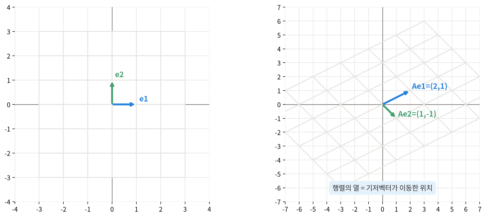

[상위 페이지 · 행렬](/study/algorithms/math/haengryeol/)

## 벡터 공간 (Vector Space)

벡터 공간은 벡터의 덧셈과 스칼라 곱이 정의되고, 그 연산이 일정한 규칙을 만족하는 집합이다. 벡터는 단순히 숫자 화살표만 의미하지 않는다. 함수, 행렬, 다항식처럼 덧셈과 스칼라 곱이 가능한 대상도 벡터가 될 수 있다.

### 벡터 공간의 핵심 조건

집합 $$V$$가 벡터 공간이 되려면 임의의 $$u,v,w\in V$$와 스칼라 $$a,b$$에 대해 다음 성질을 만족해야 한다.

1. $$u+v\in V$$: 덧셈에 대해 닫혀 있다.
2. $$av\in V$$: 스칼라 곱에 대해 닫혀 있다.
3. $$u+v=v+u$$: 덧셈의 교환법칙
4. $$(u+v)+w=u+(v+w)$$: 덧셈의 결합법칙
5. 영벡터 $$0$$가 존재하고 $$v+0=v$$이다.
6. 각 $$v$$에 대해 $$v+(-v)=0$$인 덧셈 역원이 존재한다.
7. $$a(u+v)=au+av$$
8. $$(a+b)v=av+bv$$
9. $$a(bv)=(ab)v$$
10. $$1v=v$$

### 대표적인 예

- $$\mathbb{R}^n$$: 길이가 $$n$$인 실수 벡터들의 공간
- $$\mathbb{R}^{m\times n}$$: $$m\times n$$ 실수행렬들의 공간
- 차수가 $$k$$ 이하인 다항식들의 집합
- 특정 구간에서 정의된 연속함수들의 집합

반면 원점을 지나지 않는 직선은 일반적으로 벡터 공간이 아니다. 예를 들어

$$
S=\{(x,y)\in\mathbb{R}^2:y=2x+1\}
$$

은 영벡터 $$(0,0)$$를 포함하지 않는다.

---

## 부분공간 (Subspace)

부분공간은 더 큰 벡터 공간 안에서 그 자체로도 벡터 공간을 이루는 부분집합이다. $$W\subseteq V$$가 부분공간인지 확인하려면 다음 세 조건이면 충분하다.

1. $$0\in W$$
2. $$u,v\in W$$이면 $$u+v\in W$$
3. $$v\in W$$이면 모든 스칼라 $$c$$에 대해 $$cv\in W$$

### 부분공간 판별 예제

$$
W=\{(x,y,z)\in\mathbb{R}^3:x+y+z=0\}
$$

영벡터는 조건을 만족한다. 또한 $$u,v\in W$$이면 각 성분의 합이 0이므로 $$u+v$$도 조건을 만족하고, $$cu$$도 성분의 합이 0이다. 따라서 $$W$$는 $$\mathbb{R}^3$$의 부분공간이다.

반대로 $$x+y+z=1$$로 정의된 집합은 영벡터를 포함하지 않으므로 부분공간이 아니다.

---

## 선형결합과 생성공간 (Span)

벡터 $$v_1,\ldots,v_k$$와 스칼라 $$c_1,\ldots,c_k$$에 대해

$$
c_1v_1+\cdots+c_kv_k
$$

를 선형결합이라고 한다. 이 벡터들로 만들 수 있는 모든 선형결합의 집합이 생성공간이다.

$$
\operatorname{span}(v_1,\ldots,v_k)
$$

### 기하학적 직관

- 0이 아닌 벡터 하나의 span: 원점을 지나는 직선
- 서로 평행하지 않은 두 벡터의 span: 원점을 지나는 평면
- $$\mathbb{R}^3$$에서 독립인 세 벡터의 span: 전체 $$\mathbb{R}^3$$

예를 들어 $$v_1=(1,0)$$, $$v_2=(0,1)$$이면

$$
a(1,0)+b(0,1)=(a,b)
$$

이므로 두 벡터는 $$\mathbb{R}^2$$ 전체를 생성한다.

벡터 하나의 스칼라 배는 같은 직선 위에서만 움직인다. 반면 독립인 두 벡터의 계수를 각각 바꾸면 평면의 모든 방향으로 움직일 수 있다.

### 계산 예제: 벡터가 span에 포함되는가?

$$v_1=(1,1)$$, $$v_2=(1,-1)$$일 때 $$x=(5,1)$$을 두 벡터의 선형결합으로 표현해보자.

$$
c_1(1,1)+c_2(1,-1)=(5,1)
$$

성분별로 비교하면

$$
c_1+c_2=5,\qquad c_1-c_2=1
$$

이므로 $$c_1=3$$, $$c_2=2$$이다. 따라서

$$
x=3v_1+2v_2
$$

이고 $$x\in\operatorname{span}(v_1,v_2)$$이다.

---

## 선형독립과 선형종속

벡터 $$v_1,\ldots,v_k$$가 선형독립이라는 것은

$$
c_1v_1+\cdots+c_kv_k=0
$$

을 만족하는 계수가 $$c_1=\cdots=c_k=0$$뿐이라는 뜻이다.

0이 아닌 계수로도 위 식을 만족할 수 있으면 선형종속이다. 선형종속인 집합에는 다른 벡터들의 선형결합으로 표현되는 중복 벡터가 존재한다.

### 예제

$$
v_1=(1,2),\qquad v_2=(2,4)
$$

$$v_2=2v_1$$이므로 두 벡터는 같은 방향의 정보만 제공하며 선형종속이다.

반면 $$(1,0)$$과 $$(0,1)$$은 서로의 배수로 만들 수 없으므로 선형독립이다.

### 행렬을 이용한 판별

벡터들을 행렬의 열로 배치한다.

$$
A=\begin{bmatrix}|&|&&|\\v_1&v_2&\cdots&v_k\\|&|&&|\end{bmatrix}
$$

$$Ac=0$$의 해가 $$c=0$$뿐이면 열벡터들이 선형독립이다. 피벗의 개수가 열의 개수와 같다고 표현할 수도 있다.

---

## 기저와 차원

기저는 다음 두 조건을 동시에 만족하는 벡터들의 집합이다.

1. 벡터들이 선형독립이다.
2. 벡터들이 공간 전체를 생성한다.

$$\mathbb{R}^3$$의 표준기저는

$$
e_1=(1,0,0),\qquad e_2=(0,1,0),\qquad e_3=(0,0,1)
$$

이다. 모든 $$x=(x_1,x_2,x_3)$$는 유일하게

$$
x=x_1e_1+x_2e_2+x_3e_3
$$

로 표현된다.

### 차원

차원은 기저에 포함된 벡터의 개수이다.

$$
\dim(\mathbb{R}^n)=n
$$

기저는 여러 가지일 수 있지만 같은 공간의 모든 기저는 같은 개수의 벡터를 가진다.

### 기저에 따른 좌표

기저 $$B=\{b_1,\ldots,b_n\}$$에서 벡터 $$x$$가

$$
x=c_1b_1+\cdots+c_nb_n
$$

로 표현되면 $$(c_1,\ldots,c_n)$$을 기저 $$B$$에 대한 좌표라고 한다.

행렬

$$
P_B=\begin{bmatrix}|&&|\\b_1&\cdots&b_n\\|&&|\end{bmatrix}
$$

를 사용하면 표준좌표와 기저좌표의 관계는

$$
x=P_B[x]_B
$$

이다. 따라서

$$
[x]_B=P_B^{-1}x
$$

이다. 기저변환은 벡터 자체를 바꾸는 것이 아니라 **같은 대상을 표현하는 좌표계**를 바꾸는 일이다.

그림의 벡터 $$x=(3,2)$$는 표준기저에서는 $$3e_1+2e_2$$로 표현된다. 다른 기저 $$b_1=(1,1)$$, $$b_2=(1,-1)$$에서는

$$
x=2.5b_1+0.5b_2
$$

이다. 좌표는 $$(3,2)$$에서 $$(2.5,0.5)$$로 바뀌었지만 실제 벡터의 위치와 방향은 같다.

---

## 행렬의 네 가지 기본 부분공간

$$A\in\mathbb{R}^{m\times n}$$에 대해 다음 네 공간이 중요하다.

### 열공간 (Column Space)

$$
\operatorname{Col}(A)=\{Ax:x\in\mathbb{R}^n\}
$$

$$A$$가 만들 수 있는 모든 출력의 집합이다. $$Ax=b$$가 풀리려면 $$b$$가 열공간에 속해야 한다.

### 영공간 (Null Space)

$$
\operatorname{Null}(A)=\{x:Ax=0\}
$$

$$A$$에 의해 0으로 사라지는 입력 방향이다. 서로 다른 두 입력 $$x_1,x_2$$가 같은 출력으로 변환되면 $$x_1-x_2$$는 영공간에 속한다.

### 행공간 (Row Space)

$$A$$의 행벡터들이 생성하는 $$\mathbb{R}^n$$의 부분공간이다. 입력 중 실제로 출력에 영향을 주는 방향과 관련된다.

### 왼쪽 영공간 (Left Null Space)

$$
\operatorname{Null}(A^T)=\{y:A^Ty=0\}
$$

열공간에 수직인 방향들의 공간이다.

### 직교 관계

- 행공간과 영공간은 서로 직교한다.
- 열공간과 왼쪽 영공간은 서로 직교한다.

이 관계는 최소제곱법과 직교 사영을 이해하는 기반이다.

---

## 랭크와 랭크–영정리

랭크는 행렬의 선형독립인 열 또는 행의 최대 개수이다.

$$
\operatorname{rank}(A)=\dim(\operatorname{Col}(A))=\dim(\operatorname{Row}(A))
$$

랭크는 행렬이 입력에서 보존하여 출력으로 전달하는 독립적인 정보의 차원이다.

### 랭크–영정리

$$A\in\mathbb{R}^{m\times n}$$이면

$$
\operatorname{rank}(A)+\operatorname{nullity}(A)=n
$$

이다. 여기서 nullity는 영공간의 차원이다.

### 예제

$$
A=\begin{bmatrix}1&2&3\\2&4&6\end{bmatrix}
$$

두 번째 행은 첫 번째 행의 2배이므로 $$\operatorname{rank}(A)=1$$이다. 열이 3개이므로

$$
\operatorname{nullity}(A)=3-1=2
$$

이다. 즉 입력은 3차원이지만 출력에 독립적으로 전달되는 정보는 한 방향뿐이고, 두 방향의 정보는 소실된다.

### 시각 예제: 평면을 직선으로 누르는 변환

$$
P=\begin{bmatrix}1&0\\0&0\end{bmatrix}
$$

은 $$(x,y)$$를 $$(x,0)$$으로 보낸다. 모든 y축 방향 벡터 $$(0,y)$$는 영벡터가 되므로 영공간은 y축이다. 출력은 x축 위에서만 움직이므로 열공간은 x축이고 랭크는 1이다.

$$(2,3)$$, $$(2,1)$$, $$(2,-2)$$는 서로 다른 입력이지만 모두 $$(2,0)$$으로 변환된다. 따라서 이 변환에서는 y성분을 복구할 수 없다.

---

## 선형 변환 (Linear Transformation)

함수 $$T:V\to W$$가 다음 두 조건을 만족하면 선형 변환이다.

$$
T(u+v)=T(u)+T(v)
$$

$$
T(cv)=cT(v)
$$

두 식을 합치면

$$
T(c_1v_1+\cdots+c_kv_k)=c_1T(v_1)+\cdots+c_kT(v_k)
$$

이다. 즉 입력의 선형결합 구조가 출력에서도 그대로 보존된다.

### 선형 변환과 행렬

유한차원 벡터 공간에서 기저를 정하면 모든 선형 변환을 행렬로 나타낼 수 있다.

$$
T(x)=Ax
$$

행렬 $$A$$의 $$j$$번째 열은 $$j$$번째 표준기저벡터가 변환된 결과이다.

$$
A=\begin{bmatrix}|&|&&|\\T(e_1)&T(e_2)&\cdots&T(e_n)\\|&|&&|\end{bmatrix}
$$

따라서 변환이 각 기저벡터를 어디로 보내는지만 알면 전체 변환을 알 수 있다.

### 예제: 2차원 변환의 행렬 구하기

$$
T(x,y)=(2x+y,x-y)
$$

표준기저를 변환하면

$$
T(1,0)=(2,1),\qquad T(0,1)=(1,-1)
$$

이므로

$$
A=\begin{bmatrix}2&1\\1&-1\end{bmatrix}
$$

이고 $$T(x)=Ax$$이다.

행렬의 첫 번째 열 $$(2,1)^T$$은 $$e_1$$이 이동한 위치이고, 두 번째 열 $$(1,-1)^T$$은 $$e_2$$가 이동한 위치이다. 나머지 모든 벡터와 격자는 이 두 방향의 선형결합에 따라 함께 변형된다.

예를 들어 $$x=(2,3)$$이면

$$
Ax=\begin{bmatrix}2&1\\1&-1\end{bmatrix}\begin{bmatrix}2\\3\end{bmatrix}=\begin{bmatrix}7\\-1\end{bmatrix}
$$

이다. 같은 결과는 $$x=2e_1+3e_2$$를 이용해

$$
T(x)=2T(e_1)+3T(e_2)=2(2,1)+3(1,-1)=(7,-1)
$$

로도 구할 수 있다.

---

## 핵과 상

선형 변환 $$T:V\to W$$에 대해 다음을 정의한다.

- **핵(Kernel)**: $$T(v)=0$$이 되는 모든 입력
- **상(Image)**: $$T$$가 만들 수 있는 모든 출력

행렬 표현 $$T(x)=Ax$$에서는 핵이 $$\operatorname{Null}(A)$$이고 상이 $$\operatorname{Col}(A)$$이다.

### 단사와 전사

- **단사(Injective)**: 서로 다른 입력이 서로 다른 출력으로 간다.
- **전사(Surjective)**: 공역의 모든 출력을 만들 수 있다.

선형 변환에서는 다음이 성립한다.

- $$T$$가 단사 $$\Leftrightarrow \operatorname{Ker}(T)=\{0\}$$
- $$T$$가 전사 $$\Leftrightarrow \operatorname{Im}(T)=W$$
- 정사각행렬 $$A$$가 가역 $$\Leftrightarrow$$ 단사이면서 전사

$$A\in\mathbb{R}^{m\times n}$$에서 열들이 독립이면 단사이고, 열공간이 $$\mathbb{R}^m$$ 전체이면 전사이다.

---

## 변환의 합성과 행렬곱

$$T(x)=Bx$$를 먼저 적용하고 $$S(y)=Ay$$를 나중에 적용하면

$$
S(T(x))=A(Bx)=(AB)x
$$

이다. 따라서 $$AB$$에서는 **$$B$$가 먼저, $$A$$가 나중**에 적용된다. 행렬곱이 일반적으로 교환되지 않는 이유는 변환의 순서가 결과에 영향을 주기 때문이다.

$$
AB\neq BA
$$

---

## 선형 변환의 기하학적 의미

### 스케일링

$$
A=\begin{bmatrix}s_x&0\\0&s_y\end{bmatrix}
$$

x축과 y축 방향을 각각 $$s_x$$, $$s_y$$배 한다.

### 회전

$$
R(\theta)=\begin{bmatrix}\cos\theta&-\sin\theta\\\sin\theta&\cos\theta\end{bmatrix}
$$

벡터를 원점 중심으로 $$\theta$$만큼 회전한다.

### 반사

$$
A=\begin{bmatrix}1&0\\0&-1\end{bmatrix}
$$

x축을 기준으로 반사한다.

### 사영

단위벡터 $$u$$가 생성하는 직선으로의 사영은

$$
P=uu^T
$$

이며 $$Px$$는 $$x$$를 해당 직선에 사영한 결과이다. 사영행렬은

$$
P^2=P
$$

를 만족한다.

### 랭크가 낮은 변환

2차원 공간을 직선으로 사영하면 출력은 한 방향에서만 움직일 수 있으므로 랭크가 1이다. 이런 변환은 일부 입력 정보를 되돌릴 수 없게 제거한다.

---

## 선형 변환과 아핀 변환

선형 변환은 반드시 원점을 원점으로 보낸다.

$$
T(0)=0
$$

아핀 변환은 선형 변환에 평행이동을 더한 것이다.

$$
T(x)=Ax+b
$$

$$b=0$$이면 선형 변환이고, $$b\neq0$$이면 일반적으로 원점을 $$b$$로 이동시키므로 선형 변환이 아니다. 다만 직선과 평행 관계는 보존한다.

예를 들어 $$T(x,y)=(2x,y)+(1,-1)$$은 축별 크기 변환 후 $$(1,-1)$$만큼 평행이동하는 아핀 변환이다.

---

## 종합 예제

다음 행렬을 생각하자.

$$
A=\begin{bmatrix}1&2&3\\2&4&6\end{bmatrix}
$$

1. 두 번째 행은 첫 번째 행의 2배이므로 랭크는 1이다.
2. 열공간은 $$(1,2)^T$$가 생성하는 직선이다.
3. $$Ax$$가 만들 수 있는 출력은 모두 $$(t,2t)^T$$ 형태이다.
4. 입력 차원은 3이고 랭크가 1이므로 영공간의 차원은 2이다.
5. 서로 다른 많은 입력이 같은 출력으로 변환되므로 이 변환은 단사가 아니다.
6. $$\mathbb{R}^2$$ 전체를 출력할 수 없으므로 전사도 아니다.
7. 이 행렬은 3차원 입력에서 한 방향의 정보만 출력에 남기는 저랭크 변환이다.

이 예제는 랭크, 열공간, 영공간, 단사·전사, 정보 손실이 모두 같은 현상을 서로 다른 관점에서 설명한다는 것을 보여준다.

---
