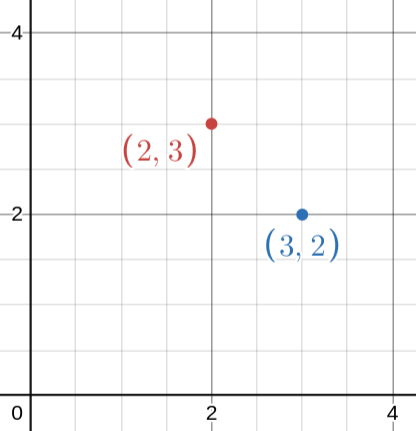
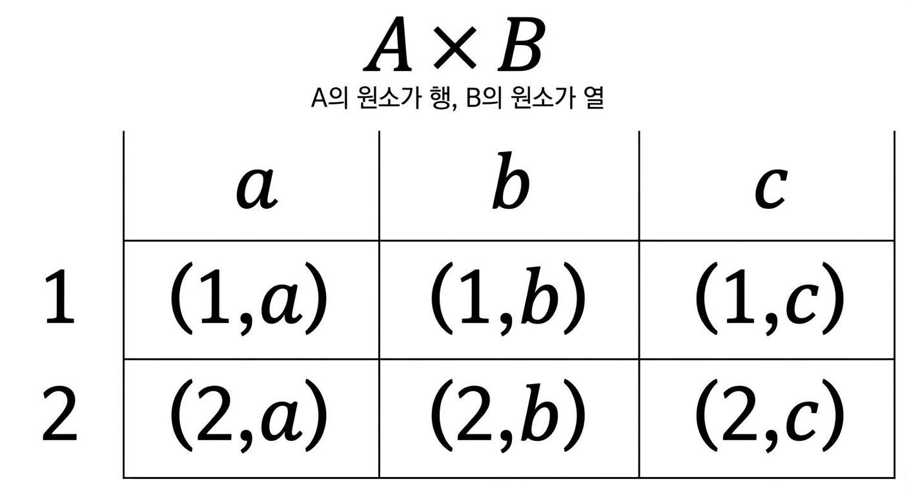
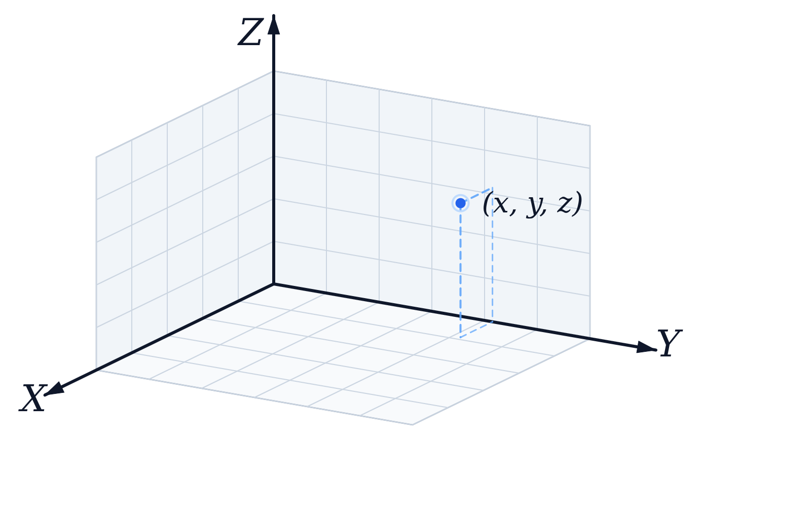

[상위 페이지 · 집합론](/study/algorithms/math/jibhabron/)

앞서 우리는 '집합'이라는 개념을 통해 원소들을 모으고, 합집합, 교집합 등 집합 자체를 연산하는 방법을 배웠다. 이제부터는 한 걸음 더 나아가, **두 집합의 원소들을 서로 '연결'하고 '짝짓는'** 방법에 대해 배운다. 이 '연결' 또는 '짝지음'을 수학적으로 엄밀하게 정의한 것이 바로 **관계**이며, 이 관계 중에서 매우 특별하고 유용한 규칙을 만족하는 것이 **함수**이다.

이 단원에서는 먼저 두 원소의 순서가 중요한 **'순서쌍(Ordered Pair)'** 개념을 도입하고, 두 집합 간에 만들 수 있는 모든 가능한 순서쌍의 집합인 **'곱집합(Cartesian Product)'**을 정의한다.

이 곱집합을 기반으로, 우리는 '관계'를 '곱집합의 부분집합'으로 공식화한다. "a는 b보다 작다", "a는 b의 약수이다"와 같은 다양한 연결 규칙들이 어떻게 수학적 '관계'로 표현되는지 살펴볼 것이다. 또한, 관계의 여러 종류(반사, 대칭, 추이 관계)를 분석하고, 이들을 모두 만족하여 '같다'의 개념을 확장하는 **'동치관계(Equivalence Relation)'**에 대해 깊이 있게 다룬다.

마지막으로, '관계' 중에서 가장 중요하고 질서정연한 형태인 '함수'를 배운다. 함수는 하나의 입력(정의역의 원소)에 대해 **오직 하나의 출력(공역의 원소)만이 짝지어지는** 특별한 관계이다. 함수의 기본 정의부터 일대일 함수, 전사 함수 등 **함수의 다양한 종류**를 배우고, 두 함수를 연결하는 **'합성함수'**와 함수의 연산을 거꾸로 되돌리는 **'역함수'**의 개념까지 탐구하며 현대 수학의 가장 기본적인 도구를 완성한다.

## 순서쌍과 곱집합

### **순서쌍의 정의**

앞서 배운 집합의 개념에서는 원소들의 **순서가 중요하지 않았다**. 예를 들어, $$\{1, 2\}$$와 $$\{2, 1\}$$은 완전히 같은 집합이다. 그러나 실생활에서는 순서가 중요한 경우가 많다. 좌표평면 위의 점 $$(2, 3)$$과 $$(3, 2)$$는 다른 위치를 나타내며, "철수가 영희를 좋아한다"와 "영희가 철수를 좋아한다"는 다른 의미이다.

이처럼 **원소의 순서가 중요한 경우**를 표현하기 위해 **순서쌍(Ordered Pair)**이라는 개념을 도입한다.

**정의:** 두 원소 $$a$$와 $$b$$에 대하여, $$a$$를 첫 번째 성분, $$b$$를 두 번째 성분으로 하는 순서쌍을 $$(a, b)$$로 나타낸다.

순서쌍 $$(a, b)$$와 $$(c, d)$$가 같을 필요충분조건은 $$a = c$$이고 $$b = d$$일 때이다. 즉:

$$
(a, b) = (c, d) \Leftrightarrow a = c \text{ and } b = d
$$

이는 일반 집합과의 중요한 차이점이다. 집합 $$\{a, b\} = \{b, a\}$$이지만, 순서쌍 $$(a, b) \neq (b, a)$$ (단, $$a \neq b$$일 때)이다.

> 좌표평면에서 $$(2, 3)$$과 $$(3, 2)$$는 서로 다른 점이다.
> 

### **순서쌍의 확장**

순서쌍의 개념은 세 개 이상의 원소로 확장할 수 있다. 세 원소 $$a, b, c$$의 순서쌍을 **순서삼조(Ordered Triple)**라 하고 $$(a, b, c)$$로 나타낸다. 일반적으로 $$n$$개의 원소의 순서쌍을 **순서 n-조(Ordered n-tuple)**라 하고 $$(a_1, a_2, \ldots, a_n)$$으로 나타낸다.

### **곱집합의 정의**

두 집합 $$A$$와 $$B$$가 주어졌을 때, $$A$$의 원소를 첫 번째 성분으로, $$B$$의 원소를 두 번째 성분으로 하는 모든 가능한 순서쌍들의 집합을 만들 수 있다. 이를 **곱집합(Cartesian Product)** 또는 **데카르트 곱**이라고 한다.

**정의:** 두 집합 $$A$$와 $$B$$에 대하여, $$A$$와 $$B$$의 곱집합 $$A \times B$$는 다음과 같이 정의된다:

$$
A \times B = \{(a, b) \mid a \in A \text{ and } b \in B\}
$$

즉, $$A \times B$$는 첫 번째 성분이 $$A$$의 원소이고 두 번째 성분이 $$B$$의 원소인 모든 순서쌍의 집합이다.

### **곱집합의 예시**

**예시 1:** $$A = \{1, 2\}$$, $$B = \{a, b, c\}$$일 때, $$A \times B$$를 구하면:

$$
A \times B = \{(1, a), (1, b), (1, c), (2, a), (2, b), (2, c)\}
$$

$$A$$의 원소가 2개, $$B$$의 원소가 3개이므로, $$A \times B$$의 원소는 $$2 \times 3 = 6$$개이다.

곱집합 표: A={1,2}, B={a,b,c}

> 세로축(행)에 $$A$$의 원소, 가로축(열)에 $$B$$의 원소를 두고 각 칸에 순서쌍을 적으면 $$A\times B$$를 한눈에 볼 수 있다.
> 

**예시 2:** 실수 집합 $$\mathbb{R}$$에 대하여, $$\mathbb{R} \times \mathbb{R}$$은 실수 순서쌍 $$(x, y)$$의 집합이며, 이는 2차원 좌표평면의 모든 점을 나타낸다. 따라서:

$$
\mathbb{R} \times \mathbb{R} = \mathbb{R}^2
$$

이는 우리가 익히 아는 $$xy$$-평면과 같다.

(사진 필요: 2차원 좌표평면($$xy$$-평면)에 여러 점들을 표시하여 $$\mathbb{R} \times \mathbb{R} = \mathbb{R}^2$$가 평면의 모든 점을 나타냄을 보여주는 그림)

### **곱집합의 성질**

**1. 곱집합은 교환법칙이 성립하지 않는다**

일반적으로 $$A \times B \neq B \times A$$이다. 왜냐하면 $$(a, b) \neq (b, a)$$ ($$a \neq b$$일 때)이기 때문이다.

예를 들어, $$A = \{1, 2\}$$, $$B = \{x, y\}$$일 때:

- $$A \times B = \{(1, x), (1, y), (2, x), (2, y)\}$$
- $$B \times A = \{(x, 1), (x, 2), (y, 1), (y, 2)\}$$

두 집합은 명백히 다르다.

**2. 곱집합의 원소 개수**

유한집합 $$A$$, $$B$$에 대하여, $$\vert A\vert  = m$$, $$\vert B\vert  = n$$일 때:

$$
\vert A \times B\vert  = \vert A\vert  \times \vert B\vert  = m \times n
$$

이는 $$A$$의 각 원소마다 $$B$$의 모든 원소와 짝을 이루기 때문이다.

**3. 공집합과의 곱집합**

임의의 집합 $$A$$에 대하여:

$$
A \times \phi = \phi \times A = \phi
$$

공집합에는 원소가 없으므로, 순서쌍을 만들 수 없다.

**4. 곱집합과 분배법칙**

곱집합은 합집합과 교집합에 대하여 분배법칙이 성립한다:

$$
A \times (B \cup C) = (A \times B) \cup (A \times C)
$$

$$
A \times (B \cap C) = (A \times B) \cap (A \times C)
$$

$$
(A \cup B) \times C = (A \times C) \cup (B \times C)
$$

$$
(A \cap B) \times C = (A \times C) \cap (B \times C)
$$

### **n개 집합의 곱집합**

곱집합의 개념은 여러 개의 집합으로 확장할 수 있다. 집합 $$A_1, A_2, \ldots, A_n$$에 대하여:

$$
A_1 \times A_2 \times \cdots \times A_n = \{(a_1, a_2, \ldots, a_n) \mid a_i \in A_i \text{ for each } i = 1, 2, \ldots, n\}
$$

특히, 같은 집합 $$A$$의 $$n$$번 곱집합을 $$A^n$$으로 나타낸다:

$$
A^n = \underbrace{A \times A \times \cdots \times A}_{n \text{개}}
$$

예를 들어, $$\mathbb{R}^3 = \mathbb{R} \times \mathbb{R} \times \mathbb{R}$$는 3차원 공간의 모든 점 $$(x, y, z)$$를 나타낸다.

> $$\mathbb{R}^3$$의 원소는 3차원 공간의 점 $$(x, y, z)$$로 생각할 수 있다.
> 

### **곱집합의 응용**

곱집합은 수학의 여러 분야에서 핵심적인 역할을 한다:

- **좌표 기하학:** 평면과 공간의 점들은 각각 $$\mathbb{R}^2$$와 $$\mathbb{R}^3$$의 원소로 표현된다
- **관계와 함수:** 다음 절에서 배울 관계는 곱집합의 부분집합으로 정의되며, 함수는 특별한 관계이다
- **확률론:** 두 사건의 결과 공간은 각 사건의 표본공간의 곱집합으로 표현된다
- **선형대수학:** 행렬과 벡터 공간의 개념은 곱집합을 기반으로 한다

### **곱집합과 일반 집합의 차이**

곱집합을 이해할 때 주의해야 할 점은, 곱집합 $$A \times B$$와 집합의 집합 $$\{A, B\}$$를 혼동하지 않는 것이다:

- $$A \times B$$는 순서쌍 $$(a, b)$$들의 집합이다
- $$\{A, B\}$$는 집합 $$A$$와 $$B$$를 원소로 하는 집합이다

예를 들어, $$A = \{1, 2\}$$, $$B = \{3, 4\}$$일 때:

- $$A \times B = \{(1, 3), (1, 4), (2, 3), (2, 4)\}$$ - 순서쌍 4개로 이루어진 집합
- $$\{A, B\} = \{\{1, 2\}, \{3, 4\}\}$$ - 집합 2개로 이루어진 집합

이 둘은 완전히 다른 개념이며, 혼동하지 않도록 주의해야 한다.

## 관계

곱집합 $$A \times B$$를 정의하면, 두 집합의 원소를 “연결”하는 규칙을 **곱집합의 부분집합**으로 엄밀하게 표현할 수 있다. 이 절에서는 관계의 정의와 기본 연산(역관계, 합성)을 정리한다.

### 관계의 정의

<aside class="notion-callout notion-callout--with-icon" markdown="1">
💡
{: .notion-callout__icon aria-hidden="true"}

**정의(관계)**

집합 $$A, B$$에 대하여, $$A$$에서 $$B$$로의 **관계** $$R$$은 $$A \times B$$의 부분집합이다.

즉,

$$
R \subseteq A \times B
$$

</aside>

관계 $$R$$의 원소 $$(a,b)$$에 대해 $$(a,b)\in R$$이라고 쓰거나, 이를 줄여

$$
aRb
$$

라고 쓴다.

### 정의역, 공역, 치역

관계 $$R \subseteq A\times B$$가 주어졌을 때 다음을 정의한다.

- **정의역**
    
    $$
    \mathrm{Dom}(R)=\{a\in A: \exists b\in B,\ (a,b)\in R\}
    $$
    
- **치역**
    
    $$
    \mathrm{Ran}(R)=\{b\in B: \exists a\in A,\ (a,b)\in R\}
    $$
    
- $$A$$, $$B$$는 관계를 정의할 때 미리 정한 집합이므로 흔히 **공역**을 $$B$$로 부른다.

<aside class="notion-callout notion-callout--with-icon" markdown="1">
💡
{: .notion-callout__icon aria-hidden="true"}

치역 $$\mathrm{Ran}(R)$$는 실제로 연결되는 값들의 집합이고, 공역 $$B$$는 “허용된 출력의 전체 후보”이다. 일반적으로 $$\mathrm{Ran}(R) \subseteq B$$이다.

</aside>

### 역관계

<aside class="notion-callout notion-callout--with-icon" markdown="1">
💡
{: .notion-callout__icon aria-hidden="true"}

**정의(역관계)**

관계 $$R\subseteq A\times B$$에 대하여, $$B$$에서 $$A$$로의 관계 $$R^{-1}$$을

$$
R^{-1}=\{(b,a)\in B\times A : (a,b)\in R\}
$$

로 정의한다.

</aside>

#### 성질

<aside class="notion-callout notion-callout--with-icon" markdown="1">
💡
{: .notion-callout__icon aria-hidden="true"}

**정리** $$(R^{-1})^{-1}=R$$

</aside>

**증명:**

$$
(x,y)\in (R^{-1})^{-1} \Leftrightarrow (y,x)\in R^{-1} \Leftrightarrow (x,y)\in R
$$

보이고 싶은 것은 두 집합이 서로 포함된다는 것이다.

1) $$(R^{-1})^{-1}\subseteq R$$를 보이자. 임의로 $$(x,y)\in (R^{-1})^{-1}$$라고 하자. 그러면 역관계의 정의에 의해

$$
(y,x)\in R^{-1}
$$

이다. 다시 역관계의 정의를 한 번 더 적용하면, 이는 곧

$$
(x,y)\in R
$$

을 의미한다. 따라서 $$(x,y)\in R$$이므로 $$(R^{-1})^{-1}\subseteq R$$이다.

2) $$R\subseteq (R^{-1})^{-1}$$를 보이자. 임의로 $$(x,y)\in R$$라고 하자. 그러면 역관계의 정의에 의해

$$
(y,x)\in R^{-1}
$$

이고, 다시 역관계의 정의에 의해

$$
(x,y)\in (R^{-1})^{-1}
$$

이다. 따라서 $$R\subseteq (R^{-1})^{-1}$$이다.

1), 2)로부터 $$(R^{-1})^{-1}=R$$.

### 관계의 합성

세 집합 $$A,B,C$$에 대해 $$R\subseteq A\times B$$, $$S\subseteq B\times C$$가 주어졌다고 하자.

<aside class="notion-callout notion-callout--with-icon" markdown="1">
💡
{: .notion-callout__icon aria-hidden="true"}

**정의(합성관계)**

$$A$$에서 $$C$$로의 관계 $$S\circ R$$을

$$
S\circ R=\{(a,c)\in A\times C : \exists b\in B,\ (a,b)\in R\ \text{and}\ (b,c)\in S\}
$$

로 정의한다.

</aside>

이는 “$$a$$가 어떤 $$b$$와 $$R$$로 연결되고, 그 $$b$$가 $$c$$와 $$S$$로 연결될 때 $$a$$와 $$c$$를 연결한다”는 뜻이다.

#### 성질

<aside class="notion-callout notion-callout--with-icon" markdown="1">
💡
{: .notion-callout__icon aria-hidden="true"}

**정리 1** 합성은 결합법칙을 만족한다. 즉, $$T\subseteq C\times D$$에 대해

$$
T\circ (S\circ R)=(T\circ S)\circ R
$$

</aside>

**증명:**

역시 두 집합이 서로 포함됨을 보이면 된다. 다만 양쪽 모두 “중간에 거쳐 가는 원소가 존재한다”는 형태이므로, 원소 하나를 잡고 정의를 그대로 풀어쓰면 된다.

임의의 $$(a,d)\in A\times D$$를 잡자.

- 먼저 $$(a,d)\in T\circ (S\circ R)$$라고 하자. 합성의 정의에 의해 어떤 $$c\in C$$가 존재하여
    - $$(a,c)\in S\circ R$$이고
    - $$(c,d)\in T$$
    
    가 성립한다.
    
    그런데 $$(a,c)\in S\circ R$$이므로, 다시 합성의 정의에 의해 어떤 $$b\in B$$가 존재하여
    
    - $$(a,b)\in R$$이고
    - $$(b,c)\in S$$
    
    가 성립한다.
    
    따라서 어떤 $$b\in B$$, $$c\in C$$가 존재하여
    
    $$
    (a,b)\in R,\quad (b,c)\in S,\quad (c,d)\in T
    $$
    
    가 성립한다.
    
- 반대로, 어떤 $$b\in B$$, $$c\in C$$가 존재하여 위 세 조건이 성립한다고 하자. 그러면 $$(b,c)\in S$$이고 $$(c,d)\in T$$이므로 합성의 정의에 의해 $$(b,d)\in T\circ S$$이다. 다시 $$(a,b)\in R$$과 $$(b,d)\in T\circ S$$로부터 합성의 정의에 의해
    
    $$
    (a,d)\in (T\circ S)\circ R
    $$
    
    가 된다.
    

정리하면,

$$
(a,d)\in T\circ (S\circ R) \Leftrightarrow \exists b\in B,\exists c\in C\ \text{s.t.}\ (a,b)\in R,\ (b,c)\in S,\ (c,d)\in T
$$

이고, 이 조건은 곧 $$(a,d)\in (T\circ S)\circ R$$와 동치이다. 따라서

$$
T\circ (S\circ R)=(T\circ S)\circ R.
$$

<aside class="notion-callout notion-callout--with-icon" markdown="1">
💡
{: .notion-callout__icon aria-hidden="true"}

**정리 2** 역관계와 합성은 다음을 만족한다.

$$
(S\circ R)^{-1}=R^{-1}\circ S^{-1}
$$

</aside>

**증명:**

임의의 $$(c,a)\in C\times A$$를 잡고, 양변의 정의를 한 단계씩 풀어서 서로 동치임을 보이자.

1) $$(c,a)\in (S\circ R)^{-1}$$라고 하자. 역관계의 정의에 의해

$$
(a,c)\in S\circ R
$$

이다. 합성의 정의에 의해 어떤 $$b\in B$$가 존재하여

$$
(a,b)\in R\quad \text{and}\quad (b,c)\in S
$$

가 성립한다.

2) 이제 위 두 조건을 역관계로 바꾸어 쓰면,

- $$(a,b)\in R$$는 $$(b,a)\in R^{-1}$$와 동치이고,
- $$(b,c)\in S$$는 $$(c,b)\in S^{-1}$$와 동치이다.

따라서 어떤 $$b\in B$$가 존재하여

$$
(c,b)\in S^{-1}\quad \text{and}\quad (b,a)\in R^{-1}
$$

가 성립한다.

3) 마지막으로 합성의 정의에 의해 이는 곧

$$
(c,a)\in R^{-1}\circ S^{-1}
$$

를 의미한다.

역으로도 같은 논리를 거꾸로 적용하면 되므로,

$$
(c,a)\in (S\circ R)^{-1} \Leftrightarrow (c,a)\in R^{-1}\circ S^{-1}
$$

이고, 따라서 $$(S\circ R)^{-1}=R^{-1}\circ S^{-1}$$이다.

### 예시

- **예시 1 (부등호 관계):** $$\mathbb{R}$$에서
    
    $$
    \le\ =\{(x,y)\in \mathbb{R}\times \mathbb{R}: x\le y\}
    $$
    
    는 $$\mathbb{R}\times\mathbb{R}$$의 부분집합이므로 관계이다.
    
- **예시 2 (나눗셈 관계):** 자연수 집합 $$\mathbb{N}$$에서
    
    $$
    a\mid b \iff \exists k\in \mathbb{N},\ b=ak
    $$
    
    로 정의하면 $$\mid$$는 $$\mathbb{N}\times\mathbb{N}$$의 부분집합이므로 관계이다.
    
- **예시 3 (역관계):** $$\le$$의 역관계는 $$\ge$$이며,
    
    $$
    (\le)^{-1}=\ge.
    $$
    

## 관계의 종류

관계를 조금 더 체계적으로 분류하기 위해, 한 집합 $$A$$ 위의 관계 $$R\subseteq A\times A$$에 대해 몇 가지 성질을 정의한다. 여기서 “$$A$$에서 $$A$$로의 관계”를 특히 $$A$$ 위의 관계라고 부른다.

### 반사관계, 대칭관계, 추이관계

<aside class="notion-callout notion-callout--with-icon" markdown="1">
💡
{: .notion-callout__icon aria-hidden="true"}

집합 $$A$$ 위의 관계 $$R$$에 대해 다음을 정의한다.

- **반사:** $$\forall a\in A,\ (a,a)\in R$$
- **대칭:** $$\forall a,b\in A,\ (a,b)\in R \Rightarrow (b,a)\in R$$
- **추이:** $$\forall a,b,c\in A,\ (a,b)\in R \land (b,c)\in R \Rightarrow (a,c)\in R$$
</aside>

각 성질은 “자기 자신과의 관계”, “순서 바꾸기”, “연결의 연쇄”를 의미한다. 예를 들어 $$\le$$는 반사이고($$x\le x$$), 대칭은 아니며($$1\le 2$$지만 $$2\le 1$$은 거짓), 추이는 성립한다.

### 반대칭과 부분순서

대칭과는 다른 방향의 성질도 중요하다.

<aside class="notion-callout notion-callout--with-icon" markdown="1">
💡
{: .notion-callout__icon aria-hidden="true"}

- **반대칭:** $$\forall a,b\in A,\ (a,b)\in R\land (b,a)\in R \Rightarrow a=b$$
</aside>

반대칭은 “서로 양방향으로 연결되면 사실상 같은 원소다”라는 뜻이다.

<aside class="notion-callout notion-callout--with-icon" markdown="1">
💡
{: .notion-callout__icon aria-hidden="true"}

**정의(부분순서)**

관계 $$\preceq$$가 반사, 반대칭, 추이를 만족하면 $$\preceq$$를 **부분순서**라 하고, $$(A,\preceq)$$를 **부분순서집합**이라 한다.

</aside>

부분순서의 대표 예시는 $$(\mathcal{P}(X),\subseteq)$$이다. 부분집합 관계는 반사($$S\subseteq S$$), 반대칭($$S\subseteq T$$이고 $$T\subseteq S$$이면 $$S=T$$), 추이($$S\subseteq T\subseteq U \Rightarrow S\subseteq U$$)를 모두 만족한다.

### 예시와 반례

- $$A=\mathbb{R}$$에서 $$\le$$는 반사, 반대칭, 추이를 만족하는 부분순서이다.
- $$A=\mathbb{Z}$$에서 “$$a\mid b$$”는 반사($$a\mid a$$), 반대칭($$a\mid b$$이고 $$b\mid a$$이면 $$\vert a\vert =\vert b\vert $$), 추이를 만족한다.
- $$A=\mathbb{R}$$에서 “$$<$$”는 추이는 맞지만 반사는 아니다.
- $$A$$위의 관계가 대칭이라고 해서 반대칭인 것은 아니다. 예를 들어 “$$a=b$$”는 대칭이지만 반대칭도 성립한다(오히려 더 강함). 반면 “$$a\neq b$$”는 대칭이지만 반대칭은 성립하지 않는다.

---

## 동치관계

앞 절에서 정의한 세 성질(반사, 대칭, 추이)을 모두 만족하는 관계는 “같음”의 개념을 확장하는 데 쓰인다.

<aside class="notion-callout notion-callout--with-icon" markdown="1">
💡
{: .notion-callout__icon aria-hidden="true"}

**정의(동치관계)**

집합 $$A$$ 위의 관계 $$\sim$$이 반사, 대칭, 추이를 모두 만족하면 $$\sim$$을 **동치관계**라 한다.

</aside>

동치관계가 주어지면, 원소들을 “같다고 보는 기준”에 따라 자연스럽게 묶을 수 있다.

### 동치류

<aside class="notion-callout notion-callout--with-icon" markdown="1">
💡
{: .notion-callout__icon aria-hidden="true"}

**정의(동치류)**

$$a\in A$$에 대하여 $$a$$의 **동치류**를

$$
[a]=\{x\in A : x\sim a\}
$$

로 정의한다.

</aside>

동치류는 “$$a$$와 동치인 모든 원소들의 집합”이다.

### 동치류의 핵심 성질

동치류가 중요한 이유는, 동치류들이 $$A$$를 겹치지 않게 깔끔하게 분해하기 때문이다.

<aside class="notion-callout notion-callout--with-icon" markdown="1">
💡
{: .notion-callout__icon aria-hidden="true"}

**정리 1** 임의의 $$a,b\in A$$에 대해 $$[a]=[b]$$이거나 $$[a]\cap[b]=\emptyset$$이다.

</aside>

**증명:** $$[a]\cap[b]\neq\emptyset$$라고 하자. 그러면 어떤 $$x\in A$$가 존재하여 $$x\in[a]$$이고 $$x\in[b]$$이다. 정의에 의해

- $$x\sim a$$
- $$x\sim b$$

가 성립한다.

대칭성으로부터 $$a\sim x$$이고, 추이성으로부터 $$a\sim b$$가 된다. 이제 임의의 $$y\in[a]$$를 잡으면 $$y\sim a$$이고, 방금 얻은 $$a\sim b$$와 추이성을 이용해 $$y\sim b$$를 얻는다. 따라서 $$y\in[b]$$이므로 $$[a]\subseteq[b]$$이다.

같은 방식으로 $$[b]\subseteq[a]$$도 얻으므로 $$[a]=[b]$$이다. 즉 교집합이 비어 있지 않으면 동치류가 같고, 그렇지 않으면 서로소다.

<aside class="notion-callout notion-callout--with-icon" markdown="1">
💡
{: .notion-callout__icon aria-hidden="true"}

**정리 2** 동치류들의 모임 $$\{[a]:a\in A\}$$는 $$A$$의 분할(partition)을 이룬다.

</aside>

**증명:** (1) 모든 $$a\in A$$에 대해 반사성으로 $$a\sim a$$이므로 $$a\in[a]$$이고, 따라서 동치류들의 합집합은 $$A$$ 전체를 덮는다.

(2) 정리 1에 의해 서로 다른 동치류는 겹치지 않는다. 따라서 동치류들은 $$A$$를 겹치지 않는 부분집합들로 분해한다.

이렇게 얻어진 분할을 이용하면, 원래 집합을 “동치류들의 집합”으로 바꾸어 생각할 수도 있다.

### 몫집합

<aside class="notion-callout notion-callout--with-icon" markdown="1">
💡
{: .notion-callout__icon aria-hidden="true"}

**정의(몫집합)**

동치관계 $$\sim$$에 대해

$$
A/\sim=\{[a]:a\in A\}
$$

를 **몫집합**이라 한다.

</aside>

### 예시: 합동

정수집합 $$\mathbb{Z}$$에서 $$a\sim b$$를

$$
a\equiv b \pmod n \iff n\mid (a-b)
$$

로 정의하면, $$\sim$$은 동치관계가 된다.

- 반사: $$a-a=0$$이므로 $$n\mid 0$$.
- 대칭: $$n\mid (a-b)$$이면 $$n\mid -(a-b)=(b-a)$$.
- 추이: $$n\mid (a-b)$$이고 $$n\mid (b-c)$$이면 더해서 $$n\mid (a-c)$$.

이때 동치류는 흔히 $$[a]=a+n\mathbb{Z}$$로 쓴다.

---

## 함수

관계는 매우 일반적인 “연결 규칙”이었다. 그중에서도 가장 질서정연한 형태가 함수이다.

집합 $$A,B$$에 대해 관계 $$f\subseteq A\times B$$가 다음 조건을 만족하면, 이를 $$A$$에서 $$B$$로의 함수라고 한다.

<aside class="notion-callout notion-callout--with-icon" markdown="1">
💡
{: .notion-callout__icon aria-hidden="true"}

**정의(함수)**

관계 $$f\subseteq A\times B$$가 다음을 만족하면 $$f$$를 함수라 한다.

1. (존재) $$\forall a\in A,\ \exists b\in B$$ such that $$(a,b)\in f$$.
2. (유일) $$(a,b)\in f$$이고 $$(a,b')\in f$$이면 $$b=b'$$.
</aside>

조건 1은 “각 입력에 대해 출력이 적어도 하나는 존재한다”는 뜻이고, 조건 2는 “출력이 둘 이상일 수는 없다”는 뜻이다.

이때 $$(a,b)\in f$$일 때의 $$b$$를 $$f(a)$$로 쓰며,

$$
f(a)=b
$$

라고 쓴다.

### 정의역, 공역, 치역

함수 $$f:A\to B$$에서

- $$A$$를 **정의역(domain)**,
- $$B$$를 **공역(codomain)**,
- $$\{f(a):a\in A\}$$를 **치역(range)**이라 한다.

이는 관계에서 정의역과 치역을 정의한 것과 같은 관점이며, 함수는 항상 정의역이 $$A$$ 전체가 된다는 점이 특징이다.

### 함수의 그래프

함수 $$f:A\to B$$에 대해

$$
\Gamma_f=\{(a,f(a))\in A\times B : a\in A\}
$$

를 $$f$$의 그래프라 한다. 함수는 곧 그래프가 곱집합의 부분집합이 되도록 하는 특별한 규칙이다.

---

## 함수의 종류

함수를 더 세분하기 위해, 서로 다른 입력이 같은 출력으로 갈 수 있는지(단사), 공역의 모든 원소가 실제로 도달되는지(전사)를 구분한다.

### 단사, 전사, 전단사

<aside class="notion-callout notion-callout--with-icon" markdown="1">
💡
{: .notion-callout__icon aria-hidden="true"}

함수 $$f:A\to B$$에 대해 다음을 정의한다.

- **단사:** $$f(a_1)=f(a_2) \Rightarrow a_1=a_2$$.
- **전사:** $$\forall b\in B,\ \exists a\in A$$ such that $$f(a)=b$$.
- **전단사:** 단사이면서 전사.
</aside>

단사는 “서로 다른 입력이 같은 출력으로 합쳐지지 않는다”는 뜻이고, 전사는 “공역의 모든 원소가 실제로 한 번은 나온다”는 뜻이다.

### 예시

- $$f:\mathbb{R}\to\mathbb{R},\ f(x)=2x$$는 단사이자 전사(전단사)이다.
- $$g:\mathbb{R}\to\mathbb{R},\ g(x)=x^2$$는 전사가 아니다(음수는 나오지 않음). 또한 단사도 아니다($$g(1)=g(-1)$$).
- $$h:\mathbb{R}\to[0,\infty),\ h(x)=x^2$$는 전사이지만 단사는 아니다.

---

## 합성함수와 역함수

관계의 합성을 배웠던 것처럼, 함수도 자연스럽게 합성할 수 있다.

### 합성함수

함수 $$f:A\to B$$, $$g:B\to C$$가 있을 때, 합성함수 $$g\circ f:A\to C$$를

$$
(g\circ f)(a)=g(f(a))
$$

로 정의한다.

관계의 합성과 같은 논리로 합성은 결합법칙을 만족한다.

<aside class="notion-callout notion-callout--with-icon" markdown="1">
💡
{: .notion-callout__icon aria-hidden="true"}

**정리**

함수 $$f:A\to B$$, $$g:B\to C$$, $$h:C\to D$$에 대해

$$
h\circ (g\circ f)=(h\circ g)\circ f.
$$

</aside>

**증명:** 임의의 $$a\in A$$에 대해

$$
\bigl(h\circ (g\circ f)\bigr)(a)=h\bigl((g\circ f)(a)\bigr)=h(g(f(a)))
$$

이고,

$$
\bigl((h\circ g)\circ f\bigr)(a)=(h\circ g)(f(a))=h(g(f(a)))
$$

이므로 모든 $$a$$에서 값이 같아 두 함수가 같다.

또한 각 집합 $$A$$에 대해 항등함수 $$id_A:A\to A$$를

$$
id_A(a)=a
$$

로 정의하면, 모든 $$f:A\to B$$에 대해

$$
f\circ id_A=f,\qquad id_B\circ f=f
$$

가 성립한다.

### 역함수

함수 $$f:A\to B$$가 전단사라면, 각 $$b\in B$$에 대해 $$f(a)=b$$를 만족하는 $$a\in A$$가 정확히 하나 존재한다. 이를 이용해 $$B$$에서 $$A$$로 가는 함수를 정의할 수 있다.

<aside class="notion-callout notion-callout--with-icon" markdown="1">
💡
{: .notion-callout__icon aria-hidden="true"}

**정의(역함수)**

함수 $$f:A\to B$$가 전단사일 때, $$f^{-1}:B\to A$$를

$$
f^{-1}(b)=a \iff f(a)=b
$$

로 정의한다.

</aside>

정의가 잘 되는 이유는 전단사성 때문이다. 전사성은 “그런 $$a$$가 존재한다”를, 단사성은 “그 $$a$$가 유일하다”를 보장한다.

역함수는 합성과 항등함수에 대해 다음 성질을 만족한다.

<aside class="notion-callout notion-callout--with-icon" markdown="1">
💡
{: .notion-callout__icon aria-hidden="true"}

**정리**

$$f:A\to B$$가 전단사이고 $$f^{-1}$$가 그 역함수이면

$$
f^{-1}\circ f=id_A,\qquad f\circ f^{-1}=id_B.
$$

</aside>

**증명:** 임의의 $$a\in A$$에 대해 $$f(a)$$는 $$B$$의 원소이고, 역함수의 정의에 의해 $$f^{-1}(f(a))=a$$이다. 따라서 $$(f^{-1}\circ f)(a)=a$$이므로 $$f^{-1}\circ f=id_A$$.

마찬가지로 임의의 $$b\in B$$에 대해 $$f^{-1}(b)$$는 $$A$$의 원소이고 $$f(f^{-1}(b))=b$$이므로 $$f\circ f^{-1}=id_B$$.

### 역함수의 유일성

마지막으로, 역함수는 존재한다면 항상 유일하다.

<aside class="notion-callout notion-callout--with-icon" markdown="1">
💡
{: .notion-callout__icon aria-hidden="true"}

**정리**

$$g,h:B\to A$$가 모두 $$f$$의 역함수라면 $$g=h$$이다.

</aside>

**증명:** 임의의 $$b\in B$$에 대해

$$
g(b)=g(id_B(b))=g\bigl((f\circ h)(b)\bigr)=(g\circ f)(h(b))=id_A(h(b))=h(b).
$$

따라서 모든 $$b$$에서 값이 같아 $$g=h$$이다.
