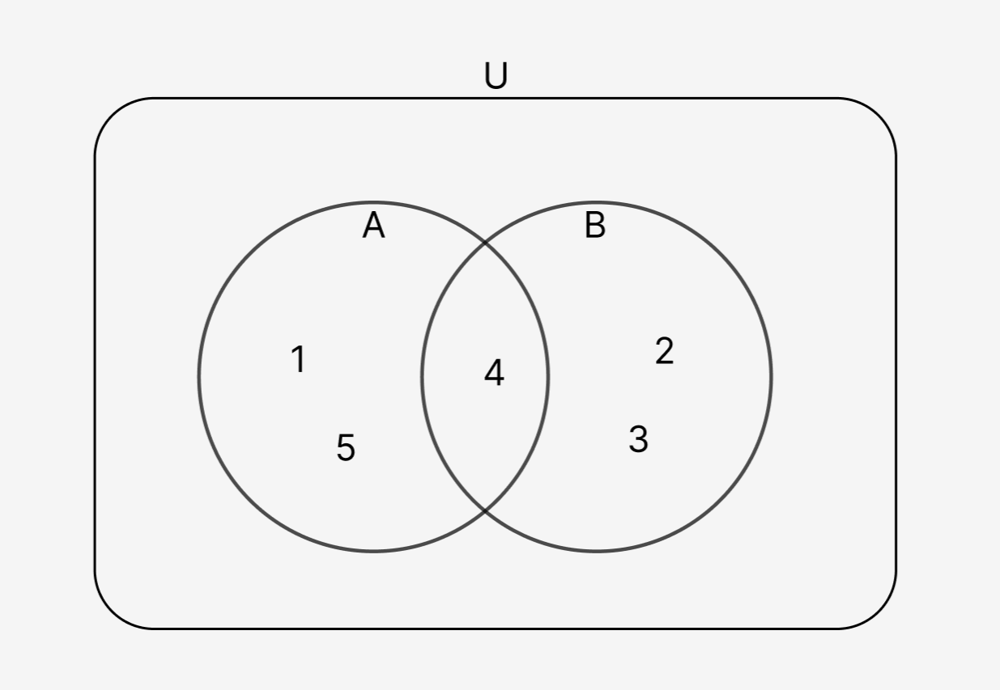
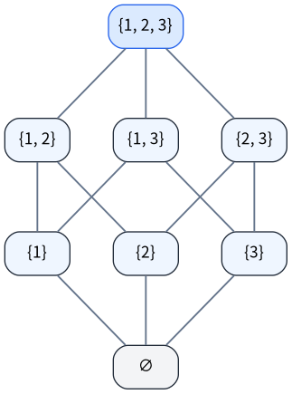
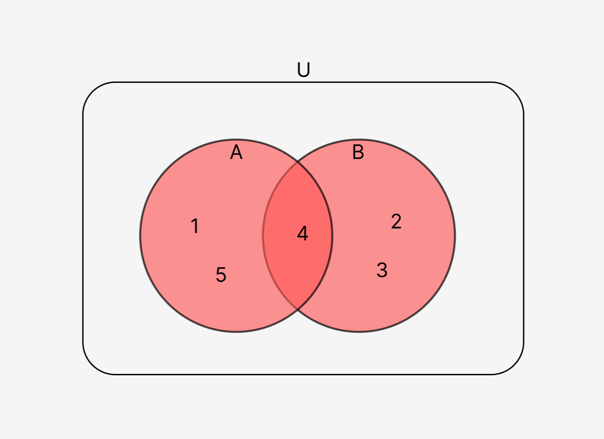
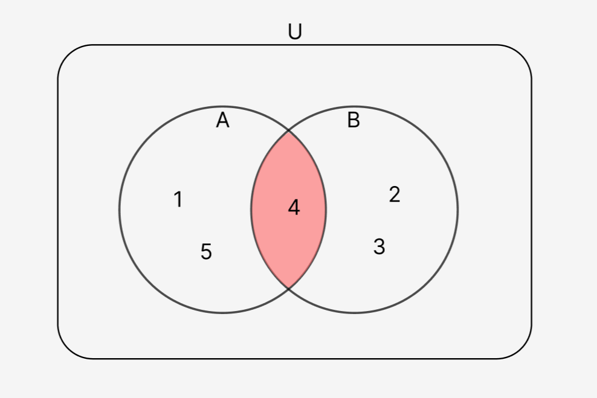
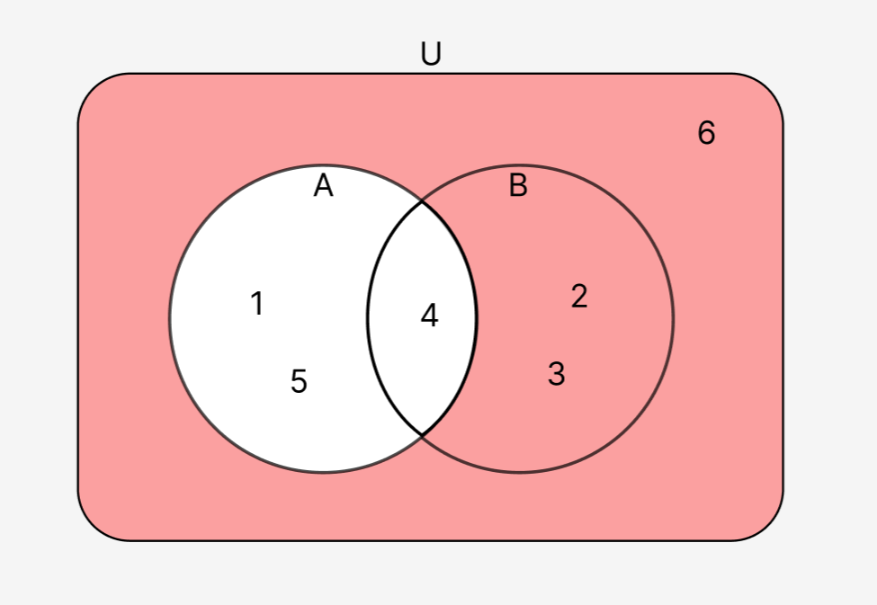
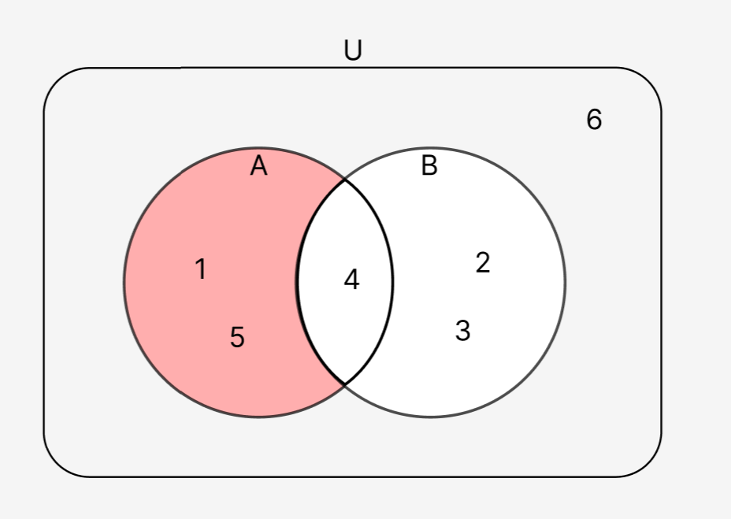
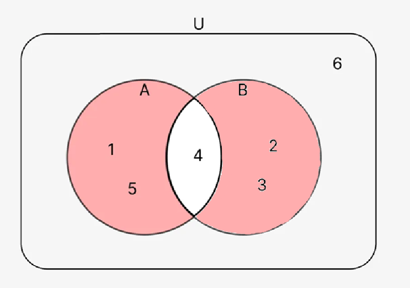
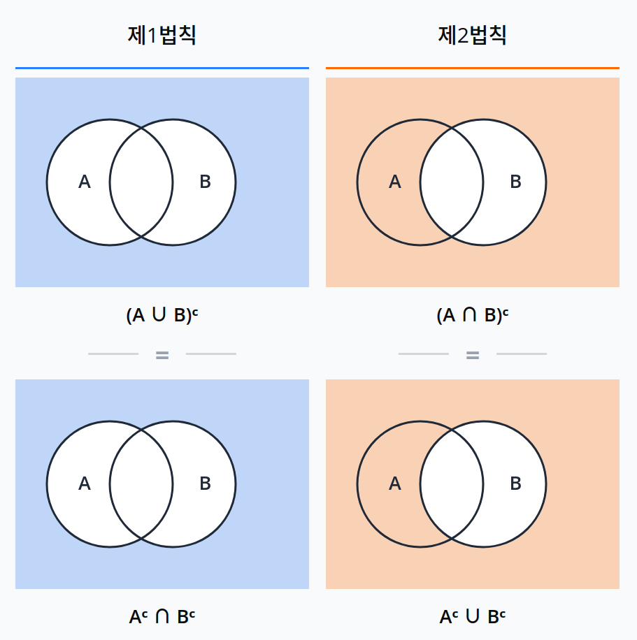

[상위 페이지 · 집합론](/study/algorithms/math/jibhabron/)

집합과 연산은 집합론의 가장 기초가 되는 부분이다. 여기서는 집합과 원소의 구분, 집합을 표현하는 방법, 부분집합과 멱집합, 그리고 합집합과 교집합 같은 기본 연산을 정리한다

## 사용 표기

- 부분집합은 $$A \subseteq B$$ 로 쓴다. 집합 A 의 모든 원소가 집합 B 에 들어 있다는 뜻이다.
- 진부분집합은 $$A \subset B$$ 로 쓴다. 부분집합이면서 두 집합이 서로 다른 경우다.
- 여집합은 항상 전체집합 $$U$$ 가 정해진 뒤에 $$A^c$$ 로 쓴다.
- 멱집합은 $$P(A)$$ 로 쓴다.

## 핵심 예시

이 문서에서는 다음 예시를 계속 사용한다.

- 전체집합 $$U = \{1, 2, 3, 4, 5, 6\}$$
- 집합 $$A = \{1, 3, 5\}$$ : 홀수의 눈
- 집합 $$B = \{2, 3, 5\}$$ : 소수의 눈

이 예시에서 먼저 원소와 부분집합을 구분해 보자.

1. $$3 \in A$$ 이다. 3 은 집합 A 안에 들어 있는 원소 하나다.
2. $$2 \notin A$$ 이다. 2 는 집합 A 의 원소가 아니다.
3. $$A \subseteq U$$ 이다. A 의 모든 원소 1, 3, 5 가 전체집합 U 안에 있기 때문이다.
4. $$\{3\} \subseteq A$$ 이다. 여기서는 3 자체가 아니라 3 을 원소로 가진 집합 하나를 보고 있다.

이제 같은 예시로 연산까지 한 번에 확인할 수 있다.

1. 합집합은 $$A \cup B = \{1, 2, 3, 5\}$$ 이다.
2. 교집합은 $$A \cap B = \{3, 5\}$$ 이다.
3. 여집합은 $$A^c = \{2, 4, 6\}$$ 이다.
4. 차집합은 $$A - B = \{1\}$$ 이고, $$B - A = \{2\}$$ 이다.
5. 대칭차집합은 $$A \Delta B = \{1, 2\}$$ 이다.
6. 합집합의 원소 수는 $$|A \cup B| = |A| + |B| - |A \cap B| = 3 + 3 - 2 = 4$$ 이다.

## 집합과 원소

## 정의

집합은 어떤 대상을 모아 놓은 것이 아니라, 주어진 기준에 따라 그 대상이 들어가는지 아닌지를 분명하게 판단할 수 있는 대상들의 모임이다. 핵심은 기준이 모호하지 않아야 한다는 점이다.

- 집합이 될 수 있는 경우
    - 7 보다 작은 홀수 양의 정수의 모임
    - 대한민국의 수도의 모임
    - 알파벳 모음의 모임
- 집합이 되기 어려운 경우
    - 아름다운 그림의 모임
    - 키가 큰 학생의 모임

앞의 두 경우는 기준이 사람마다 달라질 수 있으므로 집합의 정의에 바로 넣기 어렵다.

## 원소와 기호

집합을 이루는 대상 하나하나를 원소라고 한다. 예를 들어 집합 $$A = \{1, 2, 3, 6\}$$ 이면 1, 2, 3, 6 은 모두 집합 A 의 원소다.

어떤 대상이 집합의 원소이면 $$\in$$ 을 쓰고, 원소가 아니면 $$\notin$$ 을 쓴다.

- $$2 \in A$$
- $$5 \notin A$$

집합의 원소 개수는 $$|A|$$ 또는 $$n(A)$$ 로 적는다.

- $$|A| = 4$$
- $$n(A) = 4$$

## 기본 성질

집합에는 두 가지 중요한 성질이 있다.

1. 순서를 따지지 않는다.
2. 같은 원소를 여러 번 적어도 한 번만 있는 것으로 본다.

따라서 $$\{1, 2, 3\}$$ 와 $$\{3, 2, 1\}$$ 은 같은 집합이고, $$\{1, 1, 2, 2, 3\}$$ 도 결국 $$\{1, 2, 3\}$$ 과 같다.

## 집합의 표현

## 나열 표현

집합의 원소를 중괄호 안에 직접 나열하는 방법이다.

- $$A = \{a, e, i, o, u\}$$
- $$B = \{1, 2, 3, \ldots, 100\}$$
- $$E = \{2, 4, 6, 8, \ldots\}$$

원소가 적거나 규칙이 분명할 때 직관적으로 읽기 좋다.

## 조건 표현

원소를 하나씩 쓰는 대신, 어떤 조건을 만족하는 대상을 원소로 삼는다고 적는 방법이다.

형식은 다음과 같다.

- $$\{\text{대표 문자} \mid \text{조건}\}$$

예를 들어

- $$A = \{x \in \mathbb{Z}^+ \mid x < 10\}$$
- $$B = \{y \mid y 는 대한민국의 광역시\}$$

처럼 쓸 수 있다.

## 벤 다이어그램

집합을 그림으로 표현해 포함 관계와 집합 연산을 시각적으로 보여주는 방법이다. 전체집합은 보통 사각형으로, 그 안의 부분집합은 원이나 폐곡선으로 그린다.

이 문서의 연산 파트에서는 같은 전체집합 U 와 두 집합 A, B 를 기준으로 벤 다이어그램을 반복해서 사용할 것이다.

## 기본 집합의 형태

## 유한 집합

원소의 개수를 셀 수 있고 그 개수가 끝나는 집합이다.

## 무한 집합

원소의 개수가 끝나지 않는 집합이다.

- 자연수 전체의 집합
- 정수 전체의 집합
- 유리수 전체의 집합

## 공집합

원소가 하나도 없는 집합이다. $$\varnothing$$ 또는 $$\{\}$$ 로 쓴다.

공집합의 원소 개수는 0 이다.

## 싱글턴 집합

원소가 정확히 하나인 집합이다.

- $$\{5\}$$
- $$\{\text{서울}\}$$

여기서 특히 $$\{\varnothing\}$$ 는 공집합이 아니라, 공집합을 원소로 하나 가진 싱글턴이다.

## 전체 집합

현재 문제에서 다루는 대상 전체를 모아 둔 집합이다.

- 전체집합을 $$U$$ 라고 할 때, 여집합은 $$A^c = \{x \in U \mid x \notin A\}$$ 로 정의한다.
- 따라서 같은 A 라도 U 가 달라지면 $$A^c$$ 는 달라진다.

예시:

- $$U=\{1,2,3,4,5,6\},\;A=\{1,3,5\}$$ 이면 $$A^c=\{2,4,6\}$$
- $$U=\{1,2,3,4,5,6,7,8\}$$ 로 바꾸면 $$A^c=\{2,4,6,7,8\}$$

## 포함 관계

## 부분 집합

집합 A 의 모든 원소가 집합 B 에 들어 있으면 $$A \subseteq B$$ 라고 쓴다.

예를 들어 $$A = \{1,2\}$$, $$B = \{1,2,3\}$$ 이면 $$A \subseteq B$$ 이다.

### 원소($$\in$$)와 부분집합($$\subseteq$$)을 같이 확인하는 예시

워크스루의 $$A=\{1,3,5\}$$ 에 대해

- $$3 \in A$$ (원소)
- $$\{3\} \subseteq A$$ (부분집합)
- $$3 \subseteq A$$ 는 **의미가 없다**. $$\subseteq$$ 는 집합과 집합 사이의 관계다.

또한 $$\varnothing$$ 는 모든 집합의 부분집합이므로

- $$\varnothing \subseteq A$$

가 항상 성립한다.

부분집합과 관련해 항상 기억해야 할 성질은 다음 두 가지다.

1. $$\varnothing \subseteq A$$
2. $$A \subseteq A$$

## 진부분 집합

$$A \subseteq B$$ 이고 동시에 $$A \ne B$$ 이면 $$A \subset B$$ 라고 쓴다.

예를 들어 $$\{1, 2\} \subset \{1, 2, 3\}$$ 이다.

## 집합의 동일성

두 집합 A, B 에 대해 $$A \subseteq B$$ 이고 $$B \subseteq A$$ 이면 $$A = B$$ 이다.

즉 두 집합이 서로 같다는 말은, 두 집합이 정확히 같은 원소를 가진다는 뜻이다.

## 멱집합

집합 A 의 모든 부분집합을 원소로 가지는 집합을 A 의 멱집합이라고 하고 $$P(A)$$ 로 적는다.

예를 들어 $$A = \{1,2\}$$ 이면 부분집합은

- $$\varnothing$$
- $$\{1\}$$
- $$\{2\}$$
- $$\{1,2\}$$

이므로

- $$P(A)=\{\varnothing,\{1\},\{2\},\{1,2\}\}$$

이다.

### 특수한 예시

- $$A=\varnothing$$ 이면 부분집합은 $$\varnothing$$ 하나뿐이므로 $$P(A)=\{\varnothing\}$$ 이다.

### 자주 헷갈리는 포함관계

멱집합의 원소는 “A 의 부분집합들(=집합)”이다.

- 항상 $$A \subseteq A$$ 이므로, $$A$$ 는 A 의 부분집합이다.
- 따라서 $$A \in P(A)$$ 가 성립한다.

원소 수가 $$k$$ 개인 집합 A 의 멱집합 원소 수는 $$2^k$$ 개다. 각 원소마다 부분집합에 넣을지 말지를 두 가지 선택으로 보기 때문이다.

## 집합의 연산

## 합집합

합집합은 A 또는 B 에 속하는 모든 원소를 모은 집합이다.

- $$A \cup B = \{1, 2, 3, 5\}$$

조건제시법으로는 $$A \cup B = \{x \mid x \in A \text{ 또는 } x \in B\}$$ 이다.

## 교집합

교집합은 A 와 B 에 동시에 속하는 원소만 모은 집합이다.

- $$A \cap B = \{3, 5\}$$

조건제시법으로는 $$A \cap B = \{x \mid x \in A \text{ 그리고 } x \in B\}$$ 이다.

교집합이 공집합이면 두 집합은 서로소라고 한다.

## 합집합의 크기

합집합의 원소 수는 각 집합의 원소 수를 더한 뒤, 교집합이 두 번 세어진 만큼 한 번 빼 주어야 한다.

- $$|A \cup B| = |A| + |B| - |A \cap B|$$

워크스루의 예시에서는

- $$|A| = 3$$
- $$|B| = 3$$
- $$|A \cap B| = 2$$

이므로

- $$|A \cup B| = 3 + 3 - 2 = 4$$

이다.

## 여집합

여집합은 전체집합 U 가 정해져 있을 때, U 에는 들어 있지만 A 에는 들어 있지 않은 원소들의 집합이다.

- $$A^c = \{2, 4, 6\}$$

조건제시법으로는 $$A^c = \{x \mid x \in U \text{ 그리고 } x \notin A\}$$ 이다.

## 차집합

차집합은 A 에는 들어 있지만 B 에는 들어 있지 않은 원소들의 집합이다.

- $$A - B = \{1\}$$
- $$B - A = \{2\}$$

차집합은 순서가 중요하다. 일반적으로 $$A - B \ne B - A$$ 이다.

또한 차집합은 여집합과 교집합으로 다시 쓸 수 있다.

- $$A - B = A \cap B^c$$

## 대칭차집합

대칭차집합은 A 와 B 중 정확히 하나에만 속하는 원소들의 집합이다.

- $$A \Delta B = \{1, 2\}$$

다음처럼도 볼 수 있다.

- $$A \Delta B = (A - B) \cup (B - A)$$

## 집합 연산 법칙

법칙은 한 번에 외우기보다 성격별로 묶어서 보는 편이 좋다.

## 교환·결합 법칙

- 교환법칙
    - $$A \cup B = B \cup A$$
    - $$A \cap B = B \cap A$$
- 결합법칙
    - $$(A \cup B) \cup C = A \cup (B \cup C)$$
    - $$(A \cap B) \cap C = A \cap (B \cap C)$$

## 항등·지배·멱등 법칙

- 항등법칙
    - $$A \cup \varnothing = A$$
    - $$A \cap U = A$$
- 지배법칙
    - $$A \cup U = U$$
    - $$A \cap \varnothing = \varnothing$$
- 멱등법칙
    - $$A \cup A = A$$
    - $$A \cap A = A$$

## 보원 법칙

- 보원법칙
    - $$A \cup A^c = U$$
    - $$A \cap A^c = \varnothing$$
    - $$(A^c)^c = A$$

## 분배·흡수 법칙

- 분배법칙
    - $$A \cap (B \cup C) = (A \cap B) \cup (A \cap C)$$
    - $$A \cup (B \cap C) = (A \cup B) \cap (A \cup C)$$
- 흡수법칙
    - $$A \cup (A \cap B) = A$$
    - $$A \cap (A \cup B) = A$$

### 워크스루로 분배법칙 한 번만 검증

워크스루의 $$U=\{1,2,3,4,5,6\}$$, $$A=\{1,3,5\}$$, $$B=\{2,3,5\}$$ 에 대해

- $$C=\{1,2\}$$ 를 하나 더 잡자.
- 좌변: $$A \cap (B \cup C)$$ 에서 $$B \cup C = \{1,2,3,5\}$$ 이므로 $$A \cap (B \cup C)=\{1,3,5\}$$
- 우변: $$(A \cap B) \cup (A \cap C)$$ 에서 $$A \cap B=\{3,5\}$$, $$A \cap C=\{1\}$$ 이므로 합치면 $$\{1,3,5\}$$

즉 좌변과 우변이 일치한다.

## 드모르간 법칙 (정리)

- $$(A \cup B)^c = A^c \cap B^c$$
- $$(A \cap B)^c = A^c \cup B^c$$

드모르간 법칙은 기호만 보면 헷갈리기 쉽다. 벤 다이어그램으로 영역을 직접 비교하면 훨씬 이해가 쉽다.

### 워크스루로 드모르간 법칙 한 번만 검증

워크스루에서

- $$A \cup B = \{1,2,3,5\}$$ 이므로 $$(A \cup B)^c = \{4,6\}$$
- $$A^c=\{2,4,6\}$$, $$B^c=\{1,4,6\}$$ 이므로 $$A^c \cap B^c = \{4,6\}$$

따라서 $$(A \cup B)^c = A^c \cap B^c$$ 가 실제 계산에서도 확인된다.

## 혼동하기 쉬운 표기

## 원소와 부분 집합

- $$3 \in A$$ 는 3 이 집합 A 의 원소라는 뜻이다.
- $$\{3\} \subseteq A$$ 는 집합 {3} 이 집합 A 의 부분집합이라는 뜻이다.

원소와 집합은 서로 다른 대상이다.

## 공집합과 $$\{\varnothing\}$$

- $$\varnothing$$ 는 원소가 0 개다.
- $$\{\varnothing\}$$ 는 원소가 1 개다.

둘은 절대로 같은 집합이 아니다.

## 차집합의 방향성

- $$A - B$$ 는 A 에서 B 를 빼는 것이다.
- $$B - A$$ 는 B 에서 A 를 빼는 것이다.

둘은 일반적으로 다르다.

## 여집합과 전체 집합

$$A^c$$ 라고 적으려면 먼저 전체집합 U 가 무엇인지 정해져 있어야 한다. 전체집합이 달라지면 여집합도 달라진다.

## 멱집합과 포함관계

$$P(A)$$ 안에 들어 있는 것은 숫자나 문자 하나가 아니라, A 의 부분집합들이다. 대표적인 예가 바로 $$A \in P(A)$$ 이다. 이는 모든 집합에 대해 $$A \subseteq A$$ 가 성립하기 때문이다.
