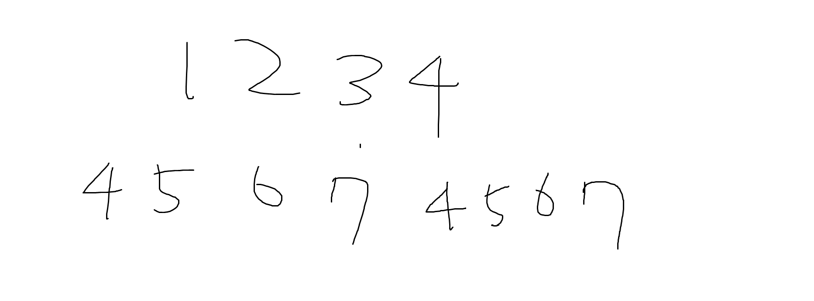
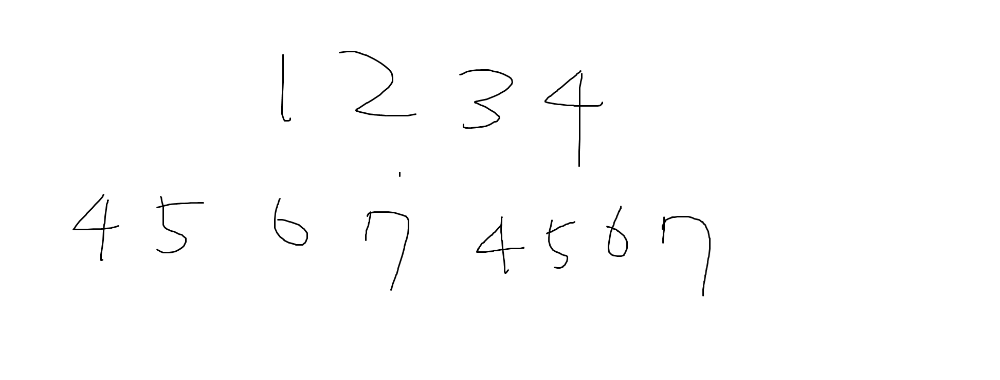

[상위 페이지 · Math](/study/algorithms/math/)


## 문제 태그

- 수학
- FFT

## 아이디어

1. Y 배열을 두개로 이어 붙여 fft를 한다음 N-1 ~ 2N-2까지가 순환 컨볼루션 결과임





이런 느낌

## 정답

```python
MOD = 998244353
PRIMITIVE_ROOT = 3

def ntt(a, invert):
    n = len(a)
    j = 0
    for i in range(1, n):
        bit = n >> 1
        while j & bit:
            j ^= bit
            bit >>= 1
        j ^= bit
        if i < j:
            a[i], a[j] = a[j], a[i]

    length = 2
    while length <= n:
        wlen = pow(PRIMITIVE_ROOT, (MOD - 1) // length, MOD)
        if invert:
            wlen = pow(wlen, MOD - 2, MOD)
        for i in range(0, n, length):
            w = 1
            for j in range(length // 2):
                u = a[i + j]
                v = a[i + j + length // 2] * w % MOD
                a[i + j] = (u + v) % MOD
                a[i + j + length // 2] = (u - v + MOD) % MOD
                w = w * wlen % MOD
        length <<= 1

    if invert:
        inv_n = pow(n, MOD - 2, MOD)
        for i in range(n):
            a[i] = a[i] * inv_n % MOD

def ntt_convolution(a, b):
    n = 1
    while n < len(a) + len(b):
        n <<= 1
    a += [0] * (n - len(a))
    b += [0] * (n - len(b))

    ntt(a, False)
    ntt(b, False)
    for i in range(n):
        a[i] = a[i] * b[i] % MOD
    ntt(a, True)
    return a

def circular_convolution(A, B):
    N = len(A)
    A_pad = A[:]
    B_rev = B[::-1]
    B_doubled = B_rev + B_rev  # 길이 2N

    conv = ntt_convolution(A_pad[:], B_doubled[:])  # 선형 컨볼루션
    # 결과에서 N-1 ~ 2N-2 까지가 순환 컨볼루션 결과
    return conv[N-1:2*N-1]

N = int(input())
a = list(map(int, input().split()))
b = list(map(int, input().split()))
print(max(circular_convolution(a, b)))
```
