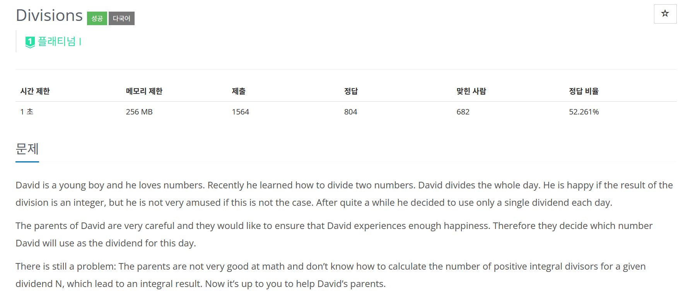

[상위 페이지 · 플레티넘](/study/algorithms/math/platinum/)



## 문제 해석

- N의 약수의 개수를 구해라

## 문제 태그

- 정수론
- 폴라드 로
- 밀러 라빈

## 아이디어

1. 소인수 분해는 폴라드 로와 밀러 라빈으로 한다. 하지만 우리가 구해야하는건 약수의 개수임으로 소인수의 지수부를 죄다 곱해준다.

## 정답

```python
import math
import random
from collections import defaultdict

n = int(input())
basic_primes = {2, 3, 5, 7, 11, 13, 17, 19, 23, 29, 31, 37, 41}

def power(x, y, p):
    res = 1
    x = x % p
    while y > 0:
        if y & 1:
            res = res * x % p
        y = y >> 1  # y /= 2
        x = (x * x) % p
    return res

def miller_rabin(n, a):
    d = n - 1
    while d % 2 == 0:
        d //= 2

    x = power(a, d, n)

    if x == 1 or x == n - 1:
        return True
    while d != n - 1:
        x = power(x, 2, n)
        d *= 2
        if x == 1:
            return False
        if x == n - 1:
            return True
    return False

def isPrime(n):
    if n in basic_primes:  # 기본적으로 소수인 경우
        return True
    if n == 1 or n % 2 == 0:
        return False
    for a in basic_primes:
        if not miller_rabin(n, a):
            return False

    return True

def f(x,c,n):
    return (x**2 + c) % n

def pollads_ro(n):
    if n == 1:
        return 1
    if n % 2 == 0:
        return 2
    if isPrime(n):
        return n
    x = random.randrange(2,n)
    c = random.randrange(1,n)
    y = x
    g = 1
    while g == 1:
        x = f(x,c,n)
        y = f(f(y,c,n),c,n)
        g = math.gcd(x-y,n)
        if g == n:
            return pollads_ro(n)
    if not isPrime(g):
        return pollads_ro(g)
    return g

factor_counts = defaultdict(int)
while n > 1:
    p = pollads_ro(n)
    while n % p == 0:
        factor_counts[p] += 1
        n //= p

answer = 1
for cnt in factor_counts.values():
    answer *= (cnt + 1)
print(answer)

```
