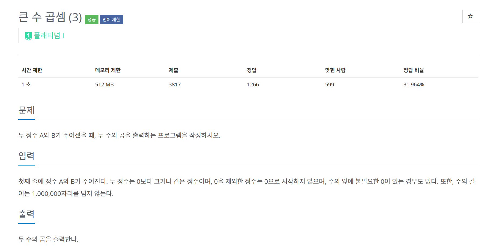

[상위 페이지 · 플레티넘](/study/algorithms/math/platinum/)



## 문제 태그

- 수학
- FFT
- 파이썬 혐오

## 아이디어

1. 각 숫자를 푸리에 변환 후 주파수 공간 안에서 합성을 한다
2. 계산 결과를 푸리에 역변환 후 보면
    
    
    | 23 | 1 | 68 | 23 |
    | --- | --- | --- | --- |
    
    같이 배열안에 곱셈결과가 십의 자리까지 표기 되는걸 볼 수 있는데
    
    이를 다음 배열로 carry까지 해준 뒤 배열을 뒤집어 출력하면 된다.
    
3. 파이썬 혐오로 강제 C++를 쓰게 만든 문제 기억하겠다.


## 정답

```python
#include <bits/stdc++.h>
using namespace std;

const int MOD = 998244353;
const int ROOT = 3;

int mod_pow(int base, int exp) {
    int res = 1;
    while (exp > 0) {
        if (exp & 1) res = 1LL * res * base % MOD;
        base = 1LL * base * base % MOD;
        exp >>= 1;
    }
    return res;
}

void ntt(vector<int> &a, bool invert) {
    int n = a.size();
    // 비트 반전 정렬
    for (int i = 1, j = 0; i < n; i++) {
        int bit = n >> 1;
        for (; j & bit; bit >>= 1) j ^= bit;
        j ^= bit;
        if (i < j) swap(a[i], a[j]);
    }

    for (int len = 2; len <= n; len <<= 1) {
        int wlen = mod_pow(ROOT, (MOD - 1) / len);
        if (invert) wlen = mod_pow(wlen, MOD - 2);
        for (int i = 0; i < n; i += len) {
            int w = 1;
            for (int j = 0; j < len / 2; j++) {
                int u = a[i + j];
                int v = 1LL * a[i + j + len / 2] * w % MOD;
                a[i + j] = (u + v < MOD ? u + v : u + v - MOD);
                a[i + j + len / 2] = (u - v >= 0 ? u - v : u - v + MOD);
                w = 1LL * w * wlen % MOD;
            }
        }
    }

    if (invert) {
        int inv_n = mod_pow(n, MOD - 2);
        for (int &x : a) x = 1LL * x * inv_n % MOD;
    }
}

vector<int> multiply_ntt(vector<int> a, vector<int> b) {
    int n = 1;
    while (n < a.size() + b.size()) n <<= 1;
    a.resize(n);
    b.resize(n);

    ntt(a, false);
    ntt(b, false);
    for (int i = 0; i < n; i++)
        a[i] = 1LL * a[i] * b[i] % MOD;
    ntt(a, true);

    // carry 처리
    vector<int> res(n);
    long long carry = 0;
    for (int i = 0; i < n; i++) {
        long long cur = a[i] + carry;
        res[i] = cur % 10;
        carry = cur / 10;
    }

    while (carry) {
        res.push_back(carry % 10);
        carry /= 10;
    }

    // 앞자리 0 제거
    while (res.size() > 1 && res.back() == 0)
        res.pop_back();
    return res;
}

int main() {
    string sa, sb;
    cin >> sa >> sb;

    vector<int> a, b;
    for (int i = sa.size() - 1; i >= 0; i--) a.push_back(sa[i] - '0');
    for (int i = sb.size() - 1; i >= 0; i--) b.push_back(sb[i] - '0');

    vector<int> res = multiply_ntt(a, b);

    for (int i = res.size() - 1; i >= 0; i--) cout << res[i];
    cout << '\n';
}

```
