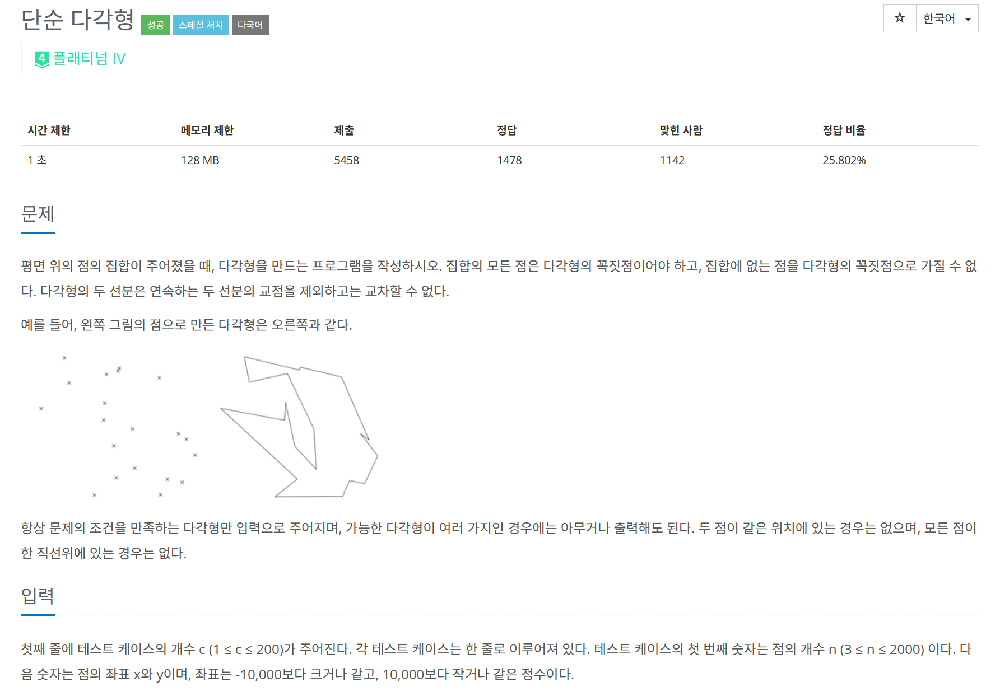
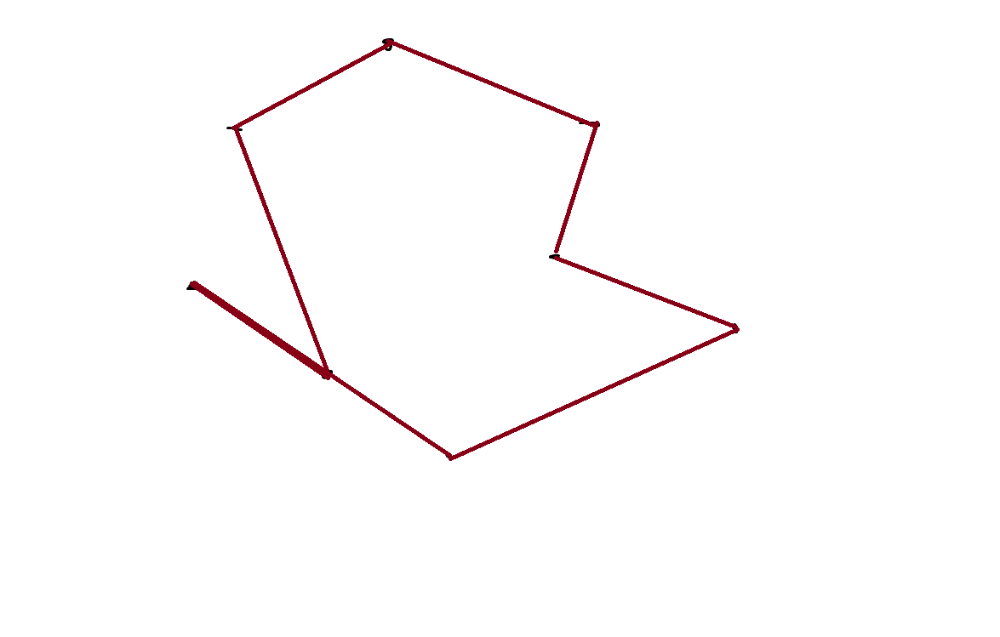

[상위 페이지 · Math](/study/algorithms/math/)



## 문제 태그

- 기하
- 볼록 껍질

## 아이디어

1. 볼록껍질을 구하는 알고리즘을 쓰면 되는데 정렬만 가져다 쓰면 된다. 대신 각도 말고도 각도가 같으면 거리가 먼 가까운 순서대로 방문 해야한다.
2. 거리가 가까운 순서대로 방문하다보면 마지막에 돌아서 올 때 기준점하고 각도가 같다면 점이 꼬일 수 있다
    1. 틀린 예시
        
        
        
        이를 해결하기 위해 마지막 각도가 같다면 반대로 돌게 해주면 된다
        

## 정답

```python
import math
from functools import cmp_to_key

class Point:
    def __init__(self, i, x: int, y: int):
        self.i = i
        self.x = x
        self.y = y

    def __str__(self):
        return f"{self.x} {self.y}"

def ccw(A: Point, B: Point, C: Point):
    result = (B.x - A.x) * (C.y - A.y) - (C.x - A.x) * (B.y - A.y)
    if result > 0:
        return 1    # 반시계 방향
    elif result < 0:
        return -1   # 시계 방향
    else:
        return 0    # 일직선

def compare_points(p, q):
    angle_p = math.atan2(p.y - base_point.y, p.x - base_point.x)
    angle_q = math.atan2(q.y - base_point.y, q.x - base_point.x)
    if angle_p < angle_q:
        return -1
    elif angle_p > angle_q:
        return 1
    else:
        dist_p = (p.x - base_point.x) ** 2 + (p.y - base_point.y) ** 2
        dist_q = (q.x - base_point.x) ** 2 + (q.y - base_point.y) ** 2
        if dist_p < dist_q:
            return -1
        elif dist_p > dist_q:
            return 1
        else:
            return 0

T = int(input())
for _ in range(T):
    native_pos = list(map(int, input().split()))
    n = native_pos[0]
    poses = []
    count = 0

    for i in range(1, 2 * n, 2):
        x, y = native_pos[i], native_pos[i + 1]
        poses.append(Point(count, x, y))
        count += 1

    poses.sort(key=lambda p: (p.y, p.x))
    base_point = poses[0]

    poses.sort(key=cmp_to_key(compare_points))

    i = len(poses) - 1
    while i > 1 and ccw(poses[0], poses[i-1], poses[i]) == 0:
        i -= 1

    poses[i:] = poses[i:][::-1]

    result = " ".join(str(p.i) for p in poses)
    print(result)

```
