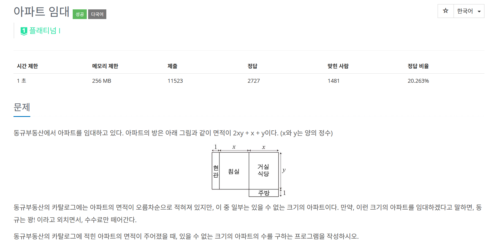

[상위 페이지 · 플레티넘](/study/algorithms/math/platinum/)



## 문제 태그

- 정수론
- 소수판별
- 밀러 라빈

## 아이디어

1. 2xy + x + y = S → 인수분해를 쉽게 만들기 위해 2를 곱하고 +1함
2. (2x+1)(2y+1) = 2S + 1 → 이 뜻은 S에 대해 2S + 1은 항상 홀수 * 홀수 형태로 나와야하며 소수가 될 수 없다는 뜻
3. 고로 2S + 1이 소수인지 아닌지 판별해주면 됨

## 정답

```python
import sys
input = sys.stdin.readline
basic_primes = {2, 3, 5, 7, 11, 13, 17, 19, 23, 29, 31, 37, 41}

def power(x, y, p):
    res = 1
    x = x % p
    while y > 0:
        if y & 1:  # y가 홀수면
            res = res * x % p  # x와 곱하고 나머지 연산
        # y가 짝수이면
        y = y >> 1  # y /= 2
        x = (x * x) % p  # 거듭제곱 계산
    return res

# 밀러-라빈 판정
def miller_rabin(n, a):
    d = n - 1  # 홀수
    while d % 2 == 0:
        d //= 2  # 2^d*r+1

    x = power(a, d, n)  # a^{d} % n 계산

    if x == 1 or x == n - 1:  # x가 1 또는 n-1이면 소수
        return True
    while d != n - 1:  # n-1이 아닌 동안
        x = power(x, 2, n)  # x^{2} % n 계산
        d *= 2
        # x가 1이면 합성수이고 아니면 소수
        if x == 1:
            return False
        if x == n - 1:
            return True
    return False

def isPrime(n):
    if n in basic_primes:  # 기본적으로 소수인 경우
        return True
    if n == 1 or n % 2 == 0:  # 1과 2의 배수는 소수가 아님
        return False
    for a in basic_primes:
        # long long 범위는 2, 3, 5, 7, 11, 13, 17, 19, 23, 29, 31, 37, 41의 소수로 검사.
        # 37까지만 검사해도 됨
        # 성립하지 않아 false를 반환하면 아마도 소수가 아님 (not False = True)
        if not miller_rabin(n, a):
            return False

    return True
n = int(input())
answer = 0
for _ in range(n):
    number = int(input())
    if number < 4 or isPrime(2*number + 1):
        answer += 1
print(answer)
```
