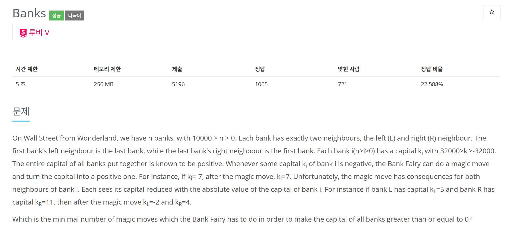
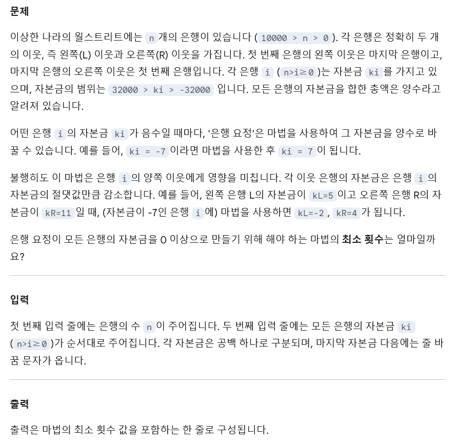
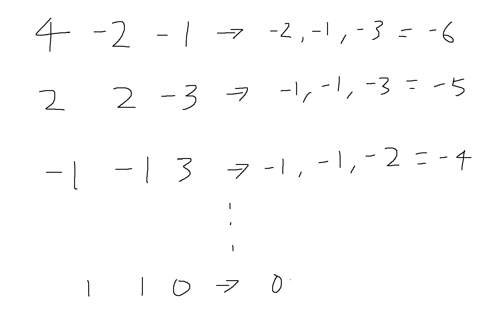

[상위 페이지 · 루비](/study/algorithms/math/ruby/)



## 번역



## 문제 태그

- 수학
- 애드 혹
- 누적 합
- 불변량 찾기

## 아이디어



1. 전체합이 사이클 1회당 줄일 수 있는 빚의 양
2. 갚아야 할 빚은 시스템에 존재하는 모든 음수 부분합들 각각
3. 고로 각각의 음수 부분합에 대해 ceil(|음수 부분합| / 전체합)을 계산하여 그 값을 모두 더한것

## 정답

```python
import math
import sys

input = sys.stdin.readline

n = int(input())
nums = list(map(int, input().split()))

P = [0] * (n * 2)
for i in range(1, n * 2):
    P[i] = P[i - 1] + nums[i % n]

result = 0
for i in range(n):
    for j in range(1, n + 1):
        if P[i + j] < P[j - 1]:
            result += math.ceil(abs(P[i + j] - P[j - 1]) / P[n])

print(result)

```
