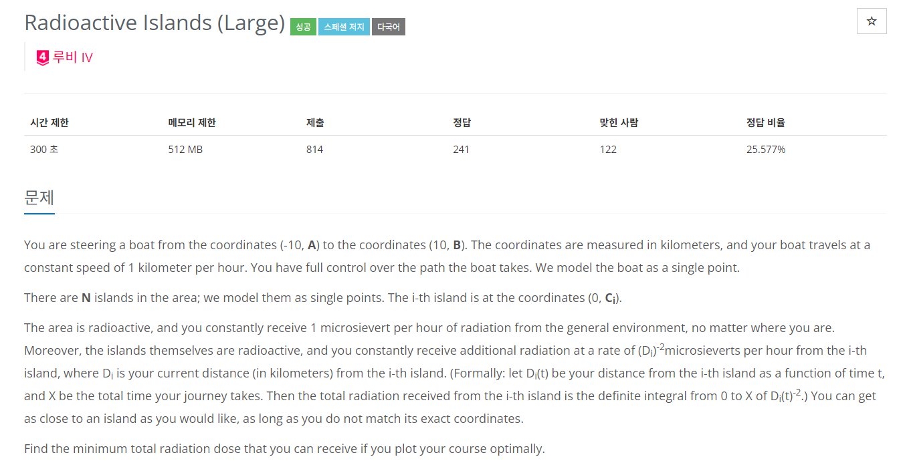
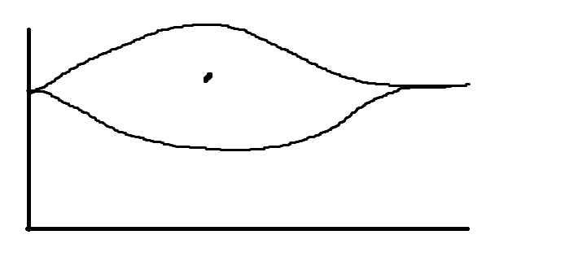
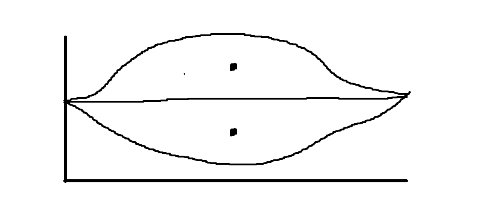

[상위 페이지 · 루비](/study/algorithms/math/ruby/)



## 문제 해석

### 기본 설정

- **목표:** 보트를 조종하여 시작점 (-10, A)에서 도착점 (10, B)까지 이동한다.
- **속력:** 보트의 속력은 **시속 1km**로 항상 일정하다.

### 방사선 피폭량 계산

총 방사선량은 두 가지 종류의 방사선을 더해서 계산한다.

- **환경 방사선 (기본 피폭량):**
    - 경로의 어디에 있든 상관없이, 주변 환경으로부터 **시간당 1 마이크로시버트**의 방사선을 계속 받는다.
    - 총 이동 시간이 T시간이라면, 환경으로부터 받는 총 방사선량은 $$1 * T$$ 이다.
    - 위에서 "이동 거리 = 걸린 시간"이므로, 총 이동 거리가 L km라면 환경 방사선 피폭량은 **L 마이크로시버트**가 된다.
- **섬 방사선 (추가 피폭량):**
    - y축 위에 **N개의 섬**이 있으며, i번째 섬의 좌표는 (0, Ci) 이다.
    - i번째 섬으로부터 **추가적인 방사선**을 받으며, 그 양은 $$d(Dose) = (1 + \sum_{i=1}^N \frac{1}{D_i^2})dt$$ **마이크로시버트** 이다.
    - 여기서 Di는 보트와 i번째 섬 사이의 현재 거리(km)를 의미한다.
    - 보트의 경로를 함수 y(x)라고 할 때, 특정 지점 (x,y(x))와 i번째 섬 (0,Ci) 사이의 거리 Di는 다음과 같다:
    
    $$
    D_i = \sqrt{x^2 + (y(x)-C_i)^2}
    $$
    

### 최종 목표

어떤 경로를 따라 이동할 때, 아주 짧은 시간 dt 동안 받는 총 방사선량은 다음과 같다:

$$
d(Dose) = (1 + \sum_{i=1}^N \frac{1}{D_i^2})dt
$$

우리가 구해야 할 것은 시작점부터 도착점까지 받은 총 방사선량이다.

## 문제 태그

- 수학
- 미적분학
- 이분탐색

## 수학적 접근

우선 이 문제를 풀기 위해서는 곱의 미분과 체인룰 미분을 알아야한다.

<aside markdown="1">
💡

**곱의 미분**

곱의 미분은 두 함수를 곱한 식을 미분할 때 사용하는 법칙이다.

두 함수 f(x)와 g(x)의 곱의 미분은 다음과 같다:

$$
(f(x)g(x))' = f'(x)g(x) + f(x)g'(x)
$$

예시:

- f(x) = x²이고 g(x) = sin(x)일 때
- (x²sin(x))' = 2x·sin(x) + x²·cos(x)

즉, 첫 번째 함수를 미분하고 두 번째 함수는 그대로 곱한 것과, 첫 번째 함수는 그대로 두고 두 번째 함수를 미분한 것을 더하면 된다.

</aside>

<aside markdown="1">
💡

**체인 룰 미분**

체인 룰(연쇄 법칙)은 합성 함수를 미분하는 방법이다.

예를 들어 y = f(g(x))와 같은 합성 함수가 있을 때, 체인 룰을 사용하면:

$$
\frac{dy}{dx} = \frac{df}{dg} \cdot \frac{dg}{dx}

$$

간단한 예시:

- y = (x² + 1)³ 일 때
- 바깥 함수 f(u) = u³
- 안쪽 함수 g(x) = x² + 1
- 체인 룰 적용: y' = 3(x² + 1)² · 2x

이처럼 체인 룰은 복잡한 합성 함수를 단계별로 나누어 미분할 수 있게 해준다.

</aside>

### 기본 설정

$$
D_i(t) = \sqrt{(x(t)-0)^2 + (y(t) - c_i)^2}
\\
방사선 = \frac{1}{D_i(t)^2}
\\
이동속도 = 1km/h
\\
총량(시간) = \int_{0}^{t}(1 + \sum_{i=0}^{N}(\frac{1}{D_i(t)^2})dt

$$

### 시간에 대한 적분을 x에 대해 적분으로 변경

- 시간 t에 대해 적분을 하면 미지수가 x,y 두개임.

$$
v = \frac{dt}{ds}
\\
ds * v = dt
\\
v = 1
\\
ds = dt
$$

- ds = dt를 이용하여 치환을 해주면 t라는 미지수 하나를 지울 수 있게 됨.

$$
총량(경로) = \int_{-10}^{10}1+\sum_{i=0}^{N}{(\frac{1}{x^2 + (y(x)-c_i)^2})} * \sqrt{1+(y'(x))^2}dx
$$

### 오일러-라그랑주로 풀이

<aside markdown="1">
💡

[오일러 - 라그랑주](/study/algorithms/unsorted/oilreo-rageurangju/) 

- 어떤 함수 y(x)가 있을 때, 다음과 같은 **함수의 전체 값을 최소화**할때 사용

$$
S[y]=∫_{x0}^{x1}F(x,y,y′)dx
$$

$$
\frac{\delta F}{\delta y} - \frac{d}{dx}(\frac{\delta F}{\delta y'}) = 0
$$

인 방정식을 푸는것

</aside>

우선 $$\frac{\delta F}{\delta y} - \frac{d}{dx}(\frac{\delta F}{\delta y'})$$의 식을 도출해야한다.

그를 위한 F(x,y,y’)을 정의하면

$$
F(x,y,y') =  \underbrace{1+\sum_{i=0}^{N}{(\frac{1}{{x^2 + (y(x)-c_i)^2}})}}_{B(y)} * \underbrace{\sqrt{1+(y'(x))^2}}_{A(y')}
$$

- $$\frac{\delta F}{\delta y}$$

$$
f_i(x) = {x^2 + (y(x)-c_i)^2}
\\
g(y) = (y(x)-c_i)^2
\\
------------------------
\\
\frac{\delta F}{\delta y} = A(y')*\frac{\delta B(y)}{\delta y}
\\
= \frac{dg}{dy} = 2(y-c_i)
\\
=\frac{df_i}{dy} = -\frac {2(y-c_i)}{(x^2 + (y-c_i)^2)^2}
\\
=\frac{dB(x)}{dy} =  -\sum_{i=1}^{N}\frac {2(y-c_i)}{(x^2 + (y-c_i)^2)^2}
\\
= \frac{\delta F}{\delta y} = A(y') * \frac{dB(x)}{dy} = \sqrt{1+ (y')^2} * -\sum_{i=1}^{N}\frac {2(y-c_i)}{(x^2 + (y-c_i)^2)^2}
$$

y’를 미분하지 않는 이유는 y’는 t에 대해 미분이 된거기 때문임.

- $$\frac{d}{dx}(\frac{\delta F}{\delta y})$$

$$
H(x,y,y') = \frac{y'}{\sqrt{1 + (y')^2}} 
\\
\frac{d}{dx}(\frac{\delta F}{\delta y}) = \frac{d}{dx}[B*H] = B'H + BH'
\\
B'= \frac{dB}{dx}
\\
= \frac{\delta f_i}{\delta x} = -\frac{2x}{(x^2 + (y-c_i)^2)^2}
\\
= \frac{\delta f_i}{\delta y} = -\frac {2(y-c_i)}{(x^2 + (y-c_i)^2)^2}
\\
\frac{dB}{dx} = \frac{dB}{dx}\frac{dB}{dy}y' = \sum_{i=1}^{N} - \frac{2x + 2(y-c_i)y'}{(x^2 + (y-c_i)^2) ^ 2} 
\\
H' = \frac{d}{dx} [\frac{y'}{\sqrt{1+(y')^2}}]
= \frac{y''}{(1+(y')2)^{\frac{3}{2}}}\\
\frac{d}{dx}(\frac{\delta F}{\delta y}) = B'H + BH' = \sum_{i=1}^{N} ( \frac{-2x + 2(y-c_i)y'}{(x^2 + (y-c_i)^2) ^ 2})\frac{y'}{\sqrt{1+(y')^2}}
\\+ (1+\sum_{i=1}^{N}{(\frac{1}{{x^2 + (y(x)-c_i)^2}})}\frac{y''}{(1+(y')2)^{\frac{3}{2}}})

$$

- 최종 식

$$
\frac{\delta F}{\delta y} - \frac{d}{dx}(\frac{\delta F}{\delta y}) =
\\
\sqrt{1+ (y')^2} * -\sum_{i=1}^{N}\frac {2(y-c_i)}{(x^2 + (y-c_i)^2)^2} \\- \left[ \sum_{i=1}^{N}  (\frac{-2x + 2(y-c_i)y'}{(x^2 + (y-c_i)^2) ^ 2})\frac{y'}{\sqrt{1+(y')^2}}
\\ + (1+\sum_{i=1}^{N}{(\frac{1}{{x^2 + (y(x)-c_i)^2}})}\frac{y''}{(1+(y')2)^{\frac{3}{2}}})) \right]
\\
= 0
$$

### BVP문제 → IVP 문제

<aside markdown="1">
💡

**BVP (Boundary Value Problem, 경계값 문제)**

**미분방정식의 해를 구하는데, 구간 양 끝점의 값을 정해주는 문제**이다.

**형태:**

$$
\frac{d^2y}{dx^2} = f(x,y), \quad y(a) = A, \quad y(b) = B
$$

두 점에서의 값을 주며, **양 끝 경계에서의 조건을 만족하는 해를 찾아야 한다**. 이는 초기값 문제(IVP)와 달리 전체 구간에서의 해의 형태를 고려해야 하므로 더 복잡한 문제가 된다.

</aside>

<aside markdown="1">
💡

**IVP(Initial Value Problem, 초기값 문제)**

**미분방정식에서 해를 구할 때, 시작점에서의 값을 정해주는 문제**이다.

**형태:**

$$
\frac{dy}{dx} = f(x,y), \quad y(x_0) = y_0
$$

여기서 f(x,y)는 미분방정식의 우변을, y(x_0) = y_0는 초기조건을 나타낸다.

- 즉, **미분방정식 + 초기 조건 한 개**이다.
- 해는 x0에서 시작하여 한 방향(보통 오른쪽)으로 진행되며, 각 지점에서의 기울기를 통해 다음 위치가 결정된다.

이는 마치 도미노가 쓰러지듯이, 초기 조건으로부터 순차적으로 해가 결정되는 특징이 있다.

</aside>

**BVP 형태 (경계값 문제)**

경계값 문제는 다음과 같은 2차 미분방정식의 형태이다:

$$
\begin{cases}
y'' = G(x, y, y') \\
y(-10) = A \\
y(10) = B
\end{cases}
$$

$$
G(x,y,y') = y''
\\
= \frac{1+(y')^2\sum_{i=1}^{N}\frac{2(y-c_i)}{(x^2 + (y-c_i)^2)^2} - \sum_{i=1}^{N}\frac{(2x+2(y-c_i)y')y'(1+(y')^2)}{(x^2+(y-c_i)^2)^4}} {1 + \sum^{N}_{i=1}(x^2 +(y-c_i)^2)^{-2} }
$$

여기서 G(x,y,y')는 주어진 함수이고, 양 끝점의 값 A와 B가 주어진다. 이는 전형적인 2점 경계값 문제(Two-point BVP)이다.

**함수 치환 (상태 공간 표현)**

2차 미분방정식을 1차 미분방정식 시스템으로 변환하기 위해 다음과 같이 치환한다:

$$
u_1(x) = y(x), \quad u_2(x) = y'(x)
$$

이 치환을 통해 미분방정식은 다음과 같은 1차 연립방정식이 된다:

$$
\begin{cases}
u_1' = u_2 \\
u_2' = G(x,u_1,u_2)
\end{cases}
$$

**IVP 구성**

초기값 문제의 조건은 다음과 같다:

$$
\begin{cases}
u_1(-10) = A \quad \text{(즉, } y(-10) = A\text{)} \\
u_2(-10) = s \quad \text{(즉, } y'(-10) = \text{추정값 } s\text{)}
\end{cases}
$$

이 과정을 반복하여 주어진 경계조건 B를 만족하는 최적의 초기 기울기 s를 찾는 것이 목적이다.

## 알고리즘 접근

### 이분 탐색

- N == 1
    
    
    
    - 가능한 경로가 총 두개가 나온다. 위로 가는 경로와 아래로 가는 경로
    - 각 가능한 경로에 따라 upper와 under를 정한다.
- N == 2
    
    
    
    - 섬이 2개일때는 총 3가지의 경로가 나온다. 위로 가는 경로, 아래를 가는 경로, 두 섬을 관통하는 경로
    - N==1일때와 마찬가지로 각 가능한 경로에 따라 upper와 under을 정한다.

### Euler Integrator (수치 적분법)

**개념**

미분방정식을 수치적으로 해결하기 위한 가장 기본적인 방법이다. 연속적인 해를 작은 시간 간격으로 근사하여 구한다.

**공식**

한 단계 오일러 적분은 다음과 같다:

$$
y_{n+1} = y_n + h \cdot f(x_n, y_n)
$$

여기서:

- h는 스텝 사이즈(step size)로, 더 작은 값을 사용할수록 정확도가 높아진다.
- f(x,y)는 도함수로, 각 지점에서의 변화율을 나타낸다.
- $$y_n$$은 현재 위치, $$y_{n+1}$$은 다음 위치를 의미한다.

### 결론

위 알고리즘 기법들을 사용하여 IVP에서 S를 구한 후 S로 적분하면 된다.

## 정답

```python
import sys
import math

x0, x1 = -10.0, 10.0

EPS1 = 1e-7
XP1 = 1e-3

def _val_ypp1(y, yp, x):
    u = 2 * x * yp - 2 * y
    uu = x * x + y * y
    if uu < 1e-14: uu = 1e-14
    uu = uu * (uu + 1.0)
    lu = 1.0 + yp * yp
    return u * lu / uu

def trial1(s, a_rel):
    x = x0
    y = a_rel
    yp = s
    dose = 0.0

    while x < x1:
        seg = math.hypot(1.0, yp) * XP1
        dose += (1.0 + 1.0 / (x * x + y * y)) * seg

        x += XP1
        ypp = _val_ypp1(y, yp, x)
        y += yp * XP1
        yp += ypp * XP1

    return y, dose

def solve1(a, b, c0):
    a_rel = a - c0
    b_rel = b - c0

    lo, hi = -100.0, -a_rel / 10.0
    while abs(hi - lo) > EPS1:
        mid = 0.5 * (lo + hi)
        y_end, _ = trial1(mid, a_rel)
        if y_end < b_rel:
            lo = mid
        else:
            hi = mid
    down = trial1(0.5 * (lo + hi), a_rel)[1]

    lo, hi = -a_rel / 10.0, 100.0
    while abs(hi - lo) > EPS1:
        mid = 0.5 * (lo + hi)
        y_end, _ = trial1(mid, a_rel)
        if y_end < b_rel:
            lo = mid
        else:
            hi = mid
    up = trial1(0.5 * (lo + hi), a_rel)[1]

    return min(down, up)

EPS2 = 1e-7
XP2 = 5e-5

def trial2(s, a, c0, c1):
    x = x0
    y = a
    yp = s
    dose = 0.0

    while x < x1:
        inv0 = 1.0 / (x * x + (y - c0) ** 2)
        inv1 = 1.0 / (x * x + (y - c1) ** 2)
        seg = math.hypot(1.0, yp) * XP2
        dose += (1.0 + inv0 + inv1) * seg

        num = ((-2 * (y - c0) + 2 * x * yp) * inv0 * inv0
               + (-2 * (y - c1) + 2 * x * yp) * inv1 * inv1)

        den = 1.0 + inv0 + inv1
        ypp = (1.0 + yp * yp) * num / den

        x += XP2
        y += yp * XP2
        yp += ypp * XP2

    return y, dose

def solve2(a, b, c0, c1):
    if c0 > c1:
        c0, c1 = c1, c0

    lo, hi = -100.0, -((a - c0) / 10.0)
    while abs(hi - lo) > EPS2:
        mid = 0.5 * (lo + hi)
        y_end, _ = trial2(mid, a, c0, c1)
        if y_end < b:
            lo = mid
        else:
            hi = mid
    down = trial2(0.5 * (lo + hi), a, c0, c1)[1]

    lo, hi = -((a - c1) / 10.0), 100.0
    while abs(hi - lo) > EPS2:
        mid = 0.5 * (lo + hi)
        y_end, _ = trial2(mid, a, c0, c1)
        if y_end < b:
            lo = mid
        else:
            hi = mid
    up = trial2(0.5 * (lo + hi), a, c0, c1)[1]

    lo, hi = -((a - c0) / 10.0), -((a - c1) / 10.0)
    while abs(hi - lo) > EPS2:
        mid = 0.5 * (lo + hi)
        y_end, _ = trial2(mid, a, c0, c1)
        if y_end < b:
            lo = mid
        else:
            hi = mid
    mid_d = trial2(0.5 * (lo + hi), a, c0, c1)[1]

    return min(down, up, mid_d)

def main():
    input = sys.stdin.readline
    T = int(input())
    for tc in range(1, T + 1):
        data = list(map(float, input().split()))
        n = int(data[0])
        a, b = data[1], data[2]

        if n == 1:
            c0 = float(input())
            ans = solve1(a, b, c0)
        else:
            c0, c1 = map(float, input().split())
            ans = solve2(a, b, c0, c1)

        print(f"Case #{tc}: {ans:.2f}")

if __name__ == "__main__":
    main()

```
