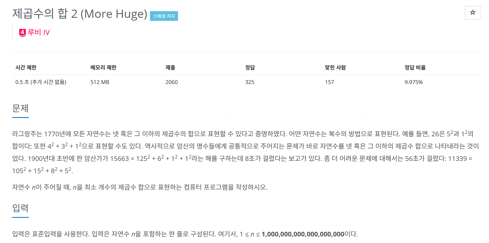

[상위 페이지 · Math](/study/algorithms/math/)



## 문제 태그

- 정수론
- 폴라드 로
- 밀러 라빈 소수판정

## 아이디어

### 하나의 제곱 수 표현

이는 $$\sqrt(n)$$임이 자명함으로 패스

좀 더 일반화 하면 모든 소인수의 지수가 짝수면 하나로 표현 가능

예시)

- 25 → $$5^2$$ → 5
- 36 → $$2^2 * 3^2$$ → $$6^2$$ → 6

### 두 제곱 수 표현

<aside markdown="1">
💡

**페르마의 두 제곱수 정리**

$$n = x^2 + y^2$$

임의에 양의 정수 n에 대하여 다음 두 조건이 동치이다

- $$n = x^2 + y^2$$인 정수 x,y가 존재한다
- n은 4에 대한 나머지가 3인 소인수의 지수로 홀수를 가지지 않는다
</aside>

<aside markdown="1">
💡

**브라마굽타 피보나치 항등식**

$$x = a^2 + b^2\ ,\ y= c^2 + d^2$$일때

$$xy = (ac-bd)^2 + (ad + bc)^2$$으로 나타낼 수 있음

</aside>

<aside markdown="1">
💡

**Tonelli-Shanks algorithm**

모듈러 산술에서 주어진 정수 n에 대하여, n의 p에 대한 제곱근 x를 효율적으로 찾기 위한 알고리즘

$$
x^2 \equiv n\ (mod\ p)
$$

여기서 p는 홀수 소수이며, n은 p에 대한 제곱잉여(Quadratic Residue)여야 한다.

**동작 요약**

- Tonelli–Shanks 알고리즘은 먼저 p−1을 홀수 Q와 $$2^S$$의 곱으로 분해하고, 비제곱잉여 z를 선택한 후, 초기 변수 r, t, c, M를 설정
- 이후 t가 1이 될 때까지 적절한 지수 i를 찾아 변수를 갱신하는 반복 과정을 거쳐, 결국 n의 모듈러 p에서의 제곱근을 구함.
- 이 알고리즘은 대칭성과 모듈러 산술의 성질을 이용하여 비교적 빠르게 해를 찾도록 설계되어 있다.
</aside>

<aside markdown="1">
💡

**Cornacchia's algorithm**

$$
x^2+dy^2=m
$$

형태의 방정식을 구하기 위한 알고리즘. 이때 특별한 경우로 d를 1로 두면 두 제곱수 표현의 해를 구할 수 있음

**알고리즘 동작**

1. 모듈러 해 찾기
    1. 주어진 d와 m에 대해 $$r^2 \equiv -d\ (mod\ m)$$을 만족하는 모듈러 제곱근을 찾음
    2. 이 해를 찾기 위해 **Tonelli-Shanks algorithm** 사용
2. r의 값이 $$\sqrt{m}$$이 이하가 될 때까지 유클리드 알고리즘 적용
3. 이때 최종 r 값이 y의 값임.
4. x의 값은 $$\sqrt{(m-r^2)}$$임
</aside>

기본적으로 4n + 1의 꼴인 소수는 언제나 제곱수 두개의 합으로 나타내짐.

- 4는 $$2^2$$ 꼴이며 1은 무엇을 제곱하든 1이기에 4와 1로 다 표현 가능

하지만 4n + 3 꼴의 소수는 쉽게 두 제곱수로 표현이 되지 않는데 4n+3 꼴의 소수가 두 제곱수로 표현되기 위해서는 지수가 짝수여야 함

- 짝수라면 $$q^{2k}=(q^k)^2$$ 으로 완전제곱수로 표현이 가능하기 때문

위와 같은 성질로 소인수 모두가 두 제곱수로 표현이 된다면 n도 두 제곱수로 표현이 가능하다.

각  4n + 1로 표현되는 소수의 두 제곱수를 빠르게 구하기 위해서는 Cornacchia's algorithm, Tonelli-Shanks algorithm을 사용한다

## 세 제곱 수 표현

<aside markdown="1">
💡

**르장드르의 정리**

자연수 n은 세 정수 x,y,z에 대해 $$n = x^2 + y^2 + z^2$$로 표현 될 수 있음은 다음과 같은 경우에만 해당 된다

$$
n \not = 4^a(8b+7)
$$

즉, 만약 어떤 n이 $$4^a(8b+7)$$꼴이라면 n은 세 제곱수의 합으로 나타낼 수 없고, 그 외에 모든 자연수는 세 제곱의 합으로 나타낼 수 있음.

</aside>

위와 같은 르장드르의 정리를 만족하면 이는 세 제곱수로 표현이 된다.

다음으로는 완전제곱수와 완전제곱수가 아닌 식으로 나눈다.

$$
n = (p_1^{e1} * p_2^{e2} * ... p_k^{ek}) =(p_1^{e1//2} * p_2^{e2//2} * ... p_k^{ek//2})^2×(p_1^{e1mod2} *p_2^{e2mod2} *p_k^{ekmod2})
$$

완전제곱수인 부분은 마지막에 다시 곱해주면 결과에 영향을 미치지 않음으로 완전 제곱수가 아닌 식으로 세제곱수를 구한다

이때

$$
n = (a^2 + b^2) + t^2
$$

으로 나타낼 수 있고 이는

$$
n -t^2 = a^2 + b^2
$$

를 만족하는 t를 찾는다면 다시  Cornacchia's algorithm을 적용하여 빠르게 a,b를 구할 수 있다

### 네 제곱수 표현

아까 세 제곱수 표현에서 n이 $$4^a(8b+7)$$라면 세 제곱수의 합으로 나타낼 수 없다고 했다. 그 이유는 $$4^a$$때문이며 $$4^a$$를 제외한 8b + 7 부분에서 세 제곱수를 구하고 $$4^a$$를 붙여주면 네 제곱수 표현까지 끝난다

### 최적화

1. 소인수 분해와 소수 판별에서 폴라드 로 알고리즘과 밀러 라빈 알고리즘을 사용하게 될 것이다. 이때 메모이제이션을 하면 최적화가 가능하다.
2. 제곱근 계산을 **나 math.sqrt로 하지 말고 소인수 분해 된 결과에서 구하면 큰 수에서 빠르다.

## 정답

```python
import math
import random
import sys
from random import randrange
from math import gcd
input = sys.stdin.readline

# 소수 후보
basic_primes = {2, 3, 5, 7, 11, 13, 17, 19, 23, 29, 31, 37, 41}

# 모듈러 거듭 제곱
def mod_pow(base, exponent, mod):
    result = 1
    base %= mod
    while exponent:
        if exponent & 1:
            result = result * base % mod
        base = base * base % mod
        exponent >>= 1
    return result

# 소수 판별 (Miller-Rabin)
is_prime_memo = dict()

def is_prime(n):
    if n in is_prime_memo:
        return is_prime_memo[n]
    if n == 1:
        return False
    if n < 4:
        return True
    if n % 2 == 0:
        return False
    if n in basic_primes:
        is_prime_memo[n] = True
        return True

    def miller_rabin_test(n, a):
        d = n - 1
        r = 0
        while d % 2 == 0:
            d //= 2
            r += 1
        x = pow(a, d, n)
        if x == 1 or x == n - 1:
            return True
        for _ in range(r - 1):
            x = pow(x, 2, n)
            if x == n - 1:
                return True
        return False

    is_probably_prime = True
    for base in basic_primes:
        if not miller_rabin_test(n, base):
            is_probably_prime = False
            break

    is_prime_memo[n] = is_probably_prime
    return is_probably_prime

# Pollard's Rho 알고리즘
factor_memo = dict()

def pollards_rho(n):
    if n == 1:
        return 1
    if n % 2 == 0:
        return 2
    if is_prime(n):
        return n

    def f(x, c, mod):
        return (x ** 2 + c) % mod

    x = random.randrange(2, n)
    c = random.randrange(1, n)
    y = x
    g = 1

    while g == 1:
        x = f(x, c, n)
        y = f(f(y, c, n), c, n)
        g = math.gcd(x - y, n)
        if g == n:
            return pollards_rho(n)
    if not is_prime(g):
        return pollards_rho(g)
    return g

# 정수 n의 소인수분해 리스트 반환
def factorize(n):
    if n in factor_memo:
        return factor_memo[n]
    if n == 1:
        factor_memo[n] = []
        return []
    if n % 2 == 0:
        factor_memo[n] = [2] + factorize(n // 2)
        return factor_memo[n]
    if is_prime(n):
        factor_memo[n] = [n]
        return [n]
    p = pollards_rho(n)
    factor_memo[n] = factorize(p) + factorize(n // p)
    return factor_memo[n]

# 제곱근 계산 (제곱수만)
def integer_sqrt(n):
    prime_factors = factorize(n)
    factors = {}
    for p in prime_factors:
        factors[p] = factors.get(p, 0) + 1
    result = 1
    for p, count in factors.items():
        result *= pow(p, count // 2)
    return result

# Tonelli-Shanks 알고리즘 (mod p에서 제곱근)
def tonelli_shanks(p):
    q = p - 1
    s = 0
    while q % 2 == 0:
        q //= 2
        s += 1
    z = randrange(2, p)
    while pow(z, (p - 1) // 2, p) == 1:
        z = randrange(2, p)
    m, c = s, pow(z, q, p)
    t, r = pow(p - 1, q, p), pow(p - 1, (q + 1) // 2, p)
    while t != 1 and t != 0:
        i, temp = 0, t
        while temp % p != 1:
            temp = pow(temp, 2, p)
            i += 1
        b = pow(c, 1 << (m - i - 1), p)
        m = i
        c = (b * b) % p
        t = (t * c) % p
        r = r * b % p
    return r

# Cornacchia 알고리즘
def cornacchia(p):
    if p % 4 == 3:
        return False
    if p == 2:
        return 1
    r = tonelli_shanks(p)
    a = p
    while r * r > p:
        a, r = r, a % r
    return r

# 네 제곱수 정리 기반 항 개수 판단
def min_square_count(n):
    factors = {}
    for f in factorize(n):
        factors[f] = factors.get(f, 0) + 1

    all_even = True
    for exp in factors.values():
        if exp % 2 != 0:
            all_even = False
            break

    legendre_ok = True
    for p, exp in factors.items():
        if p % 4 == 3 and exp % 2 != 0:
            legendre_ok = False
            break

    if all_even:
        return 1
    if legendre_ok:
        return 2
    while n % 4 == 0:
        n //= 4
    return 3 if n % 8 != 7 else 4

def get_case_1(n):
    return [integer_sqrt(n)]

def get_case_2(n):
    factors = factorize(n)
    factor_counts = {}
    for f in factors:
        factor_counts[f] = factor_counts.get(f, 0) + 1

    common_factor = 1
    odd_primes = []
    for p, exp in factor_counts.items():
        common_factor *= pow(p, exp // 2)
        if exp % 2:
            odd_primes.append(p)

    result = [1, 0]
    for p in odd_primes:
        x = cornacchia(p)
        y = integer_sqrt(p - x * x)
        a, b = result
        result = [a * y + b * x, abs(a * x - b * y)]
    return [x * common_factor for x in result]

def get_case_3(n):
    factors = factorize(n)
    factor_counts = {}
    for f in factors:
        factor_counts[f] = factor_counts.get(f, 0) + 1

    common_factor = 1
    reduced_n = 1
    for p, exp in factor_counts.items():
        common_factor *= pow(p, exp // 2)
        reduced_n *= pow(p, exp % 2)

    t = 1
    while min_square_count(reduced_n - t * t) != 2:
        t += 1
    return [x * common_factor for x in get_case_2(reduced_n - t * t)] + [t * common_factor]

def get_case_4(n):
    pow_of_4 = 0
    while n % 4 == 0:
        n //= 4
        pow_of_4 += 1
    base_case = get_case_3(n - 1)
    scale = 2 ** pow_of_4
    return [x * scale for x in base_case] + [scale]

# 실행부
n = int(input())
count = min_square_count(n)
print(count)
if count == 1:
    print(*get_case_1(n))
elif count == 2:
    print(*get_case_2(n))
elif count == 3:
    print(*get_case_3(n))
else:
    print(*get_case_4(n))

```
