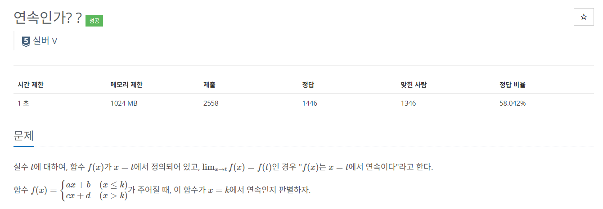

[상위 페이지 · 실버](/study/algorithms/math/silver/)



## 문제 태그

- 수학
- 미적분학

## 아이디어

- 함수의 연속성을 판단하려면 좌극한, 우극한, 함수값이 모두 같아야 하며, 이 문제에서는 단순히 두 식이 x=k에서 이어지는지를 비교하는 것으로 귀결된다. 수식적으로는 ak+b=ck+d라는 조건 하나로 충분히 판단이 가능하다.
- 좌극한 = f(x) = ax + b
- 우극한 = f(x) = cx + d
- 함수값 = f(x) = ax + b

## 정답

```python
k = int(input())
a,b,c,d = map(int,input().split())

if (a*k) + b != (c*k) + d:
    print("No")
else:
    print(f"Yes {(a*k) + b}")
```
