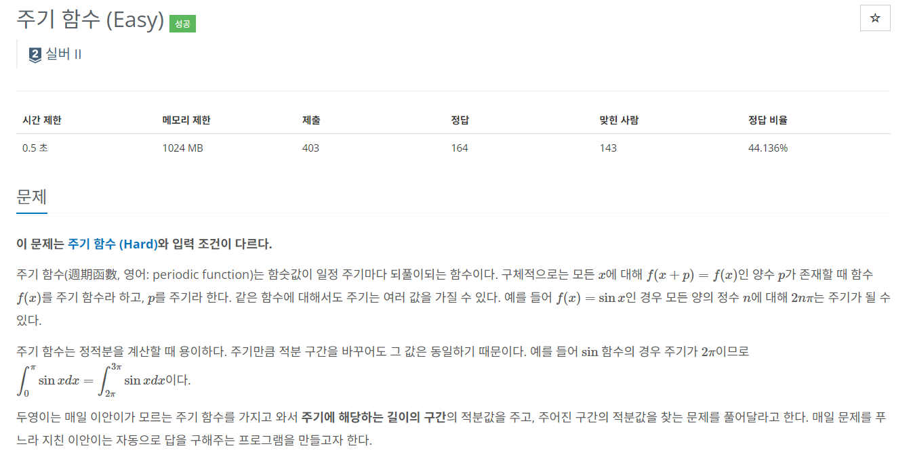

[상위 페이지 · Math](/study/algorithms/math/)



## 문제 태그

- 수학
- 미적분학
- 누적합

## 아이디어

- 주기를 이용하여 right - left가 n보다 크면, right - left를 n으로 나눈 몫만큼 전체 합을 더한다.
- 나머지 부분은 left부터 시작하여 right - left를 n으로 나눈 나머지만큼 더해준다.

## 정답

```python
n = int(input())
nums = list(map(int, input().split()))
left, right = map(int, input().split())

if left > right:
    left, right = right, left

if left == right:
    print(0)
    exit()

a = right - left
m = a // n
r = a % n

result = sum(nums) * m
left = left % n
for i in range(r):
    result += nums[(left + i) % n]

print(result)
```
