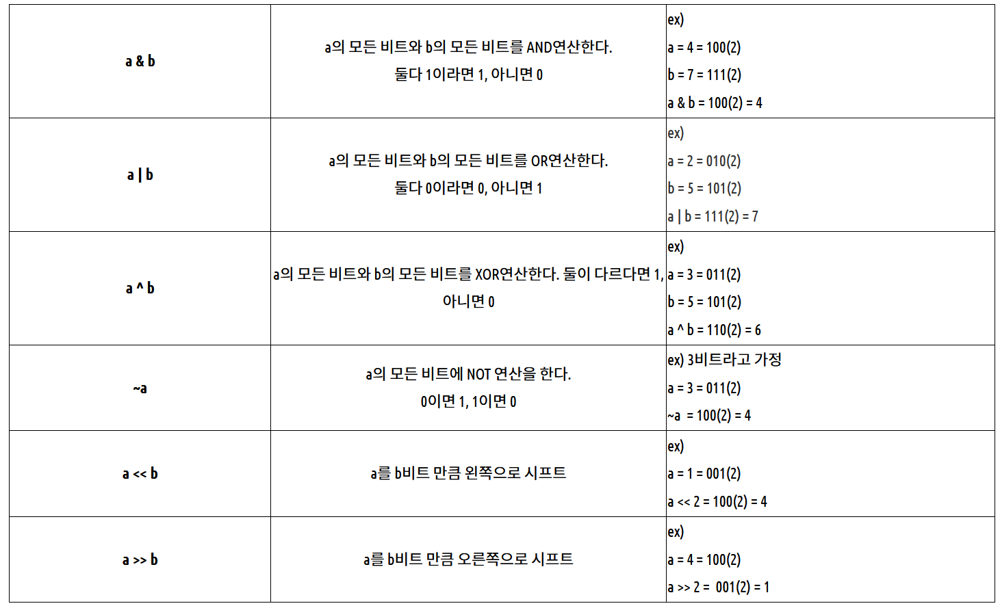

[상위 페이지 · Search](/study/algorithms/search/)

- 비트를 이용하여 집합을 표시
- 컴퓨터는 기본적으로 이진수를 활용하기에 매우 빠른 연산 속도를 보여줌, 메모리 사용량 감소, 간결한 코드 작성
- 예를 들어 1,6,7번의 성질이 존재한다면 11000010(2) = 194(10)으로 표현
- 비트 연산
    
    
    
- 원소 추가(p번 비트를 on)
    
    ```java
    cur = cur | (1 << p)
    ```
    
- 원소 삭제
    
    ```java
    cur = cur & ~(1 << p)
    ```
    
- 원소 토글 (1→0, 0→1)
    
    ```java
    cur = cur ^ (1 << p)
    ```
    
- 공집합
    
    ```java
    cur = 0
    ```
    
- 전체 집합
    
    ```java
    cur = 63
    ```
