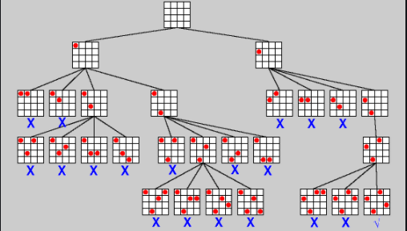

[상위 페이지 · Search](/study/algorithms/search/)

알고리즘 기법 중 하나로 **재귀적으로 문제를 해결**하는 방식이다. 현재 재귀를 통해 확인 중인 상태가 제한 조건에 위배되는지 판단하고, 해당 상태가 위배되는 경우 **해당 상태를 제외**하고 다음 단계로 넘어간다.

재귀 호출을 통해 모든 가능한 경우의 수를 탐색하되, 특정 조건을 만족하지 않으면 더 이상 진행하지 않고 이전 단계로 돌아간다.

쉽게 말하면, **해를 찾는 도중 해가 절대 될 수 없다고 판단되면, 되돌아가서 다시 해를 찾는다**는 것이다. 이를 통해 불필요한 탐색을 줄이고 효율성을 높인다.

DFS와의 주요 차이점은 더 이상 탐색할 필요가 없는 상태를 조기에 제외한다는 점이다. 이를 **가지치기**라고 한다.

DFS는 모든 경로를 끝까지 탐색하지만, 백트래킹은 유망하지 않은 경로를 즉시 배제하여 탐색 공간을 대폭 줄인다.

## 상태 공간 트리와 유망함

**상태 공간 트리:** 문제 해결 과정에서 나올 수 있는 모든 경우의 수를 트리 형태로 표현한 가상의 공간이다.

**유망하다:** 현재 노드가 해가 될 가능성이 있다는 의미이다.

**백트래킹의 재정의:** 상태 공간 트리를 DFS로 탐색하되, 유망하지 않은 노드를 만나면 부모 노드로 되돌아가 다음 자식 노드를 검색하는 과정이다.

## 효율적인 가지치기 기법

단순히 조건이 맞지 않으면 돌아가는 것이 아니라, **능동적으로 탐색 순서를 조정**하면 성능이 크게 향상된다.

1. 변수 선택 순서
    
    들어갈 수 있는 값의 후보가 가장 적은 변수부터 선택한다.
    
    **예시:** 스도쿠에서 빈칸을 채울 때, 들어갈 수 있는 숫자의 후보가 가장 적은 칸부터 채우는 것이 유리하다.
    
2. 값 선택 순서
    
    답이 될 확률이 높은 값부터 먼저 대입한다.
    
    운이 좋게 답을 빨리 찾으면 나머지 탐색을 생략할 수 있다.
    

## 분기 한정법과의 차이

**백트래킹:** 주로 모든 해를 찾거나, 조건을 만족하는 해가 존재하는지를 판단하는 데 사용된다.

**분기 한정법:** 주로 최적의 해(최솟값/최댓값)를 찾을 때 사용된다. 현재 경로가 지금까지 찾은 최적해보다 나쁘면 즉시 가지치기한다.

## 백트래킹 구현 템플릿

대부분의 백트래킹 문제는 다음 구조를 따른다.



```python
def backtrack(상태):
    # 1. 종료 조건 확인
    if 목표_달성(상태):
        해답_저장(상태)
        return
    
    # 2. 유망성 검사 (가지치기)
    if not 유망함(상태):
        return
    
    # 3. 다음 선택지 탐색
    for 선택지 in 가능한_선택지들(상태):
        # 선택
        상태_추가(선택지)
        
        # 재귀 호출
        backtrack(상태)
        
        # 선택 취소 (백트래킹)
        상태_제거(선택지)
```

다음은 백트래킹의 대표적인 문제인 N-QUEEN 문제의 백트래킹 방법을 트리 구조로 표현한 것이다. 각 노드는 퀸의 배치 상태를 나타내며, 조건을 위배하는 경로는 더 이상 탐색하지 않고 가지치기된다.

### 백트래킹 응용

- [Knuth X Algorithm](/study/algorithms/search/back-tracking/knuth-x-algorithm/)
