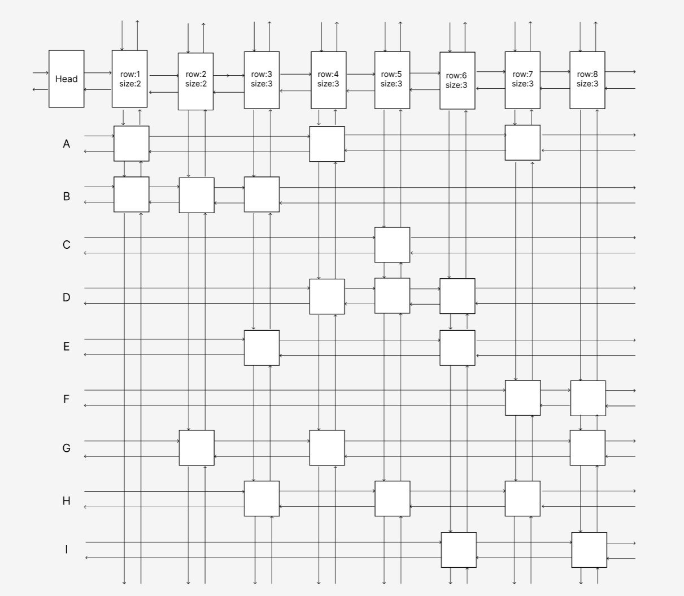
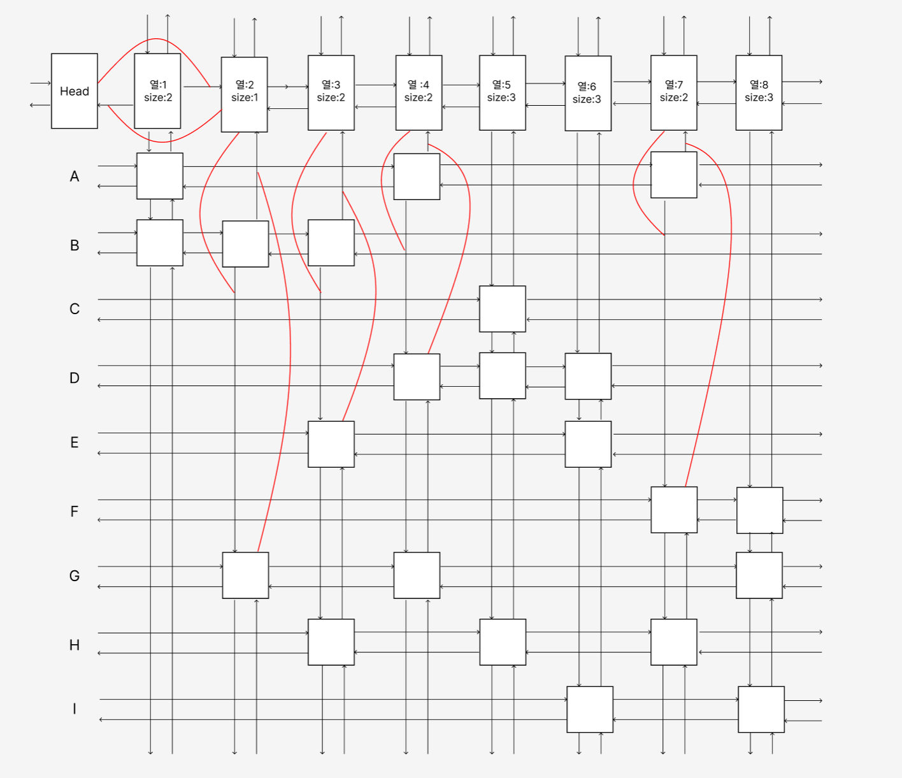

[상위 페이지 · Back-Tracking](/study/algorithms/search/back-tracking/)

Knuth X 알고리즘은 Exact Cover 문제를 해결하기 위해 Donald Knuth가 고안한 알고리즘이다. 

이 알고리즘은 DLX(Dancing Links) 기법을 사용하여 효율적으로 구현된 재귀적, 비결정적, 깊이 우선 역추적 알고리즘이다.

## Exact Cover 문제

- U = {1, 2, 3, 4, 5, 6, 7, 8}
- S $$\subset$$ U = {A, B, C, D, E, F, G, H, I}
    - A = {1, 4, 7}
    - B = {1, 2, 3}
    - C = {5}
    - D = {4, 5, 6}
    - E = {3, 6}
    - F = {7, 8}
    - G = {2, 4, 8}
    - H = {3, 5, 7}
    - I = {6, 8}
- 다음 조건을 만족하는 $$S$$의 부분 집합 $$S'$$ 구하는 것

<aside markdown="1">
💡

**조건**

1. $$\forall S_i,S_j \in S'\ (i\neq j \Rightarrow S_i \cap S_j = \phi)$$
2. $$\bigcup_{S_k \in S'}S_k = U$$
</aside>

즉, A~F 집합을 한번씩 선택하여 U의 모든 원소가 단 한번 나타나게 하는 것.

위 문제에서는 $$S' = \{B,D,F\}$$가 Exact Cover문제의 해로 성립한다.

## 문제 해결 전략

우선 각 집합 A~F가 어떤 원소를 가지고 있으면 1, 가지고 있지 않다면 0으로 표기하여 행렬을 만든다.

이러한 행렬에서 크누스 X 알고리즘은 다음과 같은 흐름을 가진다.

<aside markdown="1">
💡

**알고리즘의 흐름**

1. **종료 조건 확인 :** 행렬이 비어있다면(열이 하나도 없다면), 현재까지의 부분 해답(partial solution)은 Exact Cover문제의 해답으로 알고리즘을 종료한다
2. **열(Column) 선택 :** 행렬 A에서 ‘1’의 개수가 가장 적은 열(0 포함) c를 선택한다
    - 만약 선택한 열 c에 ‘1’이 하나도 없다면, 이 경로로는 해답을 찾을 수 없다는 의미로 백트래킹을 한다. 모든 열에 적어도 하나의 ‘1’이 존재해야한다.
3. **행(Row) 선택 (비결정적) :** 2번에서 선택한 열 c에 ‘1’을 포함하는 모든 행 r에 대해 아래 4번 과정을 반복한다
4. **탐색 및 커버**
    - 선택한 행 r을 부분 해답에 추가한다
    - 행 r에 ‘1’이 있는 모든 열을 행렬에서 제거한다
    - 방금 제거한 열들에 ‘1’이 있는  모든 행들을 행렬에서 제거한다
    - 이렇게 축소된 새 행렬에 대해 1번부터 재귀적으로 알고리즘을 호출한다
</aside>

### 예시

<aside markdown="1">
💡

**문제 상황**

- U = {1, 2, 3, 4, 5, 6, 7, 8}
- S $$\subset$$ U = {A, B, C, D, E, F, G, H, I}
    - A = {1, 4, 7}
    - B = {1, 2, 3}
    - C = {5}
    - D = {4, 5, 6}
    - E = {3, 6}
    - F = {7, 8}
    - G = {2, 4, 8}
    - H = {3, 5, 7}
    - I = {6, 8}
</aside>

> 각 집합 A~F가 어떤 원소를 가지고 있으면 1, 가지고 있지 않다면 0으로 표기하여 행렬을 만든다
> 

|  | 1 | 2 | 3 | 4 | 5 | 6 | 7 | 8 |
| --- | --- | --- | --- | --- | --- | --- | --- | --- |
| A | 1 | 0 | 0 | 1 | 0 | 0 | 1 | 0 |
| B | 1 | 1 | 1 | 0 | 0 | 0 | 0 | 0 |
| C | 0 | 0 | 0 | 0 | 1 | 0 | 0 | 0 |
| D | 0 | 0 | 0 | 1 | 1 | 1 | 0 | 0 |
| E | 0 | 0 | 1 | 0 | 0 | 1 | 0 | 0 |
| F | 0 | 0 | 0 | 0 | 0 | 0 | 1 | 1 |
| G | 0 | 1 | 0 | 1 | 0 | 0 | 0 | 1 |
| H | 0 | 0 | 1 | 0 | 1 | 0 | 1 | 0 |
| I | 0 | 0 | 0 | 0 | 0 | 1 | 0 | 1 |

> **열(Column) 선택 :** 행렬에서 ‘1’의 개수가 가장 적은 열(0 포함) c를 선택한다
> 

각 열이 가지는 1의 개수는 순서대로 2, 2, 3, 3, 3, 3, 3, 3이다. 1의 개수가 제일 적은 1열을 먼저 선택한다

> **행(Row) 선택 (비결정적) :** 2번에서 선택한 열 c에 ‘1’을 포함하는 모든 행 r에 대해 아래 4번 과정을 반복한다
> 

1열에서 1이 있는 행은 A, B행이다

|  | 1 | 2 | 3 | 4 | 5 | 6 | 7 | 8 |
| --- | --- | --- | --- | --- | --- | --- | --- | --- |
| A | 1 | 0 | 0 | 1 | 0 | 0 | 1 | 0 |
| B | 1 | 1 | 1 | 0 | 0 | 0 | 0 | 0 |
| C | 0 | 0 | 0 | 0 | 1 | 0 | 0 | 0 |
| D | 0 | 0 | 0 | 1 | 1 | 1 | 0 | 0 |
| E | 0 | 0 | 1 | 0 | 0 | 1 | 0 | 0 |
| F | 0 | 0 | 0 | 0 | 0 | 0 | 1 | 1 |
| G | 0 | 1 | 0 | 1 | 0 | 0 | 0 | 1 |
| H | 0 | 0 | 1 | 0 | 1 | 0 | 1 | 0 |
| I | 0 | 0 | 0 | 0 | 0 | 1 | 0 | 1 |

> **탐색 및 커버**
> 
> - 선택한 행 r을 부분 해답에 추가한다
> - 행 r에 ‘1’이 있는 모든 열을 행렬에서 제거한다
> - 방금 제거한 열들에 ‘1’이 있는  모든 행들을 행렬에서 제거한다
> - 이렇게 축소된 새 행렬에 대해 1번부터 재귀적으로 알고리즘을 호출한다

우선 A, B 행 중 A행을 방문한다

(현재 $$S' = \{A\}$$)

|  | 1 | 2 | 3 | 4 | 5 | 6 | 7 | 8 |
| --- | --- | --- | --- | --- | --- | --- | --- | --- |
| A | 1 | 0 | 0 | 1 | 0 | 0 | 1 | 0 |
| B | 1 | 1 | 1 | 0 | 0 | 0 | 0 | 0 |
| C | 0 | 0 | 0 | 0 | 1 | 0 | 0 | 0 |
| D | 0 | 0 | 0 | 1 | 1 | 1 | 0 | 0 |
| E | 0 | 0 | 1 | 0 | 0 | 1 | 0 | 0 |
| F | 0 | 0 | 0 | 0 | 0 | 0 | 1 | 1 |
| G | 0 | 1 | 0 | 1 | 0 | 0 | 0 | 1 |
| H | 0 | 0 | 1 | 0 | 1 | 0 | 1 | 0 |
| I | 0 | 0 | 0 | 0 | 0 | 1 | 0 | 1 |

A행에서 1이 존재하는 열은 1, 4, 7열이다. 모두 제거한다

|  | 1 | 2 | 3 | 4 | 5 | 6 | 7 | 8 |
| --- | --- | --- | --- | --- | --- | --- | --- | --- |
| A | 1 | 0 | 0 | 1 | 0 | 0 | 1 | 0 |
| B | 1 | 1 | 1 | 0 | 0 | 0 | 0 | 0 |
| C | 0 | 0 | 0 | 0 | 1 | 0 | 0 | 0 |
| D | 0 | 0 | 0 | 1 | 1 | 1 | 0 | 0 |
| E | 0 | 0 | 1 | 0 | 0 | 1 | 0 | 0 |
| F | 0 | 0 | 0 | 0 | 0 | 0 | 1 | 1 |
| G | 0 | 1 | 0 | 1 | 0 | 0 | 0 | 1 |
| H | 0 | 0 | 1 | 0 | 1 | 0 | 1 | 0 |
| I | 0 | 0 | 0 | 0 | 0 | 1 | 0 | 1 |

제거한 1, 4, 7열에서 1이 속한 행은 B, D, F, G, H이다. 모두 제거한다.

|  | 1 | 2 | 3 | 4 | 5 | 6 | 7 | 8 |
| --- | --- | --- | --- | --- | --- | --- | --- | --- |
| A | 1 | 0 | 0 | 1 | 0 | 0 | 1 | 0 |
| B | 1 | 1 | 1 | 0 | 0 | 0 | 0 | 0 |
| C | 0 | 0 | 0 | 0 | 1 | 0 | 0 | 0 |
| D | 0 | 0 | 0 | 1 | 1 | 1 | 0 | 0 |
| E | 0 | 0 | 1 | 0 | 0 | 1 | 0 | 0 |
| F | 0 | 0 | 0 | 0 | 0 | 0 | 1 | 1 |
| G | 0 | 1 | 0 | 1 | 0 | 0 | 0 | 1 |
| H | 0 | 0 | 1 | 0 | 1 | 0 | 1 | 0 |
| I | 0 | 0 | 0 | 0 | 0 | 1 | 0 | 1 |

그 결과 다음과 같은 행렬을 얻을 수 있다

|  | 2 | 3 | 5 | 6 | 8 |
| --- | --- | --- | --- | --- | --- |
| C | 1 | 0 | 1 | 0 | 0 |
| E | 0 | 0 | 0 | 1 | 0 |
| I | 0 | 0 | 0 | 1 | 1 |

> **종료 조건 확인 :** 행렬 A가 비어있다면(열이 하나도 없다면), 현재까지의 부분 해답(partial solution)은 Exact Cover문제의 해답으로 알고리즘을 종료한다.
> 

|  | 2 | 3 | 5 | 6 | 8 |
| --- | --- | --- | --- | --- | --- |
| C | 1 | 0 | 1 | 0 | 0 |
| F | 0 | 0 | 0 | 0 | 1 |
| I | 0 | 0 | 0 | 1 | 1 |

> **백트래킹 조건 :** 만약 선택한 열 c에 ‘1’이 하나도 없다면, 이 경로로는 해답을 찾을 수 없다는 의미로 백트래킹을 한다. 모든 열에 적어도 하나의 ‘1’이 존재해야한다.
> 

조건에 의해 3열에 1이 존재하지 않으므로 백트래킹을 진행한다.

A에서 백트래킹을 진행했으므로 다음은 B를 선택해주고 동일하게 알고리즘을 진행해준다

(현재 $$S' = \{B\}$$)

|  | 1 | 2 | 3 | 4 | 5 | 6 | 7 | 8 |
| --- | --- | --- | --- | --- | --- | --- | --- | --- |
| A | 1 | 0 | 0 | 1 | 0 | 0 | 1 | 0 |
| B | 1 | 1 | 1 | 0 | 0 | 0 | 0 | 0 |
| C | 0 | 0 | 0 | 0 | 1 | 0 | 0 | 0 |
| D | 0 | 0 | 0 | 1 | 1 | 1 | 0 | 0 |
| E | 0 | 0 | 1 | 0 | 0 | 1 | 0 | 0 |
| F | 0 | 0 | 0 | 0 | 0 | 0 | 1 | 1 |
| G | 0 | 1 | 0 | 1 | 0 | 0 | 0 | 1 |
| H | 0 | 0 | 1 | 0 | 1 | 0 | 1 | 0 |
| I | 0 | 0 | 0 | 0 | 0 | 1 | 0 | 1 |

그럼 다음과 같은 행렬을 얻는다.

|  | 4 | 5 | 6 | 7 | 8 |
| --- | --- | --- | --- | --- | --- |
| C | 0 | 1 | 0 | 0 | 0 |
| D | 1 | 1 | 1 | 0 | 0 |
| F | 0 | 0 | 0 | 1 | 1 |
| I | 0 | 0 | 1 | 0 | 1 |

역시 마찬가지로 4열에 1의 개수가 가장 적으므로 4열과 D행을 선택 후 알고리즘을 진행한다.

(현재 $$S' = \{B,D\}$$)

|  | 4 | 5 | 6 | 7 | 8 |
| --- | --- | --- | --- | --- | --- |
| C | 0 | 1 | 0 | 0 | 0 |
| D | 1 | 1 | 1 | 0 | 0 |
| F | 0 | 0 | 0 | 1 | 1 |
| I | 0 | 0 | 1 | 0 | 1 |

그럼 다음 행렬을 얻게 된다

|  | 7 | 8 |
| --- | --- | --- |
| F | 1 | 1 |

최종적으로 남은 행을 고르면 Exact Cover 문제의 해를 얻을 수 있게 된다.

$$S' = \{B,D,F\}$$

## 전략을 위한 도구 DLX

<aside markdown="1">
💡

**댄싱 링크**

이중 연결 리스트에서의 삽입과 삭제를 이용하면 빠르게 그 행을 배제하고 다시 복구 할 수 있다.

**노드의 제거**

```
X.left.right <- x.right
x.right.left <- x.left
```


위 코드가 실행이 되면 x의 왼쪽인 left의 R포인터가 x의 오른쪽인 right를 가리키게 되고 x의 오른쪽인 right의 L포인터가 x의 왼쪽인 left를 가리키게된다.

그 결과 X가 배제되게 된다.


이 때 중요한점은 X의 포인터들은 변화가 없기 때문에 빠르게 복구할 수 있다.

**노드의 복원**

```
X.left.right <- x
x.right.left <- x
```

X의 포인터들은 변화가 없기 때문에 다시 왼쪽과 오른쪽의 포인터만 원래대로 돌려주면 된다.

이때 주의할 점은 삭제가 이루어진 역순으로 진행해야 완전한 노드의 복원이 가능하다.

</aside>



row라 적혀있지만 행이 아닌 열이다.

위 그림은 위에서 예시를 들었던 문제 상황을 2차원 연결리스트로 표현한것이다. 1은 노드가 존재하는것이고 0은 노드가 존재하지 않는다.

### Cover

댄싱 링크와 2차원 인접리스트를 사용해서 1열을 Cover하면 다음과 같은 결과를 얻게 된다.



1열과 A,B행을 배제하는 효과를 얻게 된다. 이를 이용하면 다음 로직을 쉽게 구현할 수 있다.

> **탐색 및 커버**
> 
> 1. 선택한 행 r을 부분 해답에 추가한다
> 2. 행 r에 ‘1’이 있는 모든 열을 행렬에서 제거한다
> 3. 방금 제거한 열들에 ‘1’이 있는  모든 행들을 행렬에서 제거한다
> 4. 이렇게 축소된 새 행렬에 대해 1번부터 재귀적으로 알고리즘을 호출한다

만약 A행을 선택했다면 Cover를 3번 해준다

- cover(1번 열) - 1번 열과 1번 열에 속해있던 행 (A,B) 비활성화
- cover(4번 열) - 4번 열과 4번 열에 속해있던 행 (A,D,G) 비활성화
- cover(7번 열) - 7번 열과 7번열에 속해있던 행 (A,F,H) 비활성화

이 세번의 커버 호출 결과를 합쳐보면 A행과 충돌하는 모든 행과 열을 제거한것과 같은 효과가 나게 된다. A와 원소를 공유했던 B, D, F, G, H 행들이 모두 비활성화가 된다.

## 구현

```python
# --- 데이터 구조 정의 ---

class Node:
    """댄싱 링크의 각 노드(데이터 '1' 또는 열 헤더)를 나타내는 클래스"""
    def __init__(self, row=-1, col_header=None):
        # 이 노드가 속한 행의 인덱스. 결과 출력에 사용.
        self.row = row
        # 이 노드가 속한 열의 헤더 노드를 가리킴. 데이터 노드에서만 의미가 있음.
        self.col = col_header
        
        # 헤더 노드일 경우, 해당 열의 노드 개수를 저장.
        # 일반 노드는 이 객체를 사용하지 않음. col_header.col.size로 접근.
        # 파이썬에서는 별도의 Header 클래스 없이 Node 하나로 처리하기 위한 트릭.
        if col_header is None: 
            self.size = 0

        # 상하좌우 포인터를 자기 자신으로 초기화하여 원형 리스트의 기반을 만듦.
        self.up = self
        self.down = self
        self.left = self
        self.right = self

# --- 댄싱 링크 구조 생성 함수 ---

def create_dlx_matrix(matrix):
    """주어진 2차원 리스트(matrix)로 댄싱 링크의 십자형 원형 연결 리스트 구조를 생성"""
    # 문제 행렬의 열 개수를 가져옴.
    num_cols = len(matrix[0])
    # 전체 구조의 시작점이자 마스터 헤더 역할을 하는 root 노드 생성.
    root = Node(col_header=Node()) 
    
    # 열 헤더 노드들을 저장할 리스트.
    columns = []
    # 각 열에 대해 헤더 노드를 생성.
    for j in range(num_cols):
        # 헤더 노드 생성.
        header = Node(col_header=Node())
        # 이 헤더가 대표하는 열의 노드 개수(size)를 0으로 초기화.
        header.col.size = 0
        # columns 리스트에 헤더 추가.
        columns.append(header)
        # 헤더들을 수평으로 연결하여 원형 리스트를 만듦 (root 포함).
        header.right = root          # 새 헤더의 오른쪽은 root.
        header.left = root.left      # 새 헤더의 왼쪽은 기존의 마지막 헤더.
        root.left.right = header     # 기존 마지막 헤더의 오른쪽을 새 헤더로 연결.
        root.left = header           # root의 왼쪽을 새 헤더로 업데이트하여 마지막 헤더로 만듦.

    # 행렬을 순회하며 데이터 노드('1')를 생성하고 연결.
    for r_idx, row in enumerate(matrix):
        # 각 행의 첫 번째 노드를 저장하여 수평 원형 리스트를 만들기 위한 변수.
        first_node_in_row = None
        # 행의 각 값을 순회.
        for c_idx, val in enumerate(row):
            # 값이 '1'일 경우에만 노드를 생성.
            if val == 1:
                # 현재 위치에 해당하는 열 헤더를 가져옴.
                col_header = columns[c_idx]
                # 해당 열의 노드 개수(size)를 1 증가시킴.
                col_header.col.size += 1
                
                # 새 데이터 노드 생성. 행 번호와 열 헤더 정보를 저장.
                new_node = Node(row=r_idx, col_header=col_header)
                
                # [세로 연결]: 새 노드를 해당 열의 연결 리스트에 추가.
                new_node.down = col_header          # 새 노드의 아래는 헤더.
                new_node.up = col_header.up         # 새 노드의 위는 기존의 마지막 노드.
                col_header.up.down = new_node       # 기존 마지막 노드의 아래를 새 노드로 연결.
                col_header.up = new_node            # 헤더의 위를 새 노드로 업데이트하여 마지막 노드로 만듦.
                
                # [가로 연결]: 새 노드를 해당 행의 연결 리스트에 추가.
                if first_node_in_row is None:
                    # 이 노드가 행의 첫 번째 노드일 경우.
                    first_node_in_row = new_node
                # 새 노드의 오른쪽은 행의 첫 번째 노드 (원형).
                new_node.right = first_node_in_row
                # 새 노드의 왼쪽은 기존의 마지막 노드.
                new_node.left = first_node_in_row.left
                # 기존 마지막 노드의 오른쪽을 새 노드로 연결.
                first_node_in_row.left.right = new_node
                # 행의 첫 번째 노드의 왼쪽을 새 노드로 업데이트하여 마지막 노드로 만듦.
    # 완성된 댄싱 링크 구조의 시작점(root)을 반환.
    return root

# --- 핵심 동작 함수 (Cover & Uncover) ---

def cover(col_header):
    """특정 열(col_header)과 그 열에 속한 행들을 잠시 제거(비활성화)"""
    # [수평 제거]: 열 헤더 리스트에서 현재 열(col_header)을 제거.
    col_header.right.left = col_header.left  # 오른쪽 이웃의 왼쪽 포인터를 왼쪽 이웃으로.
    col_header.left.right = col_header.right # 왼쪽 이웃의 오른쪽 포인터를 오른쪽 이웃으로.
    
    # [수직 제거]: 현재 열에 속한 모든 노드(i)들을 순회.
    i = col_header.down
    while i != col_header:
        # 각 노드(i)가 속한 행의 다른 노드(j)들을 순회.
        j = i.right
        while j != i:
            # j 노드를 자신의 열에서 제거 (세로 연결만 끊음).
            j.down.up = j.up          # 아래 이웃의 위쪽 포인터를 위쪽 이웃으로.
            j.up.down = j.down        # 위쪽 이웃의 아래쪽 포인터를 아래쪽 이웃으로.
            # j가 속한 열의 노드 개수(size)를 1 감소.
            j.col.col.size -= 1
            # 다음 노드로 이동.
            j = j.right
        # 다음 노드로 이동.
        i = i.down

def uncover(col_header):
    """cover로 제거했던 열과 행들을 원래대로 복원 (백트래킹)"""
    # cover와 정확히 역순으로 작업을 수행.
    # [수직 복원]: 현재 열에 속했던 모든 노드(i)들을 역순으로 순회.
    i = col_header.up
    while i != col_header:
        # 각 노드(i)가 속한 행의 다른 노드(j)들을 역순으로 순회.
        j = i.left
        while j != i:
            # j가 속한 열의 노드 개수(size)를 다시 1 증가.
            j.col.col.size += 1
            # j 노드를 자신의 열에 다시 연결.
            j.down.up = j             # 아래 이웃의 위쪽 포인터를 자기 자신으로.
            j.up.down = j             # 위쪽 이웃의 아래쪽 포인터를 자기 자신으로.
            # 다음 노드로 이동.
            j = j.left
        # 다음 노드로 이동.
        i = i.up
    
    # [수평 복원]: 열 헤더 리스트에 현재 열(col_header)을 다시 연결.
    col_header.right.left = col_header # 오른쪽 이웃의 왼쪽 포인터를 자기 자신으로.
    col_header.left.right = col_header # 왼쪽 이웃의 오른쪽 포인터를 자기 자신으로.

# --- 알고리즘 X의 재귀 탐색 함수 ---

def search(root, solution, solutions):
    """재귀적으로 모든 가능한 해답을 탐색"""
    # [성공 조건]: 모든 열이 커버되면 (헤더 리스트에 root만 남으면) 해답을 찾은 것.
    if root.right == root:
        # 현재까지의 해답(solution)을 최종 해답 목록(solutions)에 추가.
        solutions.append(list(solution))
        return

    # [열 선택]: '1'의 개수가 가장 적은 열을 선택 (알고리즘 효율을 위한 S-Heuristic).
    c = root.right # 일단 첫 번째 열을 최소값으로 가정.
    min_size = c.col.size
    j = c.right
    # 모든 열 헤더를 순회하며 최소 size를 가진 열을 찾음.
    while j != root:
        if j.col.size < min_size:
            min_size = j.col.size
            c = j
        j = j.right
        
    # 선택된 열 c를 커버.
    cover(c)

    # [행 선택 및 재귀]: 선택된 열 c에 포함된 모든 행 r에 대해 반복.
    r = c.down
    while r != c:
        # 현재 행(r)의 번호를 임시 해답(solution)에 추가.
        solution.append(r.row)
        
        # [충돌 행/열 제거]: 현재 행(r)에 있는 다른 노드(j)들이 속한 열들을 모두 커버.
        j = r.right
        while j != r:
            cover(j.col)
            j = j.right
            
        # [재귀 호출]: 축소된 문제에 대해 다시 search 함수 호출.
        search(root, solution, solutions)

        # [백트래킹]: 재귀 호출에서 돌아온 후, 선택을 되돌림.
        # 방금 커버했던 열들을 정확히 역순으로 언커버.
        j = r.left
        while j != r:
            uncover(j.col)
            j = j.left

        # 임시 해답에서 현재 행(r)의 번호를 제거.
        solution.pop()
        # 다음 행으로 이동.
        r = r.down
        
    # [백트래킹]: 맨 처음 선택했던 열 c를 언커버.
    uncover(c)

# --- 메인 실행 함수 ---

def solve(matrix):
    """Exact Cover 문제를 푸는 전체 과정을 관리"""
    # 1. 댄싱 링크 구조 생성.
    root = create_dlx_matrix(matrix)
    # 2. 최종 해답들을 저장할 리스트.
    solutions = []
    # 3. 재귀 탐색 시작.
    search(root, [], solutions)
    # 4. 찾은 해답들 반환.
    return solutions

# --- 예제 실행 ---
# 이 스크립트가 직접 실행될 때만 아래 코드가 동작.
if __name__ == "__main__":
    # U = {1, 2, 3, 4, 5, 6, 7, 8}
    # S = {A, B, C, D, E, F, G, H, I}
    problem_matrix = [
      # 1  2  3  4  5  6  7  8
        [1, 0, 0, 1, 0, 0, 1, 0],  # A (row 0)
        [1, 1, 1, 0, 0, 0, 0, 0],  # B (row 1)
        [0, 0, 0, 0, 1, 0, 0, 0],  # C (row 2)
        [0, 0, 0, 1, 1, 1, 0, 0],  # D (row 3)
        [0, 0, 1, 0, 0, 1, 0, 0],  # E (row 4)
        [0, 0, 0, 0, 0, 0, 1, 1],  # F (row 5)
        [0, 1, 0, 1, 0, 0, 0, 1],  # G (row 6)
        [0, 0, 1, 0, 1, 0, 1, 0],  # H (row 7)
        [0, 0, 0, 0, 0, 1, 0, 1],  # I (row 8)
    ]
    
    # 문제 풀이 함수 호출.
    solutions = solve(problem_matrix)
    
    # 결과 출력.
    if solutions:
        print(f"총 {len(solutions)}개의 해답을 찾았습니다:")
        for sol in solutions:
            # 찾은 해답(행 번호 리스트)을 알파벳으로 변환하여 보기 좋게 출력.
            set_names = [chr(ord('A') + i) for i in sorted(sol)]
            print(f"- 해답: {set_names} (행 번호: {sorted(sol)})")
    else:
        print("해답을 찾지 못했습니다.")
```

## 응용

대표적인 Exact Cover 문제로 펜토미노나 스도쿠가 있다. 이러한 문제들은 Knuth의 알고리즘을 이용하면 빠르게 해결할 수 있다.

### 스도쿠

스도쿠를 예시로 들어보면 우선 Column에 들어가야 할 요소를 고려해야한다. 스도쿠 규칙을 생각해보면 다음과 같은 제약조건이 있다:

<aside markdown="1">
💡

1. 스도쿠의 각 칸에는 숫자 하나밖에 들어갈 수 없다. 이를 위한 81개의 column이 필요하다. 즉, (1,1)부터 (9,9)까지의 모든 위치에 정확히 하나의 숫자가 배치되어야 한다.
2. 스도쿠의 각 가로줄, 세로줄, 박스에는 1~9의 숫자가 하나씩만 사용되어야 한다. 이를 위해 243(= 3 * 9 * 9)개의 column이 필요하다. 구체적으로:
    - 각 행에 1~9의 숫자가 한 번씩 나타나야 함 (9개 행 × 9개 숫자 = 81개 제약)
    - 각 열에 1~9의 숫자가 한 번씩 나타나야 함 (9개 열 × 9개 숫자 = 81개 제약)
    - 각 3×3 박스에 1~9의 숫자가 한 번씩 나타나야 함 (9개 박스 × 9개 숫자 = 81개 제약)
</aside>

따라서 총 324개(= 81 + 243)의 column이 필요하다. 이 column들은 스도쿠의 모든 제약조건을 표현한다.

다음으로는 Row를 고려해야한다.

<aside markdown="1">

1. 스도쿠의 각 칸에는 1~9사이의 숫자가 하나 들어간다. 따라서 729(9*9*9)개의 row가 필요하다. 각 row는 특정 위치(r,c)에 특정 숫자(n)가 들어가는 경우를 의미한다. 예를 들어, (1,1) 위치에 1이 들어가는 경우, (1,1) 위치에 2가 들어가는 경우... (9,9) 위치에 9가 들어가는 경우까지 모든 가능한 조합을 고려한다.
</aside>

만약 (4,5) 위치에 숫자 2가 들어가게 된다면 이는 row에서 (4,5,2)로 표현할 수 있을것이다. 이는 다음 네 가지 제약조건을 동시에 만족시키게 된다:

- **위치 규칙:** "n행 m열 칸은 채워져야 한다"
- **가로줄 규칙:** "n행에는 숫자 m가 있어야 한다"
- **세로줄 규칙:** "n열에는 숫자 m가 있어야 한다"
- **박스 규칙:** "중앙 박스(n번 박스)에는 숫자 m가 있어야 한다”

<aside markdown="1">
💡

**예시 (4,5,2)**

- **위치 규칙:** "4행 5열 칸은 채워져야 한다" → **32번 row**
- **가로줄 규칙:** "4행에는 숫자 2가 있어야 한다" → **110번 row**
- **세로줄 규칙:** "5열에는 숫자 2가 있어야 한다" → **200번 row**
- **박스 규칙:** "중앙 박스(5번 박스)에는 숫자 2가 있어야 한다" → **281번 row**

따라서, '4행 5열에 2를 놓는다'는 하나의 행(Row)은, 이 324칸짜리 거대한 가로줄에서 **32번, 110번, 200번, 281번** 칸에만 '1'을 찍고 나머지 320칸은 '0'으로 두는 것으로 표현된다.

</aside>

스도쿠를 Exact Cover 문제로 변환하면, 729개의 row와 324개의 column을 가진 이진 행렬이 만들어진다. Knuth X 알고리즘은 이 행렬에서 정확히 81개의 row를 선택하여 모든 column을 정확히 한 번씩 커버하는 해를 찾는다. 이 81개의 row는 스도쿠 퍼즐의 해답이 된다.

### 펜토미노 퍼즐

펜토미노 퍼즐 역시 Exact Cover 문제로 변환할 수 있다. 펜토미노는 5개의 정사각형을 연결한 다각형으로, 총 12가지 모양이 있다. 이 펜토미노 조각들을 사용하여 직사각형 보드를 완전히 채우는 문제가 펜토미노 퍼즐이다.

이 경우 각 column은 보드의 각 칸을 나타내고, 각 row는 특정 펜토미노 조각을 특정 위치와 방향으로 배치하는 경우를 나타낸다. Knuth X 알고리즘을 사용하면 이러한 복잡한 퍼즐도 효율적으로 해결할 수 있다.
