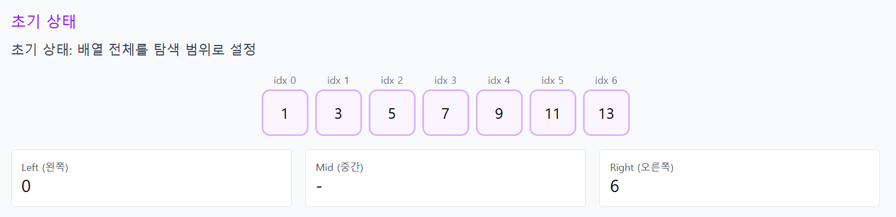
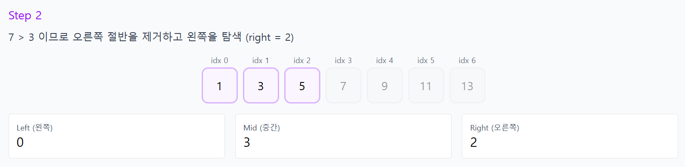

[상위 페이지 · Search](/study/algorithms/search/)

## 1. 개요

이분 탐색은 정렬된 배열이나 리스트에서 특정 값을 효율적으로 찾기 위한 알고리즘이다. 전체 데이터를 순차적으로 탐색하는 대신, 탐색 범위를 절반씩 줄여나가는 방식으로 동작한다.

이 알고리즘의 핵심은 **분할 정복**전략에 있다. 매 단계마다 중간값을 기준으로 탐색 범위를 절반으로 나누고, 찾고자 하는 값이 어느 쪽 구간에 있는지 판단하여 불필요한 절반을 제거한다.

시간 복잡도는 $$O(\log N)$$이다. 원소가 하나 이상인 닫힌 구간에서 배열을 이분 탐색하면 최대 $$\lfloor\log_2 N\rfloor + 1$$번 중간 원소를 확인한다. 예를 들어 원소가 7개라면 한 번 비교하고 남는 원소는 최대 3개, 두 번 비교한 뒤에는 최대 1개다.

이 글의 배열 탐색 예제는 배열이 **오름차순으로 정렬되어 있다**고 가정한다. 그래야 중간 원소와 목표값을 비교할 때 어느 쪽을 버려도 되는지 알 수 있다.

<span id="정렬된-배열에서-값-찾기"></span>

## 2. 알고리즘 동작 원리

이분 탐색은 크게 네 가지 핵심 개념으로 구성된다: **탐색 공간**, **중간값**, **결정**, 그리고 **종료 조건**이다. 각 단계를 구체적인 예시와 함께 살펴보자.

### 2.1 탐색 공간

**탐색 공간**은 해가 존재할 수 있는 모든 가능한 값들의 범위를 의미한다. 배열에서의 이분 탐색에서는 인덱스 범위 [Left, Right]가 탐색 공간이 된다.

탐색 공간의 핵심 특징:

- 초기 상태에서는 전체 배열이 탐색 공간이다
- 각 단계마다 탐색 공간은 절반으로 줄어든다
- 탐색 공간이 비어있을 때(Left > Right) 탐색이 종료된다

정렬된 배열 `[1, 3, 5, 7, 9, 11, 13]`에서 `9`를 찾는다고 하자.

- 초기 탐색 범위는 인덱스 `0~6`이다.
- 가운데 원소 `7`이 목표보다 작으므로 `4~6`을 남긴다.
- 새 가운데 원소 `11`이 목표보다 크므로 `4~4`를 남긴다. 마지막 비교에서 `9`를 찾는다.

### 2.2 중간값 설정

**중간값**은 현재 탐색 공간을 둘로 나누는 기준점이다. 이 값을 기준으로 어느 쪽 절반을 탐색할지 결정한다.

**계산 방법:**

```python
Mid = Left + (Right - Left) // 2
```

또는 더 직관적으로:

```python
Mid = (Left + Right) // 2
```

C++이나 Java에서 배열 인덱스를 계산할 때는 합이 정수 범위를 넘을 수 있으므로 첫 번째 식을 쓴다.

**예시 - 1단계:**

- Left = 0, Right = 6
- Mid = 0 + (6-0)//2 = 3
- arr[3] = 7 ← 이 값을 목표값과 비교한다

중간값은 항상 현재 탐색 공간의 중앙에 위치하므로 어느 쪽을 선택하더라도 탐색 공간이 대략 절반으로 줄어든다는 것이 보장된다.

### 2.3 결정

**결정 단계**는 중간값 arr[Mid]와 찾고자 하는 목표값 Target을 비교하여, 다음에 어느 구간을 탐색할지 결정하는 과정이다. 이 단계에서 세 가지 경우가 발생할 수 있다.

#### 2.3.1 경우 1: 목표값을 찾은 경우

**조건:** arr[Mid] == Target

**예시:** 목표값이 7일 때

- arr[3] = 7 == Target (7)
- **결과:** 탐색 성공! 인덱스 3을 반환

이 경우 더 이상 탐색할 필요가 없으므로 즉시 종료한다.

#### 2.3.2 경우 2: 목표값이 더 큰 경우

**조건:** arr[Mid] < Target

**예시:** 목표값이 9일 때

- arr[3] = 7 < Target (9)
- **논리:** 배열이 정렬되어 있으므로, 목표값 9는 현재 중간값 7보다 오른쪽에 있어야 함
- **결정:** Left = Mid + 1 = 4로 설정
- **새 탐색 공간:** [9, 11, 13] (인덱스 4~6)

**다음 단계:**

- Left = 4, Right = 6
- Mid = 4 + (6-4)//2 = 5
- arr[5] = 11 > 9 → 이제 왼쪽 절반을 탐색
- Right = 5 - 1 = 4
- Left = 4, Right = 4, Mid = 4
- arr[4] = 9 == Target → 찾음!

#### 2.3.3 경우 3: 목표값이 더 작은 경우

**조건:** arr[Mid] > Target

**예시:** 목표값이 5일 때

- arr[3] = 7 > Target (5)
- **논리:** 목표값 5는 현재 중간값 7보다 왼쪽에 있어야 함
- **결정:** Right = Mid - 1 = 2로 설정
- **새 탐색 공간:** [1, 3, 5] (인덱스 0~2)

**다음 단계:**

- Left = 0, Right = 2
- Mid = 0 + (2-0)//2 = 1
- arr[1] = 3 < 5 → 오른쪽 절반을 탐색
- Left = 1 + 1 = 2
- Left = 2, Right = 2, Mid = 2
- arr[2] = 5 == Target → 찾음!

**핵심 원리:** 각 비교 후에는 반드시 Left 또는 Right 중 하나를 조정하여 탐색 공간을 절반으로 줄인다. Mid 위치는 이미 확인했으므로 다음 탐색 공간에서 제외한다(Mid + 1 또는 Mid - 1).

### 2.4 종료 조건

이분 탐색은 두 가지 경우에 종료된다: **값을 찾은 경우**와 **탐색 공간이 소진된 경우**이다.

#### 2.4.1 성공 케이스: 값을 찾은 경우

**조건:** arr[Mid] == Target

**예시:** 위에서 본 목표값 7을 찾는 경우

- 첫 번째 비교에서 arr[3] = 7 == Target
- 즉시 인덱스 3을 반환하고 종료

이는 최선의 경우로, 시간 복잡도는 $$O(1)$$이다.

#### 2.4.2 실패 케이스: 탐색 공간 소진

**조건:** Left > Right

이 조건은 더 이상 탐색할 구간이 남아있지 않음을 의미한다. 즉, 목표값이 배열에 존재하지 않는다.

**예시:** 배열 [1, 3, 5, 7, 9, 11, 13]에서 목표값 6을 찾는 경우

**1단계:**

- Left = 0, Right = 6, Mid = 3
- arr[3] = 7 > Target (6)
- Right = 3 - 1 = 2

**2단계:**

- Left = 0, Right = 2, Mid = 1
- arr[1] = 3 < Target (6)
- Left = 1 + 1 = 2

**3단계:**

- Left = 2, Right = 2, Mid = 2
- arr[2] = 5 < Target (6)
- Left = 2 + 1 = 3

**종료:**

- 이제 Left = 3, Right = 2이므로 Left > Right
- 탐색 공간이 완전히 소진되었음 → 값이 배열에 존재하지 않음
- 일반적으로 -1 또는 None을 반환

**의미 해석:** 최종적으로 Left = 3이라는 것은, 만약 값 6을 배열에 삽입한다면 인덱스 3 위치(7 바로 앞)에 들어가야 한다는 것을 의미한다. 이 특성은 Lower Bound 구현에 활용된다.

### 2.5 전체 흐름 요약







## 3. 구현

### 3.1 반복문 vs 재귀

이분 탐색은 반복문과 재귀 두 가지 방식으로 구현할 수 있다. 각각 장단점이 있지만, 실무에서는 주로 반복문 방식을 선호한다.

<span id="반복문-구현"></span>

#### 3.1.1 반복문 구현

**장점:**

- 메모리 효율성: 함수 호출 스택을 사용하지 않아 추가 메모리가 필요 없다.
- 성능: 함수 호출 오버헤드가 없어 더 빠르다.
- 스택 오버플로우 위험 없음: 재귀 깊이 제한에 영향을 받지 않는다.

**단점:**

- 코드 가독성이 재귀에 비해 다소 떨어질 수 있다.

**구현 예시 (Python):**

```python
def binary_search_iterative(arr, target):
    left, right = 0, len(arr) - 1

    while left <= right:
        mid = left + (right - left) // 2

        if arr[mid] == target:
            return mid
        elif arr[mid] < target:
            left = mid + 1
        else:
            right = mid - 1

    return -1  # 찾지 못한 경우
```

#### 3.1.2 재귀 구현

**장점:**

- 코드가 간결하고 직관적이다.
- 분할 정복의 개념을 명확하게 표현한다.

**단점:**

- 함수 호출 스택 사용: 각 재귀 호출마다 스택 메모리를 사용한다.
- 오버헤드: 함수 호출에 따른 추가 비용이 발생한다.
올바른 구현에서는 재귀 깊이가 `O(log N)`이다. 종료 조건이나 경계 갱신이 틀리면 같은 범위를 반복 호출할 수 있다.

**구현 예시 (Python):**

```python
def binary_search_recursive(arr, target, left, right):
    if left > right:
        return -1  # 찾지 못한 경우

    mid = left + (right - left) // 2

    if arr[mid] == target:
        return mid
    elif arr[mid] < target:
        return binary_search_recursive(arr, target, mid + 1, right)
    else:
        return binary_search_recursive(arr, target, left, mid - 1)
```

#### 3.1.3 권장 사항

실무 및 알고리즘 문제 풀이에서는 **반복문 방식을 권장**한다:

- 메모리 효율성과 성능 면에서 우수하다.
- 스택 오버플로우 걱정이 없다.
- 반복문 구현의 보조 공간은 `O(1)`이고, 재귀 구현은 호출 스택에 `O(log N)`이 든다.

### 3.2 중간값 계산 시 오버플로우 방지

이분 탐색에서 중간 인덱스를 계산할 때 주의해야 할 중요한 함정이 있다.

#### 3.2.1 위험한 방법: (L + R) / 2

직관적으로 다음과 같이 계산하고 싶을 수 있다:

```python
mid = (left + right) // 2
```

**문제점:** left + right가 자료형의 최댓값을 초과하면 **정수 오버플로우**가 발생한다.

**예시 (Java의 경우):**

- Java의 int 범위: -2³¹ ~ 2³¹-1 (약 -21억 ~ 21억)
- 만약 left = 1,500,000,000이고 right = 2,000,000,000이라면
- left + right = 3,500,000,000은 int 범위를 초과
- 오버플로우로 인해 음수 값이 되어 잘못된 mid 계산

과거 Java의 `Arrays.binarySearch()` 구현에서도 이 문제가 발견됐다. [Joshua Bloch의 이분 탐색 버그 설명](https://research.google/blog/extra-extra-read-all-about-it-nearly-all-binary-searches-and-mergesorts-are-broken/)

#### 3.2.2 안전한 방법 1: L + (R - L) / 2

가장 안전하고 권장되는 방법:

```python
mid = left + (right - left) // 2
```

**원리:**

- `0 <= left <= right`인 배열 인덱스에서는 `right - left`가 인덱스의 자료형 범위를 넘지 않는다.
- 이 차이의 절반을 left에 더하므로, 결과가 left와 right 사이임이 보장된다.

**수학적 동치성:**

$$
L + (R - L) / 2\\
= L + R/2 - L/2\\
= (L + R) / 2 \\
$$

#### 3.2.3 안전한 방법 2: 비트 연산 (L + R) >>> 1

일부 언어에서는 부호 없는 우측 시프트 연산자를 사용할 수 있다:

```java
// Java
int mid = (left + right) >>> 1;
```

**원리:**

- >>>는 부호 비트를 무시하고 우측으로 시프트한다.
- 오버플로우가 발생해도 올바른 평균값을 계산한다.
- 우측 시프트 1칸은 2로 나누는 것과 같은 효과이다.

**주의사항:**

- 이 방법은 두 인덱스가 모두 음수가 아닌 Java `int`일 때 쓸 수 있다.
- C와 C++의 부호 있는 정수 덧셈이 범위를 넘는 경우에는 동작이 정의되지 않는다. 배열 인덱스에는 앞에서 소개한 `left + (right - left) / 2`를 쓰면 된다.

### 3.3 구간 설정의 미묘한 차이

이분 탐색 구현에서 가장 흔한 실수는 **경계 조건**처리이다. 구간을 어떻게 정의하느냐에 따라 루프 조건과 업데이트 로직이 달라진다.

#### 3.3.1 닫힌 구간 [L, R]

**정의:** left와 right 모두 유효한 탐색 범위에 포함된다.

**루프 조건:** while left <= right

- left == right일 때도 하나의 원소가 남아있으므로 검사해야 한다.

**업데이트 로직:**

```python
if arr[mid] < target:
    left = mid + 1  # mid는 이미 확인했으므로 제외
else:
    right = mid - 1  # mid는 이미 확인했으므로 제외
```

**초기화:**

```python
left, right = 0, len(arr) - 1
```

**장점:**

- 직관적이고 이해하기 쉽다.
- 가장 일반적으로 사용되는 방식이다.

**전체 구현 예시:**

```python
def binary_search_closed(arr, target):
    left, right = 0, len(arr) - 1

    while left <= right:
        mid = left + (right - left) // 2

        if arr[mid] == target:
            return mid
        elif arr[mid] < target:
            left = mid + 1
        else:
            right = mid - 1

    return -1
```

#### 3.3.2 반열린 구간 [L, R)

**정의:** left는 포함되지만 right는 제외된다.

**루프 조건:** while left < right

- left == right이면 구간이 비어있으므로 종료한다.

**업데이트 로직:**

```python
if arr[mid] < target:
    left = mid + 1  # mid는 제외
else:
    right = mid  # mid를 삽입 위치 후보로 남긴다
```

**초기화:**

```python
left, right = 0, len(arr)  # right는 배열 길이 (제외)
```

**장점:**

- Lower Bound / Upper Bound 구현에 유리하다.
- 종료 시 left가 자연스럽게 삽입 위치를 가리킨다.

**주의사항:**

- 정확한 값을 찾는 경우, 종료 후 추가 검증이 필요하다.

**전체 구현 예시:**

```python
def binary_search_half_open(arr, target):
    left, right = 0, len(arr)  # right는 len(arr)로 초기화

    while left < right:
        mid = left + (right - left) // 2

        if arr[mid] < target:
            left = mid + 1
        else:
            right = mid

    # 종료 후 left == right이며, 이 위치가 target의 삽입 위치
    if left < len(arr) and arr[left] == target:
        return left
    return -1
```

#### 3.3.3 비교 및 선택 가이드

**닫힌 구간 [L, R]을 사용하는 경우:**

- 일반적인 이분 탐색 (값 찾기)
- 직관적 이해가 중요한 경우
- 대부분의 교육 자료 및 알고리즘 책에서 사용

**반열린 구간 [L, R)을 사용하는 경우:**

- Lower Bound / Upper Bound 구현
- 삽입 위치 찾기
- C++ STL, Python bisect 등 표준 라이브러리 스타일과 일치

**핵심 원칙:**

- 어떤 방식을 선택하든, **일관성**을 유지해야 한다.
- 구간 정의에 따라 루프 조건, 초기화, 업데이트 로직이 모두 일치해야 한다.
- 헷갈릴 때는 작은 배열로 손으로 시뮬레이션해보자.

<span id="lower-bound와-upper-bound"></span>

## 4. Lower Bound와 Upper Bound

이분 탐색의 강력한 응용으로, 단순히 값의 존재 여부를 넘어 **값의 위치**를 정확하게 찾는 기법이다. 특히 **중복된 값**이 있는 정렬 배열에서 유용하다.

### 4.1 개념

#### 4.1.1 Lower Bound (하한)

**정의:** 찾고자 하는 값 target **이상**의 값이 처음으로 나타나는 위치 (인덱스)

수식으로 표현하면: arr[i] >= target을 만족하는 최소 인덱스 i

**예시:** 배열 [1, 2, 2, 2, 3, 5, 7]에서

- lower_bound(2) = 인덱스 1 (첫 번째 2)
- lower_bound(4) = 인덱스 5 (4는 없지만, 4 이상의 첫 값은 5)
- lower_bound(0) = 인덱스 0 (0 이상의 첫 값은 1)
- lower_bound(10) = 인덱스 7 (배열 끝, 10 이상의 값이 없음)

#### 4.1.2 Upper Bound (상한)

**정의:** 찾고자 하는 값 target을 **초과**하는 값이 처음으로 나타나는 위치 (인덱스)

수식으로 표현하면: arr[i] > target을 만족하는 최소 인덱스 i

**예시:** 배열 [1, 2, 2, 2, 3, 5, 7]에서

- upper_bound(2) = 인덱스 4 (2를 초과하는 첫 값은 3)
- upper_bound(4) = 인덱스 5 (4를 초과하는 첫 값은 5)
- upper_bound(0) = 인덱스 0 (0을 초과하는 첫 값은 1)
- upper_bound(10) = 인덱스 7 (배열 끝, 10을 초과하는 값이 없음)

#### 4.1.3 Lower Bound vs Upper Bound 비교

배열 [1, 2, 2, 2, 3, 5, 7]에서 값 2를 찾는 경우:

- lower_bound(2) = 1 (첫 번째 2의 위치)
- upper_bound(2) = 4 (마지막 2의 다음 위치)
- 2의 개수 = upper_bound(2) - lower_bound(2) = 4 - 1 = 3개

### 4.2 구현

#### 4.2.1 Lower Bound 구현

**핵심 아이디어:** arr[mid] >= target인 가장 왼쪽 위치를 찾는다.

```python
def lower_bound(arr, target):
    left, right = 0, len(arr)

    while left < right:
        mid = left + (right - left) // 2

        if arr[mid] < target:
            left = mid + 1  # target 이상의 값은 오른쪽에
        else:
            right = mid  # arr[mid] >= target, 더 왼쪽도 확인

    return left  # target 이상의 첫 위치 (또는 len(arr))
```

**로직 설명:**

- arr[mid] < target: 찾는 값보다 작으므로, 답은 오른쪽에 있다 → left = mid + 1
- arr[mid] >= target: 조건을 만족하지만, 더 왼쪽에도 있을 수 있다 → right = mid
- 반열린 구간 [left, right) 사용으로 종료 시 left가 자연스럽게 답이 된다.

#### 4.2.2 Upper Bound 구현

**핵심 아이디어:** arr[mid] > target인 가장 왼쪽 위치를 찾는다.

```python
def upper_bound(arr, target):
    left, right = 0, len(arr)

    while left < right:
        mid = left + (right - left) // 2

        if arr[mid] <= target:
            left = mid + 1  # target 초과하는 값은 오른쪽에
        else:
            right = mid  # arr[mid] > target, 더 왼쪽도 확인

    return left  # target 초과하는 첫 위치 (또는 len(arr))
```

**로직 설명:**

- arr[mid] <= target: 같거나 작으므로, 답은 오른쪽에 있다 → left = mid + 1
- arr[mid] > target: 조건을 만족하지만, 더 왼쪽에도 있을 수 있다 → right = mid

**Lower Bound와의 차이점:** 조건이 <에서 <=로 바뀐 것

### 4.3 활용: 범위 내 개수 세기

정렬된 배열에서 특정 값 또는 범위에 속하는 원소의 개수를 O(log N)에 구할 수 있다.

#### 4.3.1 특정 값의 개수

**문제:** 값 x가 배열에 몇 개 있는가?

**해법:**

```python
count = upper_bound(arr, x) - lower_bound(arr, x)
```

**예시:** [1, 2, 2, 2, 3, 5, 7]에서 2의 개수

- lower_bound(2) = 1
- upper_bound(2) = 4
- count = 4 - 1 = 3

#### 4.3.2 범위 내 개수

**문제:** a <= x <= b 범위의 값이 몇 개인가?

**해법:**

```python
count = upper_bound(arr, b) - lower_bound(arr, a)
```

**예시:** [1, 2, 2, 2, 3, 5, 7]에서 2 이상 5 이하의 개수

- lower_bound(2) = 1
- upper_bound(5) = 6
- count = 6 - 1 = 5 (값: 2, 2, 2, 3, 5)

#### 4.3.3 응용: 동적 순위 찾기

**문제:** 값 x가 배열에서 몇 번째로 작은 값인가?

`lower_bound(arr, x)`는 `x`보다 작은 원소의 개수다. 따라서 정렬된 배열에서 `x`가 들어갈 위치를 0부터 시작하는 순위로 구할 수 있다.

### 4.4 언어별 표준 라이브러리

대부분의 언어는 Lower Bound / Upper Bound를 표준 라이브러리로 제공한다.

#### 4.4.1 C++

```
#include <algorithm>
#include <vector>

std::vector<int> arr = {1, 2, 2, 2, 3, 5, 7};

// Lower Bound
auto it1 = std::lower_bound(arr.begin(), arr.end(), 2);
int idx1 = it1 - arr.begin();  // 인덱스 1

// Upper Bound
auto it2 = std::upper_bound(arr.begin(), arr.end(), 2);
int idx2 = it2 - arr.begin();  // 인덱스 4

// 개수
int count = it2 - it1;  // 3
```

#### 4.4.2 Python

Python의 bisect 모듈을 사용한다:

```python
import bisect

arr = [1, 2, 2, 2, 3, 5, 7]

# Lower Bound: bisect_left
idx1 = bisect.bisect_left(arr, 2)  # 1

# Upper Bound: bisect_right (또는 bisect)
idx2 = bisect.bisect_right(arr, 2)  # 4

# 개수
count = idx2 - idx1  # 3
```

`bisect.bisect()`는 `bisect_right()`의 별칭이다. [Python bisect 문서](https://docs.python.org/3/library/bisect.html)

#### 4.4.3 Java

`Arrays.binarySearch()`는 목표값이 여러 개일 때 그중 어느 인덱스를 반환할지 정해져 있지 않다. 중복 값의 첫 위치가 필요하면 다음과 같이 Lower Bound를 구현한다. [Java Arrays 문서](https://docs.oracle.com/en/java/javase/22/docs/api/java.base/java/util/Arrays.html)

```java
public static int lowerBound(int[] arr, int target) {
    int left = 0, right = arr.length;
    while (left < right) {
        int mid = left + (right - left) / 2;
        if (arr[mid] < target) {
            left = mid + 1;
        } else {
            right = mid;
        }
    }
    return left;
}
```

## 5. 파라메트릭 서치

후보로 정한 답이 조건을 만족하는지 판정하고, 가능 여부가 바뀌는 경계를 찾는 방법이다. 결정 함수와 나무 자르기 예제는 [파라메트릭 서치](/study/algorithms/search/parametric-search/)에서 다룬다.

## 6. 실수 범위에서의 이분 탐색

지금까지 다룬 이분 탐색은 주로 **정수 인덱스**나 **이산적인 값**을 대상으로 했다. 하지만 실제 문제에서는 연속적인 실수 범위에서 최적값을 찾아야 하는 경우가 많다. 예를 들어, 특정 방정식의 근을 구하거나, 최적의 속도나 시간을 찾는 문제 등이 이에 해당한다.

### 6.1 정수 이분 탐색과의 차이점

**탐색 대상 :**

- **정수 이분 탐색:** 배열의 인덱스나 이산적인 정수 값을 탐색한다. 예를 들어, 정렬된 배열에서 특정 값의 위치를 찾거나, 1부터 100 사이의 정수 중 조건을 만족하는 값을 찾는다.
- **실수 이분 탐색:** 연속적인 실수 구간 $$[a, b]$$ 내에서 조건을 만족하는 값을 찾는다. 예를 들어, $$f(x) = 0$$을 만족하는 x를 찾거나, 0.0과 100.0 사이의 실수 중 최적값을 찾는다.

**종료 조건:**

- **정수 이분 탐색:** low > high 또는 low == high와 같이 명확한 종료 조건을 사용한다. 탐색 공간이 유한하고 이산적이므로 반드시 종료된다.
- **실수 이분 탐색:** 실수는 연속적이므로 low > high 조건만으로는 불충분하다. 대신 **오차 범위**나 **반복 횟수**를 기준으로 종료한다.

**중간값 계산:**

- **정수 이분 탐색:** mid = (low + high) / 2 또는 mid = low + (high - low) / 2를 사용하며, 정수 나눗셈을 수행한다.
- **실수 이분 탐색:** mid = (low + high) / 2.0과 같이 실수 나눗셈을 사용한다. 부동소수점 연산의 특성을 고려해야 한다.

### 6.2 정밀도 문제와 부동소수점 오차

실수 이분 탐색에서 가장 큰 도전 과제는 **부동소수점 연산의 오차**이다. 컴퓨터는 실수를 유한한 비트로 표현하기 때문에, 정확한 값을 저장하거나 계산할 수 없는 경우가 많다.

#### 6.2.1 부동소수점 오차의 원인

- **표현 오차:** 0.1과 같은 간단한 십진수도 이진 부동소수점으로는 정확히 표현할 수 없다. 0.1 + 0.2 == 0.3이 false가 되는 이유이다.
- **연산 오차:** 덧셈, 뺄셈, 곱셈, 나눗셈 과정에서 반올림 오차가 누적된다.
- **비교 오차:** 두 실수가 이론적으로는 같아야 하지만, 오차로 인해 == 비교가 실패할 수 있다.

#### 6.2.2 오차 처리 방법

실수 연산의 결과가 허용 오차 안에 있는지 비교할 때는 차이의 절댓값을 사용한다. 중간값이 끝점으로 반올림됐는지 확인할 때는 정확히 같은지 비교할 수 있다.

```
const double EPS = 1e-9;
if (abs(a - b) < EPS) {
    // a와 b가 "거의 같다"
}
```

### 6.3 종료 조건 설정

실수 이분 탐색에서 가장 중요한 설계 선택은 **언제 탐색을 종료할 것인가**이다. 주요 방법은 두 가지가 있다.

#### 6.3.1 방법 1: 엡실론($$\epsilon$$) 기반 종료

범위의 양 끝 사이에 경계가 있다고 가정한다. 아래 예제의 `check`는 경계까지 참이고 그 오른쪽에서 거짓이다. 범위의 너비가 $$\epsilon$$ 이하가 되면 종료한다.

```
double low = 0.0, high = 100.0;
const double EPS = 1e-9;

while (high - low > EPS) {
    double mid = low + (high - low) / 2.0;
    if (mid == low || mid == high) break;
    if (check(mid)) {
        low = mid;
    } else {
        high = mid;
    }
}
// 답: low 또는 high (거의 같음)
```

**장점 :**

- 직관적이고 이해하기 쉽다
- 원하는 정밀도를 명시적으로 제어할 수 있다

**단점 :**

- 부동소수점 반올림으로 `mid`가 한쪽 끝과 같아지면 범위가 더 좁아지지 않는다. 이 경우도 종료 조건에 넣는다.
- ε는 문제에서 허용하는 오차와 출력 정밀도에 맞춰 정한다.

#### 6.3.2 방법 2: 고정 반복 횟수

정해진 횟수만큼 반복한 후 종료할 수도 있다. 정확한 연산을 가정하면 k번 반복한 뒤 범위의 폭은 초기 폭의 $$2^{-k}$$배다.

```
double low = 0.0, high = 100.0;

for (int iter = 0; iter < 100; iter++) {
    double mid = (low + high) / 2.0;
    if (check(mid)) {
        low = mid;
    } else {
        high = mid;
    }
}
// 답: low 또는 (low + high) / 2
```

**장점 :**

- **안정성:** 무한 루프 위험이 전혀 없다
- **예측 가능성:** 정확히 몇 번의 연산이 수행될지 알 수 있다
- **구현 단순성:** 복잡한 종료 조건이 필요 없다
- **정밀도 선택:** 초기 범위와 허용 오차를 보고 반복 횟수를 정할 수 있다.

#### 반복 횟수 선택 가이드

초기 범위의 폭이 100이고 허용 오차가 $$10^{-9}$$라면, 정확한 연산에서 37번이면 충분하다. `double`에서는 인접한 표현 가능 값까지 범위가 줄어들면 이후의 반복으로 정밀도가 높아지지 않는다.

[Ax + B sin(x) = C 문제 풀이](/study/algorithms/unsorted/boj-13705/)에서는 고정밀 실수 연산과 이분 탐색을 함께 사용한다.

<span id="함께-읽기"></span>

## 7. 이분 탐색의 응용

- **이분 탐색을 활용한 기하학/수학 문제 해결.**

- [Ternary Search](/study/algorithms/search/binary-search/ternary-search/)

- [Parallel Binary Search](/study/algorithms/search/binary-search/parallel-binary-search/)
